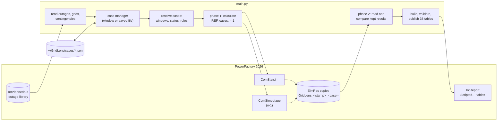
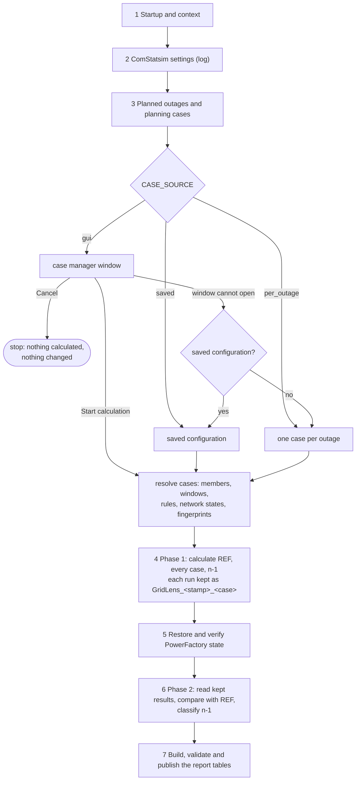
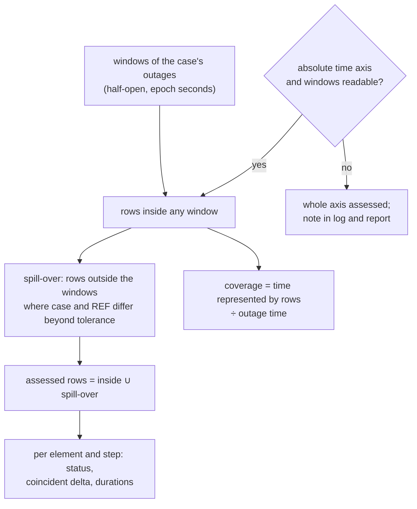
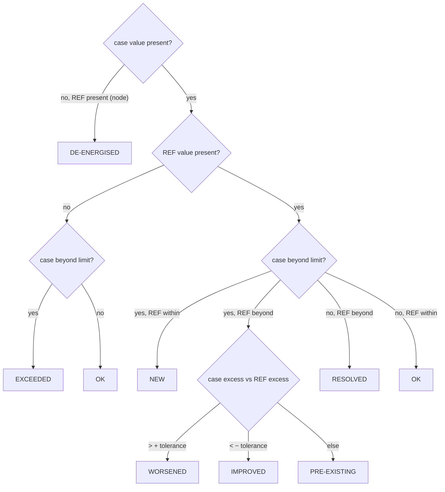

# GridLens – how the tool works

GridLens is a ComPython for DIgSILENT PowerFactory 2026. It assesses
engineer-defined **planning cases** – sets of planned outages
(`IntPlannedout`) – with the quasi-dynamic simulation (QDS) and, on request,
with the contingency analysis (n-1). Every case is compared with a reference
**at the same time step**; the findings are published as tables to a
PowerFactory report (`IntReport`) and rendered as a main report and a detail
report.

The result is a technical **pre-assessment**. It is no release of an outage
and no proof of n-1 security, security of supply, protection coordination or
safe electrical isolation.

Current versions: script `8.0.1` (`PUBLISHER_VERSION`), report pages `7.0.0`
(`TEMPLATE_VERSION`), data contract `7.0` with 38 tables
(`DATA_CONTRACT_VERSION`), settings `1.0`, classification rules `1.0`.

Related documents:

- [CASE_MANAGER.md](CASE_MANAGER.md) – operating the case manager window
- [CALCULATION_AND_EVALUATION.md](CALCULATION_AND_EVALUATION.md) – formulas and rules of the assessment in detail
- [POWERFACTORY.md](POWERFACTORY.md) – every PowerFactory object and attribute GridLens reads or writes
- [REPORT_TABLES.md](REPORT_TABLES.md) – the 38 report tables and their fields
- German version: [de/ARCHITEKTUR.md](de/ARCHITEKTUR.md)

---

## 1. Parts of the delivery

| Part | Content |
|---|---|
| `outage-assessment/main.py` | the complete tool with the case manager in tkinter (standard library) |
| `outage-assessment/main_qt.py` | the same tool with the case manager in PyQt6 or PyQt5; everything else is identical |
| `designer-pages/MASTER_GRIDLENS/` | main report: one `.dct` dictionary and one `.pg` file per page |
| `designer-pages/MASTER_GRIDLENS_DETAIL/` | detail report, same structure |

The script needs only Python's standard library, the PowerFactory module and,
for the case manager, tkinter (or PyQt for `main_qt.py`). It imports no other
file of the repository.

---

## 2. What PowerFactory must provide

| Requirement | Why | If it is missing |
|---|---|---|
| an active study case | everything is read from and written to it | the run stops before any change |
| exactly the ComStatsim of the study case, configured (period, time step, load profiles, calculation options) | GridLens runs it unchanged for every case | the run stops |
| `ComStatsim.results` bound to a result object that is **not** a `GridLens_…` copy | the QDS writes into it; a kept copy would be overwritten | the run stops with the bound name |
| the option *Planned Outages* (`iopt_maint`) on the ComStatsim | the only switch that makes PowerFactory apply planned outages | the run stops |
| recorded variables: `c:loading` or `m:loading` of lines (`ElmLne`) and transformers (`ElmTr2`, `ElmTr3`), `m:u` or `m:u1` of terminals (`ElmTerm`) | the assessed quantities | the run stops right after the first QDS run and names what is recorded instead |
| planned outages as `IntPlannedout` in the outage library (otherwise anywhere in the project) | the material of the planning cases | without any, only the reference can be calculated |
| the ComPython below the `IntReport` | needed to publish the tables | the run calculates and checks everything but publishes nothing (standalone run) |
| for n-1: at most one `ComSimoutage` in the study case | GridLens uses it; without one it defines its own | with more than one, n-1 is not evaluated, with the reason |

---

## 3. Run sequence

The output window shows the run in seven steps (`STEP n/7`). Each step below
names what is read, what is changed and when the run stops.

### Step 1 – Startup and context

GridLens finds the running ComPython, the active study case, its `IntReport`
parent (if any), the ComStatsim and the bound result object. It checks every
requirement of section 2 that can be checked without a calculation and reads
the *Planned Outages* option. It records the study time (`SetTime.cDate`,
`cTime`) so it can put it back after every run. Nothing is changed yet.

### Step 2 – ComStatsim settings

The calculation settings of the ComStatsim (period, time step, load-flow
options, result object and its variable selection) are logged. GridLens
changes none of them, except the *Planned Outages* option during the runs.

### Step 3 – Planned outages and planning cases

1. **Planned outages are read** (read only) from the outage folder of the
   project; only when it holds none is the whole project searched. For each
   `IntPlannedout` GridLens keeps its full path (the identity), name, window
   (`starttime`, `endtime` in epoch seconds), components, priority and
   *Ignored* flag (`outserv`). Outages that switch the same components are
   grouped into one technical outage (`definition_id`).
2. **Each outage is classified** against the simulated period:
   `CONSIDERED` or `SKIPPED` with the reason (outside the period, *Ignored*,
   unreadable window). When the question cannot be decided the outage stays
   `CONSIDERED`, is assessed over the whole time axis, and its object
   attributes are logged as `DIAGNOSTIC`.
3. **Grids, contingencies and kept runs are read** (read only) for the case
   manager: the grids of the model, the contingencies of the study case's
   contingency analysis, and the stamps of earlier GridLens runs.
4. **The planning cases are obtained** according to `CASE_SOURCE`:

   | `CASE_SOURCE` | Behaviour |
   |---|---|
   | `'gui'` (default) | the case manager opens; PowerFactory waits until it is closed. *Start calculation* hands over the configuration, *Cancel* ends the run without any change. If the window cannot open, the saved configuration is used; without one, every outage in the period becomes its own case. |
   | `'saved'` | the configuration saved for this project, no window |
   | `'per_outage'` | one case per planned outage in the simulated period, no window |

5. **The cases are resolved** (`resolve_request`): members, effective windows,
   network states, rule checks and a fingerprint per case (section 5). A case
   that cannot be calculated keeps its status and reason and is reported.
6. **The settings are fixed** for the whole run (`activate_settings`): the
   defaults plus the overrides of the configuration. Log and report name every
   override.

### Step 4 – Phase 1: calculation

Phase 1 only calculates and keeps; nothing is read yet.

1. **Reference (REF).** Without fixed background outages REF is **R0**:
   *Planned Outages* off (`iopt_maint=0`). With fixed background outages it is
   **Rfix**: *Planned Outages* on, only the fixed outages active. The REF run
   can be switched off in the settings; violations can then not be split into
   new and pre-existing.
2. **One QDS per case.** *Planned Outages* is switched on. For each case with
   status READY, GridLens sets the *Ignored* flag of **every** planned outage:
   `0` for the case's outages and the fixed outages, `1` for all others.
   PowerFactory then applies each active outage in its own window during the
   QDS. The ComStatsim runs exactly as configured.
3. **Identical cases are calculated once.** A case with the same outages,
   windows and fixed outages as an already calculated case (same fingerprint)
   reuses that result and is marked *reused*.
4. **Every run is kept.** PowerFactory writes each QDS into its own result
   object and overwrites it with the next run. Right after each run GridLens
   copies it into the study case as `GridLens_<yymmdd-HHMMSS>_<case>` (REF:
   `…_REF`) and writes case and fingerprint into the copy's description. The
   copies stay; GridLens never deletes them.
5. **Recording check.** Right after the first run GridLens checks that the
   copy records at least one assessed variable. If not, the run stops at once
   instead of calculating the remaining cases for nothing.
6. **After every run** the *Ignored* flags are restored and read back, the
   study time is put back, and switches that are in another state than before
   the run are logged (GridLens does not change switches).
7. **n-1**, when ticked in the case manager: see section 8.

Before every run with planned outages the log shows what PowerFactory will
apply: the option value and every outage whose *Ignored* flag is 0.

### Step 5 – Restore

In a `finally` block, so also after an error or an interruption: the study
time and the *Planned Outages* option are restored and read back, the binding
of `ComStatsim.results` is logged, and the kept result objects are listed.
If a value cannot be restored, the run stops with the expected and the found
value; the study case must then be checked by hand.

### Step 6 – Phase 2: evaluation

1. Results are read column by column into a temporary `IntVec`
   (`GridLens_column_buffer`, created in the running ComPython and deleted at
   the end of the step). Without it every value is one call (slow); the run
   summary shows which way was used.
2. REF is read first, then every case from its kept object, then compared
   with REF (section 7).
3. For every outage GridLens checks whether it took effect and whether it
   stays in effect after its window (section 7.6).
4. n-1 results are read and classified (section 8).
5. A memory budget (`MAX_RUN_CELLS`) stops the evaluation before the next
   case, not after the last; everything calculated stays kept.
6. Every case is judged **once**; log, case table and summary use that verdict.

### Step 7 – Report

GridLens builds the 38 tables (see [REPORT_TABLES.md](REPORT_TABLES.md)),
checks every row against the data contract and publishes them to the
`IntReport`. The report is then generated in PowerFactory from that
`IntReport` as a separate step. Without an `IntReport` parent GridLens logs
the number of rows per table and publishes nothing.

Exit code: 0 after a published report or a standalone run; 1 when nothing was
published (error), so that the `IntReport` does not render missing or stale
tables. *Cancel* in the case manager is passed on to the caller as a
cancellation.

---

## 4. What GridLens changes in PowerFactory

GridLens changes only these values, temporarily, and puts each one back
(recorded before writing, restored in reverse order, read back and compared):

| Object | Attribute | When | Restored |
|---|---|---|---|
| ComStatsim | `iopt_maint` (*Planned Outages*) | REF and case runs | step 5 |
| every `IntPlannedout` | `outserv` (*Ignored*) | each case run, Rfix, each n-1 sweep | right after that run |
| study time `SetTime` | `cDate`, `cTime` | changed by PowerFactory during a run | after every run and in step 5 |
| ComSimoutage (n-1 only) | `calcPeriod`, step, `startTime`, `endTime`, `stepNumber`, `isPlannedOutages` | each n-1 sweep | right after that sweep |
| contingencies `ComOutage` (n-1 only) | *Not analysed* for contingencies outside the n-1 filter | each n-1 sweep | right after that sweep |

Objects GridLens **creates and keeps**:

- `GridLens_<stamp>_<case>` – copy of each QDS result (`ElmRes`)
- `GridLens_<stamp>_<case>_N1`, `…_N1P` – copies of the n-1 and (n-1)' results
- `GridLens_<stamp>_N1` – a contingency analysis with one contingency per
  element, only when the study case has none

The temporary `IntVec` of step 6 is created and deleted in the same run.
GridLens never applies an outage itself (`IntPlannedout` has no `Apply` or
`Reset` in PowerFactory 2026), never changes the network model, ratings,
switches, the ComStatsim period or time step, and creates no operation
scenarios, variations or study cases.

---

## 5. Planning cases

### 5.1 What a case is

A planning case is a named set of planned outage **occurrences**. Each case
contains only the outages directly assigned to it; an outage may be in any
number of cases. Cases are independent: changing, excluding or deleting one
does not affect another, and GridLens never combines cases automatically. To
assess two outages together, put both into one case.

| Field | Meaning |
|---|---|
| `id` | generated `C1`, `C2`, …; part of the result object name; letters, digits, `_`, `-`, at most 16 characters, never `REF` |
| `name`, `description` | free text for log and report |
| `enabled` | the *Run* flag; an excluded case stays saved but is neither calculated nor reported |
| `outages` | full paths of the assigned `IntPlannedout` |
| `overrides` | own dates per outage; **recorded only, not applied** (the case is reported NOT EVALUATED) |

### 5.2 Fixed background outages

Outages marked as fixed background are active in the reference (which then
becomes Rfix) and in every case. An outage cannot be fixed and in a case at
the same time.

### 5.3 Rules between outages

| Rule | Check | Broken rule |
|---|---|---|
| must not overlap | a case with both outages is refused if their windows overlap | case NOT EVALUATED |
| second only after the first | the second may only start after the first has ended | case NOT EVALUATED |
| only together | a case with one of them must contain the other, overlapping in time | case NOT EVALUATED |

Two outages on the same equipment are normal planning and no rule.

### 5.4 Resolution and status

`resolve_request` turns the configuration into calculable plans:

| Status | Meaning |
|---|---|
| READY | will be calculated |
| NOT EVALUATED | no outage assigned, an outage no longer exists, own dates, a broken rule, an unreadable window |
| NOT SIMULATED | none of the case's outages lies in the simulated period |
| excluded | the *Run* flag is off |

The **fingerprint** of a case covers its outages, their windows and the fixed
outages. Equal fingerprints share one calculation.

### 5.5 Network states

During one QDS the set of active outages changes over time. GridLens computes
these states for log, preview and report; PowerFactory applies them. For the
outages `O` of a case, the active set at time `t` is
`A(t) = { o ∈ O | start_o ≤ t < end_o }` (half-open windows). All start and end
times are sorted into elementary intervals; neighbours with the same set are
merged and empty intervals are kept.

```mermaid
gantt
    title Three overlapping outages, five network states
    dateFormat HH:mm
    axisFormat %H:%M
    section Outages
    FS1 :a1, 08:00, 13:00
    FS2 :a2, 10:00, 15:00
    FS3 :a3, 11:00, 14:00
    section Network state
    FS1           :s1, 08:00, 10:00
    FS1+FS2       :s2, 10:00, 11:00
    FS1+FS2+FS3   :s3, 11:00, 13:00
    FS2+FS3       :s4, 13:00, 14:00
    FS2           :s5, 14:00, 15:00
```

### 5.6 Example: two outages far apart

FS1 in week 10 and FS2 in week 40 in one case A, a full-year ComStatsim:

1. REF: one QDS over the year with `iopt_maint=0`, kept as `GridLens_<stamp>_REF`.
2. Case A: one QDS over the year with FS1 and FS2 active, all other outages
   *Ignored*, kept as `GridLens_<stamp>_A`. PowerFactory applies FS1 in week 10
   and FS2 in week 40; network states `FS1 | ∅ | FS2`.
3. Comparison: the rows of weeks 10 and 40 with REF at the same time steps,
   plus every row in between where case and REF differ (spill-over).
4. Report: one row for case A with both windows, coverage of both weeks and
   the verdict.

Cost: one REF run for all cases plus one run per distinct case; no run is
shortened.

---

## 6. Reading the results

| Item | Rule |
|---|---|
| assessed elements | lines `ElmLne`, transformers `ElmTr2`/`ElmTr3` (loading), terminals `ElmTerm` (voltage) |
| variables | first recorded of `c:loading`, `m:loading` for branches; `m:u`, `m:u1` for terminals; angles are not read |
| time axis | column −1 of the `ElmRes`, absolute epoch seconds; it must increase strictly, otherwise the case fails |
| report filter | optional grid selection (Settings → Network scope); the grid of an element comes from `cpGrid`, else from the `ElmNet` in its path. Without a selection every grid is assessed (or `GRID_NAME_FILTER`, if set in the script) |
| DC terminals | `ElmTerm.systype == 1` are not assessed and counted on the quality page |
| de-energised | a voltage below *De-energised below* (default 0.1 p.u.) or NaN is no measured value; the node counts as de-energised at that step |
| invalid values | NaN, ±∞, `None`, booleans and unreadable cells are no measured values; an invalid loading cell fails the case, an invalid voltage cell counts as de-energised |
| missing series | equipment switched off or not recorded gets no series; no artificial zeros |
| element names | the report shows `loc_name` only; full paths are internal identities |
| size limits | at most 35 040 rows (`MAX_RESULT_ROWS`) and 20 000 000 cells per result object (`MAX_RESULT_CELLS`), 120 000 000 cells per run (`MAX_RUN_CELLS`) |

---

## 7. Assessment of a case (n-0)

Formulas and edge cases: [CALCULATION_AND_EVALUATION.md](CALCULATION_AND_EVALUATION.md).

### 7.1 Assessed time steps

Only the case's own outages differ from REF, so any difference outside their
windows means PowerFactory applied them shifted or a switching state outlasts
the outage. Those rows are assessed as well and the quality page names the
case.

### 7.2 Status per time step

- Loading is beyond the limit when it is **strictly greater** than the limit
  (lines and transformers separately, default 100 %).
- Voltage is beyond the band when it is strictly below the minimum or above
  the maximum (one band for every voltage level, default 0.95–1.05 p.u.).
- A value exactly on a limit is no violation.
- Tolerances: 0.1 %-points for loading, 0.001 p.u. for voltage.

An element takes its most severe status: NEW > WORSENED > EXCEEDED >
DE-ENERGISED > PRE-EXISTING > IMPROVED > RESOLVED > OK. Equipment the case
itself switches off is OUT OF SERVICE, never RESOLVED.

### 7.3 Values per element

- **coincident delta** `max_t [case(t) − REF(t)]` (voltage: largest absolute
  change, signed) – the decisive change, always at the same time step
- **difference of maxima** `max case − max REF`, shown separately and labelled so
- **excess** loading `max(0, L − limit)`; voltage `max(0, U_min − U, U − U_max)`
- **duration** of caused violations: the sum of time steps `Δt_k` over all
  rows where any element is NEW or WORSENED

### 7.4 Coverage

Coverage is the share of the outage time that result rows represent. Below
99.9 % a case can never be NO LIMIT EXCEEDED; it is INCOMPLETE COVERAGE. An
outage shorter than one time step has coverage 0.

### 7.5 Verdict of the case

First match wins:

| Verdict | Condition | Colour |
|---|---|---|
| OVERLOAD + VOLTAGE BAND / OVERLOAD / VOLTAGE BAND | a loading and/or voltage element NEW, WORSENED or EXCEEDED | red |
| DE-ENERGISED NODES | a node loses its voltage in the case | yellow |
| INCOMPLETE COVERAGE | nothing found, but results cover less than 99.9 % of the outage time | yellow |
| NO ADDITIONAL VIOLATION | only PRE-EXISTING or IMPROVED violations | yellow |
| NO LIMIT EXCEEDED | nothing beyond a limit | – |
| NO RESULT DATA IN WINDOW | no row to assess | – |
| NOT EVALUATED / NOT SIMULATED | failed run, rule conflict, changed fingerprint / outside the period | – |

REF itself is BASELINE. Missing or incomplete results never produce NO LIMIT
EXCEEDED.

### 7.6 Did the outages take effect?

For every outage of a case, inside its own window:

| Status | Meaning |
|---|---|
| APPLIED | a recorded component carries no load in the case but does in REF |
| EFFECT SEEN | its components are not recorded, but the network differs from REF |
| NO EFFECT | the case equals REF in the window – most likely not applied; logged as a warning |
| NOT CHECKABLE | no REF on the same time axis or no result row in the window |

After the window GridLens counts the steps in which a component still
carries no load while it does in REF (persistence) and reports how long the
outage stays in effect. The quality page carries one row per case.

### 7.7 Statement A and statement B

Statement A – what the planned outages add – is what the cases assess.
Statement B – whether the network is permissible over the whole period – is
described only by REF. A case that adds nothing does not prove statement B.

---

## 8. n-1 and (n-1)'

Ticked in the case manager (*Calculation*). n-0 is always calculated.

| Assessment | What is calculated | Planned outages active |
|---|---|---|
| n-1 | contingency analysis of the reference | only the fixed background outages |
| (n-1)' | contingency analysis of the planning case; needs n-1 | the case's outages and the fixed ones |

1. **Contingency analysis.** GridLens uses the `ComSimoutage` of the study
   case. If there is none, it defines `GridLens_<stamp>_N1` with one
   contingency per branch, transformer, reactor, compensation and FACTS
   element (no generators, loads or busbars) and keeps it. With more than one
   `ComSimoutage` n-1 is not evaluated.
2. **Filters.** The n-1 filters of the settings (grids of the outaged
   equipment, outaged elements) set every other contingency to *Not analysed*
   for the sweep; restored afterwards. The report filter decides which
   monitored elements are assessed.
3. **Study times.** The QDS time steps inside the case's outage windows, at
   most *n-1 study times per case* (default 2000). One sweep calculates the
   period from the first to the last of them with the QDS step; steps between
   windows that lie apart are calculated but not assessed.
4. **Sweep.** Period, step and `isPlannedOutages` are written for the sweep,
   the *Ignored* flags set as for the QDS, and everything is restored right
   after it. GridLens checks that every study time was calculated; a missing
   one stops that case's n-1 with the wanted and the found times.
5. **Kept results.** Each sweep is copied as `GridLens_<stamp>_<case>_N1` and
   `…_N1P`. Cases with the same study times share one n-1 reference sweep.
6. **Classification.** (n-1)' is compared with n-1 at the same study time,
   contingency, monitored element and quantity, per criterion *loading*,
   *voltage low*, *voltage high*:

| Code | Status | Condition |
|---|---|---|
| 0 | OK | neither side violated |
| 1 | NEW | only (n-1)' violated |
| 2 | WORSENED | both violated, increase > WORSENED tolerance |
| 3 | PRE_EXISTING | both violated, change within the tolerances |
| 4 | IMPROVED | both violated, decrease > IMPROVED tolerance |
| 5 | RESOLVED | only n-1 violated |
| 90 | FAILED | a calculation failed or did not converge |
| 91 | NOT_EVALUATED | a value or the limit is missing or invalid |
| 92 | NOT_APPLICABLE | the contingency cannot be applied, e.g. its element is already switched off by a planned outage |
| 93 | NOT_COMPARABLE | time, contingency, element, quantity or limit definition differ |

Decision order: FAILED, NOT_APPLICABLE, NOT_COMPARABLE, NOT_EVALUATED, then the
numeric decision. A side is violated when its excess exceeds the limit
tolerance plus the numeric tolerance (defaults 0 and 1e-9). Missing values are
never replaced by zero. *Reduced margin* marks an OK result whose reserve to
the limit shrank by more than the WORSENED tolerance, for loading only from the
*Reduced margin warning* threshold (default 80 %).

n-1 loading limit: by default the ratings PowerFactory relates `c:loading` to
(*use PowerFactory limits*), or one global assessment limit. Either way it
changes only the assessment, never a rating.

---

## 9. Settings

Settings interpret results; category B settings would change what
PowerFactory calculates and are shown read only.

| Section | Setting | Default |
|---|---|---|
| Network scope | Report filter: assessed equipment, grids | every grid |
| Network scope | n-1 filter: grids of the outaged equipment | every grid |
| Network scope | n-1 filter: outaged elements | every element |
| Thermal limits | Warning threshold, lines / transformers | 80 % |
| Thermal limits | Maximum loading for n-0, lines / transformers | 100 % |
| Thermal limits | Limits for n-1 and (n-1)' | use PowerFactory limits |
| Thermal limits | Global assessment limit for n-1 and (n-1)' | 100 % |
| Voltage limits | Minimum / maximum voltage, every voltage level | 0.95 / 1.05 p.u. |
| Voltage limits | De-energised below | 0.1 p.u. |
| Classification | n-0 change tolerance, loading / voltage | 0.1 %-points / 0.001 p.u. |
| Classification | Limit tolerance, loading / voltage | 0 |
| Classification | Numerical comparison tolerance | 1e-9 |
| Classification | WORSENED / IMPROVED versus PRE_EXISTING, loading | 0.1 %-points |
| Classification | WORSENED / IMPROVED versus PRE_EXISTING, voltage | 0.001 p.u. |
| Classification | Reduced margin warning from, loading | 80 % |
| Report | Appendix: also list a loading / voltage change from | 1.0 %-points / 0.005 p.u. |
| Report | Rows of the Top-N lists | 10 (at most 50) |
| Report | Points per time plot, at most | 200 (at most 2000) |
| Run | Reference case (REF) | on |
| Run | Planning cases, at most | 5 (at most 20) |
| Run | n-1 study times per case, at most | 2000 (at most 20 000) |
| Contingency analysis | contingency set, categories, monitored scope, AC/DC, islanding, unsupplied load, load shedding, post-fault phases, remedial actions | read only (category B) |

The voltage band of 0.95–1.05 p.u. is a GridLens proposal and has to be
confirmed for the network. Only overrides are stored, under `settings` in the
case configuration file. The report names every override on the quality page
(row *Settings*, WARNING when one is active).

---

## 10. Saved configuration

File: `~/GridLens/cases/<project>_<hash>.v2.json` (folder changeable with
`CASE_CONFIG_DIR`). It holds the cases, fixed outages, rules, assessments and
setting overrides, with schema, revision, user and time – never results.
It is checked field by field on load; a damaged file stops the run with its
path. *Save configuration* in the case manager writes it; the project is not
touched.

---

## 11. Re-evaluating a kept run

The case manager's *Results* choice lists the kept runs of the study case.
Choosing one skips phase 1: nothing is calculated and PowerFactory is not
changed. Phase 2 reads that run's objects with the **current** settings
(limits, tolerances, grids). A case whose outages or windows changed since
that run (another fingerprint), or whose object is missing, is NOT EVALUATED
with the reason; a changed REF stops the run. The n-1 filters can only leave
contingencies out of a re-evaluation, not add ones that were not calculated.

---

## 12. Log

| Part | Content |
|---|---|
| steps | `STEP n/7` sections; one block per case run |
| plan | every case with status, outages, windows, network states, reuse |
| applied outages | before each run: the option and every outage with *Ignored* = 0 |
| results | verdict per case, outage effect, persistence, n-1 summary |
| failure report | on an error: the error, step and case, cause chain, details, code location, PowerFactory state after restore, kept result objects, last warnings, what to do |
| run summary | always: time and calls per service (reading outages, case manager, each QDS and contingency analysis, reading results, comparison, restore, publication) and counts (QDS runs, time steps, reused cases, values read, n-1 study times, report rows) |

---

## 13. Error handling

| Situation | Behaviour |
|---|---|
| configuration with wrong types, ids, rules or dates | every problem named with its case; the run stops **before** any PowerFactory change |
| configuration file unreadable or of another schema | the run stops with the file path |
| outage deleted or renamed since the configuration was saved | that case NOT EVALUATED with the path |
| fixed outage unknown or *Ignored* in PowerFactory | warning in log and on the quality page |
| case manager window cannot open | saved configuration, else one case per outage; the report says so |
| error in a dialog button | shown in a message box; the window stays open; nothing calculated |
| Cancel | nothing calculated, saved or published; cancellation passed on to the caller |
| `outserv` cannot be written | that case FAILED; values restored; the next case runs |
| QDS fails or its result cannot be read | that case FAILED; the next case runs |
| comparison fails | that case NOT EVALUATED with the reason; its result object is kept |
| reference fails | the run stops (no case could be compared); state restored |
| no assessed variable recorded | the run stops after the first QDS and names what is recorded |
| memory budget exceeded | stops before the next case; state restored; calculated runs stay kept |
| a value cannot be restored | the run stops with expected and found value |
| outage windows cannot be placed on the time axis | every time step compared; note in log and report |
| coverage below 99.9 % | never NO LIMIT EXCEEDED |
| nothing published | exit code 1; the last log line says that no report tables were published |

All restore steps run in `finally`, so they also run after an error or an
interruption.

---

## 14. Run time

`T ≈ (1 + m) · (τ_I + n · τ_L)` with `m` distinct cases, `n` time steps,
`τ_I` the initialisation and `τ_L` one load flow of the QDS; n-1 adds one
contingency sweep per distinct set of study times and one per (n-1)' case.
Every run covers the complete ComStatsim period. The case manager preview
shows the number of runs before the start ("1 reference + n case run(s)", "n
identical case(s) reused"); the report shows the measured time per run.

---

## 15. Points to watch in PowerFactory

These behaviours of PowerFactory have not been confirmed in a real run yet. A
problem report usually belongs to one of them:

1. Several outages active in one case: the log lists all of them as active;
   loadings match two single cases.
2. An outage window boundary: does the effect appear inside the window rows
   or in the spill-over rows (an effect one step late is assessed as spill-over)?
3. The result objects `GridLens_<stamp>_<case>` appear in the study case and
   open.
4. The case manager opens, *Start calculation* and *Cancel* work, PowerFactory
   stays responsive afterwards.
5. The report renders with one page per chapter.
6. Memory and run time of a full-year run with many cases.
