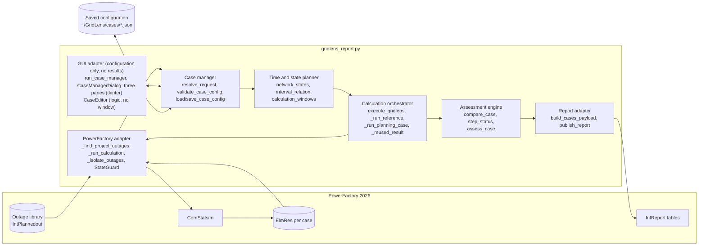
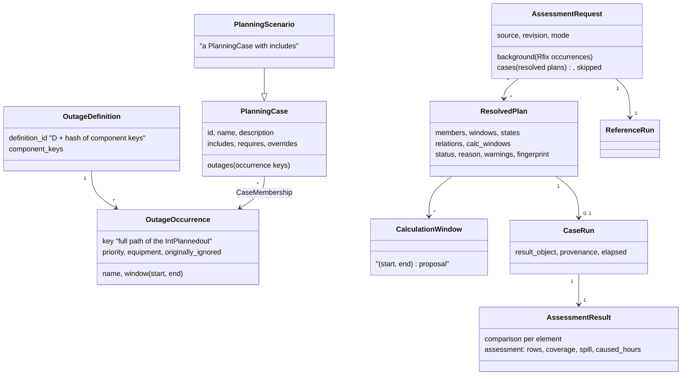
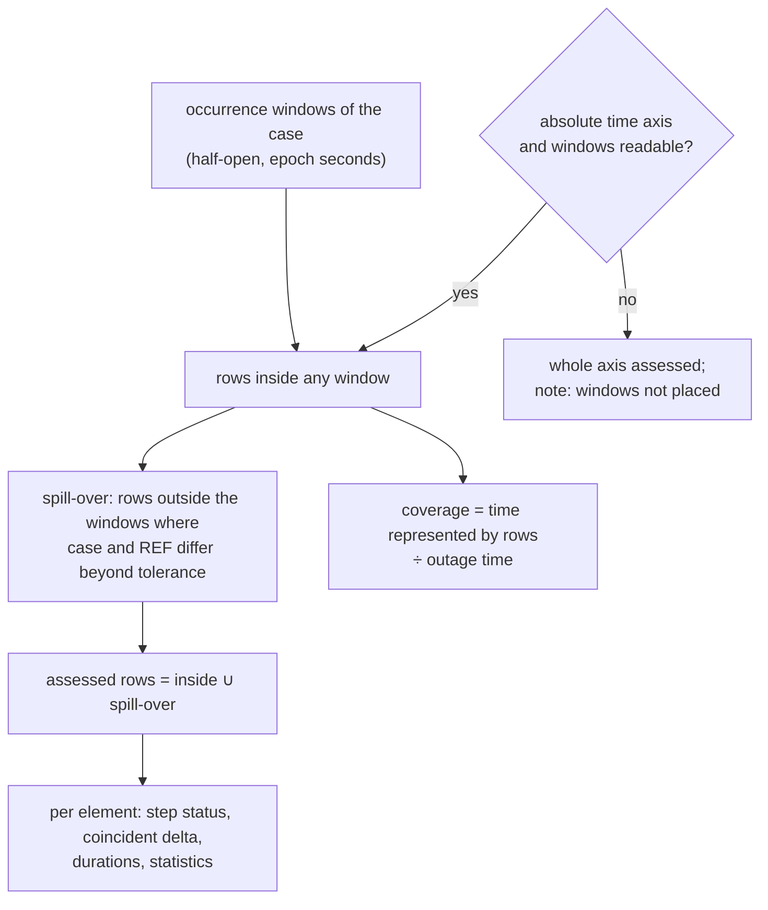
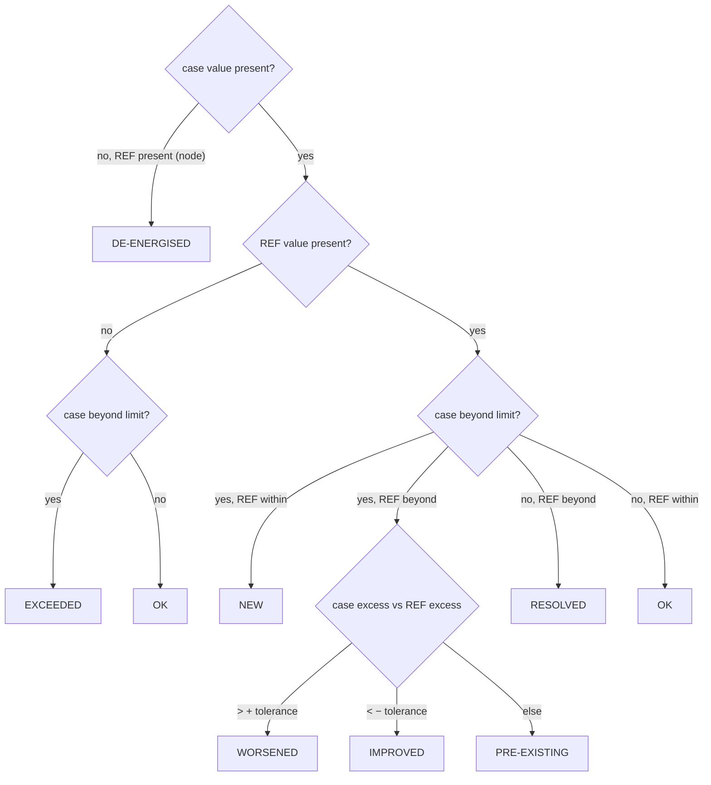
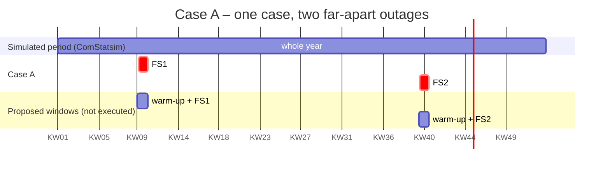

# GridLens 8.0 – Planning-Case Manager: Architecture and Method

Status: 22 October 2026 · Publisher 8.0.0 · MRT 6.0.0 · data contract 6.0

GridLens 8 turns the single-outage pre-check of 7.x into an assessment of
**engineer-defined planning cases**. A planning case is any set of planned
outage occurrences; PowerFactory applies each of them in its own time window
during one quasi-dynamic simulation (QDS), so one case passes through several
network states. Every case is compared with a reference **at the same time
step**. LODF is removed completely.

Nothing here has run in PowerFactory yet. Section 11 lists what must be
verified there before the results may be relied on.

Related documents:

- [CASE_MANAGER.md](CASE_MANAGER.md) – operating the dialog, configuration file, fallbacks
- [REPORT_MIGRATION.md](REPORT_MIGRATION.md) – data contract 5.0 → 6.0 and template changes
- [TEST_MATRIX.md](TEST_MATRIX.md) – V01–V40 and tests A–E with their verification status
- German version: [de/ARCHITEKTUR.md](de/ARCHITEKTUR.md) and the other files in [de/](de/)

---

## 1. Central change

| | GridLens 7.x | GridLens 8.0 |
|---|---|---|
| Case | one planned outage = one automatic case | one engineer-defined planning case = any number of outage occurrences |
| Combination | FS1 + FS2 never calculated together | calculated together whenever they are in the same case |
| Active set over time | one outage, one window | a sequence of network states (elementary intervals) |
| Comparison | case maximum − REF maximum inside the window | case(t) − REF(t) at every time step, then aggregated |
| Reference | always "no planned outage" | R0 (none) or Rfix (fixed background outages) |
| Line ranking | LODF from `ComVstab` | removed; real QDS load flows only |
| Result objects | temporary `ElmRes`, deleted after extraction | one `ElmRes` per case, kept in the study case |
| QDS period | complete `ComStatsim` period | complete period; the case manager offers no time optimisation (shorter windows only appear when `QDS_WINDOW_MODE = 'optimized'` is set in the script, as a proposal in log and report) |

---

## 2. As-is / to-be analysis (deliverable A)

### 2.1 What 7.x already did and stays

| Area | Function(s) | 8.0 |
|---|---|---|
| Context, settings log | `execute_gridlens` (steps 1–2), `_log_qds_settings` | unchanged |
| Outage discovery | `_find_project_outages`, `_outage_details`, `outage_window` | unchanged; records now carry the stable key (full path) and every component key |
| Outage classification | `classify_planned_outages` | unchanged; now only informs the per-outage mode and the dialog |
| QDS execution | `_run_calculation` | same call; result object is kept and named per case |
| Result extraction | `collect_series` | keeps full-resolution value arrays; unique labels across DST changes |
| State protection | `StateGuard`, `_restore_study_time`, `_restore_planned_outage_option`, `_restore_results_binding` | unchanged and used for every case |
| Whole-period tables | `apply_reference`, pies, radar, counts, top 10, trends, appendices | unchanged (documented as difference of maxima) |
| Publication | `validate_payload`, `publish_report` | unchanged |

### 2.2 What was extended or replaced

| 7.x | 8.0 | Why |
|---|---|---|
| `_isolate_outage(guard, active, records)` | `_isolate_outages(guard, active_keys, records, label)` | a set of outages instead of one |
| `_run_outage_case` | `_run_planning_case` + `_reused_result` | multi-outage cases, reuse of identical cases |
| reference block inside `execute_gridlens` | `_run_reference` | R0 with `iopt_maint=0`, Rfix with `iopt_maint=1` and only the fixed outages |
| `window_bounds` (end inclusive, `bisect_right`) | `window_rows` (half-open `[start, end)`, `bisect_left`) | consistent interval convention |
| `window_statistics` per outage index | `compare_case` / `compare_element` | time-aligned comparison, durations, coverage, spill-over |
| `paired(..., windowed=True)` | returns the time-aligned records | all case-level tables use the coincident comparison |
| `limit_status` (5 states) | `step_status` per time step + precedence; adds IMPROVED, DE-ENERGISED, OUT OF SERVICE | spec section 20 |
| `assess_case` | adds DE-ENERGISED NODES and INCOMPLETE COVERAGE verdicts | no positive statement from missing data |
| `_case_rows` (one row per outage) | one row per planning case + skipped outages | spec section 39 |
| `_temporary_result` + `_delete_temporary_results` | `_case_result_object` + `ResultStore` | result objects stay in PowerFactory |

### 2.3 What was removed (LODF)

`CALCULATE_LODF`, `LODF_*` constants, `LodfError`, `_contents`, `_lodf_create`,
`contingency_keys`, `_prepare_lodf`, `_lodf_result`, `_read_lodf_matrix`,
`_execute_lodf`, `_clean_up_lodf`, `calculate_lodf`, `_lodf_ranking`,
`_lodf_text`, the LODF quality check, all `ComVstab` / `ComSimoutage` /
`ComOutage` handling, table `ScriptedLodfRanking`, field `lodf_text`, chapter 12
of the template. Tests enforce that neither the script nor the template
mentions LODF. The documents under `docs/superpowers/` describe the 7.0
design and are historical.

### 2.4 PowerFactory API assumptions that must be verified

| # | Assumption | Used for | Status |
|---|---|---|---|
| P1 | `iopt_maint=1` applies every `IntPlannedout` with `outserv=0` inside its own window | every case | confirmed in field for one outage (28 Sep 2026) |
| P2 | `outserv=1` on an `IntPlannedout` excludes it while `iopt_maint=1` | isolating the case's set | not verified |
| P3 | several active outages are applied at the same time and switch back at their own end | multi-outage cases, T01–T13 | not verified |
| P4 | two outages on the same equipment: behaviour when the first ends | V13 | unknown; overlapping outages are normal planning and no warning |
| P5 | `ElmRes` time stamp vs. window boundaries (02:00 effect seen in the 29 Sep test) | half-open windows | open; the spill-over check now detects and assesses such effects |
| P6 | `AddCopy` of the configured `ElmRes`, renaming, `ComStatsim.results` binding | result objects per case | used since 6.x, not end-to-end verified |
| P7 | writing `IntPlannedout.starttime/endtime` | own dates per case | not used (`ALLOW_OUTAGE_TIME_OVERRIDE = False`) |
| P8 | writing `ComStatsim.startTime/endTime` and initial state of time-coupled models | shorter QDS windows | not used (preview only) |
| P9 | `tkinter` / Tcl/Tk inside PowerFactory's Python | case manager | tested only with `tools/FS_CaseManager_GUI_Test_PowerFactory2026.py` design; result not recorded |
| P10 | `GetCalcRelevantObjects('*.ElmQdsl')` lists time-coupled models | optimization check | not verified; class list `TIME_COUPLED_CLASSES` is a starting point |

---

## 3. Change and risk matrix

| Change | Risk | Mitigation | Residual risk |
|---|---|---|---|
| Several outages active in one QDS | P2/P3 wrong → a case contains more or fewer outages than shown | the log and the evidence table list active and ignored outages per run; every `outserv` is restored and read back | needs PF test V02/V03 |
| Time-aligned comparison | memory: full arrays per series | arrays (`array('d')`, 8 bytes per value) kept only for the reference; case arrays released after comparison | very large models may hit `MAX_RUN_CELLS` |
| Spill-over assessment | numeric noise outside windows counted as effect | tolerance 0.1 pp / 0.001 p.u.; exact array equality is checked first | none known |
| Result objects kept | study case grows by one `ElmRes` per case and run | names `GridLens_<yymmdd-HHMMSS>_<case>`; listed in the report | disk usage on long annual runs; the engineer deletes old runs |
| Case manager inside PowerFactory | Tk may not start or may block the UI | dialog opens before any state change; failure → saved configuration → one case per outage; Cancel changes nothing | Tk behaviour in PF unverified (P9) |
| Saved configuration outside the project | file lost or edited by hand | schema + version checked on load; damaged file stops the run with its path | not versioned with the project |
| Own dates per case | overwrite of the original outage | not applied in 8.0; case reported NOT EVALUATED | none |
| Shorter QDS windows | skipping a time-coupled state | never executed in 8.0; only proposed with the reason | none (conservative) |
| Removing LODF | users miss the ranking | ranking by coincident delta in Metric View, trend and summary | none |

---

## 4. Logical architecture

Single file `powerfactory/gridlens_report.py`, separated into sections:



---

## 5. Run flow


A case that raises an ordinary error is kept as `FAILED` with its reason and
the next case runs. A state that cannot be restored (`StateRestoreError`)
stops the run. Restoration runs in a `finally` block, so it also runs after a
failure in the reference or in the extraction.

### 5.1 One case in detail

```mermaid
sequenceDiagram
    participant OR as Orchestrator
    participant SG as StateGuard
    participant IP as IntPlannedout (all)
    participant CS as ComStatsim
    participant ER as ElmRes copy
    OR->>SG: open
    loop every planned outage
        SG->>IP: read outserv, remember
        SG->>IP: write 0 (case / fixed) or 1 (other)
    end
    OR->>ER: AddCopy(configured ElmRes), name GridLens_<stamp>_<case>
    OR->>CS: results = copy; Execute()
    CS-->>ER: QDS results (PowerFactory applies the active outages in their windows)
    OR->>ER: Load, read series, Release
    OR->>SG: close
    loop reverse order
        SG->>IP: write original outserv, read back, compare
    end
    OR->>OR: restore study time, compare with REF
```

---

## 6. Data model (deliverable C)



| Entity | Implementation | Notes |
|---|---|---|
| `OutageDefinition` | `assign_definitions(records)` sets `definition_id` | occurrences that switch the same components belong to one technical outage |
| `OutageOccurrence` | the record of one `IntPlannedout` (`_outage_record`) | identity = full PowerFactory path, never the display name |
| `CaseMembership` | `cases[].outages` (list of occurrence keys) | many-to-many; an occurrence may be in any number of cases |
| `PlanningCase` | `cases[]` in the configuration | id: letters, digits, `_`, `-`, ≤ 16 characters, not `REF` (it becomes part of the `ElmRes` name; a dot would read as a class separator) |
| `PlanningScenario` | a case with `includes` | joint plan A+B only when the engineer defines it; `_case_tree` resolves hierarchies and rejects cycles |
| `AssessmentRequest` | `resolve_request(...)` result | source, revision, mode, background, resolved plans |
| `CalculationWindow` | `calculation_windows(...)` | warm-up 24 h before each window, windows < 48 h apart merged; proposal only |
| `ReferenceRun` | result with id `REF` | R0 or Rfix, `run_note` states which |
| `CaseRun` | result of `_run_planning_case` or `_reused_result` | `result_object`, `provenance`, `elapsed` |
| `AssessmentResult` | `result['comparison']`, `result['assessment']`, `assess_case(...)` | per element and per case |

**Alternative vs. repeated execution.** Two occurrences of FS1 (KW10 and
KW40) in *one* case mean the outage really takes place twice (F05). In *two*
cases they are alternatives (F02); listing those cases in an exclusive group
prevents any joint case from containing both (B02).

**Case relations.**

| Rule | Configuration | Check |
|---|---|---|
| B01 same case | `outages` | common time line |
| B02 alternatives | `exclusive_groups` | a case containing two of them is NOT EVALUATED |
| B03/B06 joint plan, hierarchy | `includes` | resolved recursively, every occurrence once (B05) |
| B04 conditional | `requires` | a case without its precondition is NOT EVALUATED |
| B08/F11 must not overlap | rule `not_overlap` | overlapping windows refused |
| B09/F10 order | rule `order` | second must start after the first has ended |
| B10 together | rule `together` | both present and overlapping |
| F15/V13 same equipment | automatic | none: overlapping outages are normal planning, recorded only as their relation |

---

## 7. Method

### 7.1 Active set and network states

For the occurrences `O_c` of a case, `A_c(t) = { o ∈ O_c | a_o ≤ t < b_o }`.
`network_states` collects every start and end, sorts them and returns the
elementary intervals with their active set; neighbours with the same set are
merged and empty intervals (∅) are kept. This works for any number of
occurrences; the 13 relations of two intervals (T01–T13) are just the special
case, reported per pair by `interval_relation`.


GridLens does not switch these states itself. PowerFactory applies every
active outage in its own window during the QDS (`iopt_maint=1`); GridLens only
decides which outages are active (`outserv`). The computed states document
what PowerFactory is expected to do and appear in the preview, the log and
the report (`states_text`).

### 7.2 Time-aligned comparison

For element `e`, rows `k` and step durations `Δt_k = t_{k+1} − t_k` (the last
row repeats the previous step):

- coincident delta: `D_max(e) = max_k [ y_c(e,t_k) − y_R(e,t_k) ]` (voltage: largest absolute change, signed)
- difference of maxima (kept separately, labelled so): `max_k y_c − max_k y_R`
- excess: loading `max(0, L − 100 %)`; voltage `max(0, U_min − U, U − U_max)`
- caused-violation duration of the case: `Σ Δt_k` over the union of rows where any element is NEW or WORSENED

Test A of the specification: REF 80 %, 60 %; case 70 %, 85 % → difference of
maxima +5 pp, coincident delta +25 pp.

### 7.3 Which rows are assessed



In a case only its own outages differ from the reference, so any difference
outside their windows means PowerFactory applied them shifted, or a switching
state outlasts the outage (F14). Those rows are assessed as well and the model
quality page names the case. This also catches the 02:00 effect of the
29 September test.

### 7.4 Classification



An element takes its most severe step status (NEW > WORSENED > EXCEEDED >
DE-ENERGISED > PRE-EXISTING > IMPROVED > RESOLVED > OK). Equipment the case
itself switches off is OUT OF SERVICE, never RESOLVED. Values exactly on a
limit are no violation. Loading limit 100 % (unchanged fallback; element
ratings are already inside `c:loading`), voltage bands per nominal voltage as
in 7.x.

Case verdict, first match wins:

| Verdict | Condition | Colour |
|---|---|---|
| OVERLOAD + VOLTAGE BAND / OVERLOAD / VOLTAGE BAND | a loading and/or voltage element NEW, WORSENED or EXCEEDED | red |
| DE-ENERGISED NODES | a node loses its voltage in the case | yellow |
| INCOMPLETE COVERAGE | nothing found, but results cover < 99.9 % of the outage time | yellow |
| NO ADDITIONAL VIOLATION | only PRE-EXISTING or IMPROVED violations | yellow |
| NO LIMIT EXCEEDED | nothing beyond a limit | none |
| NO RESULT DATA IN WINDOW | no row to assess | none |
| NOT EVALUATED / NOT SIMULATED | failed run, rule conflict, axis mismatch / outside the period | none |

Missing or failed results never produce NO LIMIT EXCEEDED.

### 7.5 Statement A and statement B

The report states on the cases page: statement A (what the planned outages
add) is what the cases assess. Statement B (the network is permissible over
the whole period) is described only by Reference; a case that adds nothing
does not prove it.

---

## 8. Walk-through: FS1 in KW10, FS2 in KW40 (deliverable E)



1. **Read.** Both `IntPlannedout` objects are read (key, window, components).
2. **Assign.** The engineer puts FS1 and FS2 into case A.
3. **States.** `FS1 | ∅ | FS2` (relation T01).
4. **Proposed windows.** Two windows with 24 h warm-up. The optimization
   check refuses to execute them: shorter QDS periods are not verified, and
   time-coupled models (`ElmQdsl`) would also make them inadmissible.
5. **Reference.** One REF run over the whole period (`iopt_maint=0`), kept as
   `GridLens_<stamp>_REF`.
6. **Case run.** One QDS over the whole period with FS1 and FS2 active
   (`outserv=0`), all other outages ignored, kept as `GridLens_<stamp>_A`.
   PowerFactory applies FS1 in KW10 and FS2 in KW40.
7. **Compare.** Rows of KW10 and KW40 are compared with REF at the same time
   steps; any difference in between (e.g. a switching state that outlasts
   FS1) is assessed as spill-over and reported.
8. **Report.** One row for case A: both periods, both outages, the five
   columns of the case definition, coverage of both weeks, the verdict, the
   evidence table with both runs and their result objects.

Cost in conservative mode: 2 full-year QDS runs for any number of cases
sharing the reference, plus 1 per distinct case. The proposed windows would
reduce the case run to ~16 days; this is shown, not executed.

---

## 9. Error handling and robustness

| Situation | Behaviour | Where |
|---|---|---|
| configuration file with wrong types, ids, rules, own dates | every problem named with the case; the run stops **before** any PowerFactory change | `validate_case_config` |
| configuration unreadable or of another schema | run stops with the file path; never silently ignored | `load_case_config` |
| outage deleted or renamed since the configuration was saved | that case NOT EVALUATED with the path | `resolve_request` |
| window ends before it starts | that case NOT EVALUATED | `resolve_request` |
| fixed outage unknown or Ignored in PowerFactory | warning in log and quality page | `resolve_request`, `_model_quality` |
| Tk missing, or the dialog cannot be built | treated as "dialog unavailable": saved configuration, else one case per outage; the report says so | `run_case_manager`, `obtain_case_request` |
| error in a dialog button | shown in a message box; the dialog stays open; nothing calculated | `report_callback_exception` |
| dialog crashes while open | run stops, nothing calculated | `run_case_manager` |
| Cancel | run stops, nothing calculated, nothing saved | `GridLensCancelled` |
| `outserv` cannot be written | that case FAILED; settings restored | `_isolate_outages`, `StateGuard` |
| QDS fails or its `ElmRes` cannot be read | that case FAILED; the next case runs | `_run_planning_case` |
| comparison fails unexpectedly | that case NOT EVALUATED with the reason; its `ElmRes` is kept; the next case runs | `_run_planning_case` |
| memory budget (`MAX_RUN_CELLS`) exceeded | stops before the next run, not after the last one; state restored | `check_run_budget` |
| a setting cannot be restored | run stops with expected and found value | `StateRestoreError` |
| reference fails | run stops (no case could be compared); state restored | `_run_reference` |
| coverage below 99.9 % | never "NO LIMIT EXCEEDED"; text never shows "100 %" | `assess_case`, `percent_text` |
| outage windows cannot be placed on the time axis | every time step compared (slower); warning in the log, note in the report | `compare_case`, `_run_planning_case` |
| verdict computed several times could drift | each case is judged once after the runs; log, case table and summary read that verdict | `judge_cases`, `judged` |

All restore steps run in `finally`, so they also run after an error or a
`KeyboardInterrupt`.

---

## 10. Performance (deliverable H)

| Quantity | Where it is reported |
|---|---|
| planned QDS runs | case manager preview: "Calculation runs: 1 reference + n case run(s)" |
| avoided runs | identical cases (same outages, windows, fixed outages) reuse the result: case manager preview "n identical case(s) reused", evidence table "CASE (reused)" |
| time steps per run | evidence table `time_steps` |
| measured run time | evidence table `elapsed_text`, log (QDS and comparison separately) |
| proposed windows | only with `QDS_WINDOW_MODE = 'optimized'` in the script: log and report (`windows_text`, `qds_mode_text`), never executed; the case manager shows none |

Rough model (spec section 27): `T ≈ (1 + m_distinct) · (τ_I + n · τ_L)`. No
speed-up is claimed; nothing has been measured in PowerFactory.

---

## 11. Open PowerFactory acceptance

Before production use, run in PowerFactory 2026 and record the result:

1. P2/P3: a case with two overlapping outages – the log lists both active; compare loadings with two single cases (V02, V03).
2. P5: an outage window boundary with hourly steps – does the effect appear in the window rows or in the spill-over rows?
3. P6: the result objects `GridLens_<stamp>_<case>` appear in the study case and can be opened.
4. P9: the case manager opens, OK / Cancel work, PowerFactory stays responsive afterwards (V30, V31).
5. The report renders: new chapters 5, 8, 15 and the TOC with 19 entries.
6. Memory and run time of a full-year run with 10 cases.

Shorter QDS windows and own dates per case need their own probe first
(`tools/probe_planned_outages.py` is the place), then a decision to enable
them.
