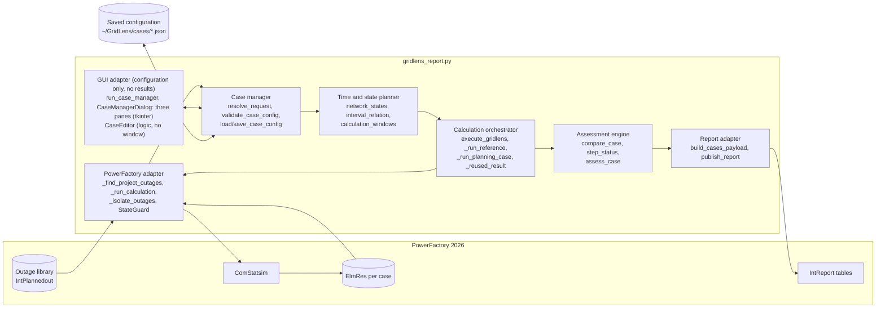
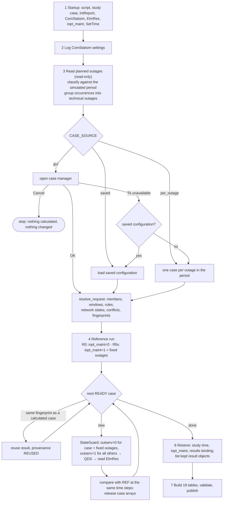
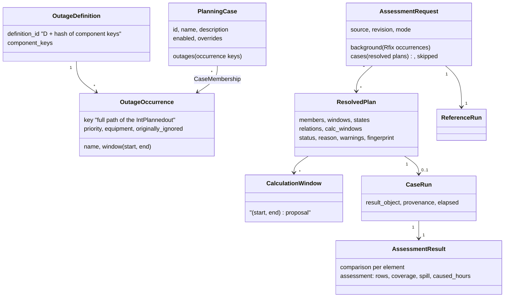
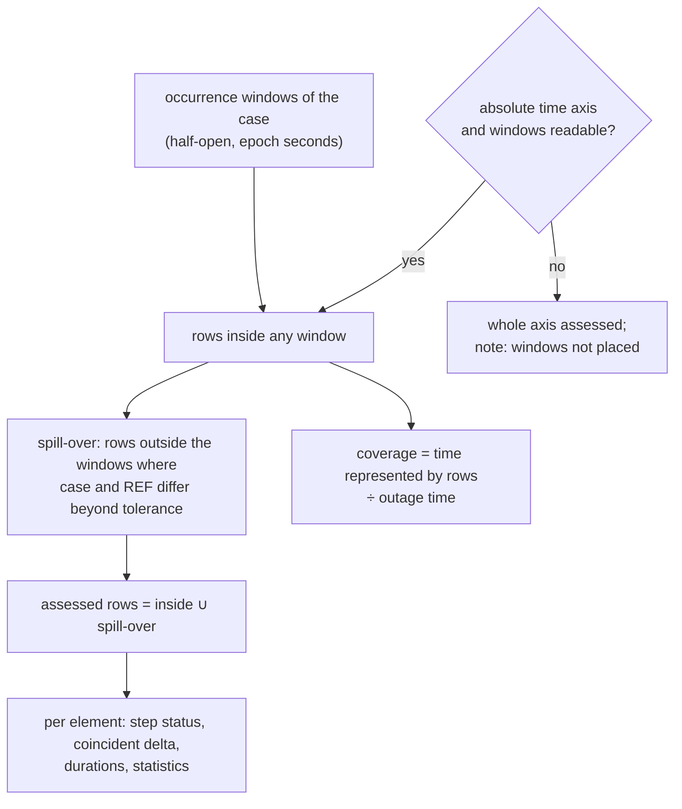
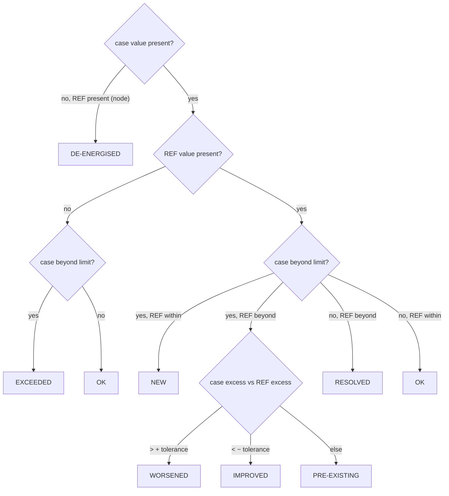
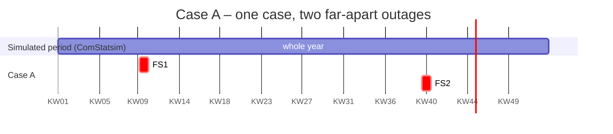

# GridLens 8.0 – Planning-Case Manager: Architecture and Method

Status: 23 October 2026 · Publisher 8.0.0 · MRT 6.0.0 · data contract 6.0 (unchanged by part 2) · settings 1.0 · classification rules 1.0

GridLens 8 turns the single-outage pre-check of 7.x into an assessment of
**engineer-defined planning cases**. A planning case is any set of planned
outage occurrences; PowerFactory applies each of them in its own time window
during one quasi-dynamic simulation (QDS), so one case passes through several
network states. Every case is compared with a reference **at the same time
step**. LODF is removed completely.

Nothing here has run in PowerFactory yet. Section 11 lists what must be
verified there before the results may be relied on.

Related documents:

- [CASE_MANAGER.md](CASE_MANAGER.md) – operating the dialog, configuration file, fallbacks
- [REPORT_MIGRATION.md](REPORT_MIGRATION.md) – data contract 5.0 → 6.0 and template changes
- [TEST_MATRIX.md](TEST_MATRIX.md) – V01–V40 and tests A–E with their verification status
- [superpowers/specs/2026-10-23-n1-settings-design.md](superpowers/specs/2026-10-23-n1-settings-design.md) – design of parts 1 and 2 (n-1 preparation, settings)
- German version: [de/ARCHITEKTUR.md](de/ARCHITEKTUR.md) and the other files in [de/](de/)

---

## 1. Central change

| | GridLens 7.x | GridLens 8.0 |
|---|---|---|
| Case | one planned outage = one automatic case | one engineer-defined planning case = any number of outage occurrences |
| Combination | FS1 + FS2 never calculated together | calculated together whenever they are in the same case |
| Active set over time | one outage, one window | a sequence of network states (elementary intervals) |
| Comparison | case maximum − REF maximum inside the window | case(t) − REF(t) at every time step, then aggregated |
| Reference | always "no planned outage" | R0 (none) or Rfix (fixed background outages) |
| Line ranking | LODF from `ComVstab` | removed; real QDS load flows only |
| Result objects | temporary `ElmRes`, deleted after extraction | one `ElmRes` per case, kept in the study case |
| QDS period | complete `ComStatsim` period | complete period with the ComStatsim time step; no time optimisation at all (removed with part 2: no proposed windows, no `QDS_WINDOW_MODE`) |

---

## 2. As-is / to-be analysis (deliverable A)

### 2.1 What 7.x already did and stays

| Area | Function(s) | 8.0 |
|---|---|---|
| Context, settings log | `execute_gridlens` (steps 1–2), `_log_qds_settings` | unchanged |
| Outage discovery | `_find_project_outages`, `_outage_details`, `outage_window` | unchanged; records now carry the stable key (full path) and every component key |
| Outage classification | `classify_planned_outages` | unchanged; now only informs the per-outage mode and the dialog |
| QDS execution | `_run_calculation` | same call; result object is kept and named per case |
| Result extraction | `collect_series` | keeps full-resolution value arrays; unique labels across DST changes |
| State protection | `StateGuard`, `_restore_study_time`, `_restore_planned_outage_option`, `_restore_results_binding` | unchanged and used for every case |
| Whole-period tables | `apply_reference`, pies, radar, counts, top 10, trends, appendices | unchanged (documented as difference of maxima) |
| Publication | `validate_payload`, `publish_report` | unchanged |

### 2.2 What was extended or replaced

| 7.x | 8.0 | Why |
|---|---|---|
| `_isolate_outage(guard, active, records)` | `_isolate_outages(guard, active_keys, records, label)` | a set of outages instead of one |
| `_run_outage_case` | `_run_planning_case` + `_reused_result` | multi-outage cases, reuse of identical cases |
| reference block inside `execute_gridlens` | `_run_reference` | R0 with `iopt_maint=0`, Rfix with `iopt_maint=1` and only the fixed outages |
| `window_bounds` (end inclusive, `bisect_right`) | `window_rows` (half-open `[start, end)`, `bisect_left`) | consistent interval convention |
| `window_statistics` per outage index | `compare_case` / `compare_element` | time-aligned comparison, durations, coverage, spill-over |
| `paired(..., windowed=True)` | returns the time-aligned records | all case-level tables use the coincident comparison |
| `limit_status` (5 states) | `step_status` per time step + precedence; adds IMPROVED, DE-ENERGISED, OUT OF SERVICE | spec section 20 |
| `assess_case` | adds DE-ENERGISED NODES and INCOMPLETE COVERAGE verdicts | no positive statement from missing data |
| `_case_rows` (one row per outage) | one row per planning case + skipped outages | spec section 39 |
| `_temporary_result` + `_delete_temporary_results` | `_case_result_object` + `ResultStore` | result objects stay in PowerFactory |

### 2.3 What was removed (LODF)

`CALCULATE_LODF`, `LODF_*` constants, `LodfError`, `_contents`, `_lodf_create`,
`contingency_keys`, `_prepare_lodf`, `_lodf_result`, `_read_lodf_matrix`,
`_execute_lodf`, `_clean_up_lodf`, `calculate_lodf`, `_lodf_ranking`,
`_lodf_text`, the LODF quality check, all `ComVstab` / `ComSimoutage` /
`ComOutage` handling, table `ScriptedLodfRanking`, field `lodf_text`, chapter 12
of the template. Tests enforce that neither the script nor the template
mentions LODF. The documents under `docs/superpowers/` describe the 7.0
design and are historical.

### 2.4 PowerFactory API assumptions that must be verified

| # | Assumption | Used for | Status |
|---|---|---|---|
| P1 | `iopt_maint=1` applies every `IntPlannedout` with `outserv=0` inside its own window | every case | confirmed in field for one outage (28 Sep 2026) |
| P2 | `outserv=1` on an `IntPlannedout` excludes it while `iopt_maint=1` | isolating the case's set | not verified |
| P3 | several active outages are applied at the same time and switch back at their own end | multi-outage cases, T01–T13 | not verified |
| P4 | two outages on the same equipment: behaviour when the first ends | V13 | unknown; overlapping outages are normal planning and no warning |
| P5 | `ElmRes` time stamp vs. window boundaries (02:00 effect seen in the 29 Sep test) | half-open windows | open; the spill-over check now detects and assesses such effects |
| P6 | `AddCopy` of the configured `ElmRes`, renaming, `ComStatsim.results` binding | result objects per case | used since 6.x, not end-to-end verified |
| P7 | writing `IntPlannedout.starttime/endtime` | own dates per case | not used (`ALLOW_OUTAGE_TIME_OVERRIDE = False`) |
| P8 | writing `ComStatsim.startTime/endTime` and initial state of time-coupled models | – | not used; shorter QDS windows were removed |
| P9 | `tkinter` / Tcl/Tk inside PowerFactory's Python | case manager | tested only with `tools/FS_CaseManager_GUI_Test_PowerFactory2026.py` design; result not recorded |
| P10 | `GetCalcRelevantObjects('*.ElmQdsl')` lists time-coupled models | state consistency for part 3 | not verified; counted by `tools/probe_contingency.py` |

---

## 3. Change and risk matrix

| Change | Risk | Mitigation | Residual risk |
|---|---|---|---|
| Several outages active in one QDS | P2/P3 wrong → a case contains more or fewer outages than shown | the log and the evidence table list active and ignored outages per run; every `outserv` is restored and read back | needs PF test V02/V03 |
| Time-aligned comparison | memory: full arrays per series | arrays (`array('d')`, 8 bytes per value) kept only for the reference; case arrays released after comparison | very large models may hit `MAX_RUN_CELLS` |
| Spill-over assessment | numeric noise outside windows counted as effect | tolerance 0.1 pp / 0.001 p.u.; exact array equality is checked first | none known |
| Result objects kept | study case grows by one `ElmRes` per case and run | names `GridLens_<yymmdd-HHMMSS>_<case>`; listed in the report | disk usage on long annual runs; the engineer deletes old runs |
| Case manager inside PowerFactory | Tk may not start or may block the UI | dialog opens before any state change; failure → saved configuration → one case per outage; Cancel changes nothing | Tk behaviour in PF unverified (P9) |
| Saved configuration outside the project | file lost or edited by hand | schema + version checked on load; damaged file stops the run with its path | not versioned with the project |
| Own dates per case | overwrite of the original outage | not applied in 8.0; case reported NOT EVALUATED | none |
| Settings (part 2) | an override changes the n-0 assessment unnoticed | overrides are validated, named in log and report (row *Settings*, WARNING); defaults reproduce the previous report exactly | stored provisionally outside the project |
| Removing LODF | users miss the ranking | ranking by coincident delta in Metric View, trend and summary | none |

---

## 4. Logical architecture

Single file `powerfactory/gridlens_report.py`, separated into sections:



---

## 5. Run flow



A case that raises an ordinary error is kept as `FAILED` with its reason and
the next case runs. A state that cannot be restored (`StateRestoreError`)
stops the run. Restoration runs in a `finally` block, so it also runs after a
failure in the reference or in the extraction.

### 5.1 One case in detail

```mermaid
sequenceDiagram
    participant OR as Orchestrator
    participant SG as StateGuard
    participant IP as IntPlannedout (all)
    participant CS as ComStatsim
    participant ER as ElmRes copy
    OR->>SG: open
    loop every planned outage
        SG->>IP: read outserv, remember
        SG->>IP: write 0 (case / fixed) or 1 (other)
    end
    OR->>ER: AddCopy(configured ElmRes), name GridLens_<stamp>_<case>
    OR->>CS: results = copy; Execute()
    CS-->>ER: QDS results (PowerFactory applies the active outages in their windows)
    OR->>ER: Load, read series, Release
    OR->>SG: close
    loop reverse order
        SG->>IP: write original outserv, read back, compare
    end
    OR->>OR: restore study time, compare with REF
```

---

## 6. Data model (deliverable C)



| Entity | Implementation | Notes |
|---|---|---|
| `OutageDefinition` | `assign_definitions(records)` sets `definition_id` | occurrences that switch the same components belong to one technical outage |
| `OutageOccurrence` | the record of one `IntPlannedout` (`_outage_record`) | identity = full PowerFactory path, never the display name |
| `CaseMembership` | `cases[].outages` (list of occurrence keys) | many-to-many; an occurrence may be in any number of cases |
| `PlanningCase` | `cases[]` in the configuration | id: letters, digits, `_`, `-`, ≤ 16 characters, not `REF` (it becomes part of the `ElmRes` name; a dot would read as a class separator) |
| `AssessmentRequest` | `resolve_request(...)` result | source, revision, mode, background, resolved plans |
| `CalculationWindow` | `calculation_windows(...)` | warm-up 24 h before each window, windows < 48 h apart merged; proposal only |
| `ReferenceRun` | result with id `REF` | R0 or Rfix, `run_note` states which |
| `CaseRun` | result of `_run_planning_case` or `_reused_result` | `result_object`, `provenance`, `elapsed` |
| `AssessmentResult` | `result['comparison']`, `result['assessment']`, `assess_case(...)` | per element and per case |

**Independent cases.** Every case contains only its directly assigned outage
occurrences. Put both outages directly into a third case to assess a joint plan.
Changes, exclusion or deletion of one case do not affect another. Copy creates
an independent variant. There are no case dependencies or alternative groups.

**Saved configuration.** Schema version 2 stores direct memberships only.
`upgrade_case_config` converts version 1 on load: inherited memberships and
first-effective own dates become direct assignments; dependencies and exclusions
are removed. A migration notice is shown under Problems and warnings and in the log. Loading
does not rewrite the file. Invalid legacy references/cycles stop migration.

**Rules between outage occurrences.**

| Rule | Configuration | Check |
|---|---|---|
| B01 same case | `outages` | common time line |
| B08/F11 must not overlap | rule `not_overlap` | overlapping windows refused |
| B09/F10 order | rule `order` | second must start after the first has ended |
| B10 together | rule `together` | both present and overlapping |
| F15/V13 same equipment | automatic | none: overlapping outages are normal planning, recorded only as their relation |

---

## 7. Method

### 7.1 Active set and network states

For the occurrences `O_c` of a case, `A_c(t) = { o ∈ O_c | a_o ≤ t < b_o }`.
`network_states` collects every start and end, sorts them and returns the
elementary intervals with their active set; neighbours with the same set are
merged and empty intervals (∅) are kept. This works for any number of
occurrences; the 13 relations of two intervals (T01–T13) are just the special
case, reported per pair by `interval_relation`.

```mermaid
gantt
    title Test B – three overlapping outages, five network states
    dateFormat HH:mm
    axisFormat %H:%M
    section Outages
    FS1 :a1, 08:00, 13:00
    FS2 :a2, 10:00, 15:00
    FS3 :a3, 11:00, 14:00
    section Network state
    FS1           :s1, 08:00, 10:00
    FS1+FS2       :s2, 10:00, 11:00
    FS1+FS2+FS3   :s3, 11:00, 13:00
    FS2+FS3       :s4, 13:00, 14:00
    FS2           :s5, 14:00, 15:00
```



GridLens does not switch these states itself. PowerFactory applies every
active outage in its own window during the QDS (`iopt_maint=1`); GridLens only
decides which outages are active (`outserv`). The computed states document
what PowerFactory is expected to do and appear in the preview, the log and
the report (`states_text`).

### 7.2 Time-aligned comparison

For element `e`, rows `k` and step durations `Δt_k = t_{k+1} − t_k` (the last
row repeats the previous step):

- coincident delta: `D_max(e) = max_k [ y_c(e,t_k) − y_R(e,t_k) ]` (voltage: largest absolute change, signed)
- difference of maxima (kept separately, labelled so): `max_k y_c − max_k y_R`
- excess: loading `max(0, L − 100 %)`; voltage `max(0, U_min − U, U − U_max)`
- caused-violation duration of the case: `Σ Δt_k` over the union of rows where any element is NEW or WORSENED

Test A of the specification: REF 80 %, 60 %; case 70 %, 85 % → difference of
maxima +5 pp, coincident delta +25 pp.

### 7.3 Which rows are assessed



In a case only its own outages differ from the reference, so any difference
outside their windows means PowerFactory applied them shifted, or a switching
state outlasts the outage (F14). Those rows are assessed as well and the model
quality page names the case. This also catches the 02:00 effect of the
29 September test.

### 7.4 Classification



An element takes its most severe step status (NEW > WORSENED > EXCEEDED >
DE-ENERGISED > PRE-EXISTING > IMPROVED > RESOLVED > OK). Equipment the case
itself switches off is OUT OF SERVICE, never RESOLVED. Values exactly on a
limit are no violation. Loading limit 100 % by default (element ratings are
already inside `c:loading`), one voltage band in p.u. of the nominal voltage
for every voltage level (default 0.95–1.05 p.u.); both are settings (7.5).

Case verdict, first match wins:

| Verdict | Condition | Colour |
|---|---|---|
| OVERLOAD + VOLTAGE BAND / OVERLOAD / VOLTAGE BAND | a loading and/or voltage element NEW, WORSENED or EXCEEDED | red |
| DE-ENERGISED NODES | a node loses its voltage in the case | yellow |
| INCOMPLETE COVERAGE | nothing found, but results cover < 99.9 % of the outage time | yellow |
| NO ADDITIONAL VIOLATION | only PRE-EXISTING or IMPROVED violations | yellow |
| NO LIMIT EXCEEDED | nothing beyond a limit | none |
| NO RESULT DATA IN WINDOW | no row to assess | none |
| NOT EVALUATED / NOT SIMULATED | failed run, rule conflict, axis mismatch / outside the period | none |

Missing or failed results never produce NO LIMIT EXCEEDED.

### 7.5 Settings (part 2)

Every limit and tolerance of the assessment is a **setting** (`SETTINGS` in
`gridlens_report.py`, version `SETTINGS_VERSION = '1.0'`). Defaults are the
values of the code: loading warning 80 %, n-0 loading limit 100 % (lines and
transformers separately), one voltage band of 0.95–1.05 p.u. for every voltage
level (marked as a GridLens proposal; the kV bands per voltage level were
replaced on 23 October 2026), change tolerances 0.1 %-points / 0.001 p.u. The
former script constants TOP_N, MAX_PLOT_POINTS, ENERGIZED_MIN_PU, the appendix
thresholds, RUN_REFERENCE_CASE, MAX_CASES and MAX_N1_TIMES are the defaults of
settings of the same meaning (`setting_value()`). CASE_SLOTS, the versions and
the start options stay script constants: the MRT or the start depends on them.

Calculation and publication are separate: a ComPython that is not below an
IntReport calculates, builds and checks every report table and logs the
results, but publishes nothing (standalone run, exit code 0).

A run has **two phases**. Phase 1 (log step 4) only calculates: REF and every
case into its own kept `GridLens_<stamp>_<case>`, and every n-1 sweep into a
kept copy of its result object (`…_<case>_N1`, `…_<case>_N1P`; when PowerFactory
refuses the copy, that sweep is read at once). Each kept object names its case,
the case fingerprint and, for n-1, the recording limits in its description.
Step 5 restores the PowerFactory state; phase 2 (step 6) reads, compares and
classifies the kept objects; step 7 builds and publishes the report. The memory
budget stops phase 2 before the next case is read; everything calculated stays.

**Re-evaluation without calculation:** the case manager's *Results* choice
lists the kept runs of the study case (`kept_stamps`). Choosing one skips
phase 1 entirely – nothing is calculated, PowerFactory is not changed – and
phase 2 reads that run's objects with the current settings (`kept_runs`). A
case whose outages or windows changed since then (another fingerprint), or
whose object is missing, is NOT EVALUATED with the reason; a changed REF stops
the run.

**Are the outages really applied?** Three checks make this visible in the
log and the report:

- Whether n-1 runs is always logged: "n-1 is not calculated: it is not
  ticked in the case manager", "... no planning case can be calculated", or
  the contingency analysis used.
- Before every QDS run with planned outages and before every n-1 sweep,
  GridLens reads back what PowerFactory will apply (`applied_text`): the
  option (`iopt_maint` or `isPlannedOutages`) and every planned outage whose
  'Ignored' flag is 0; with the option at 0 the line says that none applies.
- In phase 2 each outage of a case is checked against REF inside its own
  window (`outage_effects`): **APPLIED** (a recorded component carries no
  load in the case but does in REF), **EFFECT SEEN** (components not
  recorded, but the network differs from REF), **NO EFFECT** (the case equals
  REF in the window; most likely not applied, logged as a warning), **NOT
  CHECKABLE** (no REF on the same time axis or no result row in the window).
  The model quality page carries one row `outages_<case>` per case.

Every run ends with a **run summary** (`RunStats`, `log_run_summary`), also a
failed one: time and calls per service (reading planned outages, grids and
contingencies, the case manager with its window build and refreshes, each QDS
and contingency analysis inside PowerFactory, reading results, comparison and
classification, restore, building and publishing the report tables) and the
number of calculations (QDS runs and time steps, reused cases, series and
values read, contingency analyses created and run, n-1 study times,
contingency load flows, classified n-1 results, report rows).

Results are read one column per call: `ElmRes.GetColumnValues(IntVec, column)`
fills a temporary IntVec `GridLens_column_buffer`, created in the running
ComPython for the run and deleted in the restore step. Without it every value
would be one `GetValue` call; the run summary counts both kinds of reads, so a
slow run shows at once whether the bulk read worked. A voltage column of an
n-1 sub-result that contains a 0 is read cell by cell, because what the bulk
read writes into a cell inside the recording limits (code 3) is not verified.
Planned outages are read in one pass per outage, the whole project is searched
only when the outage folder holds none, and without a grid selection no grid
is looked up per result column.

| Category | Meaning | Examples | Editable |
|---|---|---|---|
| A – evaluation | interprets calculated results; never changes a load flow, a rating or the model | warning thresholds, assessment limits, voltage bands, tolerances | yes, validated |
| B – calculation | would change what PowerFactory calculates | contingency set, post-fault phases, remedial actions, AC/DC, islanding, unsupplied load, load shedding | **no**: read only until the interface is verified |

At the start of a run (after the case manager closes) `activate_settings`
fixes a snapshot: values, source per value (`GridLens`, `PowerFactory`,
`user`), overrides, settings and classification versions. The assessment reads
limits only through `loading_limit()`, `loading_warning()`, `voltage_bands()`,
`default_voltage_limits()` and `change_tolerance()`; `reset_settings()` restores
the defaults at the end. With the defaults the published report tables are
identical to the previous version (test
`test_default_settings_reproduce_the_n0_report_exactly`, exact equality of every
row except the generation time). The report names the settings in *Model
Quality Assurance* (row *Settings*, WARNING when an override is active).

Storage: only overrides, under `settings` in the case configuration file
(JSON). **Provisional** – a native storage inside the PowerFactory project and an
immutable snapshot object per run are open until the probe (part 1) shows a
suitable object. Settings and results are never mixed: the file holds no
result.

### 7.6 Classification n-1 against (n-1)' (part 2, rules version 1.0)

`classify_comparison(reference, scenario, parameters)` is one pure function for
every scenario (`CLASSIFICATION_VERSION = '1.0'`). It is implemented and tested,
but **not used by a calculation yet**: n-1 and (n-1)' follow in part 3. The n-0
QDS keeps its own statuses (`step_status`: `PRE-EXISTING`, `DE-ENERGISED`, …),
unchanged.

Comparable only with the same time step, contingency, monitored element,
quantity, post-fault phase and limit definition. With the scenario `c`, the
contingency `k`, the element `e` and the time `t`:

- coincident delta `ΔL = L(n-1)',c,k(e,t) − L(n-1),k(e,t)` in %-points; never a
  difference of independent maxima,
- loading violation `V_L = max(0, L − L_lim)`,
- voltage violation `V_U = max(0, U_min − U, U − U_max)`.

| Code | Status | Condition |
|---|---|---|
| 0 | OK | neither side violated |
| 1 | NEW | only the scenario violated |
| 2 | WORSENED | both violated, `V_s − V_r > worsened tolerance + numeric tolerance` |
| 3 | PRE_EXISTING | both violated, change within the tolerances |
| 4 | IMPROVED | both violated, `V_r − V_s > improved tolerance + numeric tolerance` |
| 5 | RESOLVED | only the reference violated |
| 90 | FAILED | a calculation failed or did not converge; never a proven violation |
| 91 | NOT_EVALUATED | a value or the limit is missing or invalid (NaN, ±∞, None, boolean, text) |
| 92 | NOT_APPLICABLE | the contingency cannot be applied, e.g. its element is already switched off by a planned outage |
| 93 | NOT_COMPARABLE | time, contingency, element, quantity, phase or limit definition differ |

A side is violated when `V > limit tolerance + numeric tolerance` (defaults 0
and 1e-9: exactly on the limit is no violation, rounding noise neither).

Decision order: 1 FAILED, 2 NOT_APPLICABLE, 3 NOT_COMPARABLE, 4 NOT_EVALUATED,
5 numeric decision. Applicability is checked before missing values, because a
contingency that cannot be applied legitimately has no value and must keep
that reason. Every non-numeric finding is kept in `reasons`, so the precedence
never hides a second cause. Missing values are never replaced by zero.
`MARGIN_REDUCED` is an indicator, never a status: an OK result whose reserve to
the limit shrank by more than the WORSENED tolerance (for loading only from the
reduced-margin warning, default 80 %).

Defaults and their reasons: limit tolerance 0 (the existing rule "on the limit is
no violation"); numeric tolerance 1e-9 (far below any meaningful %-point or p.u.
difference); WORSENED and IMPROVED tolerances 0.1 %-points / 0.001 p.u. (the
existing n-0 change tolerances, so both assessments use the same resolution);
n-1 limits "use PowerFactory limits" = 100 % of the rating PowerFactory relates
the loading to (whether that is the post-fault rating is open, see 12).

### 7.7 Statement A and statement B

The report states on the cases page: statement A (what the planned outages
add) is what the cases assess. Statement B (the network is permissible over
the whole period) is described only by Reference; a case that adds nothing
does not prove it.

---

## 8. Walk-through: FS1 in KW10, FS2 in KW40 (deliverable E)



1. **Read.** Both `IntPlannedout` objects are read (key, window, components).
2. **Assign.** The engineer puts FS1 and FS2 into case A.
3. **States.** `FS1 | ∅ | FS2` (relation T01).
4. **Time base.** No shortened window: every run covers the complete
   ComStatsim period with its time step (no time optimisation since part 2).
5. **Reference.** One REF run over the whole period (`iopt_maint=0`), kept as
   `GridLens_<stamp>_REF`.
6. **Case run.** One QDS over the whole period with FS1 and FS2 active
   (`outserv=0`), all other outages ignored, kept as `GridLens_<stamp>_A`.
   PowerFactory applies FS1 in KW10 and FS2 in KW40.
7. **Compare.** Rows of KW10 and KW40 are compared with REF at the same time
   steps; any difference in between (e.g. a switching state that outlasts
   FS1) is assessed as spill-over and reported.
8. **Report.** One row for case A: both periods, both outages, the five
   columns of the case definition, coverage of both weeks, the verdict, the
   evidence table with both runs and their result objects.

Cost: 2 full-year QDS runs for any number of cases sharing the reference, plus
1 per distinct case. No run is shortened.

---

## 9. Error handling and robustness

| Situation | Behaviour | Where |
|---|---|---|
| configuration file with wrong types, ids, rules, own dates | every problem named with the case; the run stops **before** any PowerFactory change | `validate_case_config` |
| configuration unreadable or of another schema | run stops with the file path; never silently ignored | `load_case_config` |
| outage deleted or renamed since the configuration was saved | that case NOT EVALUATED with the path | `resolve_request` |
| window ends before it starts | that case NOT EVALUATED | `resolve_request` |
| fixed outage unknown or Ignored in PowerFactory | warning in log and quality page | `resolve_request`, `_model_quality` |
| Tk missing, or the dialog cannot be built | treated as "dialog unavailable": saved configuration, else one case per outage; the report says so | `run_case_manager`, `obtain_case_request` |
| error in a dialog button | shown in a message box; the dialog stays open; nothing calculated | `report_callback_exception` |
| dialog crashes while open | run stops, nothing calculated | `run_case_manager` |
| Cancel | run stops, nothing calculated, nothing saved or published; `main` logs CANCELLED and propagates the cancellation to the report caller instead of returning normally, so the caller cannot treat the extension as successful | `GridLensCancelled`, `main`; actual IntReport handling still needs a PowerFactory check |
| `outserv` cannot be written | that case FAILED; settings restored | `_isolate_outages`, `StateGuard` |
| QDS fails or its `ElmRes` cannot be read | that case FAILED; the next case runs | `_run_planning_case` |
| comparison fails unexpectedly | that case NOT EVALUATED with the reason; its `ElmRes` is kept; the next case runs | `_run_planning_case` |
| memory budget (`MAX_RUN_CELLS`) exceeded | stops before the next run, not after the last one; state restored | `check_run_budget` |
| a setting cannot be restored | run stops with expected and found value | `StateRestoreError` |
| reference fails | run stops (no case could be compared); state restored | `_run_reference` |
| result object records no loading or voltage (no `c:loading`/`m:loading` of lines and transformers, no `m:u`/`m:u1` of terminals) | the message names what is needed, lists what the `ElmRes` records instead and says to add the variables in the QDS result variables or choose another study case; all-de-energised terminals are named as such | `collect_series`, `missing_series_message` |
| run fails without publication | the script ends with exit code 1 (`NO_REPORT_EXIT_CODE`) so that PowerFactory does not render the report; the last log line says so (a report generated by hand would fail with "Scripted... not found" in `ReportsNet.log`); a successful run ends with 0 and names the IntReport | `main`, `exit_code`, `NO_REPORT_DATA`; needs a PowerFactory check |
| run fails without publication | the last log line says that no report tables were published, so generating the report fails with "Scripted... not found" in `ReportsNet.log`; a successful run names the IntReport to generate from. Cancel follows the separate propagation path above. | `main`, `NO_REPORT_DATA`, `execute_gridlens` |
| coverage below 99.9 % | never "NO LIMIT EXCEEDED"; text never shows "100 %" | `assess_case`, `percent_text` |
| outage windows cannot be placed on the time axis | every time step compared (slower); warning in the log, note in the report | `compare_case`, `_run_planning_case` |
| verdict computed several times could drift | each case is judged once after the runs; log, case table and summary read that verdict | `judge_cases`, `judged` |

All restore steps run in `finally`, so they also run after an error or a
`KeyboardInterrupt`.

---

## 10. Performance (deliverable H)

| Quantity | Where it is reported |
|---|---|
| planned QDS runs | case manager preview: "Calculation runs: 1 reference + n case run(s)" |
| avoided runs | identical cases (same outages, windows, fixed outages) reuse the result: case manager preview "n identical case(s) reused", evidence table "CASE (reused)" |
| time steps per run | evidence table `time_steps` |
| measured run time | evidence table `elapsed_text`, log (QDS and comparison separately) |
| time base | always the complete ComStatsim period; `qds_mode_text` says so in the report; no proposed windows exist |

The GUI updates changed native table rows instead of deleting and reinserting
all rows. Filtering detaches rows and clearing the filter reattaches them;
rows removed from the data are deleted, including filtered-out ones. Scroll
and visible selection are preserved; keyboard focus is cleared when filtered out.
Empty rule lists avoid building and sorting all outage names on every refresh.
A local Tk 8.6 profile with 5,000 synthetic outages, four case switches and one
checkbox toggle took 0.758 s before and 0.358 s after the change: 25,000 inserts
became 81 row updates, with no inserts/deletes after opening. These are local
GUI measurements, not PowerFactory or QDS performance results.

Rough model (spec section 27): `T ≈ (1 + m_distinct) · (τ_I + n · τ_L)`. No
speed-up is claimed; nothing has been measured in PowerFactory.

---

## 11. Open PowerFactory acceptance

Before production use, run in PowerFactory 2026 and record the result:

1. P2/P3: a case with two overlapping outages – the log lists both active; compare loadings with two single cases (V02, V03).
2. P5: an outage window boundary with hourly steps – does the effect appear in the window rows or in the spill-over rows?
3. P6: the result objects `GridLens_<stamp>_<case>` appear in the study case and can be opened.
4. P9: the case manager opens, OK / Cancel work, PowerFactory stays responsive afterwards (V30, V31).
5. The report renders: new chapters 5, 8, 15 and the TOC with 19 entries.
6. Memory and run time of a full-year run with 10 cases.

Own dates per case need their own probe first (`tools/probe_planned_outages.py`
is the place), then a decision to enable them. Shorter QDS windows are removed
and not planned.

---

## 12. Part 1 and part 2, and what part 3 needs

Part 1 (released 23 October 2026): `tools/probe_contingency.py`, strictly read
only (no `Execute`, `CreateObject`, `SetAttribute`, no `GetFromStudyCase`, which
creates a missing command; `tests/test_probe_contingency.py` checks the source).
Probe 1.0 reported ComSimoutage, ComStatsim, contingency definitions,
contingency `ElmRes`, the `ElmRes` interface and storage candidates with names
and values. Since 23 October 2026 probe 2.0 runs in **strict privacy mode**:
fixed labels and status tokens only, no name, path, value, study time or count,
every PowerFactory call through a read-only gateway (see the spec,
section 2.1). Its output may be shared; the other tools are local only.
`tools/test_contingency.py` prepares a very small test calculation on an
explicitly named project copy; it is disabled (`ENABLED = False`), asks before
every write, restores and verifies – and its release is separate.

Part 2: the two-tab case manager, settings with validation and provisional
storage, tooltips, `classify_comparison` with tests. n-1 and (n-1)' stay
disabled.

| Status | Function |
|---|---|
| implemented and tested locally (unit tests) | settings model, validation, snapshot, `classify_comparison`, removal of the time optimisation, n-0 with settings (default regression) |
| tested with mock objects or local Tk only | case manager with two tabs, Settings tab, tooltips (Tk 8.6 on macOS); the probe against mock PowerFactory objects |
| needs a real PowerFactory 2026 test | the probe run itself; Tk inside PowerFactory; the n-0 run with settings overrides; the report row *Settings* in the rendered PDF |
| part 3 (n-1 run), tested with mock objects | n-1 and (n-1)' via `run_n1` / `run_n1_case` / `run_n1_sweep`, study times on the QDS grid inside the case windows, contingency grid filter, `compare_n1`, rows *n-1 <case>* on the QA page (`tests/test_n1_core.py`); needs a real PowerFactory run |
| still read only | category-B parameters other than the contingency grids, post-fault voltage limits, native storage of settings and of `GL_<scenario>_CLASSIFICATION`, n-1 report chapters (part 4) |

Prerequisites of part 3 (each answered by the probe output or by an approved
run of `tools/test_contingency.py`):

1. ComSimoutage time sweep: attributes, and proof that it computes exactly the
   ComStatsim time steps (start, end, step, last step).
2. Whether the time sweep applies `IntPlannedout` in their windows with the same
   `iopt_maint` / `outserv` semantics as the QDS.
3. The contingency set object, shared unchanged by n-1 and (n-1)'.
4. Result structure: how a row names contingency, time step and post-fault
   phase; dense or sparse; how to prove the complete set of contingency × time
   combinations.
5. PowerFactory's result for a contingency whose element is already switched off
   (→ NOT_APPLICABLE).
6. Which rating `c:loading` refers to after a contingency (post-fault rating).
7. An `ElmRes` write method that stores classification codes and reads them back
   unchanged (`GL_<scenario>_CLASSIFICATION`), and a native project object for
   settings, snapshots and case configurations.
8. State consistency of time-coupled models (`ElmQdsl`) between QDS and time
   sweep.
