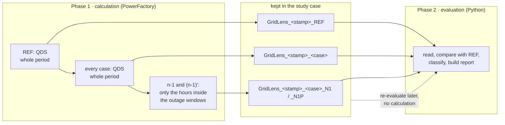
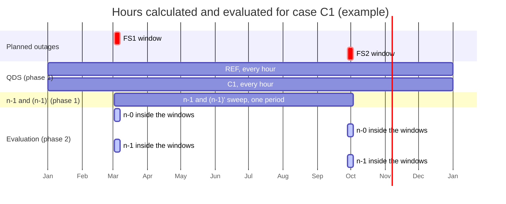

# GridLens – calculation and evaluation, and how GridLens saves time

How GridLens 8.0 calculates and evaluates, which hours each step covers, where
the filters act, and every measure that saves calculation or evaluation time.
As of 25 October 2026. German version:
[`docs/de/BERECHNUNG_UND_AUSWERTUNG.md`](de/BERECHNUNG_UND_AUSWERTUNG.md); both
are maintained together. How GridLens talks to PowerFactory is described in
[`POWERFACTORY.md`](POWERFACTORY.md).

---

## 1. Two phases: calculate everything, then evaluate

1. **Phase 1** runs every calculation and keeps each result as its own object
   in the study case. Nothing is read in between.
2. **Restore**: every value GridLens wrote is put back and verified.
3. **Phase 2** reads the kept objects and evaluates them.

Because the results are kept, phase 2 can run again at any time **without
phase 1**: the case manager's *Results* choice lists the kept runs. **The
engineer alone decides** whether to calculate again or to re-evaluate a kept
run; GridLens never switches on its own.

---

## 2. Which hours are calculated and evaluated

Example: QDS period one year, hourly. Case C1 holds two planned outages, FS1 in
calendar week 10 and FS2 in calendar week 40.

| Step | Hours | Why |
|---|---|---|
| QDS, REF and every case | **every hour of the period** | PowerFactory applies each outage in its own window during one QDS; the QDS cannot skip hours |
| n-1 and (n-1)' | **only the QDS steps from the first to the last window hour of the case** | `calcPeriod = 4` with `startTime`/`endTime`; every step outside the windows would only repeat REF |
| evaluation n-0 | the window hours, plus every hour outside in which the case differs from REF (spill-over) | outside the windows case and REF should be equal |
| evaluation n-1 | only the window hours | the steps between windows that lie apart are calculated but not assessed |

**Known limit:** windows far apart (as FS1 and FS2 above) make the n-1 period
long: every hour in between is calculated. A period longer than *n-1 study
times, at most* (Settings) is refused with a message. Splitting such a case, or
one sweep per window, avoids this.

---

## 3. Measures that save time

| Measure | What it saves | Where | Status |
|---|---|---|---|
| **Re-evaluate a kept run** | the whole phase 1: no QDS, no n-1 | *Results* in the case manager, `kept_runs` | used |
| **Identical cases calculated once** | one QDS and one n-1 per distinct set of outages and windows; the others are `REUSED` | `plan_fingerprint` | used |
| **Shared n-1 reference** | the n-1 sweep is calculated once per set of study times and shared by every case with the same hours | `references` in `calculate_n1_case` | used |
| **n-1 only inside the windows** | instead of every hour of the period, only the window hours (first run: 2 of 8784) | `n1_study_times`, `sweep_period` | verified 24 Oct 2026 |
| **One column per call** | `GetColumnValues` reads a whole column instead of one call per value | `read_column` | used |
| **Report filter before reading** | series of grids outside the report filter are not read at all | `collect_series` | used |
| **Comparison only where needed** | the window hours and the hours where case and REF differ, not every hour | `compare_case` | used |
| **Stop after the first run** | if the first kept result records no loading or voltage, no further run is started | `check_recording` | verified 24 Oct 2026 |
| **Plot points** | time plots use at most *Plot points* points per series | `MAX_PLOT_POINTS` setting | used |
| **n-1 filters** | only contingencies inside the n-1 grids and outaging a selected element are calculated | `excluded_contingencies` | used |

The run summary at the end of every log shows the time per service and the
number of calculations, so the effect of each measure can be read off a run.

---

## 4. Calculation in detail

1. **REF**: R0 (`iopt_maint = 0`, no planned outage) or Rfix (`iopt_maint = 1`,
   only the fixed outages).
2. **Every case**: `iopt_maint = 1`; the case's outages and the fixed ones have
   `outserv = 0`, every other planned outage `outserv = 1`. One QDS over the whole
   period. Right after it GridLens copies the result object PowerFactory wrote
   into as `GridLens_<stamp>_<case>`.
3. **n-1**: per case one sweep with `isPlannedOutages = 0` (or only the fixed
   outages), over the period from the first to the last window hour.
4. **(n-1)'**: the same period with the case's outages applied.
5. The n-1 results are kept as `…_N1` and `…_N1P`; their description holds the
   n-1 filters they were calculated with.

## 5. Evaluation in detail

1. Read the kept QDS results; the report filter decides which series are read.
2. Compare every case with REF **at the same time step**: the window hours and
   every hour where they differ; classify each step (`NEW`, `WORSENED`, …).
3. Check that every outage took effect (`APPLIED`, `NO EFFECT`, …) and whether
   it stays in effect after its window.
4. Read the kept n-1 results, leave out the contingencies outside the current
   n-1 filters, classify (n-1)' against n-1 per study time and contingency.
5. Build the report tables (and publish them below an `IntReport`).

---

## 6. Where the filters act

| Filter (Settings → Network scope) | Calculation | Evaluation | Re-evaluation of a kept run |
|---|---|---|---|
| **Report filter: assessed equipment, grids** | no effect: PowerFactory calculates the whole network | only lines, transformers and terminals of these grids are assessed (n-0 and the elements watched in n-1) | applies in full |
| **n-1 filter: grids of the outaged equipment** | contingencies outside these grids are "Not analysed" for the run | – | narrows: contingencies now outside are left out of the evaluation |
| **n-1 filter: outaged elements** | only contingencies outaging at least one selected element are analysed; the others are "Not analysed" for the run (or not created). None selected: every element | the loading of every element is still assessed under the analysed contingencies | narrows in the same way |
| *(no filter on the QDS)* | the QDS always calculates the whole network | | |

In a re-evaluation the n-1 filters can only **narrow**: a contingency that was
"Not analysed" at the calculation has no result, and only a new calculation
adds it. The log names the filters the kept run was calculated with and the
contingencies the current filters leave out; the case manager's preview says
what applies for the chosen *Results*.

---

## 7. Re-evaluating in practice

1. Open the case manager.
2. *Results*: choose the kept run (`GridLens_<stamp>_…`), or *Calculate now*.
3. Change the report filter, limits or thresholds as needed; change the n-1
   filters to narrow the evaluation.
4. *Start calculation*: with a kept run, PowerFactory calculates nothing.

The report states that it is a re-evaluation of the kept run; the result
objects are the same as before.

---

## 8. Open question: evaluating in the template with SQL

Stimulsoft reads the report database (SQLite) and could compare and evaluate
with SQL in the template. For that, the QDS time series would have to be in the
report database: Python still reads them from PowerFactory (Stimulsoft cannot
read `ElmRes`) and would then write every value with `IntReport.SetValue`, one
call per cell. One year hourly with 450 series, REF and five cases are about
24 million calls; today GridLens writes a few thousand result cells.

Whether that is acceptable depends on how fast `SetValue` is in PowerFactory,
which has not been measured. `tools/probe_report_write.py` measures it: it runs
below a **separate** IntReport whose name contains "probe" (its `Reset()`
clears that report), writes numbers, integers and texts in growing stages and a
narrow long-format table, and prints cells per second and estimates for the
cases above. The decision follows from its numbers.
