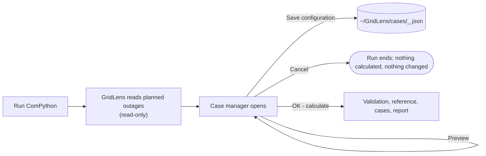

# GridLens Case Manager – Operating Guide

German version: [de/FALLMANAGER.md](de/FALLMANAGER.md)

The case manager is the small dialog GridLens opens when the ComPython runs
(`CASE_SOURCE = 'gui'`). It only edits a configuration. PowerFactory waits
while it is open; nothing is calculated or changed before you press
**OK – calculate**.



## Areas of the window

| Area | Purpose |
|---|---|
| **Planned outages** (left) | every `IntPlannedout` / `IntOutage` found: name, equipment, start, end, priority, status (*in simulated period*, *outside simulated period*, *Ignored in PowerFactory*). Column **Case** shows `[x]` for outages of the selected case, **Fixed** for fixed outages of the reference. |
| **Planning cases** (right) | case IDs: letters, digits, `_`, `-`, up to 16 characters. **New**, **Rename**, **Copy**, **Delete**, **One case per outage** (fills the list like GridLens 7). Below: description, *Includes cases* (joint plans, hierarchy), *Only together with* (conditional cases). |
| **Assessment request** (bottom left) | alternative cases (`A|B; C|D`), rules, calculation period mode, path of the saved configuration. |
| **Calculation preview** (bottom right) | reference, number of QDS runs, per case its outages, pairwise relation (T01–T13), network states, proposed windows, warnings and the reason a case cannot be calculated. |

## Typical tasks

| Task | How |
|---|---|
| One outage alone | **New** → select it → double-click (or **Assign / remove**) |
| FS1 and FS2 at the same time | one case, assign both |
| FS1 in KW10 *or* KW40 | create a planned outage per date in PowerFactory, one case per date, enter `A|B` as alternatives |
| FS1 really twice (KW10 *and* KW40) | both occurrences in the same case |
| A and B both take place | case **AB** with *Includes cases* `A, B`; never created automatically |
| B only together with A | case B: *Only together with* `A`; calculate it through a joint case |
| Additional effect of a new outage while FS0 is fixed | select FS0 → **Fixed outage (reference)**; the reference becomes Rfix and keeps FS0 active in every case |
| Outage on its own date in one case | **Own dates** records it; GridLens 8.0 does **not** apply it (the case is reported NOT EVALUATED) – create a planned outage with that date instead |

Rules (one per line, outage names as in the list):

```
not_overlap: FS1, FS2
order: FS1, FS2
together: FS3, FS4
```

## Buttons

| Button | Effect |
|---|---|
| **Preview** | validates and shows the plan; no QDS |
| **Save configuration** | writes the JSON file with the next revision number, user and time; the project is not touched |
| **OK – calculate** | validates; asks before continuing when cases cannot be calculated; closes the dialog; then the calculation starts |
| **Cancel** / window close | ends the run; nothing is calculated, nothing is saved, nothing in the project changes |

## Where the cases come from

| `CASE_SOURCE` | Behaviour |
|---|---|
| `'gui'` (default) | dialog, pre-filled with the saved configuration. If `tkinter` cannot open a window: the saved configuration; without one: one case per outage. The report states which source was used. |
| `'saved'` | the saved configuration, no dialog (repeatable runs) |
| `'per_outage'` | one case per planned outage in the simulated period (GridLens 7 behaviour) |

The configuration lives in `CASE_CONFIG_DIR` (default `~/GridLens/cases`), one
file per project, named after the project and a hash of its full path. A file
with the wrong schema or version stops the run with its path instead of being
ignored.

```json
{
  "schema": "gridlens.cases", "schema_version": 1, "revision": 3,
  "project": "\\User\\Grid.IntPrj", "saved_at": "2026-10-22 10:15:00 +0200", "saved_by": "hadi",
  "mode": "conservative",
  "background": ["\\User\\Grid.IntPrj\\Outages\\FS0.IntPlannedout"],
  "cases": [
    {"id": "A", "name": "FS1 + FS2 week 10", "description": "",
     "outages": ["...\\FS1.IntPlannedout", "...\\FS2.IntPlannedout"],
     "includes": [], "requires": [], "overrides": {}}
  ],
  "exclusive_groups": [["A", "B"]],
  "rules": [{"kind": "not_overlap", "first": "...\\FS1.IntPlannedout", "second": "...\\FS2.IntPlannedout"}]
}
```

Outages are stored by their full PowerFactory path, never by display name. A
renamed or deleted outage makes its case NOT EVALUATED with the path named.

## What happens in PowerFactory after OK

- One reference run, then one QDS per distinct case. Cases with the same
  outages and windows are calculated once.
- During a case run only that case's outages (and the fixed ones) have
  `outserv = 0`; every other planned outage is set to Ignored. `iopt_maint`,
  every `outserv`, `ComStatsim.results` and the study time are restored and
  read back afterwards.
- Every run keeps its result object in the active study case:
  `GridLens_<yymmdd-HHMMSS>_<case id>` (e.g. `GridLens_261022-101500_REF`,
  `GridLens_261022-101500_A`). The report's *Calculation Evidence* page lists
  them. Delete old runs yourself when they are no longer needed.

## If the dialog does not open in PowerFactory

The output window shows `The case manager cannot open a window: …` and the
source GridLens used instead. Run `tools/FS_CaseManager_GUI_Test_PowerFactory2026.py`
as its own ComPython to check Tcl/Tk; until the dialog works, configure the
cases on a workstation where it does (or edit the JSON) and set
`CASE_SOURCE = 'saved'`. A DPL dialog as fallback is not implemented.
