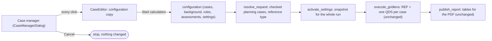

# GridLens Case Manager – Operating Guide

German version: [de/FALLMANAGER.md](de/FALLMANAGER.md)

The case manager is the window GridLens opens when the ComPython runs
(`CASE_SOURCE = 'gui'`). It only **configures** the calculation. It shows no
results: results, violations and charts are in the PDF report that the
existing GridLens publication produces after the calculation. PowerFactory
waits while the window is open; nothing is calculated or changed before
**Start calculation**.

Technology: `tkinter` / `ttk` of the Python that PowerFactory runs, styled
with `ttk.Style` (theme `clam`); `tk.Canvas` only for the timeline. No other
package.

## Layout

The window opens centred at about 86 % of the screen (at most 1480 × 860, never larger than the screen).
**Exactly two tabs**, *Case Manager* and *Settings*; there is no results tab. A status
line and the action bar stay visible on both tabs:

```
 [ Case Manager (1) ] [ Settings ]
+--------------------------------------+------------------------------------+------------------------+
| Available planned outages            | Case A - Summer measures           | Planning cases  2 of 5 |
| In case  Planned outage Equip. Start | 2 case outages · 1 fixed backgr.   | Planning case Outg Stat|
| ☑ in case FS Bedarf 1 NE_L1  ...     | FS Bedarf 1    NE_L1  ...          | Summer         2  ready|
| ☐       FS Bedarf 3    NE_L7  ...    | FS Bedarf 2    NE_L2  ...          | North-east     1  ready|
| [Add to case] [Set as fixed] [Det.]  | [Remove from case] [Details]       | [New][Copy][Delete]    |
|                                      | Timeline of the case               |                        |
+--------------------------------------+------------------------------------+------------------------+
| Calculation                                  | Problems and warnings                                 |
| [x] n-0 - reference QDS                      | Where        Problem                                  |
| [ ] n-1 - reference contingency analysis     | Empty        Not calculated: no planned outage ...    |
| [ ] (n-1)' - ... planned-outage scenarios    |                                                       |
| QDS: ...        [Show calculation preview]   |                                                       |
+----------------------------------------------+-------------------------------------------------------+
 QDS ... · n-0 · 3 of 4 cases ready · 1 problem · default settings
 [Save configuration] [Load saved]                                    [Cancel] [Start calculation]
```

- **Case Manager** – the three panes on top, about 40 % / 38 % / 22 %, dividers draggable.
  Left to right the way an outage travels: from the library, into the
  selected case, which is chosen on the right.
  - **Available planned outages** (left): every planned outage (`IntPlannedout`)
    of the library. The first column *In case* is a **check box**: tick it
    (click or Space) and the outage belongs to the selected case, untick it and
    the assignment ends; `☑ in case`, `☐` free, `fixed` (cannot be ticked), also
    as row colour. Then *Planned outage, Equipment, Start, End, Status*;
    *Add to case* (or Enter) adds all selected rows at once, *Set as fixed
    background*, *Details* (also double-click on a row). Demand transfers
    (`IntOutage`) are not read: they move load and switch no equipment.
  - **The selected case** (centre): title *Case A - name*, the count line *n case outages ·
    m fixed background outages*, the table *Planned outage, Equipment, Start, End,
    Priority*, *Remove from case*, *Details*, and the timeline of the case.
  - **Planning cases** (right) – **at most 5**, the counter *2 of 5 cases* stands above
    the table; at five, *New* and *Copy* are locked. Table *Planning case, Outages*
    (number of outages), *Status* (`ready`, `not calculated`, `excluded`).
    Nobody types an ID: GridLens numbers the cases itself (C1 … C5, the lowest
    free number) and uses that ID only internally (result objects
    `GridLens_<stamp>_C1`, report). Below: *New, Copy, Delete*, *One case
    per planned outage* (creates at most five), and for the selected case
    *Run*. Every case contains only the outages assigned
    directly to it. Copying, editing or deleting a case leaves the others unchanged.
  - **Calculation** (below, left): *n-1 - reference contingency analysis* and
    *(n-1)' - contingency analysis with planned-outage scenarios*. n-0 (the QDS
    of REF and every case) is always calculated and has no control; (n-1)'
    needs n-1 (ticking it ticks n-1). *Results*: *Calculate now*, or
    *Re-evaluate the kept run of <date time>* – then nothing is calculated and
    the kept result objects of that run are assessed again with the current
    settings; a case changed since then is NOT EVALUATED. The choice is not
    saved with the cases. The QDS period of the active ComStatsim and *Show calculation
    preview* (collapsible, see below).
  - **Problems and warnings** (below, right): everything that stops or limits
    the calculation, including invalid settings. The tab label shows the
    number, e.g. *Case Manager (1)*.
- **Settings** – an action bar (*Restore defaults*, *Apply settings*, *Save
  settings*, state of the settings) and six pages:
  - *Network scope*: two lists with **every grid of the model** (inactive ones
    labelled; the summary grid of a study case is not offered) and an element
    list. *Report filter: assessed equipment*: only lines, transformers and
    terminals in the selected grids are assessed (n-0 and the elements watched
    in n-1); none selected = every grid; no effect on the calculation, applies
    in full when a kept run is re-evaluated; *Select all grids*, *Clear
    selection*. *n-1 filter: contingencies by grid*: *Every grid (no filter)*
    or *Own selection*; below, the preview "x of y contingencies … in scope".
    *n-1 filter: outaged elements* (below it in the same card): a searchable
    list of the elements the contingencies outage; only contingencies outaging
    a selected element are calculated, none selected = every element. The n-1
    run sets the contingencies the two n-1 filters leave
    out to *Not analysed* for the run and restores them; in a re-evaluation
    they leave them out of the evaluation. A selection takes effect at once.
    See [`CALCULATION_AND_EVALUATION.md`](CALCULATION_AND_EVALUATION.md).
  - *Limits*: thermal limits (warning thresholds and n-0 limits, lines and
    transformers separately; limit handling for n-1 and (n-1)') and voltage
    limits (one band in p.u. of the nominal voltage for every voltage level,
    default 0.95–1.05 p.u., marked as GridLens proposal; the de-energised
    threshold 0.1 p.u.; post-fault voltage limits read only).
  - *Report and run*: appendix thresholds (1 %-point, 0.005 p.u.), rows of the
    Top-N lists (10), points per time plot (200), the reference case REF
    (on/off), planning cases at most (5, up to 20) and n-1 study times per case
    at most (2000). The case limit acts at once in the Case Manager tab.
  - *Classification*: n-0 change tolerances and the n-1 / (n-1)'
    classification parameters (rules version 1.0).
  - *Contingency analysis*: contingency set, categories, monitored scope,
    AC/DC, islanding, unsupplied load, load shedding, post-fault phases,
    remedial actions – category B, **read only** (`not verified yet`).
    Without a contingency analysis in the study case, GridLens defines one for
    n-1 itself (see *Calculation options*).
  - *QDS time base*: start, end, time step and time definition of the active
    ComStatsim, read only.
  - *Fixed background & rules*: the former tab of that name, unchanged: the
    fixed background outages (Rfix) with *Remove from fixed background* and the
    rules between planned outages with three drop-downs, *Add rule*, *Remove rule*.
- **Status line** (both tabs): QDS period, assessment, ready cases, problem
  count in red, number of settings overrides; a click opens *Case Manager*.

### Settings fields

Every row: *Setting, Value, Unit, Source, Category* and a message. *Source* is
`GridLens` (GridLens default), `PowerFactory` (read from the model or the
calculation configuration – today only the read-only category-B fields, shown
as `not verified yet`), `user` (an applied override) or `edited, not applied`.
*Category* is `A · evaluation` (interprets results, never changes a load flow,
a rating or the model) or `B · calculation` (would change what PowerFactory
calculates; read only until verified).

Each entry is checked while it is typed: finite number, positive limits,
non-negative tolerances, a value from the list for the n-1 limit handling. On
*Apply* also de-energised threshold < minimum < maximum voltage and warning ≤ limit. An
invalid field turns red with its message, the tab reads *Settings (!)* and
*Start calculation* and *Save* refuse with the list of problems. *Start
calculation* and *Save* apply edited values first. *Restore defaults* removes
every override.

Only overrides are stored, under `settings` in the case configuration file.
**This JSON storage is provisional** (part 2); a native storage inside the
PowerFactory project and a stored settings snapshot per run follow once the
probe has identified a suitable object. At the start of a run the settings
are fixed as a snapshot (values, sources, overrides, settings version 1.0,
classification rules 1.0) and named in the log and in the report (*Model
Quality Assurance*, row *Settings*).

### Filtering and sorting – every table

- A **filter row** directly under the column headers: a text field per text
  column (keeps rows that contain the text, any case) and a drop-down per
  category column (*Status*, *In case*, *Rule*; *All* switches it off).
  Filters of several columns combine.
- Under the table: *12 of 48 shown · Clear filters* (only while a filter is
  active).
- A **click on a header** sorts by that column, a second click reverses it
  (▲/▼ after the heading); numbers sort by value.
- Filtering and sorting change only what is shown, never the configuration.
  Header and filter widths follow the table width; on narrow screens every
  column shrinks in proportion.

### Hover help

Resting the mouse on a control for about half a second shows what it does to
the calculation: every button, *Run*, the name and description fields, the case
counter, the column headings with categories (*Status*, *In case*, *Outages*,
*Priority*, *Rule*; each also says how sorting works), every filter field, the
timeline legend, the rule drop-down, n-0, n-1, (n-1)', the QDS period, the
status line and every field and button of *Settings*. The delay is 450 ms; the
text disappears when the mouse leaves, on a click or on a key. Bindings are added
(`add='+'`), never replaced, and a tooltip never starts a calculation. The texts
are in `HELP_TEXTS`, `SETTING_HELP` and `COLUMN_HELP` of `main.py`
(class `Tooltip`, standard library only); the texts for n-0, n-1, (n-1)',
planned outages, QDS time step, contingency set, limits, classification and the
settings follow the master prompt, translated into English.

## Window design and visible guidance

A navy header identifies the planning workspace. The tables use a shared blue-grey
palette, larger native text, 26-pixel rows and distinct selected rows. Instructions
wrap to the pane width; the status line sits above the action row so it cannot
push Cancel or Start calculation out of the window. Ctrl+Tab navigates the tabs.
The first case-table column is a Run flag (☑/☐). Click it or press Space on a focused row to include or exclude that case. Excluded cases remain saved and are omitted from calculation and report. The separate Selected case checkbox panel is removed. The rule editor has labelled,
flexible-width fields. All widgets remain standard Tk/ttk; no new dependency or
animation was added. Both the publisher and standalone GUI test use the same design.

## Independent planning cases

Build every case by assigning its planned outages directly. For example:

- C1: FS North.
- C2: FS South.
- C3: FS North and FS South, both assigned directly.

The same outage can belong to several cases. No case inherits outages from
another case, depends on it or excludes a combination. To create a variant,
copy a case and change the copy. Deleting or excluding C1 leaves C2 and C3 unchanged.

Saved version 1 configurations are converted to version 2 in memory when opened:
formerly inherited outages and their effective own dates become direct assignments;
case dependencies and alternatives are removed. *Problems and warnings* shows a migration
notice if relations were present; saving drops the notice, so it appears only until
the reviewed cases are saved. The original file stays unchanged even then (see below).
Invalid legacy references or cycles are reported with the file path rather than
silently losing assignments.

The rules on *Fixed background & rules* apply between two
**planned outages** in every case: *must not overlap* (windows must not
overlap), *second only after the first* (the second starts after the first
has ended), *only together* (a case with one contains the other and their windows overlap). A case that breaks a rule is not calculated and is reported.

## Keyboard

Every list can be used without the mouse (`KEYBOARD_SHORTCUTS` in `main.py`). On macOS Command works like Ctrl.

| Key | Where | What |
|---|---|---|
| Delete / BackSpace | case list | delete the selected case (asks first) |
| Delete / BackSpace | outages of the case | remove the selected outages from the case |
| Delete / BackSpace | fixed background outages | remove the selected outages from the fixed background |
| Delete / BackSpace | rules | remove the selected rules |
| Space | case list | switch the Run flag of the focused case |
| Space | available outages | tick or untick the focused outage |
| Enter | available outages | add all selected outages to the case |
| F2 / Enter | case list | rename the case in place |
| Ctrl+A | any table | select every shown row |
| Ctrl+N | window | new case |
| Ctrl+F | window | search the available outages |
| Ctrl+S | window | save configuration |
| Ctrl+O | window | load saved configuration |
| Ctrl+Enter | window | start calculation |
| Escape | window | end an in-place edit, otherwise cancel |

## What a click does

| Action | Effect |
|---|---|
| Click a case on the right (`<<TreeviewSelect>>`) | the centre shows its planned outages at once; the left marks them `in case`; name, description, timeline, the other tabs and the status line follow. No extra window. |
| Type into a filter field / choose in a filter list | the table shows only matching rows at once; *Clear filters* shows all again |
| Click a column header | sorts by that column; a second click reverses the order |
| Click a case in a relation list | selects (highlights) or deselects it; the relation applies at once |
| Rest the mouse on a control | after about half a second an explanation appears; it closes when the mouse leaves or on a click |
| Click the status line | opens *Case Manager* |
| Type into a *Settings* field | checked at once: red with the reason when invalid, *edited, not applied* until applied |
| *Apply settings* / *Save settings* / *Restore defaults* | validates and takes the values / also saves the configuration file / removes every override |
| *Show calculation preview* | opens or closes the read-only preview below the problems |
| Tick or untick the box in the first column of the left list (or Space) | that one outage is added to or removed from the selected case at once; a fixed outage cannot be ticked and says why |
| *Add to case* or Enter in the left list | the selected outages are assigned; centre table, outage count, marks and preview update at once. An outage already in the case or fixed is refused with the reason. |
| *Remove from case* or Delete key in the centre | only the assignment ends; the planned outage in PowerFactory is untouched. |
| Double-click in the centre or *Details* | a compact window with what PowerFactory holds for the outage (object, class, equipment, actions, window, priority, status, cases it is used in) and its own dates in this case. |
| *Set as fixed background* | the outage becomes part of the reference and of every case (Rfix). Refused while the outage is assigned to a case, so it never acts twice. |
| *New* | creates *Case n* with the next generated ID (C1 … C5) and selects it; no extra window. Locked at five cases. |
| *Copy* | new generated ID, name *… (copy)*, same outages and own dates; fully independent. Locked at five cases. |
| Double-click a case (or F2 / Enter) in the case list | the name becomes editable right in its row; Enter or a click elsewhere applies, Escape cancels only the edit; an empty name keeps the old one. The generated ID used for result objects stays. |
| Double-click the description next to the case name in the centre | the description becomes editable in place, the same way; without one it reads *(double-click to add a description)* |
| Double-click a row in the left list | the details window of that planned outage |
| *Delete* | asks once and removes only the selected case. Other cases and the PowerFactory planned outages stay unchanged. |
| *One case per planned outage* | replaces the cases by one per outage in the simulated period, at most five (and says so when outages are left out); ignored and fixed outages get none. |
| *Save configuration* / *Load saved configuration* | writes / reads the project's JSON file (cases, fixed outages, rules, settings) with revision, user and time; the project is not touched. |
| *Cancel*, Escape, window close | ends the run: nothing calculated, saved or published, nothing in the project changed. The cancellation is passed to the report caller; the extension does not finish normally and hand control back for rendering. IntReport behaviour still needs verification in PowerFactory. |
| *Start calculation* | applies edited settings, checks (see below), closes the window and hands the configuration to GridLens; then the existing calculation and table publication run. The PDF report is rendered in PowerFactory as a separate step. No result window follows. |

## Timeline

The timeline is a planning check only (no load flow, voltage or other
result). One row per case outage (blue) and per fixed outage (grey); light blue
shading marks times when more than one is active. Overlapping outages are
normal planning: they are neither a warning nor an error. The timeline shows
no dates and no numbers, only the order and the overlap. A long empty period (e.g. between KW10 and KW40)
is drawn as a short light band, so far-apart outages stay readable
(`timeline_scale`).

## Calculation options

- **n-0 – reference QDS**: the base state without planned outages and without
  additional contingencies, with the ComStatsim load and infeed profiles. It is
  always calculated: the report is built on it.
- **n-1 – reference contingency analysis** and **(n-1)' – contingency analysis
  with planned-outage scenarios**: calculated with the contingency analysis
  (ComSimoutage) of the active study case, at the QDS time steps inside the
  outage windows of each case (GridLens writes the period from the first to
  the last of them, `calcPeriod` 4 with `startTime`/`endTime`, for the run). n-1 runs with the fixed outages only, (n-1)' with the outages of the
  case; every result of (n-1)' is classified against n-1 at the same study time
  and contingency. Without a contingency analysis in the active study case
  (e.g. the QDS study case) GridLens creates `GridLens_<stamp>_N1` there, with
  one contingency per line/branch, transformer, reactor, compensation and FACTS
  element of the activated contingency grids – no generators, loads or busbars –
  and keeps it after the run. A contingency whose equipment the case already switches
  off is NOT_APPLICABLE. Until the report has n-1 chapters (part 4) the result
  appears in the log and as row *n-1 <case>* on the Model Quality Assurance
  page.
- **QDS period**: taken from the active ComStatsim and shown only (also on
  *Settings → QDS time base*). There is no time optimisation: no shortened
  window, no segmentation, no extra time step, no changed time step; every run
  covers the complete ComStatsim period.

## Checks on Start calculation

1. The configuration is valid (IDs, outage paths, own dates, outage rules).
2. At least one case can be calculated; otherwise GridLens asks whether to
   calculate the reference only.
3. Cases that cannot be calculated (missing planned outage, broken outage
   rule, outside the period, own dates) are listed with
   their reason; GridLens asks whether to continue and reports them as
   NOT EVALUATED / NOT SIMULATED.
4. Only n-0 is requested.
5. Every setting is valid (edited values are applied first); otherwise the
   *Settings* tab opens with the list of problems and nothing starts.

## Hand-over to GridLens



Separation in the code: `CaseManagerDialog` is the window and keeps only
the selection state; `CaseEditor` holds every editing rule and the
configuration copy (tested without a window); PowerFactory outage references
are the records GridLens read before the window opened; `resolve_request`
turns the configuration into the calculation request; `execute_gridlens`
calculates and `publish_report` publishes. The window never switches
equipment, never writes PowerFactory and never starts a QDS.

## Where the cases come from

| `CASE_SOURCE` | Behaviour |
|---|---|
| `'gui'` (default) | the window, pre-filled with the saved configuration. If `tkinter` cannot open it or it cannot be built: the saved configuration; without one: one case per outage. The report states the source. |
| `'saved'` | the saved configuration, no window |
| `'per_outage'` | one case per planned outage in the simulated period |

Configuration file: `CASE_CONFIG_DIR` (default `~/GridLens/cases`), one per
project, saved as `<project>_<hash>.v2.json`. The schema-1 file `<project>_<hash>.json`
of the delivered gridlens-powerfactory script is only read (as long as no `.v2.json`
exists) and never overwritten, so both versions keep working on the same project. New fields since the redesign: `assessments` (`["n-0"]`), per case
`enabled` (true/false) and `settings` (overrides only, provisional). The field
`mode` of earlier versions (time optimisation) is ignored on reading and no
longer saved. A saved or hand-edited configuration with more than five
cases (e.g. saved by GridLens 8.0) still opens in the case manager, shows *6 of 5
cases* in red and the reason under *Problems and warnings*, so cases can be deleted;
calculating, saving or `CASE_SOURCE = 'saved'` refuse it with that reason; only `CASE_SOURCE = 'per_outage'` (no window)
still creates one case per outage without a limit. A case excluded with *Run* is neither calculated nor
reported; other cases are unaffected.

## What changed against the previous window

| Kept | Changed |
|---|---|
| cases: new, copy, rename, delete, description, one case per outage | case list as a filterable table with FS count and status, **at most 5 cases**, **IDs generated (C1 … C5), never typed**; new case without dialog; rename in place; delete affects only the selected case |
| assignment of outages, an outage in several cases | assignment from a separate list of available outages with search, filter and *Add to case*; the case table shows only the case's outages |
| fixed background outages (Rfix) | own section and own button; a fixed outage cannot also be a case outage |
| – | **removed:** relations between cases; assign outages directly to independent cases |
| rules `not_overlap`, `order`, `together` | added with three drop-downs instead of typed text lines |
| own dates per case (recorded, not applied) | in the details window of the outage |
| save configuration, preview, Cancel, OK | preview as short lines; *Load saved configuration*; OK is now *Start calculation* |
| – | **removed:** Conservative/Optimized choice and the proposal of shorter windows |
| – | **new:** a filter row and header sorting in every table, status line, problem list, timeline, per-case *Run* |
| three tabs (Workspace, Fixed background & rules, Review & start) | **since part 2:** exactly two tabs, *Case Manager* (workspace, calculation choice, problems, collapsible preview) and *Settings* (limits, classification, contingency analysis read only, QDS time base, fixed background & rules); n-0 / n-1 / (n-1)' choice; tooltips on every setting |

## Trying it in PowerFactory

`ui/preview_case_manager.py` is a **separate script**:
it does not load or import `main.py`. Paste it alone into a
ComPython. It carries its own copy of the case manager (the window and what it
needs: reading the planned outages, checking a configuration, the preview), so
it opens exactly this window with the real planned outages of the active
project, read only, and prints what *Start calculation* hands back instead of
calculating. Save and load work on a temporary copy of the configuration. If
the window does not open there, configure the cases where it does and set
`CASE_SOURCE = 'saved'`.

The copy is marked in the file and written by `ui/sync_case_manager_copy.py`
(development tool, not delivered). Whoever changes the case manager in
`main.py` runs `python3 ui/sync_case_manager_copy.py`;
`test_the_copied_case_manager_matches_gridlens_report` fails while the copy is
out of date.

## Case settings preview

*Show calculation preview* on the Case Manager tab opens a read-only, scrollable
preview below the problems (closed by default).
It updates immediately when Run flags or case settings change. Each ready case
lists its name, description, planned outages and effective time windows, n-0
assessment, full QDS period and shared background. The common settings name the
reference, background outage windows, planning rules and the settings
overrides and the chosen assessments. Identical cases show
which result is planned for reuse. Blocked cases show their reason; cases with
the Run flag off are listed separately as excluded. Previewing starts no calculation.
