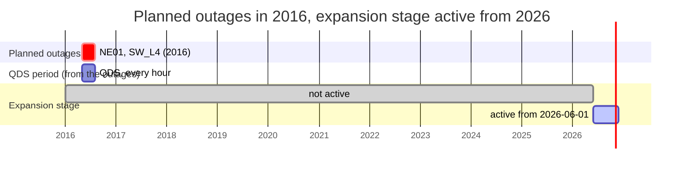
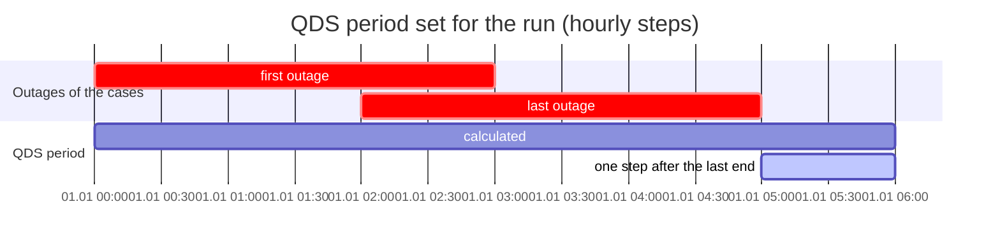
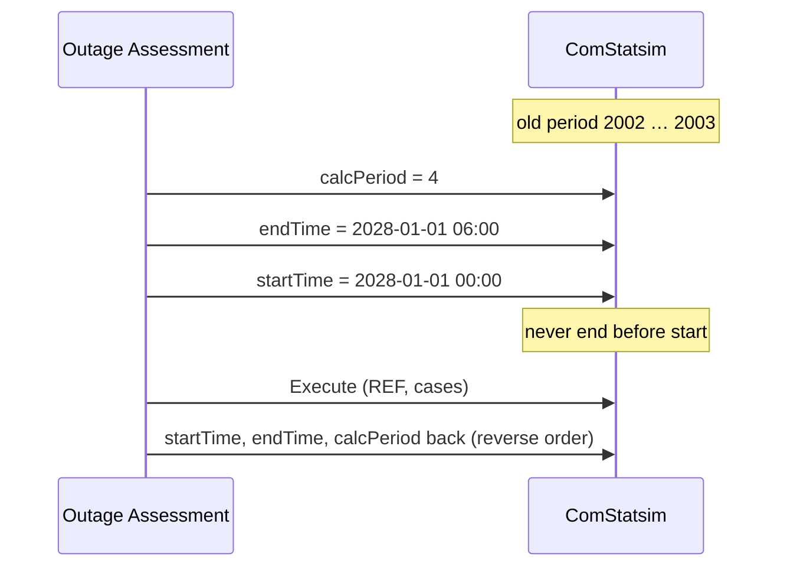
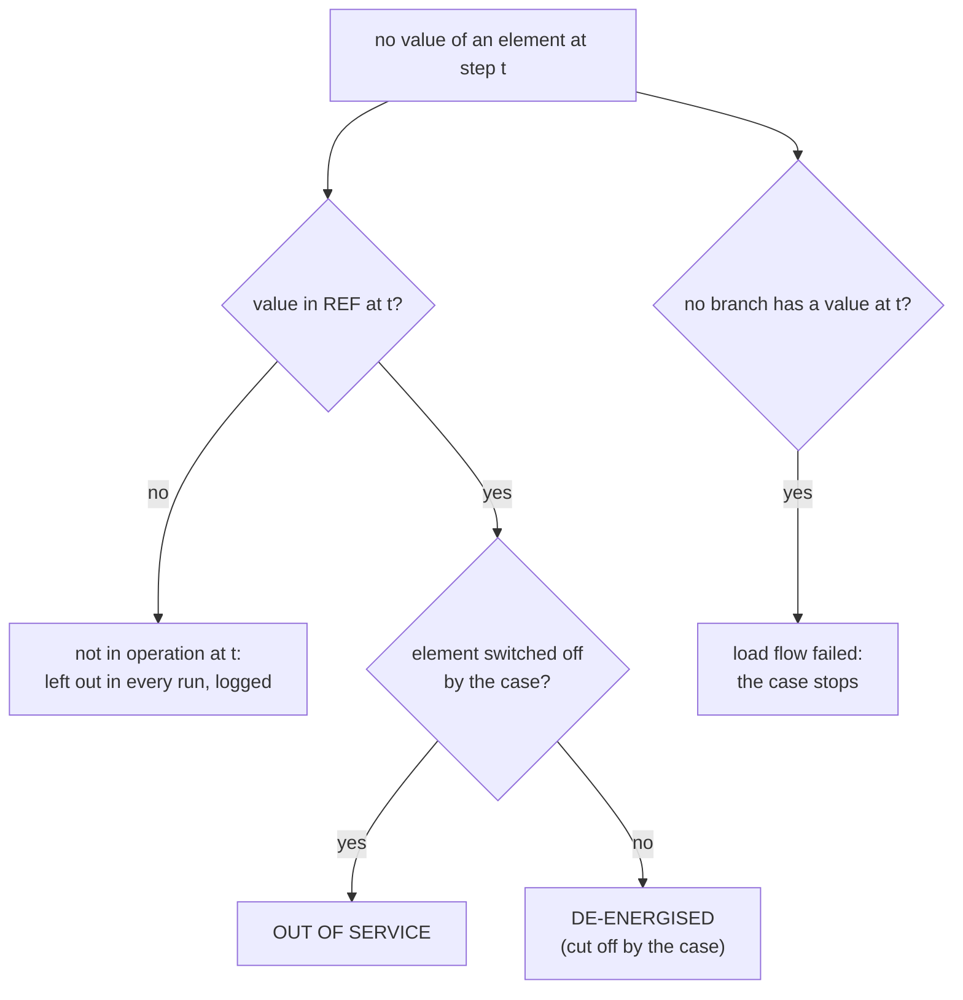

# Pitfalls and how Outage Assessment handles them

PowerFactory and its report engine behave in ways that are easy to miss and
that change results or break a run. This page collects every such case met in
real runs, what goes wrong and what the tool does about it. The architecture
([ARCHITECTURE.md](ARCHITECTURE.md)) describes the normal sequence; this page
describes the traps around it.

Contents:

1. [Expansion stages and the QDS period](#1-expansion-stages-and-the-qds-period)
2. [Which period the QDS really calculates](#2-which-period-the-qds-really-calculates)
3. [Setting the QDS period from the planned outages](#3-setting-the-qds-period-from-the-planned-outages)
4. [Applying planned outages](#4-applying-planned-outages)
5. [Values that are missing](#5-values-that-are-missing)
6. [Result objects](#6-result-objects)
7. [State that PowerFactory changes during a run](#7-state-that-powerfactory-changes-during-a-run)
8. [Reading results fast](#8-reading-results-fast)
9. [Contingency analysis (n-1)](#9-contingency-analysis-n-1)
10. [Report engine (Stimulsoft)](#10-report-engine-stimulsoft)
11. [Python inside PowerFactory](#11-python-inside-powerfactory)

---

## 1. Expansion stages and the QDS period

**Problem.** An expansion stage of a network variation becomes active at its
*activation time*. The QDS evaluates the variation at every time step: a step
before the activation time sees the network **without** the stage. When the
planned outages lie in another year than the stage, the stage never becomes
active in any run.

**What to know.**

- The PowerFactory message *'Recording' expansion stages at study time …*
  names the stage that **records changes** at the current study case time. It
  says nothing about the stages active during the QDS.
- An element that exists only from an activation time on has no value before
  it (section 5). The log table *Time-dependent operation* lists when elements
  get or lose their values.
- **What to do:** keep the planned outages and the activation times in the
  same period: either the activation time inside the outage period or the
  outages in the year of the stage.

---

## 2. Which period the QDS really calculates

**Problem.** `ComStatsim` keeps several period definitions side by side. Only
the one selected by *Time period* (`calcPeriod`) is calculated; the others keep
old values. Reading `startTime`/`endTime` alone gave 2002–2003 for a QDS set to
one day in 2028, and every planned outage counted as outside the period.

| `calcPeriod` | Period PowerFactory calculates | Read by the tool |
|---|---|---|
| 0 | the day in `date` (YYYYMMDD, 00:00) plus `stepNumber` steps | yes |
| 4 | user-defined `startTime` … `endTime` | yes |
| other | not verified | period left unknown; outages are judged against the result time axis, with a warning |

`powerfactory_tests/inspect_qds_period.py` prints every time-like attribute of
the `ComStatsim` and the period the tool reads, without changing anything.

---

## 3. Setting the QDS period from the planned outages

By default (*QDS period* = *first to last planned outage*) the tool sets the
period for every run itself, so that REF and every case cover exactly the same
time. Three details matter:

1. **No step before the first outage.** No outage acts there, and the step can
   fall into another network state. A step at 2027-12-31 23:00 lay before an
   expansion stage that starts on 2028-01-01; a transformer of that stage had
   no loading value there and stopped the run.
2. **One step after the last end.** PowerFactory can show the effect of an
   outage in the step right after its window (an outage 00:00–01:59 changed the
   result at 02:00). That step is calculated and assessed.
3. **Write order.** PowerFactory checks every single write of `startTime` and
   `endTime` (*End date must not be before beginning of the time period*). A
   new period after the old end gets its end first; restoring in reverse order
   then also passes only valid periods.

Fixed background outages do not extend the period; a fixed outage lasting
months would otherwise make every run that long.

---

## 4. Applying planned outages

- `IntPlannedout` has **no** `Apply`, `Reset` or `Check` in PowerFactory 2026.
  PowerFactory applies an outage during the QDS when *Planned Outages*
  (`iopt_maint`) is on, the outage is not *Ignored* (`outserv = 0`) and the time
  step lies in its window. The tool chooses the outages of a case only through
  `outserv` and restores every flag afterwards.
- PowerFactory resets the outage after the run (*Outage … reset*) and may leave
  switches in another state. The tool logs every switch that changed; it never
  switches itself.
- An outage whose components stay without load after its window is reported
  as *in effect after its window*, with the duration.

---

## 5. Values that are missing

PowerFactory writes no value (NaN) for an element at a time step when it is not
in operation (expansion or switching stage), when a case switches it off or
cuts it off, or when the load flow fails. A missing value is never 0.

- A value in the case without one in REF is assessed alone (EXCEEDED above the
  limit), so a newly connected overloaded element is never overlooked.
- n-1: a cell is left out when REF n-0 has no value at that time; a value only
  in n-1 and none in (n-1)' is NOT_EVALUATED with that cause, never IMPROVED.
- A voltage below *De-energised below* (0.1 p.u.) or NaN counts as
  de-energised, not as a value.

---

## 6. Result objects

- PowerFactory writes each QDS into **its own** result object of the study case
  and overwrites it with the next run. The tool copies it right after each run
  (`AddCopy`) as `OA_<stamp>_<case>`; the copies stay.
- PowerFactory names are limited to about 40 characters. The prefix `OA_`
  keeps names such as `OA_261029-214330_<case>_N1P` short enough.
- When `ComStatsim.results` is empty, the REF run lets PowerFactory bind its
  own result object; if it binds none, the tool creates an empty `ElmRes`
  *Quasi-Dynamic Simulation AC*, binds it, calculates REF once more and leaves
  it bound.
- A binding to a kept `OA_…` copy stops the run before any change: the next
  QDS would overwrite a kept result.

---

## 7. State that PowerFactory changes during a run

| What changes | Who changes it | Handling |
|---|---|---|
| study case time | PowerFactory moves it to the last calculated step | restored after every run |
| switch states | PowerFactory, when it resets an outage | logged, not changed back |
| `iopt_maint`, QDS period, `outserv` | the tool | restored and read back; a value that cannot be restored stops the run |
| `ComStatsim.results` | PowerFactory (own binding) or the tool (only when empty) | left as it is, logged |

---

## 8. Reading results fast

`ElmRes.GetColumnValues` reads a whole column in one call, but needs an
`IntVec`. The tool creates it in the running script and deletes it at the end
of the evaluation. When PowerFactory refuses that (*cannot create IntVec*,
e.g. a script in a read-only place), every value is read on its own: the same
results, much slower. The run summary counts both ways.

---

## 9. Contingency analysis (n-1)

- With `calcPeriod = 4` the sweep calculates `startTime` … `endTime`
  (exclusive) and ignores the `studyTime` vector, even when it reads back
  unchanged. The tool writes that period for every sweep.
- `isPlannedOutages` drops exactly the contingency whose equipment a planned
  outage already switches off; it is NOT_APPLICABLE, not FAILED.
- Contingencies outside the n-1 filter are set to *Not analysed* (`outserv`)
  for the sweep and restored afterwards.
- `c:maxCntcy` does not help to find the critical contingency.

---

## 10. Report engine (Stimulsoft)

| Pitfall | Rule in the report pages |
|---|---|
| whitespace between an empty list's tags is read as a string; the designer stops with `InvalidCastException` | empty lists are self-closing |
| data relations are not applied to charts; a chart would draw the data of every master row | every chart reads its own table with only its rows |
| the palette of a chart style carries no meaning | colours are fixed per series or set by `Conditions` |
| charts are drawn at export with the Windows culture, which `Culture=en-US` does not reach | no axis prints a decimal separator: loading axes as integers, count axes without labels |
| table and field names with digits were missing in the report database | names without digits |
| a wrapping name breaks the row grid | data cells `GrowToHeight=True` |
| range (Gantt) charts: the end column was not drawn in PowerFactory 2026 SP1 – a window appeared from 0 to its start | stacked bars instead: an invisible bar up to the start, then the window (`duration_hours`) |
| a category axis with `StartFromZero=False` cuts the first and last bar in half and drops their labels | `StartFromZero=True` on every category axis |
| values above points or columns (`OutsideEnd`) are cut at the top of the plot | values inside the column (`InsideEnd`) |
| colour by a threshold in the page would be fixed while the limits are settings | the script splits the value into one series per class (`value_ok`, `value_warning`, `value_over`) |

---

## 11. Python inside PowerFactory

- Never delete or release the `Application` object (`del app`, garbage
  collection): it closed PowerFactory. The warning about the unattended mode
  is accepted instead.
- Times are epoch seconds and shown in the local time of the computer.
- Runtime code uses only the standard library and `powerfactory`.
