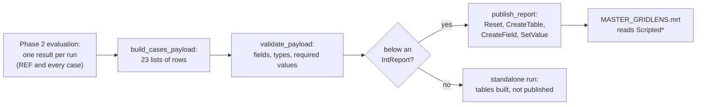

# GridLens – how every Scripted table is calculated and built

GridLens publishes **38 tables** (data contract 7.0) that both report templates
read: `MASTER_GRIDLENS` (main report, chapters H01–H10) and
`MASTER_GRIDLENS_DETAIL` (technical detail report, D01–D13), kept as pages in
`powerfactory/pages/<report>/` (`.dct` dictionary and one `.pg` per page). Each template
shows its chapters; for the same run ID both print the same statistics. This document describes, table by table, where
each row comes from, how every field is calculated and which report chapter
shows it. As of 26 October 2026, publisher 8.0.0. German version:
[`docs/de/BERICHTSTABELLEN.md`](de/BERICHTSTABELLEN.md); both are maintained
together. Calculation and evaluation as such:
[`CALCULATION_AND_EVALUATION.md`](CALCULATION_AND_EVALUATION.md).

Function names in `code` refer to `powerfactory/gridlens_report.py`.

---

## 1. From the results to the report

1. **Phase 2** produces one *result* per run: REF and every planning case, each
   with its series (one per element and variable), their statistics and, for a
   case, the comparison with REF at the same time steps and its verdict.
2. **`build_cases_payload`** turns these results and the request (cases,
   outages, settings) into 23 lists of rows, in the order of section 3.
3. **`validate_payload`** checks every row: only declared fields
   (`TABLES`), the right type (string, integer, finite number), every required
   field (`REQUIRED_FIELDS`) filled, exactly one row in `ScriptedReportMeta`,
   one element per trend table. Texts are shortened to 80 characters for names
   and 500 for other texts and end with "…".
4. **`publish_report`** (only below an `IntReport`): `Reset()` exactly once,
   then per table `CreateTable(name)` with the name **without** the prefix
   `Scripted` (PowerFactory adds it), `CreateField` per field and `SetValue` per
   filled cell. A table with more than 5000 rows is cut and a `FAIL` row is
   added to the model quality page (`_enforce_table_limits`).

---

## 2. Terms used by every table

| Term | Meaning |
|---|---|
| **REF** | the reference run: R0 (no planned outage) or Rfix (only the fixed outages) |
| **case** | a planning case; *calculated* cases are those whose QDS converged |
| **series** | one element with one variable over time: lines and transformers `c:loading`/`m:loading` in %, terminals `m:u`/`m:u1` in p.u. |
| **statistics** | per series over the **whole** period: minimum, maximum, mean and the time of the minimum and maximum (`statistics`) |
| **critical** | loading strictly above the limit (*Maximum loading for n-0*, lines and transformers separately), voltage strictly outside the band (`is_critical`) |
| **time-aligned record** | one element of a case next to the same element in REF, compared at the same time steps inside the outage windows and wherever they differ (`compare_case`); carries the step status, the coincident delta and the caused hours |
| **step status** | `NEW`, `WORSENED`, `PRE-EXISTING`, `IMPROVED`, `RESOLVED`, `EXCEEDED`, `DE-ENERGISED`, `OK`; an element gets the most severe one |
| **verdict** | per case one of `NO LIMIT EXCEEDED`, `NO ADDITIONAL VIOLATION`, `OVERLOAD`, `VOLTAGE BAND`, `OVERLOAD + VOLTAGE BAND`, `DE-ENERGISED NODES`, `INCOMPLETE COVERAGE`, … (`assess_case`, stored once per case and used by every table) |
| **violation** | 1 (red): the case caused it (`OVERLOAD`, `VOLTAGE BAND`, both); 2 (yellow): attention (`NO ADDITIONAL VIOLATION`, `DE-ENERGISED NODES`, `INCOMPLETE COVERAGE`); 0: none |
| **report filter** | only elements of the selected grids become series at all; every table sees only them |

**The verdict of a case** (`assess_case`), in this order:

1. a caused overload (`NEW`, `WORSENED` or `EXCEEDED` of a line or transformer) and a caused voltage violation → `OVERLOAD + VOLTAGE BAND`;
2. only a caused overload → `OVERLOAD`; only a caused voltage violation → `VOLTAGE BAND`;
3. a node de-energised by the case → `DE-ENERGISED NODES`;
4. the outage time is not completely covered by result rows (< 99.9 %) → `INCOMPLETE COVERAGE`;
5. a violation that already exists in REF (`PRE-EXISTING`, `IMPROVED`) → `NO ADDITIONAL VIOLATION`;
6. otherwise → `NO LIMIT EXCEEDED`.

A case without any result row inside its windows gets `NO RESULT DATA IN
WINDOW`; missing or incomplete results never lead to `NO LIMIT EXCEEDED`.

**Matrix tables** put REF and up to six cases side by side (`_matrix_tables`).
Every row repeats the block number (`block`, cases 1–6, 7–12, …), the number
of case columns of its block (`col_count`), the case names (`case_a_name` …
`case_f_name`) and their texts (`case_a_text` … `case_f_text`); the report has one band
pair per column count. Used by `ScriptedCaseComparison`,
`ScriptedTopLinesByCase` and the three appendix tables.

**Chart tables in wide format** draw REF and the first six cases with fixed
colours: slot `ref` is REF (grey), slots `a`–`f` the cases (`series_ref_name`,
`series_a_name` … `series_f_name`, `value_ref`, `value_a` … `value_f`). Used by
`ScriptedRadar` and the two trend tables.

**No field name contains a digit** (since contract 6.1). With contract 6.0 the
tables whose fields carried digits (`c1_text`, `s0_name`, `v0`, …) were missing
from the report database opened in the Stimulsoft designer, while every other
table was there.

---

## 3. The tables

### 3.1 `ScriptedReportMeta` – cover, header, statements

**Chapter:** cover, table of contents, header and footer of every page.
**Rows:** exactly one.

| Field | Calculation |
|---|---|
| `run_id` | stamp of the result objects the run keeps or re-evaluates (`GridLens_<stamp>_…`); in every page header of both reports |
| `study_name`, `study_description` | name and description of the active study case (the cover shows no Study ID) |
| `model_name` | name of the project |
| `model_version` | `PowerFactory 2026` |
| `simulation_start`, `simulation_end` | first and last time label of the first converged run |
| `simulation_time_step` | difference of the first two time steps, e.g. `1 h` |
| `generation_date`, `generated_by` | local time of the run, Windows user |
| `run_mode` | `REFERENCE + PLANNING CASES` |
| `template_name`, `template_version`, `data_contract_version` | constants of the script (MRT 7.0.0, contract 7.0) |
| `result_name` | the configured result object |
| `assessment_scope` | number of planning cases, name of REF, report filter text |
| `assessment_status` | `PRE-ASSESSMENT - NOT AN OPERATIONAL RELEASE` |
| `voltage_limits` | text of the voltage band from the settings |
| `has_cases` | `1` when at least one case was calculated |
| `case_source_text`, `reference_text`, `qds_mode_text` | where the cases come from, R0/Rfix, the fixed QDS time base |
| `coverage_statement` | statement A (effect of the outages) and statement B (absolute network state, only REF) |

### 3.2 `ScriptedModelQuality` – model quality page

**Main 4** Calculation Quality, **detail 14** Quality and Error Register. **Rows:** one per check, in this order
(`build_cases_payload`, `_model_quality`):

| Check (`check_id`) | Status rule |
|---|---|
| `planned_outages` | PASS when at least one outage is assigned to a case; message: found, assigned, not calculated |
| `cases` | PASS when every run converged and has series |
| `case_<id>` | FAIL per run that did not converge |
| `case_configuration` | WARNING when a case is not ready |
| `request_warning_<n>`, `case_warning_<id>` | warnings from the case configuration |
| `coverage` | WARNING when a case covers less than 99.9 % of its outage time |
| `outside_window` | WARNING when a case differs from REF outside its windows |
| `series_line`, `series_transformer`, `series_voltage` | evaluated and critical elements per kind |
| `voltage_data` | INFO: DC nodes and nodes without voltage left out |
| `deenergized` | WARNING: nodes de-energised by a case |
| `time_variation` | WARNING when every series is constant (profiles missing) |
| `reference_comparison` | PASS when a converged REF exists |
| `qds_mode` | INFO: complete ComStatsim period |
| `security_scope` | WARNING: what the report does not prove (n-1 security, protection, …) |
| `limit_loading`, `limit_voltage` | INFO: the limits used |
| `network_scope` | INFO: report filter and contingency scope |
| `settings` | INFO, or WARNING when settings differ from the GridLens defaults |
| `outages_<case>` | did each outage take effect (`APPLIED`, `EFFECT SEEN`, `NO EFFECT`, `NOT CHECKABLE`) |
| `outages_after_<case>` | an outage that stays in effect after its window |
| `n1_<case>` | (n-1)' against n-1: counts per status; FAIL when the case causes `NEW` or `WORSENED`, WARNING when results are missing (details in main chapters 10–12 and the detail registers) |
| `table_limit_<table>` | FAIL when a table was cut at 5000 rows |

`affected_element` names the case or element concerned, `-` otherwise. The
n-1 results are detailed in the contract 7.0 tables (sections 3.22–3.43).

### 3.3 `ScriptedCases` – calculated cases and planned outages

**Main 5** (planned outage planning) **and 6** (case definition and network states).
**Rows:** REF (`case_order` 0), then every planning case in the order of the
configuration, then every planned outage outside the simulated period
(`case_id` `N/A`) (`_case_rows`).

| Field | REF | Planning case |
|---|---|---|
| `case_id`, `case_name` | `REF`, `Reference` | id and name of the case |
| `is_reference` | 1 | 0 |
| `simulation_status` | status of the run | status of the run, or of the case when it was not calculated |
| `period_text` | first to last time label | from the earliest start to the latest end of its windows |
| `priority` | 0 | highest priority of its outages |
| `equipment_name` | `No planned outage` or the fixed outages | the switched equipment of its outages |
| `assessment` | `BASELINE` | the verdict, or `NOT SIMULATED` / `NOT EVALUATED` with the reason |
| `assessment_detail` | max line loading and voltage range of REF | the sentences behind the verdict (`assessment_detail`): max loading with element, time and REF value, largest coincident increase, overload counts, voltage range, de-energised nodes, caused hours, spill-over, coverage |
| `violation` | 0 | 0, 1 or 2 from the verdict |
| `case_description`, `outage_names` | | description and outages of the case |
| `states_text`, `windows_text` | | network states (active set between window boundaries) and windows |
| `coverage_text` | `full period` | share of the outage time covered by result rows |
| `provenance_text` | `CALCULATED` | `CALCULATED`, `REUSED (…)` or `NOT CALCULATED` |

### 3.4 `ScriptedCaseMetrics` – metric view

**Main 9** n-0 Case Comparison. **Rows:** REF (order 0) and every calculated case
(`_case_metrics`).

| Field | Calculation |
|---|---|
| `max_line_text`, `max_line_element` | highest line maximum over the whole period, and its line |
| `coincident_delta_text` | largest **coincident** increase of a line: `max over t (case(t) − REF(t))` inside the assessed steps, with the line; REF: `-` |
| `maxima_difference_text` | for the same line: maximum of the case minus maximum of REF |
| `violation_hours_text` | duration of the violations the case caused, weighted with the time steps |
| `voltage_range_text` | lowest minimum to highest maximum of every node |
| `coverage_text` | share of the outage time covered by results; REF: `full period` |

### 3.5 `ScriptedKpis` – the two cards of the metric view

**Main 3** Overall Technical Assessment. **Rows:** one (none when no line was evaluated).

- `highest_text`: the highest line maximum of all rows of 3.4 with its line;
  `highest_violation` 1 when it exceeds the line limit.
- `delta_text`: the largest coincident increase of all cases above the change
  tolerance (*n-0 change tolerance, loading*), with the case; otherwise
  `no increase`.

### 3.6 `ScriptedPieLines` and `ScriptedPieTransformers` – reference pies

**Main 7** Base Network Reference. **Rows:** three each, the loading classes of
**REF** (`_pies`, `loading_classes`): *up to the warning threshold*, *warning
threshold to limit*, *above the limit*. `element_count` counts the lines or
transformers whose REF maximum falls into the class. The pies colour the
classes through conditions on `class_label`.

### 3.7 `ScriptedReferenceExceeded` – overloads already in REF (removed in 7.0)

Removed in contract 7.0: replaced by the n-0 rows of `ScriptedReferenceFindings` (3.27), which also name warnings and voltages.

### 3.8 `ScriptedCaseCounts` – critical elements per case

**Main 9** n-0 Case Comparison (chart). **Rows:** REF and every calculated case
(`_case_counts`). `line_count`, `transformer_count`, `node_count`: number of
elements critical over the whole period in this run (`_violation_counts`).

### 3.9 `ScriptedRadar` – radar comparison (removed in 7.0)

Removed in contract 7.0: the assignment removes radar plots; the counts stay in `ScriptedCaseCounts` (3.8).

### 3.10 `ScriptedLineLoadingBars` – top lines over all runs

**Main 9** (top lines chart). **Rows:** *Top-N* (setting,
default 10) lines with the highest maximum in **any** run (`_line_bars`).
`max_value` is that maximum, `case_name` the run it occurred in.

### 3.11 `ScriptedTrendMostLoaded` – time plot of the most loaded line (removed in 7.0)

Removed in contract 7.0: the assignment removes time plots with Reference and up to six cases.

### 3.12 `ScriptedTrendLargestDelta` – time plot of the largest coincident delta (removed in 7.0)

Removed in contract 7.0: as 3.11.

### 3.13 `ScriptedCaseComparison` – case comparison summary

**Main 9.** Matrix table with nine key figures as rows and REF plus the
cases as columns (`_case_comparison`, `COMPARISON_ROWS`):

| Row | Case column | REF column |
|---|---|---|
| New overloads | number of lines/transformers with status `NEW` | `-` |
| Worsened overloads | number with `WORSENED` | `-` |
| Pre-existing or improved overloads | number with `PRE-EXISTING` or `IMPROVED` | `-` |
| Max. coincident loading increase | largest coincident delta in pp | `-` |
| New or worsened voltage violations | number of nodes with `NEW` or `WORSENED` | `-` |
| Nodes de-energised by the case | number with `DE-ENERGISED` | `-` |
| Duration of caused violations | caused hours | `-` |
| Outage time covered by results | coverage | `full period` |
| Assessment | the verdict | `BASELINE` |

`violation` is 1 for a row in which at least one case caused something.

### 3.14 `ScriptedCalculationRuns` – calculation evidence

**Main 13**, **detail 15.** **Rows:** every run (REF and every case), then every planning
case that was not run (`_calculation_runs`).

| Field | Calculation |
|---|---|
| `run_kind` | `REFERENCE`, `CASE`, `… (reused)` or `NOT RUN` |
| `reference_text` | for REF R0/Rfix, for a case `REF` |
| `period_text`, `time_steps` | first to last time label, number of time steps |
| `elapsed_text` | QDS time in s; `-` for a reused run, `0.0 s` for a run re-evaluated from its kept result object |
| `status`, `provenance_text` | status of the run; `CALCULATED`, `REUSED` or `NOT CALCULATED` |
| `result_object` | the kept result object `GridLens_<stamp>_<case>` |
| `note` | what was applied (`iopt_maint=1; active: …`) or that the run was re-evaluated from the kept result object |

### 3.15 `ScriptedTopLinesByCase` – top lines per case

**Detail 17** (appendix page). Matrix table: row *n* holds, per run, the line with the n-th
highest maximum in this run as `name - max %` (`_top_lines_by_case`); up to
*Top-N* rows, ending when no run has a further line.

### 3.16 `ScriptedAppendixLine` and `ScriptedAppendixTransformer` – appendices A and B

**Detail**, appendices A (lines) and B (transformers). Matrix tables with one
row per element that matters (`_loading_appendix`): its maximum in any run is
at or above the warning threshold, **or** its maximum differs from REF by at
least *Appendix: loading change* (setting) in a case. The cell is the maximum
of the element in that run. Sorted by the highest maximum, then name.
`violation`: 1 when a case causes a violation of the element, 2 when it already
exists in REF.

### 3.17 `ScriptedAppendixVoltage` – appendix C

**Detail**, appendix C (node voltages). One row per node that matters
(`_voltage_appendix`): a status other than `OK` in a case, **or** a minimum that
differs from REF by at least *Appendix: voltage change*. The cell is the
minimum voltage in that run (p.u.). Sorted by the largest excess beyond the
band, then name.

### 3.18 `ScriptedContingencyCases` – n-1 summary per case (removed in 7.0)

Removed in contract 7.0: replaced by `ScriptedCaseStatistics` and `ScriptedCoverage` (3.22, 3.24).

### 3.19 `ScriptedContingencyCounts` – chart of the n-1 summary (removed in 7.0)

Removed in contract 7.0: replaced by `ScriptedCaseStatusCounts` (3.23).

### 3.20 `ScriptedContingencyFindings` – n-1 findings per element (removed in 7.0)

Removed in contract 7.0: replaced by the element matrices and `ScriptedContingencyEvents` (3.28–3.39); the cut at 40 rows per case is gone.

### 3.21 `ScriptedContingencySkipped` – contingencies not applicable (removed in 7.0)

Removed in contract 7.0: the not applicable contingencies are counted in `ScriptedContingencyRegister` (3.37) and `ScriptedCoverage`.

### 3.22–3.43 Contract 7.0: the statistics of the reporting core

Built by `_reporting_tables` from the statistics every evaluated case carries
(`evaluate_n1_case`: `statistics` = `compare_scenario` of (n-1)' against n-1,
or of n-1 with itself when only n-1 was calculated; `reference_statistics` =
`level_statistics` of the n-1 reference), all over the study times inside the
case's outage windows (the requested times). The n-0 rows come from the QDS
results. Every count is taken from the complete statistics before any display
limit. Cells = study time x contingency x element x criterion; elements =
distinct equipment.

| # | Table | Report and chapter | Rows | Built by | Rule |
|---|---|---|---|---|---|
| 3.22 | `ScriptedCaseStatistics` | main 3, 8 | per case and level (n-0, n-1, (n-1)') | `_case_statistics` | critical lines/transformers/nodes, distinct NEW/WORSENED elements, findings per status, critical contingencies and study times, episodes, completeness; `assessment` for (n-1)': NEW OR WORSENED FINDINGS, INCOMPLETE COVERAGE, NO ADDITIONAL VIOLATION or NO LIMIT EXCEEDED |
| 3.23 | `ScriptedCaseStatusCounts` | main 8 (stacked columns) | per (n-1)' case | `_case_status_counts` | NEW, WORSENED, IMPROVED, RESOLVED findings |
| 3.24 | `ScriptedCoverage` | main 4, detail 3 | per case and level | `_coverage` | three axes: requested/calculated study times, defined/applicable contingencies, required/evaluated cells and the cells per quality status |
| 3.25 | `ScriptedScope` | detail 3 | per case, level, grid, voltage level, class | `_scope` | monitored, critical and not completely evaluable elements |
| 3.26 | `ScriptedOutageWindows` | main 5 (Gantt and table), detail 4 | per planned outage of every case | `_outage_windows` | PowerFactory path, equipment, start, end; Gantt hours from the first outage start |
| 3.27 | `ScriptedReferenceFindings` | main 7 (top 10 per level and criterion), detail 5 (every n-0 row) | per element and criterion at or above warning or beyond the limit | `_reference_findings` | n-0 from the QDS REF, n-1 from the reference extremes; thermal and voltage apart |
| 3.28–3.30 | `ScriptedCriticalLines`, `…Transformers`, `…Nodes` | main 10 | up to 20 / 15 / 20 conspicuous elements, most critical first | `_critical_elements` | n-1 reference extreme with limit, absolute (n-1)' extreme per case with counters N/W/P/I/R/Q; "shown x of y" in `critical_note` |
| 3.31–3.34 | `ScriptedDetailLines`, `…Transformers`, `…VoltageLow`, `…VoltageHigh` | detail 6–9 | every conspicuous element, by grid and voltage level | `_detail_matrices` | each extreme with its study time and contingency; blocks of three cases |
| 3.35 | `ScriptedClassificationMatrix` | detail 10 | per conspicuous element and criterion | `_classification` | counters per case as text ("N 4 · W 2"), blocks of three |
| 3.36 | `ScriptedClassificationCounts` | removed | – | – | no template showed it; the counters come from `element_counters` when needed |
| 3.37 | `ScriptedContingencyRegister` | detail 11 | per case and contingency with a finding or quality status | `_contingency_register` | examined, not applicable, failed and missing study times; affected elements, critical times, worst finding |
| 3.38 | `ScriptedContingencyRanking` | main 11 (columns) | top 10 contingencies | `_contingency_register` | critical findings over every (n-1)' case |
| 3.39 | `ScriptedContingencyEvents` | main 11 (`main_rank` > 0: top 10 per criterion), detail 12 (all listed) | the prioritised selection per case (up to 500) | `_contingency_events` | complete comparison key, n-1 and (n-1)' value, limit, violation, coincident change, status; `events_note` names "x of y" |
| 3.40 | `ScriptedContingencyEpisodes` | detail 13 | every critical episode | `_episodes` | first and last examined study time, points, peak |
| 3.41 | `ScriptedQualityRegister` | detail 14 | per case, quality status, cause and contingency | `_quality_register` | study time range and cells; cases not evaluated as a whole |
| 3.42 | `ScriptedTimeCriticality`, `ScriptedTimeMatrix` | main 12 | per actual study time | `_time_criticality` | with n-1: distinct critical elements in n-1 and in (n-1)' over every case (two series), per case E = critical elements, C = critical contingencies. Without n-1 (n-0 with planned outages only): Reference and all cases per QDS time step (`critical_steps`, kept before the value arrays are released; the chart takes the largest count since the previous plot point), the table lists the steps where a case has other critical elements than Reference |
| 3.43 | `ScriptedAssessmentSettings`, `ScriptedResultProvenance` | main 13, detail 15 | per setting; per result object | `_assessment_settings`, `_result_provenance` | value, unit, origin, status; object name and PowerFactory path where known |

**Only what is printed is saved.** `UNPUBLISHED_FIELDS` lists, per table, the fields the script computes for itself
(summaries, log, checks) that no template shows; they are neither declared to PowerFactory nor written. Unused
scenario slots of a matrix row are left empty (not written), and the detail matrices declare only three slots. A test
fails when a declared field is used by neither template.

**Cuts.** No register is cut in case order. When a table would exceed `MAX_TABLE_ROWS`, `_fair_cut` shares the rows
between the cases (each keeps its most severe rows) and `_block_rows` keeps the same, most severe rows in every
scenario block; the cut is named in `ScriptedModelQuality` and every count still includes the rows left out. Only
the top rows of the n-1 reference findings are published (the detail report shows the n-0 rows). Every planning
case keeps its rows, also when its QDS or its n-1 failed (`planning_results`); `ScriptedQualityRegister` also holds
NOT APPLICABLE per contingency.

`ScriptedReportMeta` (7.0) adds `run_id` (shown in every page header),
`overall_text`, `critical_note`, `events_note` and `empty_tables` (the tables
without rows; the templates show an empty-state note by it) and drops
`study_id`, `chart_cases` and `radar_note`. `has_contingency` and
`contingency_text` stay.

---

## 4. Chapters and their tables

**Main report** (`MASTER_GRIDLENS.mrt`):

| Chapter | Tables |
|---|---|
| 1, 2 Cover, table of contents | `ScriptedReportMeta` |
| 3 Overall Technical Assessment (H02) | `ScriptedKpis`, `ScriptedCaseStatistics` |
| 4 Calculation Quality (H03) | `ScriptedCoverage`, `ScriptedModelQuality` |
| 5 Planned Outage Planning (H04) | `ScriptedCases`, `ScriptedOutageWindows` (Gantt and table) |
| 6 Case Definition and Network States | `ScriptedCases` |
| 7 Base Network Reference (H05) | `ScriptedPieLines`, `ScriptedPieTransformers`, `ScriptedReferenceFindings` |
| 8 Scenario Comparison (H06) | `ScriptedCaseStatistics`, `ScriptedCaseStatusCounts` |
| 9 n-0 Case Comparison | `ScriptedCaseMetrics`, `ScriptedCaseComparison`, `ScriptedCaseCounts`, `ScriptedLineLoadingBars` |
| 10 Critical Equipment (H07) | `ScriptedCriticalLines`, `ScriptedCriticalTransformers`, `ScriptedCriticalNodes` |
| 11 Critical Contingencies and Findings (H08) | `ScriptedContingencyRanking`, `ScriptedContingencyEvents` |
| 12 Time Criticality (H09) | `ScriptedTimeCriticality`, `ScriptedTimeMatrix` |
| 13 Settings and Evidence (H10) | `ScriptedAssessmentSettings`, `ScriptedResultProvenance`, `ScriptedCalculationRuns` |

**Detail report** (`MASTER_GRIDLENS_DETAIL.mrt`):

| Chapter | Tables |
|---|---|
| 1, 2 Cover, table of contents | `ScriptedReportMeta` |
| 3 Scope and Coverage (D01) | `ScriptedScope`, `ScriptedCoverage` |
| 4 Planned Outage Register (D02) | `ScriptedOutageWindows` |
| 5 n-0 Base Findings (D03) | `ScriptedReferenceFindings` (n-0) |
| 6–9 Line Loading Matrix, Transformer Loading Matrix, Voltage Minimum, Voltage Maximum (D04–D06b) | `ScriptedDetailLines`, `ScriptedDetailTransformers`, `ScriptedDetailVoltageLow`, `ScriptedDetailVoltageHigh` |
| 10 Classification Matrix (D07) | `ScriptedClassificationMatrix` |
| 11 Contingency Register (D08) | `ScriptedContingencyRegister` |
| 12 Single Finding Register (D09) | `ScriptedContingencyEvents` |
| 13 Episode Register (D10) | `ScriptedContingencyEpisodes` |
| 14 Quality and Error Register (D11) | `ScriptedQualityRegister`, `ScriptedModelQuality` |
| 15 Settings and Provenance (D12) | `ScriptedAssessmentSettings`, `ScriptedResultProvenance`, `ScriptedCalculationRuns` |
| 16 Method and Reading Key (D13) | text only |
| 17 Appendix and appendices A, B, C (n-0) | `ScriptedTopLinesByCase`, `ScriptedAppendixLine`, `ScriptedAppendixTransformer`, `ScriptedAppendixVoltage` |

Every chapter is its own page of the template (`PageQuality`, `PageCases`, …),
after the cover (`PageCover`) and the table of contents (`PageContents`): the
designer shows one page per chapter, and every page but the cover has its own
header; every page has its own footer. Every chart reads its own table and is
never filtered through a data relation (the PowerFactory report engine does not
apply relations to charts).
