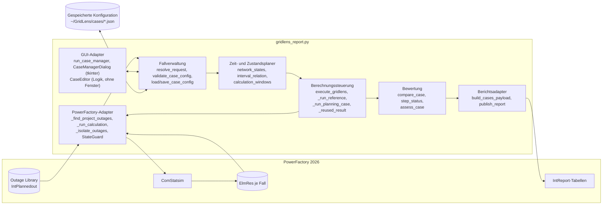
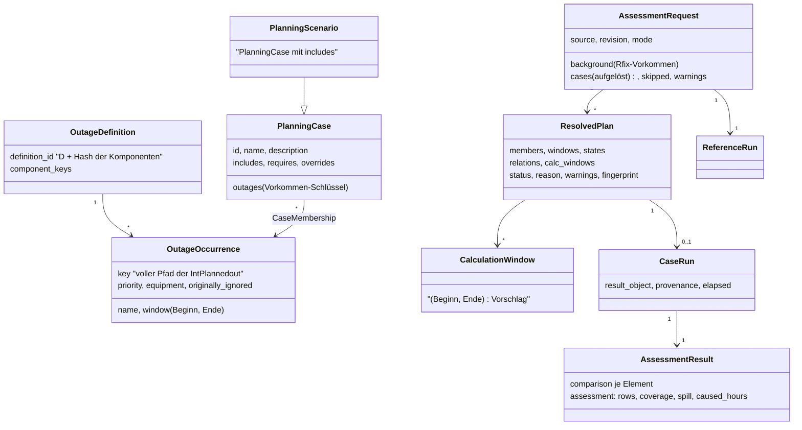
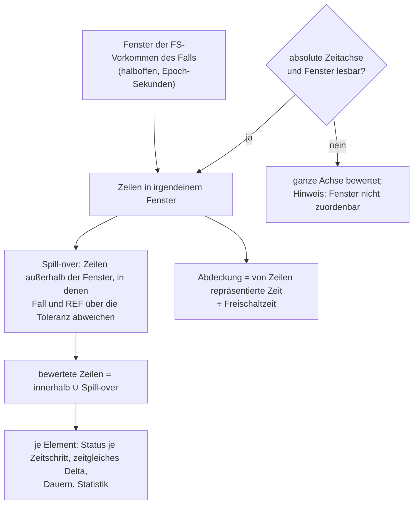
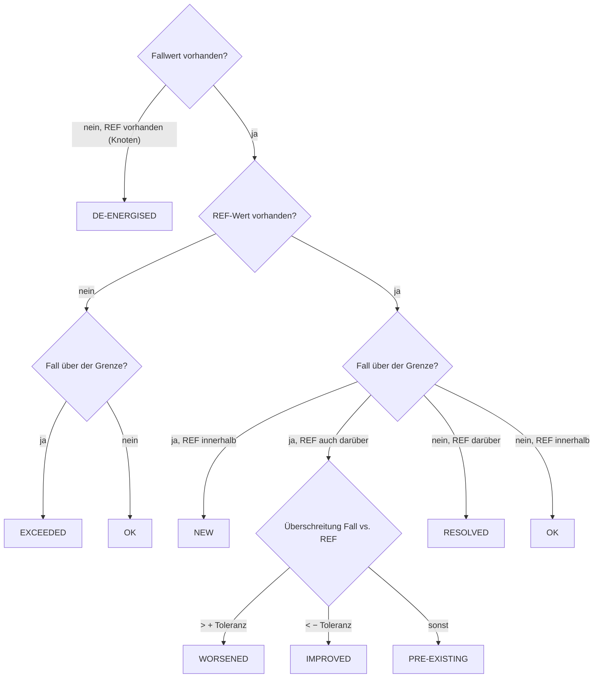
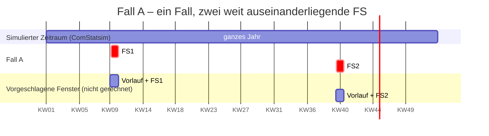

# GridLens 8.0 – Planungsfall-Manager: Architektur und Methodik

Stand: 22. Oktober 2026 · Publisher 8.0.0 · MRT 6.0.0 · Datenvertrag 6.0

GridLens 8 erweitert die Einzel-Vorprüfung von 7.x zu einer Bewertung **vom
Ingenieur definierter Planungsfälle**. Ein Planungsfall ist eine beliebige
Menge von Freischaltungs-Vorkommen (FS); PowerFactory wendet jede in ihrem
eigenen Zeitfenster während einer quasi-dynamischen Simulation (QDS) an. Ein
Fall durchläuft dadurch mehrere Netzzustände. Jeder Fall wird **zum selben
Zeitschritt** mit einer Referenz verglichen. LODF ist vollständig entfernt.

Nichts davon ist bisher in PowerFactory gelaufen. Abschnitt 11 nennt, was
dort geprüft werden muss, bevor man sich auf die Ergebnisse verlässt.

Weitere Dokumente (deutsch):

- [FALLMANAGER.md](FALLMANAGER.md) – Bedienung des Dialogs, Konfigurationsdatei, Rückfallwege
- [BERICHTSMIGRATION.md](BERICHTSMIGRATION.md) – Datenvertrag 5.0 → 6.0 und Vorlagenänderungen
- [TESTMATRIX.md](TESTMATRIX.md) – V01–V40 und Tests A–E mit Prüfstatus

Englische Fassung: [../ARCHITECTURE.md](../ARCHITECTURE.md). Code, Logs und
Berichtstexte bleiben englisch; die Begriffe in Klammern sind die Namen im Code
bzw. im Bericht.

---

## 1. Der zentrale Wechsel

| | GridLens 7.x | GridLens 8.0 |
|---|---|---|
| Fall | eine Freischaltung = ein automatischer Fall | ein vom Ingenieur definierter Planungsfall = beliebig viele FS-Vorkommen |
| Kombination | FS1 + FS2 nie gemeinsam gerechnet | gemeinsam gerechnet, wenn sie im selben Fall stehen |
| Aktive Menge über die Zeit | eine FS, ein Fenster | Folge von Netzzuständen (elementare Intervalle) |
| Vergleich | Fall-Maximum − REF-Maximum im Fenster | Fall(t) − REF(t) in jedem Zeitschritt, danach aggregiert |
| Referenz | immer „ohne Freischaltung“ | R0 (keine) oder Rfix (feste Hintergrund-Freischaltungen) |
| Leitungsranking | LODF aus `ComVstab` | entfernt; nur echte QDS-Lastflüsse |
| Ergebnisobjekte | temporäres `ElmRes`, nach dem Auslesen gelöscht | ein `ElmRes` je Fall, bleibt im Study Case |
| QDS-Zeitraum | gesamter `ComStatsim`-Zeitraum | gesamter Zeitraum (konservativ); kürzere Fenster werden nur vorgeschlagen |

---

## 2. Ist–Soll-Analyse (Lieferteil A)

### 2.1 Was 7.x konnte und bleibt

| Bereich | Funktion(en) | 8.0 |
|---|---|---|
| Kontext, Einstellungsprotokoll | `execute_gridlens` (Schritte 1–2), `_log_qds_settings` | unverändert |
| Erkennung der Freischaltungen | `_find_project_outages`, `_outage_details`, `outage_window` | unverändert; jeder Datensatz trägt jetzt den stabilen Schlüssel (voller Pfad) und alle Komponenten-Schlüssel |
| Klassifikation | `classify_planned_outages` | unverändert; dient nur noch dem Modus „je Freischaltung ein Fall“ und dem Dialog |
| QDS-Ausführung | `_run_calculation` | gleicher Aufruf; das Ergebnisobjekt bleibt erhalten und trägt den Fallnamen |
| Ergebnisauslese | `collect_series` | behält die Werte in voller Auflösung; eindeutige Zeitlabels auch bei Zeitumstellung |
| Zustandsschutz | `StateGuard`, `_restore_study_time`, `_restore_planned_outage_option`, `_restore_results_binding` | unverändert, für jeden Fall verwendet |
| Tabellen über den Gesamtzeitraum | `apply_reference`, Kreise, Radar, Zählungen, Top 10, Zeitplots, Anhänge | unverändert (als Differenz der Maxima dokumentiert) |
| Publikation | `validate_payload`, `publish_report` | unverändert |

### 2.2 Erweitert oder ersetzt

| 7.x | 8.0 | Grund |
|---|---|---|
| `_isolate_outage(guard, active, records)` | `_isolate_outages(guard, active_keys, records, label)` | eine Menge statt einer FS |
| `_run_outage_case` | `_run_planning_case` + `_reused_result` | Mehrfach-FS-Fälle, Wiederverwendung identischer Fälle |
| Referenzblock in `execute_gridlens` | `_run_reference` | R0 mit `iopt_maint=0`, Rfix mit `iopt_maint=1` und nur den festen FS |
| `window_bounds` (Ende inklusive, `bisect_right`) | `window_rows` (halboffen `[Beginn, Ende)`, `bisect_left`) | einheitliche Intervallkonvention |
| `window_statistics` je FS-Index | `compare_case` / `compare_element` | zeitgleicher Vergleich, Dauern, Abdeckung, Spill-over |
| `paired(..., windowed=True)` | liefert die zeitgleichen Datensätze | alle fallbezogenen Tabellen nutzen den zeitgleichen Vergleich |
| `limit_status` (5 Zustände) | `step_status` je Zeitschritt + Rangfolge; neu IMPROVED, DE-ENERGISED, OUT OF SERVICE | Vorgabe Abschnitt 20 |
| `assess_case` | neue Urteile DE-ENERGISED NODES und INCOMPLETE COVERAGE | keine positive Aussage aus fehlenden Daten |
| `_case_rows` (Zeile je FS) | Zeile je Planungsfall + übersprungene FS | Vorgabe Abschnitt 39 |
| `_temporary_result` + `_delete_temporary_results` | `_case_result_object` + `ResultStore` | Ergebnisobjekte bleiben in PowerFactory |

### 2.3 Entfernt (LODF)

`CALCULATE_LODF`, alle `LODF_*`-Konstanten, `LodfError`, `_contents`,
`_lodf_create`, `contingency_keys`, `_prepare_lodf`, `_lodf_result`,
`_read_lodf_matrix`, `_execute_lodf`, `_clean_up_lodf`, `calculate_lodf`,
`_lodf_ranking`, `_lodf_text`, die LODF-Qualitätsprüfung, jede Verwendung von
`ComVstab` / `ComSimoutage` / `ComOutage`, Tabelle `ScriptedLodfRanking`, Feld
`lodf_text`, Kapitel 12 der Vorlage. Tests stellen sicher, dass weder Skript
noch Vorlage LODF erwähnen. Die Dokumente unter `docs/superpowers/` beschreiben
den Stand 7.0 und sind historisch.

### 2.4 Zu prüfende PowerFactory-API-Annahmen

| # | Annahme | Wofür | Stand |
|---|---|---|---|
| P1 | `iopt_maint=1` wendet jede `IntPlannedout` mit `outserv=0` in ihrem Fenster an | jeder Fall | im Feld für eine FS bestätigt (28.09.2026) |
| P2 | `outserv=1` an einer `IntPlannedout` schließt sie bei `iopt_maint=1` aus | Isolation der Fallmenge | nicht geprüft |
| P3 | mehrere aktive FS wirken gleichzeitig und enden je an ihrem eigenen Ende | Mehrfach-FS-Fälle, T01–T13 | nicht geprüft |
| P4 | zwei FS auf demselben Betriebsmittel: Verhalten, wenn die erste endet | V13 | unbekannt, als Warnung gemeldet |
| P5 | `ElmRes`-Zeitstempel und Fenstergrenzen (02:00-Effekt im Test vom 29.09.) | halboffene Fenster | offen; die Spill-over-Prüfung erkennt und bewertet solche Effekte |
| P6 | `AddCopy` des konfigurierten `ElmRes`, Umbenennen, Bindung `ComStatsim.results` | Ergebnisobjekt je Fall | seit 6.x genutzt, nicht Ende-zu-Ende geprüft |
| P7 | Schreiben von `IntPlannedout.starttime/endtime` | eigene Termine je Fall | nicht genutzt (`ALLOW_OUTAGE_TIME_OVERRIDE = False`) |
| P8 | Schreiben von `ComStatsim.startTime/endTime` und Anfangszustand zeitgekoppelter Modelle | kürzere QDS-Fenster | nicht genutzt (nur Vorschau) |
| P9 | `tkinter` / Tcl/Tk in PowerFactorys Python | Fall-Manager | Probe-Werkzeug vorhanden, Ergebnis in PowerFactory nicht dokumentiert |
| P10 | `GetCalcRelevantObjects('*.ElmQdsl')` listet zeitgekoppelte Modelle | Optimierungsprüfung | nicht geprüft; `TIME_COUPLED_CLASSES` ist ein Startpunkt |

---

## 3. Änderungs- und Risikomatrix

| Änderung | Risiko | Gegenmaßnahme | Restrisiko |
|---|---|---|---|
| Mehrere FS in einer QDS | P2/P3 falsch → ein Fall enthält mehr oder weniger FS als angezeigt | Log und Nachweistabelle nennen je Lauf aktive und ignorierte FS; jedes `outserv` wird zurückgesetzt und zurückgelesen | PF-Test V02/V03 nötig |
| Zeitgleicher Vergleich | Speicher: volle Reihen je Element | `array('d')` (8 Byte je Wert) nur für die Referenz dauerhaft; Fallreihen nach dem Vergleich freigegeben; Budget vor jedem Lauf geprüft | sehr große Modelle erreichen `MAX_RUN_CELLS` |
| Spill-over-Bewertung | numerisches Rauschen außerhalb der Fenster als Wirkung gezählt | Toleranz 0,1 pp / 0,001 p.u.; zuerst exakter Array-Vergleich | keines bekannt |
| Ergebnisobjekte bleiben | Study Case wächst je Lauf und Fall um ein `ElmRes` | Namen `GridLens_<yymmdd-HHMMSS>_<Fall>`; im Bericht aufgeführt | Speicherbedarf bei Jahresläufen; alte Läufe löscht der Ingenieur |
| Fall-Manager in PowerFactory | Tk startet nicht oder blockiert | Dialog vor jeder Zustandsänderung; Fehler → gespeicherte Konfiguration → je FS ein Fall; Abbrechen ändert nichts | Tk-Verhalten in PF ungeprüft (P9) |
| Konfiguration außerhalb des Projekts | Datei verloren oder von Hand verändert | Schema, Version und alle Feldtypen werden geprüft; beschädigte Datei stoppt den Lauf mit Pfad | nicht mit dem Projekt versioniert |
| Eigene Termine je Fall | Überschreiben des Originals | in 8.0 nicht angewendet; Fall NOT EVALUATED | keines |
| Kürzere QDS-Fenster | Überspringen eines zeitgekoppelten Zustands | in 8.0 nie gerechnet, nur mit Grund vorgeschlagen | keines (konservativ) |
| LODF entfernt | Ranking fehlt | Ranking nach zeitgleichem Delta in Metric View, Zeitplot und Übersicht | keines |

---

## 4. Logischer Aufbau

Eine Datei `powerfactory/gridlens_report.py`, in Abschnitte gegliedert:



---

## 5. Ablauf eines Laufs


Ein Fall mit einem gewöhnlichen Fehler bleibt als `FAILED` bzw.
`NOT EVALUATED` mit Grund im Bericht; der nächste Fall läuft. Ein nicht
rücksetzbarer Zustand (`StateRestoreError`) stoppt den Lauf. Das
Wiederherstellen steht in einem `finally`-Block und läuft daher auch nach
einem Fehler in der Referenz oder beim Auslesen.

### 5.1 Ein Fall im Detail

```mermaid
sequenceDiagram
    participant OR as Steuerung
    participant SG as StateGuard
    participant IP as IntPlannedout (alle)
    participant CS as ComStatsim
    participant ER as ElmRes-Kopie
    OR->>SG: öffnen
    loop jede Freischaltung
        SG->>IP: outserv lesen, merken
        SG->>IP: 0 schreiben (Fall / fest) oder 1 (andere)
    end
    OR->>ER: AddCopy(konfiguriertes ElmRes), Name GridLens_<stamp>_<Fall>
    OR->>CS: results = Kopie; Execute()
    CS-->>ER: QDS-Ergebnisse (PowerFactory wendet die aktiven FS in ihren Fenstern an)
    OR->>ER: Load, Reihen lesen, Release
    OR->>SG: schließen
    loop umgekehrte Reihenfolge
        SG->>IP: Original-outserv schreiben, zurücklesen, vergleichen
    end
    OR->>OR: Studienzeit wiederherstellen, mit REF vergleichen
```

---

## 6. Datenmodell (Lieferteil C)



| Entität | Umsetzung | Hinweise |
|---|---|---|
| `OutageDefinition` (technische FS) | `assign_definitions(records)` setzt `definition_id` | Vorkommen, die dieselben Komponenten schalten, gehören zu einer technischen FS |
| `OutageOccurrence` (FS-Vorkommen) | Datensatz einer `IntPlannedout` (`_outage_record`) | Identität = voller PowerFactory-Pfad, nie der Anzeigename |
| `CaseMembership` (Fallzuordnung) | `cases[].outages` (Liste von Vorkommen-Schlüsseln) | viele-zu-viele; ein Vorkommen darf in beliebig vielen Fällen stehen |
| `PlanningCase` (Bewertungsfall) | `cases[]` der Konfiguration | ID: Buchstaben, Ziffern, `_`, `-`, höchstens 16 Zeichen, nicht `REF` (Teil des `ElmRes`-Namens; ein Punkt würde als Klassentrenner gelesen) |
| `PlanningScenario` (Gesamtplanung) | Fall mit `includes` | A+B nur, wenn der Ingenieur ihn anlegt; `_case_tree` löst Hierarchien auf und lehnt Zyklen ab |
| `AssessmentRequest` (Bewertungsauftrag) | Ergebnis von `resolve_request(...)` | Quelle, Revision, Modus, Hintergrund, aufgelöste Fälle, Warnungen |
| `CalculationWindow` (Berechnungsfenster) | `calculation_windows(...)` | 24 h Vorlauf je Fenster, Fenster mit < 48 h Abstand zusammengefasst; nur Vorschlag |
| `ReferenceRun` | Ergebnis mit ID `REF` | R0 oder Rfix, `run_note` nennt welche |
| `CaseRun` | Ergebnis von `_run_planning_case` oder `_reused_result` | `result_object`, `provenance`, `elapsed` |
| `AssessmentResult` | `result['comparison']`, `result['assessment']`, `assess_case(...)` | je Element und je Fall |

**Alternative oder mehrmalige Durchführung.** Zwei Vorkommen von FS1 (KW10
und KW40) in *einem* Fall bedeuten, dass FS1 tatsächlich zweimal stattfindet
(F05). In *zwei* Fällen sind sie Alternativen (F02); stehen diese Fälle in einer
Alternativgruppe, darf kein gemeinsamer Fall beide enthalten (B02).

**Fallbeziehungen.**

| Regel | Konfiguration | Prüfung |
|---|---|---|
| B01 gleicher Fall | `outages` | gemeinsame Zeitachse |
| B02 Alternativen | `exclusive_groups` | ein Fall mit zweien davon wird NOT EVALUATED |
| B03/B06 Gesamtplanung, Hierarchie | `includes` | rekursiv aufgelöst, jedes Vorkommen nur einmal (B05) |
| B04 bedingter Fall | `requires` | ein Fall ohne seine Voraussetzung wird NOT EVALUATED |
| B08/F11 dürfen nicht überlappen | Regel `not_overlap` | überlappende Fenster abgelehnt |
| B09/F10 Reihenfolge | Regel `order` | die zweite FS muss nach dem Ende der ersten beginnen |
| B10 nur gemeinsam | Regel `together` | beide vorhanden und überlappend |
| F15/V13 gleiches Betriebsmittel | automatisch | Warnung |

---

## 7. Methodik

### 7.1 Aktive Menge und Netzzustände

Für die Vorkommen `O_c` eines Falls gilt `A_c(t) = { o ∈ O_c | a_o ≤ t < b_o }`.
`network_states` sammelt alle Beginne und Enden, sortiert sie und liefert die
elementaren Intervalle mit ihrer aktiven Menge; Nachbarn mit gleicher Menge
werden zusammengefasst, leere Intervalle (∅) bleiben erhalten. Das gilt für
beliebig viele Vorkommen; die 13 Beziehungen zweier Intervalle (T01–T13) sind
nur der Sonderfall, den `interval_relation` je Paar meldet.


GridLens schaltet diese Zustände nicht selbst. PowerFactory wendet jede aktive
FS in ihrem eigenen Fenster während der QDS an (`iopt_maint=1`); GridLens
bestimmt nur, welche FS aktiv sind (`outserv`). Die berechneten Zustände
dokumentieren, was PowerFactory tun soll; sie stehen in Vorschau, Log und
Bericht (`states_text`).

### 7.2 Zeitgleicher Vergleich

Für Element `e`, Zeilen `k` und Schrittdauern `Δt_k = t_{k+1} − t_k` (die
letzte Zeile wiederholt den vorigen Schritt):

- zeitgleiches Delta: `D_max(e) = max_k [ y_c(e,t_k) − y_R(e,t_k) ]` (Spannung: größte betragsmäßige Änderung, mit Vorzeichen)
- Differenz der Maxima (getrennt, so benannt): `max_k y_c − max_k y_R`
- Überschreitung: Auslastung `max(0, L − 100 %)`; Spannung `max(0, U_min − U, U − U_max)`
- Dauer verursachter Verletzungen eines Falls: `Σ Δt_k` über die Vereinigung aller Zeilen, in denen ein Element NEW oder WORSENED ist

Test A der Vorgabe: REF 80 %, 60 %; Fall 70 %, 85 % → Differenz der Maxima
+5 pp, zeitgleiches Delta +25 pp.

### 7.3 Welche Zeilen bewertet werden



In einem Fall unterscheiden sich nur seine eigenen FS von der Referenz. Jede
Abweichung außerhalb ihrer Fenster bedeutet daher, dass PowerFactory sie
versetzt anwendet oder ein Schaltzustand die FS überdauert (F14). Diese Zeilen
werden mitbewertet, und die Qualitätsseite nennt den Fall. Das erfasst auch den
02:00-Effekt aus dem Test vom 29. September.

### 7.4 Klassifikation



Ein Element erhält den schwersten Zustand seiner Zeitschritte (NEW >
WORSENED > EXCEEDED > DE-ENERGISED > PRE-EXISTING > IMPROVED > RESOLVED > OK).
Betriebsmittel, die der Fall selbst ausschaltet, sind OUT OF SERVICE, nie
RESOLVED. Werte genau auf der Grenze sind keine Verletzung. Auslastungsgrenze
100 % (dokumentierter Rückfall; die Bemessung der Elemente steckt bereits in
`c:loading`), Spannungsbänder je Nennspannung wie in 7.x.

Urteil je Fall, die erste zutreffende Zeile gilt:

| Urteil | Bedingung | Farbe |
|---|---|---|
| OVERLOAD + VOLTAGE BAND / OVERLOAD / VOLTAGE BAND | ein Auslastungs- und/oder Spannungselement NEW, WORSENED oder EXCEEDED | rot |
| DE-ENERGISED NODES | ein Knoten verliert im Fall seine Spannung | gelb |
| INCOMPLETE COVERAGE | nichts gefunden, aber die Ergebnisse decken < 99,9 % der Freischaltzeit ab | gelb |
| NO ADDITIONAL VIOLATION | nur PRE-EXISTING oder IMPROVED | gelb |
| NO LIMIT EXCEEDED | nichts über einer Grenze | keine |
| NO RESULT DATA IN WINDOW | keine Zeile zu bewerten | keine |
| NOT EVALUATED / NOT SIMULATED | Lauf fehlgeschlagen, Regelkonflikt, Zeitachse abweichend / außerhalb des Zeitraums | keine |

Fehlende oder fehlerhafte Ergebnisse ergeben nie NO LIMIT EXCEEDED.

### 7.5 Aussage A und Aussage B

Der Bericht trennt auf der Fallseite: Aussage A (was die Freischaltungen
hinzufügen) bewerten die Fälle. Aussage B (das Netz ist über den ganzen
Zeitraum zulässig) beschreibt nur die Referenz; ein Fall ohne zusätzliche
Verletzung beweist sie nicht.

---

## 8. Beispiel: FS1 in KW10, FS2 in KW40 (Lieferteil E)



1. **Einlesen.** Beide `IntPlannedout` werden gelesen (Schlüssel, Fenster, Komponenten).
2. **Zuordnen.** Der Ingenieur legt FS1 und FS2 in Fall A.
3. **Zustände.** `FS1 | ∅ | FS2` (Beziehung T01).
4. **Vorgeschlagene Fenster.** Zwei Fenster mit 24 h Vorlauf. Die
   Optimierungsprüfung lehnt die Ausführung ab: kürzere QDS-Zeiträume sind
   nicht verifiziert, und zeitgekoppelte Modelle (`ElmQdsl`) würden sie
   zusätzlich unzulässig machen.
5. **Referenz.** Ein REF-Lauf über den ganzen Zeitraum (`iopt_maint=0`),
   erhalten als `GridLens_<stamp>_REF`.
6. **Fall-Lauf.** Eine QDS über den ganzen Zeitraum mit FS1 und FS2 aktiv
   (`outserv=0`), alle anderen FS ignoriert, erhalten als `GridLens_<stamp>_A`.
   PowerFactory wendet FS1 in KW10 und FS2 in KW40 an.
7. **Vergleich.** Die Zeilen von KW10 und KW40 werden zum selben Zeitschritt
   mit REF verglichen; jede Abweichung dazwischen (z. B. ein Schaltzustand,
   der FS1 überdauert) wird als Spill-over bewertet und gemeldet.
8. **Bericht.** Eine Zeile für Fall A: beide Zeiträume, beide FS, die
   Fall-Definition, Abdeckung beider Wochen, das Urteil und die
   Nachweistabelle mit beiden Läufen und ihren Ergebnisobjekten.

Aufwand im konservativen Modus: ein Ganzjahres-Lauf für die Referenz (für
beliebig viele Fälle gemeinsam) plus einer je unterschiedlichem Fall. Die
vorgeschlagenen Fenster würden den Fall-Lauf auf etwa 16 Tage verkürzen; das
wird angezeigt, nicht gerechnet.

---

## 9. Fehlerbehandlung und Robustheit

| Situation | Verhalten | Wo |
|---|---|---|
| Konfigurationsdatei mit falschen Typen, IDs, Regeln, eigenen Terminen | jedes Problem mit Fall genannt; der Lauf stoppt **vor** jeder Änderung in PowerFactory | `validate_case_config` |
| Konfiguration unlesbar oder anderes Schema | Lauf stoppt mit Dateipfad; nie stillschweigend übergangen | `load_case_config` |
| FS seit dem Speichern gelöscht oder umbenannt | dieser Fall NOT EVALUATED mit Pfad | `resolve_request` |
| Fenster endet vor seinem Beginn | dieser Fall NOT EVALUATED | `resolve_request` |
| feste FS unbekannt oder in PowerFactory „Ignored“ | Warnung in Log und Qualitätsseite | `resolve_request`, `_model_quality` |
| Tk fehlt oder Dialog lässt sich nicht aufbauen | gilt als „Dialog nicht verfügbar“: gespeicherte Konfiguration, sonst je FS ein Fall; der Bericht nennt die Quelle | `run_case_manager`, `obtain_case_request` |
| Fehler in einer Dialog-Schaltfläche | in einem Meldungsfenster angezeigt; Dialog bleibt offen; nichts gerechnet | `report_callback_exception` |
| Dialog bricht während der Bedienung ab | Lauf stoppt, nichts gerechnet | `run_case_manager` |
| Abbrechen | Lauf endet, nichts gerechnet, nichts gespeichert | `GridLensCancelled` |
| `outserv` nicht schreibbar | dieser Fall FAILED; Einstellungen zurückgesetzt | `_isolate_outages`, `StateGuard` |
| QDS scheitert oder `ElmRes` nicht lesbar | dieser Fall FAILED; der nächste Fall läuft | `_run_planning_case` |
| Vergleich scheitert unerwartet | dieser Fall NOT EVALUATED mit Grund; sein `ElmRes` bleibt; der nächste Fall läuft | `_run_planning_case` |
| Speicherbudget (`MAX_RUN_CELLS`) überschritten | Stopp vor dem nächsten Lauf, nicht nach dem letzten; Zustand zurückgesetzt | `check_run_budget` |
| Einstellung nicht rücksetzbar | Lauf stoppt mit erwartetem und gelesenem Wert | `StateRestoreError` |
| Referenz scheitert | Lauf stoppt (kein Fall vergleichbar); Zustand zurückgesetzt | `_run_reference` |
| Abdeckung unter 99,9 % | nie „NO LIMIT EXCEEDED“; der Text zeigt nie „100 %“ | `assess_case`, `percent_text` |
| Fenster nicht auf der Zeitachse platzierbar | jeder Zeitschritt wird verglichen (langsamer); Warnung im Log, Hinweis im Bericht | `compare_case`, `_run_planning_case` |
| mehrfach berechnetes Urteil könnte abweichen | jeder Fall wird nach den Läufen einmal beurteilt; Log, Falltabelle und Übersicht lesen dieses Urteil | `judge_cases`, `judged` |

Alle Wiederherstellungsschritte stehen in `finally` und laufen daher auch nach
einem Fehler oder einem `KeyboardInterrupt`.

---

## 10. Performance (Lieferteil H)

| Größe | Wo sie steht |
|---|---|
| geplante QDS-Läufe | Vorschau: „QDS runs: n (1 reference)“ |
| vermiedene Läufe | identische Fälle (gleiche FS, Fenster, feste FS) übernehmen das Ergebnis: Vorschau „identical cases calculated once“, Nachweistabelle „CASE (reused)“ |
| Zeitschritte je Lauf | Nachweistabelle `time_steps` |
| gemessene Laufzeit | Nachweistabelle `elapsed_text`, Log (QDS und Vergleich getrennt) |
| vorgeschlagene Fenster | Vorschau, Bericht (`windows_text`, `qds_mode_text`) – nicht gerechnet |

Grobes Modell (Vorgabe Abschnitt 27): `T ≈ (1 + m_unterschiedlich) · (τ_I + n · τ_L)`.
Es wird keine Beschleunigung behauptet; in PowerFactory ist nichts gemessen.

---

## 11. Offene Abnahme in PowerFactory

Vor dem produktiven Einsatz in PowerFactory 2026 ausführen und das Ergebnis
festhalten:

1. P2/P3: ein Fall mit zwei überlappenden FS – das Log nennt beide aktiv;
   Auslastungen mit zwei Einzelfällen vergleichen (V02, V03).
2. P5: eine Fenstergrenze bei Stundenschritten – erscheint die Wirkung in den
   Fensterzeilen oder in den Spill-over-Zeilen?
3. P6: die Ergebnisobjekte `GridLens_<stamp>_<Fall>` erscheinen im Study Case
   und lassen sich öffnen.
4. P9: der Fall-Manager öffnet sich, OK / Abbrechen funktionieren,
   PowerFactory reagiert danach normal (V30, V31).
5. Der Bericht rendert: neue Kapitel 5, 8, 15 und das Inhaltsverzeichnis mit
   19 Einträgen.
6. Speicher und Laufzeit eines Ganzjahreslaufs mit 10 Fällen.

Kürzere QDS-Fenster und eigene Termine je Fall brauchen zuerst eine eigene
Probe (`tools/probe_planned_outages.py` ist der Ort), dann eine Entscheidung,
sie freizuschalten.
