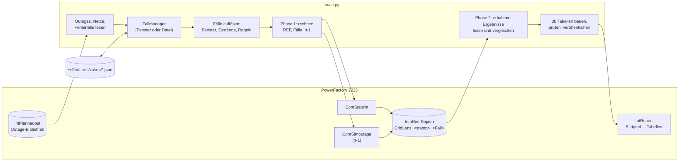
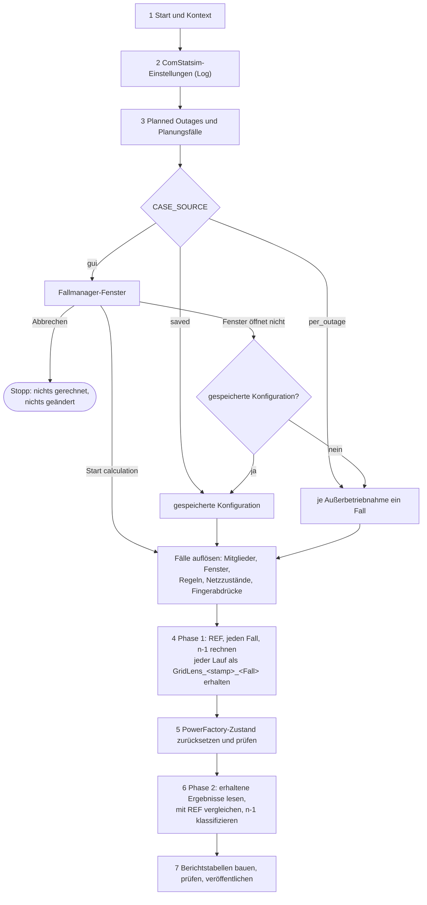
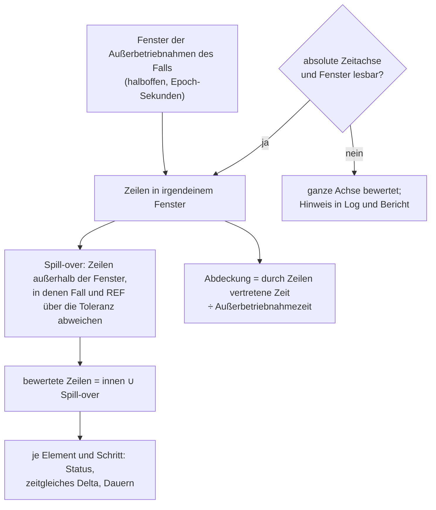
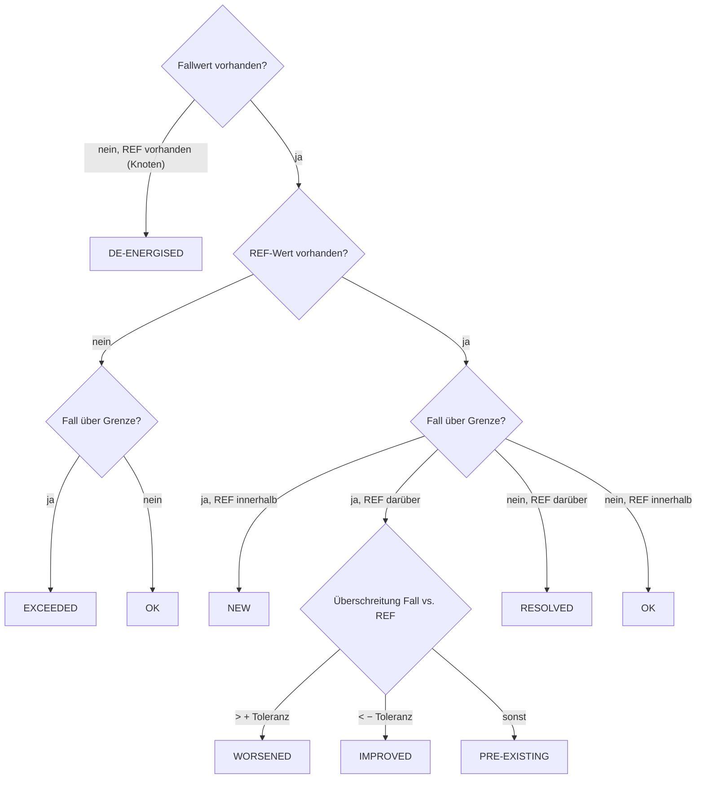

# GridLens – wie das Werkzeug arbeitet

GridLens ist ein ComPython für DIgSILENT PowerFactory 2026. Es bewertet
**Planungsfälle**, die der Ingenieur festlegt – Mengen von Planned Outages
(`IntPlannedout`) –, mit der quasi-dynamischen Simulation (QDS) und auf Wunsch
mit der Contingency Analysis (n-1). Jeder Fall wird **zum selben Zeitschritt**
mit einer Referenz verglichen; die Ergebnisse werden als Tabellen an einen
PowerFactory-Bericht (`IntReport`) übergeben und als Haupt- und Detailbericht
gerendert.

Das Ergebnis ist eine technische **Vorprüfung**. Es ist keine Freigabe einer
Außerbetriebnahme und kein Nachweis für n-1-Sicherheit, Versorgungssicherheit,
Schutzkoordination oder sichere elektrische Trennung.

Aktuelle Versionen: Skript `8.0.1` (`PUBLISHER_VERSION`), Berichtsseiten
`7.0.0` (`TEMPLATE_VERSION`), Datenvertrag `7.0` mit 38 Tabellen
(`DATA_CONTRACT_VERSION`), Einstellungen `1.0`, Klassifikationsregeln `1.0`.

Weitere Dokumente:

- [FALLMANAGER.md](FALLMANAGER.md) – Bedienung des Fallmanager-Fensters
- [BERECHNUNG_UND_AUSWERTUNG.md](BERECHNUNG_UND_AUSWERTUNG.md) – Formeln und Regeln der Bewertung im Detail
- [POWERFACTORY.md](POWERFACTORY.md) – jedes PowerFactory-Objekt und -Attribut, das GridLens liest oder schreibt
- [BERICHTSTABELLEN.md](BERICHTSTABELLEN.md) – die 38 Berichtstabellen und ihre Felder
- Englische Fassung: [../ARCHITECTURE.md](../ARCHITECTURE.md)

---

## 1. Bestandteile der Auslieferung

| Teil | Inhalt |
|---|---|
| `outage-assessment/main.py` | das vollständige Werkzeug mit dem Fallmanager in tkinter (Standardbibliothek) |
| `outage-assessment/main_qt.py` | dasselbe Werkzeug mit dem Fallmanager in PyQt6 oder PyQt5; alles andere ist identisch |
| `designer-pages/MASTER_GRIDLENS/` | Hauptbericht: ein `.dct`-Dictionary und eine `.pg`-Datei je Seite |
| `designer-pages/MASTER_GRIDLENS_DETAIL/` | Detailbericht, gleicher Aufbau |

Das Skript braucht nur die Python-Standardbibliothek, das PowerFactory-Modul
und für den Fallmanager tkinter (bzw. PyQt bei `main_qt.py`). Es importiert
keine andere Datei des Repositorys.

---

## 2. Was PowerFactory bereitstellen muss

| Voraussetzung | Wozu | Fehlt sie |
|---|---|---|
| ein aktiver Study Case | alles wird darin gelesen und geschrieben | der Lauf stoppt vor jeder Änderung |
| genau der ComStatsim des Study Case, konfiguriert (Zeitschritt, Lastprofile, Berechnungsoptionen; Zeitraum bei *QDS period* = *as set in ComStatsim*) | GridLens rechnet ihn für jeden Fall; nur der Zeitraum wird aus den Außerbetriebnahmen gesetzt (Schritt 4) | der Lauf stoppt |
| `ComStatsim.results` auf ein Ergebnisobjekt gebunden, das **keine** `GridLens_…`-Kopie ist | die QDS schreibt hinein; eine erhaltene Kopie würde überschrieben | der Lauf stoppt mit dem gebundenen Namen |
| die Option *Planned Outages* (`iopt_maint`) am ComStatsim | der einzige Schalter, mit dem PowerFactory Planned Outages anwendet | der Lauf stoppt |
| aufgezeichnete Variablen: `c:loading` oder `m:loading` von Leitungen (`ElmLne`) und Transformatoren (`ElmTr2`, `ElmTr3`), `m:u` oder `m:u1` von Knoten (`ElmTerm`) | die bewerteten Größen | der Lauf stoppt direkt nach dem ersten QDS-Lauf und nennt, was stattdessen aufgezeichnet ist |
| Planned Outages als `IntPlannedout` in der Outage-Bibliothek (sonst irgendwo im Projekt) | der Stoff der Planungsfälle | ohne sie kann nur die Referenz gerechnet werden |
| das ComPython unterhalb des `IntReport` | nötig, um die Tabellen zu veröffentlichen | der Lauf rechnet und prüft alles, veröffentlicht aber nichts (eigenständiger Lauf) |
| für n-1: höchstens ein `ComSimoutage` im Study Case | GridLens verwendet ihn; ohne legt es einen eigenen an | bei mehreren wird n-1 mit Grund nicht bewertet |

---

## 3. Ablauf eines Laufs

Das Ausgabefenster zeigt den Lauf in sieben Schritten (`STEP n/7`). Zu jedem
Schritt steht unten, was gelesen und geändert wird und wann der Lauf stoppt.

### Schritt 1 – Start und Kontext

GridLens findet das laufende ComPython, den aktiven Study Case, den
übergeordneten `IntReport` (falls vorhanden), den ComStatsim und das gebundene
Ergebnisobjekt. Es prüft jede Voraussetzung aus Abschnitt 2, die sich ohne
Rechnung prüfen lässt, und liest die Option *Planned Outages*. Es merkt sich
die Studienzeit (`SetTime.cDate`, `cTime`), um sie nach jedem Lauf
zurückzusetzen. Noch wird nichts geändert.

### Schritt 2 – ComStatsim-Einstellungen

Die Berechnungseinstellungen des ComStatsim (Zeitraum, Zeitschritt,
Lastfluss-Optionen, Ergebnisobjekt und seine Variablenauswahl) werden
protokolliert. GridLens ändert keine davon, außer der Option *Planned
Outages* während der Läufe.

### Schritt 3 – Planned Outages und Planungsfälle

1. **Planned Outages werden gelesen** (nur lesend) aus dem Outage-Ordner des
   Projekts; nur wenn er keine enthält, wird das ganze Projekt durchsucht. Zu
   jeder `IntPlannedout` behält GridLens den vollständigen Pfad (die
   Identität), Namen, Fenster (`starttime`, `endtime` in Epoch-Sekunden),
   Betriebsmittel, Priorität und das Flag *Ignored* (`outserv`).
   Außerbetriebnahmen, die dieselben Betriebsmittel schalten, werden zu einer
   technischen Außerbetriebnahme zusammengefasst (`definition_id`).
2. **Jede Außerbetriebnahme wird eingeordnet** gegenüber dem Zeitraum des
   ComStatsim (`qds_period`: bei `calcPeriod` 4 `startTime`…`endTime`, bei 0
   der Tag in `date` plus `stepNumber` Schritte, jede andere Art offen):
   `CONSIDERED` oder `SKIPPED` mit Grund (außerhalb des Zeitraums, *Ignored*,
   unlesbares Fenster). Ist die Frage nicht entscheidbar, bleibt sie
   `CONSIDERED`, wird über die ganze Zeitachse bewertet, und ihre
   Objektattribute werden als `DIAGNOSTIC` protokolliert. Mit *QDS period* =
   *first to last planned outage* (Standard) zählt eine Außerbetriebnahme
   außerhalb dieses Zeitraums nach dem Schließen des Fallmanagers ebenfalls:
   der Zeitraum des Laufs folgt den Außerbetriebnahmen.
3. **Netze, Fehlerfälle und erhaltene Läufe werden gelesen** (nur lesend) für
   den Fallmanager: die Netze des Modells, die Fehlerfälle der Contingency
   Analysis des Study Case und die Zeitstempel früherer GridLens-Läufe.
4. **Die Planungsfälle werden bestimmt** nach `CASE_SOURCE`:

   | `CASE_SOURCE` | Verhalten |
   |---|---|
   | `'gui'` (Standard) | der Fallmanager öffnet sich; PowerFactory wartet, bis er geschlossen ist. *Start calculation* übergibt die Konfiguration, *Cancel* beendet den Lauf ohne jede Änderung. Kann das Fenster nicht öffnen, gilt die gespeicherte Konfiguration; ohne sie wird jede Außerbetriebnahme im Zeitraum ein eigener Fall. |
   | `'saved'` | die für dieses Projekt gespeicherte Konfiguration, ohne Fenster |
   | `'per_outage'` | je Außerbetriebnahme im simulierten Zeitraum ein Fall, ohne Fenster |

5. **Die Fälle werden aufgelöst** (`resolve_request`): Mitglieder, wirksame
   Fenster, Netzzustände, Regelprüfung und ein Fingerabdruck je Fall
   (Abschnitt 5). Ein Fall, der nicht gerechnet werden kann, behält Status und
   Grund und wird im Bericht genannt.
6. **Die Einstellungen werden festgelegt** für den ganzen Lauf
   (`activate_settings`): die Standardwerte plus die Abweichungen aus der
   Konfiguration. Log und Bericht nennen jede Abweichung.

### Schritt 4 – Phase 1: Berechnung

Phase 1 rechnet und erhält nur; gelesen wird noch nichts.

0. **QDS-Zeitraum.** Mit *QDS period* = *first to last planned outage*
   (Standard) setzt GridLens den Zeitraum des ComStatsim für jeden Lauf: von
   einem QDS-Schritt vor dem frühesten Beginn bis einen Schritt nach dem
   spätesten Ende der Außerbetriebnahmen aller READY-Fälle, auf dem
   QDS-Schrittraster ab lokaler Mitternacht des frühesten Beginns
   (`outage_span`). Geschrieben werden `calcPeriod` = 4 (benutzerdefiniert),
   `startTime`, `endTime` und, wo lesbar, `stepNumber`; GridLens liest sie
   zurück und protokolliert den Zeitraum und den vorher eingestellten. REF und
   jeder Fall decken so genau dieselbe Zeit ab; der Schritt nach dem letzten
   Ende erfasst eine Wirkung über das Fenster hinaus. Feste
   Hintergrund-Außerbetriebnahmen verlängern den Zeitraum nicht. Ist ein
   Fenster oder der Zeitschritt nicht lesbar, bleibt der Zeitraum wie
   eingestellt, mit Warnung. Mit *as set in ComStatsim* wird nichts
   geschrieben.
1. **Referenz (REF).** Ohne feste Hintergrund-Außerbetriebnahmen ist REF
   **R0**: *Planned Outages* aus (`iopt_maint=0`). Mit festen
   Außerbetriebnahmen ist sie **Rfix**: *Planned Outages* an, nur die festen
   aktiv. Der REF-Lauf lässt sich in den Einstellungen abschalten;
   Verletzungen lassen sich dann nicht in neu und vorbestehend trennen.
2. **Eine QDS je Fall.** *Planned Outages* wird eingeschaltet. Für jeden Fall
   mit Status READY setzt GridLens das Flag *Ignored* **jeder** Planned Outage:
   `0` für die Außerbetriebnahmen des Falls und die festen, `1` für alle
   anderen. PowerFactory wendet dann jede aktive Außerbetriebnahme während der
   QDS in ihrem eigenen Fenster an. Bis auf den Zeitraum (Punkt 0) läuft der
   ComStatsim genau wie konfiguriert.
3. **Gleiche Fälle werden einmal gerechnet.** Ein Fall mit denselben
   Außerbetriebnahmen, Fenstern und festen Außerbetriebnahmen wie ein bereits
   gerechneter (gleicher Fingerabdruck) übernimmt dessen Ergebnis und wird als
   *reused* gekennzeichnet.
4. **Jeder Lauf bleibt erhalten.** PowerFactory schreibt jede QDS in sein
   eigenes Ergebnisobjekt und überschreibt es beim nächsten Lauf. Direkt nach
   jedem Lauf kopiert GridLens es in den Study Case als
   `GridLens_<yymmdd-HHMMSS>_<Fall>` (REF: `…_REF`) und schreibt Fall und
   Fingerabdruck in die Beschreibung der Kopie. Die Kopien bleiben; GridLens
   löscht sie nie.
5. **Aufzeichnungsprüfung.** Direkt nach dem ersten Lauf prüft GridLens, dass
   die Kopie mindestens eine bewertete Variable enthält. Wenn nicht, stoppt der
   Lauf sofort, statt die übrigen Fälle umsonst zu rechnen.
6. **Nach jedem Lauf** werden die *Ignored*-Flags zurückgesetzt und
   zurückgelesen, die Studienzeit wird zurückgesetzt, und Schalter, die anders
   stehen als vor dem Lauf, werden protokolliert (GridLens ändert keine
   Schalter).
7. **n-1**, wenn im Fallmanager angekreuzt: siehe Abschnitt 8.

Vor jedem Lauf mit Planned Outages zeigt das Log, was PowerFactory anwenden
wird: den Wert der Option und jede Außerbetriebnahme mit *Ignored* = 0.

### Schritt 5 – Zurücksetzen

In einem `finally`-Block, also auch nach einem Fehler oder Abbruch:
Studienzeit, Option *Planned Outages* und QDS-Zeitraum werden zurückgesetzt
und zurückgelesen, die Bindung von `ComStatsim.results` wird protokolliert, und
die erhaltenen Ergebnisobjekte werden aufgelistet. Lässt sich ein Wert nicht
zurücksetzen, stoppt der Lauf mit erwartetem und gefundenem Wert; der Study
Case ist dann von Hand zu prüfen.

### Schritt 6 – Phase 2: Auswertung

1. Ergebnisse werden spaltenweise in einen temporären `IntVec` gelesen
   (`GridLens_column_buffer`, im laufenden ComPython angelegt und am Ende des
   Schritts gelöscht). Ohne ihn ist jeder Wert ein Aufruf (langsam); die
   Laufzusammenfassung zeigt, welcher Weg genutzt wurde.
2. Zuerst wird REF gelesen, dann jeder Fall aus seiner Kopie, dann mit REF
   verglichen (Abschnitt 7).
3. Für jede Außerbetriebnahme prüft GridLens, ob sie gewirkt hat und ob sie
   nach ihrem Fenster weiterwirkt (Abschnitt 7.6).
4. n-1-Ergebnisse werden gelesen und klassifiziert (Abschnitt 8).
5. Ein Speicherbudget (`MAX_RUN_CELLS`) stoppt die Auswertung vor dem nächsten
   Fall, nicht nach dem letzten; alles Gerechnete bleibt erhalten.
6. Jeder Fall wird **einmal** beurteilt; Log, Falltabelle und Zusammenfassung
   verwenden dieses Urteil.

### Schritt 7 – Bericht

GridLens baut die 38 Tabellen (siehe [BERICHTSTABELLEN.md](BERICHTSTABELLEN.md)),
prüft jede Zeile gegen den Datenvertrag und veröffentlicht sie an den
`IntReport`. Der Bericht wird danach in PowerFactory aus diesem `IntReport`
als eigener Schritt erzeugt. Ohne übergeordneten `IntReport` protokolliert
GridLens die Zeilenzahl je Tabelle und veröffentlicht nichts.

Rückgabecode: 0 nach einem veröffentlichten Bericht oder einem eigenständigen
Lauf; 1, wenn nichts veröffentlicht wurde (Fehler), damit der `IntReport`
keine fehlenden oder veralteten Tabellen rendert. *Cancel* im Fallmanager
wird als Abbruch an den Aufrufer weitergegeben.

---

## 4. Was GridLens in PowerFactory ändert

GridLens ändert nur diese Werte, vorübergehend, und setzt jeden zurück (vor
dem Schreiben gemerkt, in umgekehrter Reihenfolge zurückgesetzt, zurückgelesen
und verglichen):

| Objekt | Attribut | Wann | Zurückgesetzt |
|---|---|---|---|
| ComStatsim | `iopt_maint` (*Planned Outages*) | REF- und Fallläufe | Schritt 5 |
| ComStatsim | `calcPeriod`, `startTime`, `endTime`, `stepNumber` (QDS-Zeitraum) | alle Läufe, bei *QDS period* = *first to last planned outage* | Schritt 5 |
| jede `IntPlannedout` | `outserv` (*Ignored*) | jeder Falllauf, Rfix, jeder n-1-Sweep | direkt nach diesem Lauf |
| Studienzeit `SetTime` | `cDate`, `cTime` | ändert PowerFactory während eines Laufs | nach jedem Lauf und in Schritt 5 |
| ComSimoutage (nur n-1) | `calcPeriod`, Schrittweite, `startTime`, `endTime`, `stepNumber`, `isPlannedOutages` | jeder n-1-Sweep | direkt nach diesem Sweep |
| Fehlerfälle `ComOutage` (nur n-1) | *Not analysed* für Fehlerfälle außerhalb des n-1-Filters | jeder n-1-Sweep | direkt nach diesem Sweep |

Objekte, die GridLens **anlegt und behält**:

- `GridLens_<stamp>_<Fall>` – Kopie jedes QDS-Ergebnisses (`ElmRes`)
- `GridLens_<stamp>_<Fall>_N1`, `…_N1P` – Kopien der n-1- und (n-1)'-Ergebnisse
- `GridLens_<stamp>_N1` – eine Contingency Analysis mit einem Fehlerfall je
  Element, nur wenn der Study Case keine hat

Der temporäre `IntVec` aus Schritt 6 wird im selben Lauf angelegt und
gelöscht. GridLens wendet nie selbst eine Außerbetriebnahme an
(`IntPlannedout` hat in PowerFactory 2026 kein `Apply` oder `Reset`), ändert
nie Netzmodell, Bemessungswerte, Schalter oder den Zeitschritt des
ComStatsim und legt keine Operation Scenarios, Variationen oder Study Cases an.

---

## 5. Planungsfälle

### 5.1 Was ein Fall ist

Ein Planungsfall ist eine benannte Menge von Planned-Outage-**Vorkommen**.
Jeder Fall enthält nur die ihm direkt zugeordneten Außerbetriebnahmen; eine
Außerbetriebnahme kann in beliebig vielen Fällen stehen. Fälle sind
unabhängig: Ändern, Ausschließen oder Löschen eines Falls berührt keinen
anderen, und GridLens kombiniert Fälle nie automatisch. Um zwei
Außerbetriebnahmen gemeinsam zu bewerten, beide in einen Fall legen.

| Feld | Bedeutung |
|---|---|
| `id` | erzeugt `C1`, `C2`, …; Teil des Ergebnisobjektnamens; Buchstaben, Ziffern, `_`, `-`, höchstens 16 Zeichen, nie `REF` |
| `name`, `description` | freier Text für Log und Bericht |
| `enabled` | das Flag *Run*; ein ausgeschlossener Fall bleibt gespeichert, wird aber weder gerechnet noch berichtet |
| `outages` | vollständige Pfade der zugeordneten `IntPlannedout` |
| `overrides` | eigene Termine je Außerbetriebnahme; **nur erfasst, nicht angewendet** (der Fall wird NOT EVALUATED berichtet) |

### 5.2 Feste Hintergrund-Außerbetriebnahmen

Als fest markierte Außerbetriebnahmen sind in der Referenz (dann Rfix) und in
jedem Fall aktiv. Eine Außerbetriebnahme kann nicht zugleich fest und in einem
Fall sein.

### 5.3 Regeln zwischen Außerbetriebnahmen

| Regel | Prüfung | Bei Verstoß |
|---|---|---|
| must not overlap | ein Fall mit beiden wird abgelehnt, wenn ihre Fenster überlappen | Fall NOT EVALUATED |
| second only after the first | die zweite darf erst beginnen, wenn die erste geendet hat | Fall NOT EVALUATED |
| only together | ein Fall mit einer muss die andere enthalten, zeitlich überlappend | Fall NOT EVALUATED |

Zwei Außerbetriebnahmen auf demselben Betriebsmittel sind normale Planung und
keine Regel.

### 5.4 Auflösung und Status

`resolve_request` macht aus der Konfiguration rechenbare Pläne:

| Status | Bedeutung |
|---|---|
| READY | wird gerechnet |
| NOT EVALUATED | keine Außerbetriebnahme zugeordnet, eine existiert nicht mehr, eigene Termine, eine verletzte Regel, ein unlesbares Fenster |
| NOT SIMULATED | keine Außerbetriebnahme des Falls liegt im simulierten Zeitraum |
| excluded | das Flag *Run* ist aus |

Der **Fingerabdruck** eines Falls umfasst seine Außerbetriebnahmen, deren
Fenster und die festen Außerbetriebnahmen. Gleiche Fingerabdrücke teilen eine
Rechnung.

### 5.5 Netzzustände

Während einer QDS ändert sich die Menge der aktiven Außerbetriebnahmen über
die Zeit. GridLens berechnet diese Zustände für Log, Vorschau und Bericht;
PowerFactory wendet sie an. Für die Außerbetriebnahmen `O` eines Falls ist die
aktive Menge zur Zeit `t` gleich `A(t) = { o ∈ O | Beginn_o ≤ t < Ende_o }`
(halboffene Fenster). Alle Beginn- und Endzeiten werden zu elementaren
Intervallen sortiert; Nachbarn mit gleicher Menge werden zusammengefasst, leere
Intervalle bleiben erhalten.

```mermaid
gantt
    title Drei überlappende Außerbetriebnahmen, fünf Netzzustände
    dateFormat HH:mm
    axisFormat %H:%M
    section Außerbetriebnahmen
    FS1 :a1, 08:00, 13:00
    FS2 :a2, 10:00, 15:00
    FS3 :a3, 11:00, 14:00
    section Netzzustand
    FS1           :s1, 08:00, 10:00
    FS1+FS2       :s2, 10:00, 11:00
    FS1+FS2+FS3   :s3, 11:00, 13:00
    FS2+FS3       :s4, 13:00, 14:00
    FS2           :s5, 14:00, 15:00
```

### 5.6 Beispiel: zwei weit auseinanderliegende Außerbetriebnahmen

FS1 in KW 10 und FS2 in KW 40 in einem Fall A, ComStatsim über ein Jahr:

1. REF: eine QDS über das Jahr mit `iopt_maint=0`, erhalten als `GridLens_<stamp>_REF`.
2. Fall A: eine QDS über das Jahr mit FS1 und FS2 aktiv, alle anderen
   *Ignored*, erhalten als `GridLens_<stamp>_A`. PowerFactory wendet FS1 in
   KW 10 und FS2 in KW 40 an; Netzzustände `FS1 | ∅ | FS2`.
3. Vergleich: die Zeilen von KW 10 und KW 40 mit REF zu denselben
   Zeitschritten, dazu jede Zeile dazwischen, in der Fall und REF sich
   unterscheiden (Spill-over).
4. Bericht: eine Zeile für Fall A mit beiden Fenstern, Abdeckung beider Wochen
   und dem Urteil.

Aufwand: ein REF-Lauf für alle Fälle plus ein Lauf je unterschiedlichem Fall;
kein Lauf wird verkürzt.

---

## 6. Ergebnisse lesen

| Punkt | Regel |
|---|---|
| bewertete Elemente | Leitungen `ElmLne`, Transformatoren `ElmTr2`/`ElmTr3` (Auslastung), Knoten `ElmTerm` (Spannung) |
| Variablen | die erste aufgezeichnete von `c:loading`, `m:loading` für Zweige; `m:u`, `m:u1` für Knoten; Winkel werden nicht gelesen |
| Zeitachse | Spalte −1 des `ElmRes`, absolute Epoch-Sekunden; sie muss streng steigen, sonst scheitert der Fall |
| Berichtsfilter | optionale Netzauswahl (Settings → Network scope); das Netz eines Elements kommt aus `cpGrid`, sonst aus dem `ElmNet` in seinem Pfad. Ohne Auswahl wird jedes Netz bewertet (bzw. `GRID_NAME_FILTER`, wenn im Skript gesetzt) |
| DC-Knoten | `ElmTerm.systype == 1` werden nicht bewertet und auf der Qualitätsseite gezählt |
| spannungslos | eine Spannung unter *De-energised below* (Standard 0,1 p.u.) oder NaN ist kein Messwert; der Knoten gilt in diesem Schritt als spannungslos |
| ungültige Werte | NaN, ±∞, `None`, Booleans und unlesbare Zellen sind keine Messwerte; eine ungültige Auslastungszelle lässt den Fall scheitern, eine ungültige Spannungszelle zählt als spannungslos |
| fehlende Reihen | ausgeschaltete oder nicht aufgezeichnete Betriebsmittel erhalten keine Reihe; keine künstlichen Nullen |
| Namen | der Bericht zeigt nur `loc_name`; vollständige Pfade sind interne Identitäten |
| Größengrenzen | höchstens 35 040 Zeilen (`MAX_RESULT_ROWS`) und 20 000 000 Zellen je Ergebnisobjekt (`MAX_RESULT_CELLS`), 120 000 000 Zellen je Lauf (`MAX_RUN_CELLS`) |

---

## 7. Bewertung eines Falls (n-0)

Formeln und Grenzfälle: [BERECHNUNG_UND_AUSWERTUNG.md](BERECHNUNG_UND_AUSWERTUNG.md).

### 7.1 Bewertete Zeitschritte

Nur die eigenen Außerbetriebnahmen des Falls unterscheiden ihn von REF. Jede
Abweichung außerhalb ihrer Fenster bedeutet, dass PowerFactory sie versetzt
angewendet hat oder ein Schaltzustand die Außerbetriebnahme überdauert. Diese
Zeilen werden mitbewertet, und die Qualitätsseite nennt den Fall.

### 7.2 Status je Zeitschritt

- Auslastung liegt über der Grenze, wenn sie **echt größer** ist als die
  Grenze (Leitungen und Transformatoren getrennt, Standard 100 %).
- Spannung liegt außerhalb des Bands, wenn sie echt unter dem Minimum oder
  über dem Maximum liegt (ein Band für jede Spannungsebene, Standard
  0,95–1,05 p.u.).
- Ein Wert genau auf der Grenze ist keine Verletzung.
- Toleranzen: 0,1 %-Punkte für Auslastung, 0,001 p.u. für Spannung.

Ein Element erhält seinen schwersten Status: NEW > WORSENED > EXCEEDED >
DE-ENERGISED > PRE-EXISTING > IMPROVED > RESOLVED > OK. Betriebsmittel, die der
Fall selbst ausschaltet, sind OUT OF SERVICE, nie RESOLVED.

### 7.3 Werte je Element

- **zeitgleiches Delta** `max_t [Fall(t) − REF(t)]` (Spannung: größte absolute
  Änderung, mit Vorzeichen) – die maßgebliche Änderung, immer zum selben
  Zeitschritt
- **Differenz der Maxima** `max Fall − max REF`, getrennt ausgewiesen und so
  benannt
- **Überschreitung** Auslastung `max(0, L − Grenze)`; Spannung
  `max(0, U_min − U, U − U_max)`
- **Dauer** verursachter Verletzungen: die Summe der Zeitschritte `Δt_k` über
  alle Zeilen, in denen irgendein Element NEW oder WORSENED ist

### 7.4 Abdeckung

Abdeckung ist der Anteil der Außerbetriebnahmezeit, den Ergebniszeilen
vertreten. Unter 99,9 % kann ein Fall nie NO LIMIT EXCEEDED sein; er ist
INCOMPLETE COVERAGE. Eine Außerbetriebnahme kürzer als ein Zeitschritt hat
Abdeckung 0.

### 7.5 Urteil des Falls

Die erste zutreffende Zeile gilt:

| Urteil | Bedingung | Farbe |
|---|---|---|
| OVERLOAD + VOLTAGE BAND / OVERLOAD / VOLTAGE BAND | ein Auslastungs- und/oder Spannungselement NEW, WORSENED oder EXCEEDED | rot |
| DE-ENERGISED NODES | ein Knoten verliert im Fall seine Spannung | gelb |
| INCOMPLETE COVERAGE | nichts gefunden, aber die Ergebnisse decken weniger als 99,9 % der Außerbetriebnahmezeit ab | gelb |
| NO ADDITIONAL VIOLATION | nur PRE-EXISTING- oder IMPROVED-Verletzungen | gelb |
| NO LIMIT EXCEEDED | nichts über einer Grenze | – |
| NO RESULT DATA IN WINDOW | keine Zeile zu bewerten | – |
| NOT EVALUATED / NOT SIMULATED | gescheiterter Lauf, Regelkonflikt, geänderter Fingerabdruck / außerhalb des Zeitraums | – |

REF selbst ist BASELINE. Fehlende oder unvollständige Ergebnisse ergeben nie
NO LIMIT EXCEEDED.

### 7.6 Haben die Außerbetriebnahmen gewirkt?

Für jede Außerbetriebnahme eines Falls, innerhalb ihres eigenen Fensters:

| Status | Bedeutung |
|---|---|
| APPLIED | ein aufgezeichnetes Betriebsmittel trägt im Fall keine Last, in REF schon |
| EFFECT SEEN | ihre Betriebsmittel sind nicht aufgezeichnet, aber das Netz weicht von REF ab |
| NO EFFECT | der Fall gleicht REF im Fenster – höchstwahrscheinlich nicht angewendet; als Warnung protokolliert |
| NOT CHECKABLE | keine REF auf derselben Zeitachse oder keine Ergebniszeile im Fenster |

Nach dem Fenster zählt GridLens die Schritte, in denen ein Betriebsmittel
weiterhin keine Last trägt, während es in REF eine trägt (Nachwirkung), und
berichtet, wie lange die Außerbetriebnahme nachwirkt. Die Qualitätsseite hat
eine Zeile je Fall.

### 7.7 Aussage A und Aussage B

Aussage A – was die Planned Outages hinzufügen – bewerten die Fälle.
Aussage B – ob das Netz über den ganzen Zeitraum zulässig ist – beschreibt nur
REF. Ein Fall, der nichts hinzufügt, belegt Aussage B nicht.

---

## 8. n-1 und (n-1)'

Im Fallmanager angekreuzt (*Calculation*). n-0 wird immer gerechnet.

| Bewertung | Was gerechnet wird | Aktive Planned Outages |
|---|---|---|
| n-1 | Contingency Analysis der Referenz | nur die festen Hintergrund-Außerbetriebnahmen |
| (n-1)' | Contingency Analysis des Planungsfalls; braucht n-1 | die Außerbetriebnahmen des Falls und die festen |

1. **Contingency Analysis.** GridLens verwendet den `ComSimoutage` des Study
   Case. Gibt es keinen, legt es `GridLens_<stamp>_N1` an, mit einem Fehlerfall
   je Zweig, Transformator, Drossel, Kompensation und FACTS-Element (keine
   Generatoren, Lasten oder Sammelschienen), und behält ihn. Bei mehr als
   einem `ComSimoutage` wird n-1 nicht bewertet.
2. **Filter.** Die n-1-Filter der Einstellungen (Netze der ausfallenden
   Betriebsmittel, ausfallende Elemente) setzen jeden anderen Fehlerfall für
   den Sweep auf *Not analysed*; danach zurückgesetzt. Der Berichtsfilter
   entscheidet, welche überwachten Elemente bewertet werden.
3. **Studienzeitpunkte.** Die QDS-Zeitschritte in den Fenstern der
   Außerbetriebnahmen des Falls, höchstens *n-1 study times per case*
   (Standard 2000). Ein Sweep rechnet den Zeitraum vom ersten bis zum letzten
   davon mit dem QDS-Schritt; Schritte zwischen auseinanderliegenden Fenstern
   werden gerechnet, aber nicht bewertet.
4. **Sweep.** Zeitraum, Schrittweite und `isPlannedOutages` werden für den
   Sweep geschrieben, die *Ignored*-Flags wie bei der QDS gesetzt, und alles
   wird direkt danach zurückgesetzt. GridLens prüft, dass jeder
   Studienzeitpunkt gerechnet wurde; fehlt einer, stoppt das n-1 dieses Falls
   mit gewünschten und gefundenen Zeitpunkten.
5. **Erhaltene Ergebnisse.** Jeder Sweep wird als `GridLens_<stamp>_<Fall>_N1`
   und `…_N1P` kopiert. Fälle mit denselben Studienzeitpunkten teilen sich
   einen n-1-Referenz-Sweep.
6. **Klassifikation.** (n-1)' wird mit n-1 verglichen, zum selben
   Studienzeitpunkt, Fehlerfall, überwachten Element und zur selben Größe, je
   Kriterium *Auslastung*, *Spannung tief*, *Spannung hoch*:

| Code | Status | Bedingung |
|---|---|---|
| 0 | OK | keine Seite verletzt |
| 1 | NEW | nur (n-1)' verletzt |
| 2 | WORSENED | beide verletzt, Zunahme > WORSENED-Toleranz |
| 3 | PRE_EXISTING | beide verletzt, Änderung innerhalb der Toleranzen |
| 4 | IMPROVED | beide verletzt, Abnahme > IMPROVED-Toleranz |
| 5 | RESOLVED | nur n-1 verletzt |
| 90 | FAILED | eine Rechnung ist gescheitert oder nicht konvergiert |
| 91 | NOT_EVALUATED | ein Wert oder die Grenze fehlt oder ist ungültig |
| 92 | NOT_APPLICABLE | der Fehlerfall ist nicht anwendbar, z. B. weil sein Element schon durch eine Planned Outage ausgeschaltet ist |
| 93 | NOT_COMPARABLE | Zeit, Fehlerfall, Element, Größe oder Grenzdefinition weichen ab |

Prüfreihenfolge: FAILED, NOT_APPLICABLE, NOT_COMPARABLE, NOT_EVALUATED, dann
die numerische Entscheidung. Eine Seite ist verletzt, wenn ihre
Überschreitung die Grenztoleranz plus die numerische Toleranz übersteigt
(Standard 0 und 1e-9). Fehlende Werte werden nie durch Null ersetzt.
*Reduced margin* markiert ein OK-Ergebnis, dessen Reserve zur Grenze um mehr
als die WORSENED-Toleranz geschrumpft ist, bei Auslastung erst ab der Schwelle
*Reduced margin warning* (Standard 80 %).

n-1-Auslastungsgrenze: standardmäßig die Bemessung, auf die PowerFactory
`c:loading` bezieht (*use PowerFactory limits*), oder eine globale
Bewertungsgrenze. In beiden Fällen ändert sie nur die Bewertung, nie eine
Bemessung.

---

## 9. Einstellungen

Einstellungen interpretieren Ergebnisse; Einstellungen der Kategorie B würden
ändern, was PowerFactory rechnet, und werden nur angezeigt.

| Abschnitt | Einstellung | Standard |
|---|---|---|
| Network scope | Report filter: assessed equipment, grids | jedes Netz |
| Network scope | n-1 filter: grids of the outaged equipment | jedes Netz |
| Network scope | n-1 filter: outaged elements | jedes Element |
| Thermal limits | Warning threshold, lines / transformers | 80 % |
| Thermal limits | Maximum loading for n-0, lines / transformers | 100 % |
| Thermal limits | Limits for n-1 and (n-1)' | use PowerFactory limits |
| Thermal limits | Global assessment limit for n-1 and (n-1)' | 100 % |
| Voltage limits | Minimum / maximum voltage, every voltage level | 0,95 / 1,05 p.u. |
| Voltage limits | De-energised below | 0,1 p.u. |
| Classification | n-0 change tolerance, loading / voltage | 0,1 %-Punkte / 0,001 p.u. |
| Classification | Limit tolerance, loading / voltage | 0 |
| Classification | Numerical comparison tolerance | 1e-9 |
| Classification | WORSENED / IMPROVED versus PRE_EXISTING, loading | 0,1 %-Punkte |
| Classification | WORSENED / IMPROVED versus PRE_EXISTING, voltage | 0,001 p.u. |
| Classification | Reduced margin warning from, loading | 80 % |
| Report | Appendix: also list a loading / voltage change from | 1,0 %-Punkte / 0,005 p.u. |
| Report | Rows of the Top-N lists | 10 (höchstens 50) |
| Report | Points per time plot, at most | 200 (höchstens 2000) |
| Run | Reference case (REF) | an |
| Run | QDS period | erste bis letzte Außerbetriebnahme der Fälle (Alternative: wie im ComStatsim eingestellt) |
| Run | Planning cases, at most | 5 (höchstens 20) |
| Run | n-1 study times per case, at most | 2000 (höchstens 20 000) |
| Contingency analysis | Contingency Set, Kategorien, überwachter Umfang, AC/DC, Inselbildung, nicht versorgte Last, Lastabwurf, Post-Fault-Phasen, Abhilfemaßnahmen | nur lesend (Kategorie B) |

Das Spannungsband 0,95–1,05 p.u. ist ein Vorschlag von GridLens und für das
Netz zu bestätigen. Gespeichert werden nur Abweichungen, unter `settings` in
der Fallkonfigurationsdatei. Der Bericht nennt jede Abweichung auf der
Qualitätsseite (Zeile *Settings*, WARNING, wenn eine aktiv ist).

---

## 10. Gespeicherte Konfiguration

Datei: `~/GridLens/cases/<Projekt>_<Hash>.v2.json` (Ordner änderbar mit
`CASE_CONFIG_DIR`). Sie enthält Fälle, feste Außerbetriebnahmen, Regeln,
Bewertungen und Einstellungsabweichungen, mit Schema, Revision, Benutzer und
Zeit – nie Ergebnisse. Sie wird beim Laden Feld für Feld geprüft; eine
beschädigte Datei stoppt den Lauf mit ihrem Pfad. *Save configuration* im
Fallmanager schreibt sie; das Projekt bleibt unberührt.

---

## 11. Einen erhaltenen Lauf neu auswerten

Die Auswahl *Results* im Fallmanager listet die erhaltenen Läufe des Study
Case. Wird einer gewählt, entfällt Phase 1: Es wird nichts gerechnet und
PowerFactory nicht verändert. Phase 2 liest die Objekte dieses Laufs mit den
**aktuellen** Einstellungen (Grenzen, Toleranzen, Netze). Ein Fall, dessen
Außerbetriebnahmen oder Fenster sich seitdem geändert haben (anderer
Fingerabdruck) oder dessen Objekt fehlt, ist mit Grund NOT EVALUATED; eine
geänderte REF stoppt den Lauf. Die n-1-Filter können in einer Neuauswertung nur
Fehlerfälle weglassen, keine hinzufügen, die nicht gerechnet wurden.

---

## 12. Log

| Teil | Inhalt |
|---|---|
| Schritte | Abschnitte `STEP n/7`; ein Block je Falllauf |
| Plan | jeder Fall mit Status, Außerbetriebnahmen, Fenstern, Netzzuständen, Wiederverwendung |
| angewendete Außerbetriebnahmen | vor jedem Lauf: die Option und jede Außerbetriebnahme mit *Ignored* = 0 |
| Ergebnisse | Urteil je Fall, Wirkung der Außerbetriebnahmen, Nachwirkung, n-1-Zusammenfassung |
| Fehlerbericht | bei einem Fehler: der Fehler, Schritt und Fall, Ursachenkette, Details, Codestelle, PowerFactory-Zustand nach dem Zurücksetzen, erhaltene Ergebnisobjekte, letzte Warnungen, was zu tun ist |
| Laufzusammenfassung | immer: Zeit und Aufrufe je Dienst (Outages lesen, Fallmanager, jede QDS und Contingency Analysis, Ergebnisse lesen, Vergleich, Zurücksetzen, Veröffentlichung) und Zählungen (QDS-Läufe, Zeitschritte, wiederverwendete Fälle, gelesene Werte, n-1-Studienzeitpunkte, Berichtszeilen) |

---

## 13. Fehlerbehandlung

| Situation | Verhalten |
|---|---|
| Konfiguration mit falschen Typen, IDs, Regeln oder Terminen | jedes Problem mit seinem Fall genannt; der Lauf stoppt **vor** jeder Änderung in PowerFactory |
| Konfigurationsdatei unlesbar oder mit anderem Schema | der Lauf stoppt mit dem Dateipfad |
| Außerbetriebnahme seit dem Speichern gelöscht oder umbenannt | dieser Fall NOT EVALUATED mit dem Pfad |
| feste Außerbetriebnahme unbekannt oder in PowerFactory *Ignored* | Warnung im Log und auf der Qualitätsseite |
| Fallmanager-Fenster kann nicht öffnen | gespeicherte Konfiguration, sonst je Außerbetriebnahme ein Fall; der Bericht nennt das |
| Fehler in einer Schaltfläche des Fensters | in einem Meldungsfenster angezeigt; das Fenster bleibt offen; nichts gerechnet |
| Abbrechen | nichts gerechnet, gespeichert oder veröffentlicht; Abbruch an den Aufrufer weitergegeben |
| `outserv` lässt sich nicht schreiben | dieser Fall FAILED; Werte zurückgesetzt; der nächste Fall läuft |
| QDS scheitert oder ihr Ergebnis ist nicht lesbar | dieser Fall FAILED; der nächste Fall läuft |
| Vergleich scheitert | dieser Fall NOT EVALUATED mit Grund; sein Ergebnisobjekt bleibt erhalten |
| Referenz scheitert | der Lauf stoppt (kein Fall wäre vergleichbar); Zustand zurückgesetzt |
| keine bewertete Variable aufgezeichnet | der Lauf stoppt nach der ersten QDS und nennt, was aufgezeichnet ist |
| Speicherbudget überschritten | Stopp vor dem nächsten Fall; Zustand zurückgesetzt; gerechnete Läufe bleiben erhalten |
| ein Wert lässt sich nicht zurücksetzen | der Lauf stoppt mit erwartetem und gefundenem Wert |
| Fenster lassen sich nicht auf der Zeitachse platzieren | jeder Zeitschritt wird verglichen; Hinweis in Log und Bericht |
| Abdeckung unter 99,9 % | nie NO LIMIT EXCEEDED |
| nichts veröffentlicht | Rückgabecode 1; die letzte Logzeile sagt, dass keine Berichtstabellen veröffentlicht wurden |

Alle Rücksetzschritte laufen in `finally`, also auch nach einem Fehler oder
einem Abbruch.

---

## 14. Laufzeit

`T ≈ (1 + m) · (τ_I + n · τ_L)` mit `m` unterschiedlichen Fällen, `n`
Zeitschritten, `τ_I` der Initialisierung und `τ_L` einem Lastfluss der QDS;
n-1 fügt einen Fehlerfall-Sweep je unterschiedlicher Menge von
Studienzeitpunkten und einen je (n-1)'-Fall hinzu. Jeder Lauf umfasst den
vollständigen ComStatsim-Zeitraum. Die Vorschau im Fallmanager zeigt die Zahl
der Läufe vor dem Start („1 reference + n case run(s)“, „n identical case(s)
reused“); der Bericht zeigt die gemessene Zeit je Lauf.

---

## 15. Worauf in PowerFactory zu achten ist

Diese Verhaltensweisen von PowerFactory sind in einem echten Lauf noch nicht
bestätigt. Eine Problemmeldung gehört meist zu einer davon:

1. Mehrere aktive Außerbetriebnahmen in einem Fall: das Log nennt alle als
   aktiv; die Auslastungen passen zu zwei Einzelfällen.
2. Eine Fenstergrenze: erscheint die Wirkung in den Fensterzeilen oder in den
   Spill-over-Zeilen (eine um einen Schritt verspätete Wirkung wird als
   Spill-over bewertet)?
3. Die Ergebnisobjekte `GridLens_<stamp>_<Fall>` erscheinen im Study Case und
   lassen sich öffnen.
4. Der Fallmanager öffnet sich, *Start calculation* und *Cancel* funktionieren,
   PowerFactory reagiert danach normal.
5. Der Bericht rendert mit einer Seite je Kapitel.
6. Speicher und Laufzeit eines Ganzjahreslaufs mit vielen Fällen.
