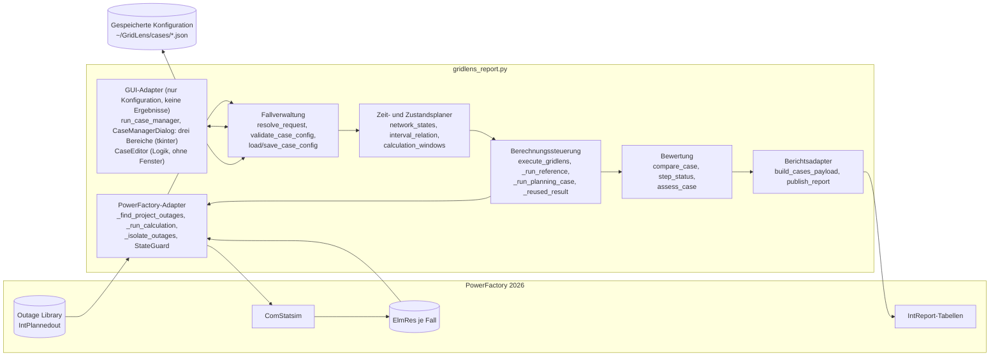
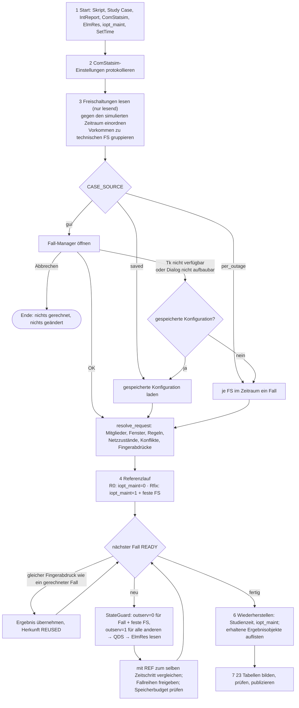
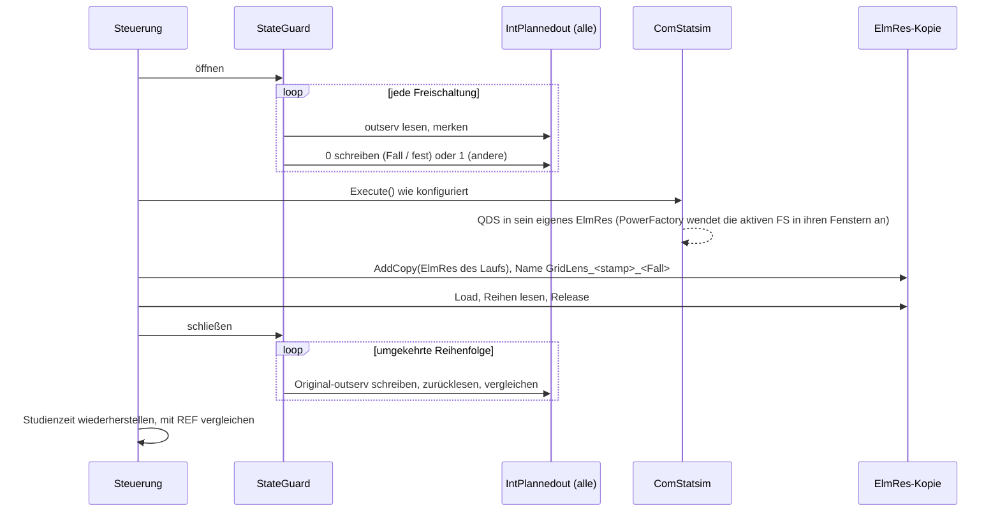
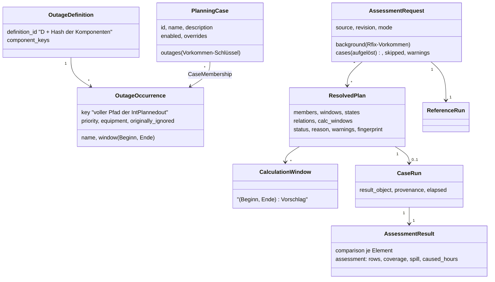
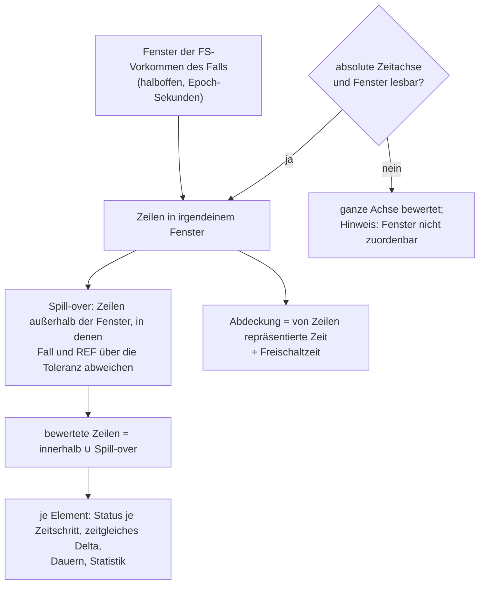
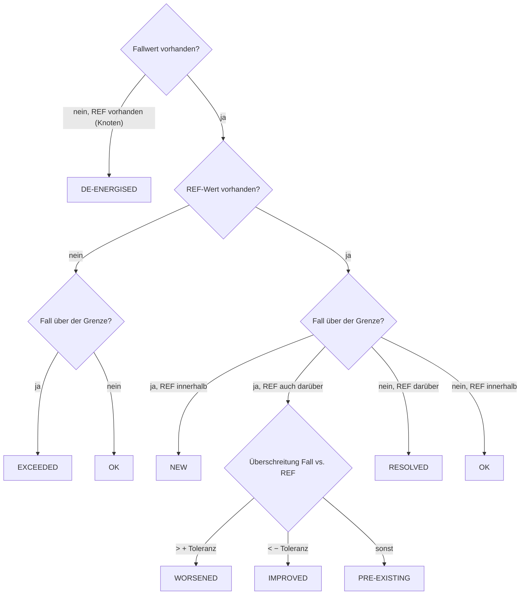
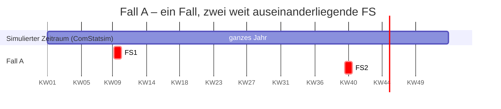

# GridLens 8.0 – Planungsfall-Manager: Architektur und Methodik

Stand: 23. Oktober 2026 · Publisher 8.0.0 · MRT 6.2.0 · Datenvertrag 6.2 (n-1-Kapitel; Namen ohne Ziffern; eine Vorlagenseite je Kapitel) · Settings 1.0 · Klassifizierungsregeln 1.0

GridLens 8 erweitert die Einzel-Vorprüfung von 7.x zu einer Bewertung **vom
Ingenieur definierter Planungsfälle**. Ein Planungsfall ist eine beliebige
Menge von Freischaltungs-Vorkommen (FS); PowerFactory wendet jede in ihrem
eigenen Zeitfenster während einer quasi-dynamischen Simulation (QDS) an. Ein
Fall durchläuft dadurch mehrere Netzzustände. Jeder Fall wird **zum selben
Zeitschritt** mit einer Referenz verglichen. LODF ist vollständig entfernt.

Alles, was GridLens in PowerFactory tut (Objekte, Schalter, Planned Outages,
QDS, Contingency Analysis, Falldefinition, geprüftes und offenes
API-Verhalten), beschreibt [`POWERFACTORY.md`](POWERFACTORY.md).

Nichts davon ist bisher in PowerFactory gelaufen. Abschnitt 11 nennt, was
dort geprüft werden muss, bevor man sich auf die Ergebnisse verlässt.

Weitere Dokumente (deutsch):

- [FALLMANAGER.md](FALLMANAGER.md) – Bedienung des Dialogs, Konfigurationsdatei, Rückfallwege
- [BERICHTSMIGRATION.md](BERICHTSMIGRATION.md) – Datenvertrag 5.0 → 6.0 und Vorlagenänderungen
- [TESTMATRIX.md](TESTMATRIX.md) – V01–V40 und Tests A–E mit Prüfstatus
- [../superpowers/specs/2026-10-23-n1-settings-design.de.md](../superpowers/specs/2026-10-23-n1-settings-design.de.md) – Entwurf von Teil 1 und 2 (n-1-Vorbereitung, Settings)

Englische Fassung: [../ARCHITECTURE.md](../ARCHITECTURE.md). Code, Logs und
Berichtstexte bleiben englisch; die Begriffe in Klammern sind die Namen im Code
bzw. im Bericht.

---

## 1. Der zentrale Wechsel

| | GridLens 7.x | GridLens 8.0 |
|---|---|---|
| Fall | eine Freischaltung = ein automatischer Fall | ein vom Ingenieur definierter Planungsfall = beliebig viele FS-Vorkommen |
| Kombination | FS1 + FS2 nie gemeinsam gerechnet | gemeinsam gerechnet, wenn sie im selben Fall stehen |
| Aktive Menge über die Zeit | eine FS, ein Fenster | Folge von Netzzuständen (elementare Intervalle) |
| Vergleich | Fall-Maximum − REF-Maximum im Fenster | Fall(t) − REF(t) in jedem Zeitschritt, danach aggregiert |
| Referenz | immer „ohne Freischaltung“ | R0 (keine) oder Rfix (feste Hintergrund-Freischaltungen) |
| Leitungsranking | LODF aus `ComVstab` | entfernt; nur echte QDS-Lastflüsse |
| Ergebnisobjekte | temporäres `ElmRes`, nach dem Auslesen gelöscht | ein `ElmRes` je Fall, bleibt im Study Case |
| QDS-Zeitraum | gesamter `ComStatsim`-Zeitraum | gesamter Zeitraum mit dem ComStatsim-Zeitschritt; keinerlei Zeitoptimierung (mit Teil 2 entfernt: keine vorgeschlagenen Fenster, kein `QDS_WINDOW_MODE`) |

---

## 2. Ist–Soll-Analyse (Lieferteil A)

### 2.1 Was 7.x konnte und bleibt

| Bereich | Funktion(en) | 8.0 |
|---|---|---|
| Kontext, Einstellungsprotokoll | `execute_gridlens` (Schritte 1–2), `_log_qds_settings` | unverändert |
| Erkennung der Freischaltungen | `_find_project_outages`, `_outage_details`, `outage_window` | unverändert; jeder Datensatz trägt jetzt den stabilen Schlüssel (voller Pfad) und alle Komponenten-Schlüssel |
| Klassifikation | `classify_planned_outages` | unverändert; dient nur noch dem Modus „je Freischaltung ein Fall“ und dem Dialog |
| QDS-Ausführung | `_run_calculation` | gleicher Aufruf; das Ergebnisobjekt bleibt erhalten und trägt den Fallnamen |
| Ergebnisauslese | `collect_series` | behält die Werte in voller Auflösung; eindeutige Zeitlabels auch bei Zeitumstellung |
| Zustandsschutz | `StateGuard`, `_restore_study_time`, `_restore_planned_outage_option`, `_restore_results_binding` | unverändert, für jeden Fall verwendet |
| Tabellen über den Gesamtzeitraum | `apply_reference`, Kreise, Radar, Zählungen, Top 10, Zeitplots, Anhänge | unverändert (als Differenz der Maxima dokumentiert) |
| Publikation | `validate_payload`, `publish_report` | unverändert |

### 2.2 Erweitert oder ersetzt

| 7.x | 8.0 | Grund |
|---|---|---|
| `_isolate_outage(guard, active, records)` | `_isolate_outages(guard, active_keys, records, label)` | eine Menge statt einer FS |
| `_run_outage_case` | `_run_planning_case` + `_reused_result` | Mehrfach-FS-Fälle, Wiederverwendung identischer Fälle |
| Referenzblock in `execute_gridlens` | `_run_reference` | R0 mit `iopt_maint=0`, Rfix mit `iopt_maint=1` und nur den festen FS |
| `window_bounds` (Ende inklusive, `bisect_right`) | `window_rows` (halboffen `[Beginn, Ende)`, `bisect_left`) | einheitliche Intervallkonvention |
| `window_statistics` je FS-Index | `compare_case` / `compare_element` | zeitgleicher Vergleich, Dauern, Abdeckung, Spill-over |
| `paired(..., windowed=True)` | liefert die zeitgleichen Datensätze | alle fallbezogenen Tabellen nutzen den zeitgleichen Vergleich |
| `limit_status` (5 Zustände) | `step_status` je Zeitschritt + Rangfolge; neu IMPROVED, DE-ENERGISED, OUT OF SERVICE | Vorgabe Abschnitt 20 |
| `assess_case` | neue Urteile DE-ENERGISED NODES und INCOMPLETE COVERAGE | keine positive Aussage aus fehlenden Daten |
| `_case_rows` (Zeile je FS) | Zeile je Planungsfall + übersprungene FS | Vorgabe Abschnitt 39 |
| `_temporary_result` + `_delete_temporary_results` | `_case_result_object` + `ResultStore` | Ergebnisobjekte bleiben in PowerFactory |

### 2.3 Entfernt (LODF)

`CALCULATE_LODF`, alle `LODF_*`-Konstanten, `LodfError`, `_contents`,
`_lodf_create`, `contingency_keys`, `_prepare_lodf`, `_lodf_result`,
`_read_lodf_matrix`, `_execute_lodf`, `_clean_up_lodf`, `calculate_lodf`,
`_lodf_ranking`, `_lodf_text`, die LODF-Qualitätsprüfung, jede Verwendung von
`ComVstab` / `ComSimoutage` / `ComOutage`, Tabelle `ScriptedLodfRanking`, Feld
`lodf_text`, Kapitel 12 der Vorlage. Tests stellen sicher, dass weder Skript
noch Vorlage LODF erwähnen. Die Dokumente unter `docs/superpowers/` beschreiben
den Stand 7.0 und sind historisch.

### 2.4 Zu prüfende PowerFactory-API-Annahmen

| # | Annahme | Wofür | Stand |
|---|---|---|---|
| P1 | `iopt_maint=1` wendet jede `IntPlannedout` mit `outserv=0` in ihrem Fenster an | jeder Fall | im Feld für eine FS bestätigt (28.09.2026) |
| P2 | `outserv=1` an einer `IntPlannedout` schließt sie bei `iopt_maint=1` aus | Isolation der Fallmenge | nicht geprüft |
| P3 | mehrere aktive FS wirken gleichzeitig und enden je an ihrem eigenen Ende | Mehrfach-FS-Fälle, T01–T13 | nicht geprüft |
| P4 | zwei FS auf demselben Betriebsmittel: Verhalten, wenn die erste endet | V13 | unbekannt; sich überlappende FS sind normale Planung und keine Warnung |
| P5 | `ElmRes`-Zeitstempel und Fenstergrenzen (02:00-Effekt im Test vom 29.09.) | halboffene Fenster | offen; die Spill-over-Prüfung erkennt und bewertet solche Effekte |
| P6 | `AddCopy` des `ElmRes`, in das eine QDS schrieb, nach dem Lauf; Umbenennen | Ergebnisobjekt je Fall | geprüft am 24.10.2026: die Kopie behält Zeilen, Spalten, Werte und IntMon, auch nach dem nächsten QDS-Lauf |
| P7 | Schreiben von `IntPlannedout.starttime/endtime` | eigene Termine je Fall | nicht genutzt (`ALLOW_OUTAGE_TIME_OVERRIDE = False`) |
| P8 | Schreiben von `ComStatsim.startTime/endTime` und Anfangszustand zeitgekoppelter Modelle | – | nicht genutzt; kürzere QDS-Fenster sind entfernt |
| P9 | `tkinter` / Tcl/Tk in PowerFactorys Python | Fall-Manager | Probe-Werkzeug vorhanden, Ergebnis in PowerFactory nicht dokumentiert |
| P10 | `GetCalcRelevantObjects('*.ElmQdsl')` listet zeitgekoppelte Modelle | Zustandskonsistenz für Teil 3 | nicht geprüft; gezählt von `tools/probe_contingency.py` |

---

## 3. Änderungs- und Risikomatrix

| Änderung | Risiko | Gegenmaßnahme | Restrisiko |
|---|---|---|---|
| Mehrere FS in einer QDS | P2/P3 falsch → ein Fall enthält mehr oder weniger FS als angezeigt | Log und Nachweistabelle nennen je Lauf aktive und ignorierte FS; jedes `outserv` wird zurückgesetzt und zurückgelesen | PF-Test V02/V03 nötig |
| Zeitgleicher Vergleich | Speicher: volle Reihen je Element | `array('d')` (8 Byte je Wert) nur für die Referenz dauerhaft; Fallreihen nach dem Vergleich freigegeben; Budget vor jedem Lauf geprüft | sehr große Modelle erreichen `MAX_RUN_CELLS` |
| Spill-over-Bewertung | numerisches Rauschen außerhalb der Fenster als Wirkung gezählt | Toleranz 0,1 pp / 0,001 p.u.; zuerst exakter Array-Vergleich | keines bekannt |
| Ergebnisobjekte bleiben | Study Case wächst je Lauf und Fall um ein `ElmRes` | Namen `GridLens_<yymmdd-HHMMSS>_<Fall>`; im Bericht aufgeführt | Speicherbedarf bei Jahresläufen; alte Läufe löscht der Ingenieur |
| Fall-Manager in PowerFactory | Tk startet nicht oder blockiert | Dialog vor jeder Zustandsänderung; Fehler → gespeicherte Konfiguration → je FS ein Fall; Abbrechen ändert nichts | Tk-Verhalten in PF ungeprüft (P9) |
| Konfiguration außerhalb des Projekts | Datei verloren oder von Hand verändert | Schema, Version und alle Feldtypen werden geprüft; beschädigte Datei stoppt den Lauf mit Pfad | nicht mit dem Projekt versioniert |
| Eigene Termine je Fall | Überschreiben des Originals | in 8.0 nicht angewendet; Fall NOT EVALUATED | keines |
| Settings (Teil 2) | ein Override ändert die n-0-Bewertung unbemerkt | Overrides werden geprüft und in Log und Bericht genannt (Zeile *Settings*, WARNING); Standards reproduzieren den bisherigen Bericht exakt | vorläufig außerhalb des Projekts gespeichert |
| LODF entfernt | Ranking fehlt | Ranking nach zeitgleichem Delta in Metric View, Zeitplot und Übersicht | keines |

---

## 4. Logischer Aufbau

Eine Datei `powerfactory/gridlens_report.py`, in Abschnitte gegliedert:

---

## 5. Ablauf eines Laufs

Ein Fall mit einem gewöhnlichen Fehler bleibt als `FAILED` bzw.
`NOT EVALUATED` mit Grund im Bericht; der nächste Fall läuft. Ein nicht
rücksetzbarer Zustand (`StateRestoreError`) stoppt den Lauf. Das
Wiederherstellen steht in einem `finally`-Block und läuft daher auch nach
einem Fehler in der Referenz oder beim Auslesen.

### 5.1 Ein Fall im Detail

---

## 6. Datenmodell (Lieferteil C)

| Entität | Umsetzung | Hinweise |
|---|---|---|
| `OutageDefinition` (technische FS) | `assign_definitions(records)` setzt `definition_id` | Vorkommen, die dieselben Komponenten schalten, gehören zu einer technischen FS |
| `OutageOccurrence` (FS-Vorkommen) | Datensatz einer `IntPlannedout` (`_outage_record`) | Identität = voller PowerFactory-Pfad, nie der Anzeigename |
| `CaseMembership` (Fallzuordnung) | `cases[].outages` (Liste von Vorkommen-Schlüsseln) | viele-zu-viele; ein Vorkommen darf in beliebig vielen Fällen stehen |
| `PlanningCase` (Bewertungsfall) | `cases[]` der Konfiguration | ID: Buchstaben, Ziffern, `_`, `-`, höchstens 16 Zeichen, nicht `REF` (Teil des `ElmRes`-Namens; ein Punkt würde als Klassentrenner gelesen) |
| `AssessmentRequest` (Bewertungsauftrag) | Ergebnis von `resolve_request(...)` | Quelle, Revision, Modus, Hintergrund, aufgelöste Fälle, Warnungen |
| `CalculationWindow` (Berechnungsfenster) | `calculation_windows(...)` | 24 h Vorlauf je Fenster, Fenster mit < 48 h Abstand zusammengefasst; nur Vorschlag |
| `ReferenceRun` | Ergebnis mit ID `REF` | R0 oder Rfix, `run_note` nennt welche |
| `CaseRun` | Ergebnis von `_run_planning_case` oder `_reused_result` | `result_object`, `provenance`, `elapsed` |
| `AssessmentResult` | `result['comparison']`, `result['assessment']`, `assess_case(...)` | je Element und je Fall |

**Unabhängige Fälle.** Jeder Fall enthält nur seine direkt zugeordneten
FS-Vorkommen. Für eine gemeinsame Planung beide FS direkt einem dritten Fall
zuordnen. Ändern, Ausschließen oder Löschen eines Falls verändert keinen anderen
Fall. Kopieren erzeugt eine unabhängige Variante. Voraussetzungen und
Alternativgruppen zwischen Fällen gibt es nicht mehr.

**Gespeicherte Konfiguration.** Schemaversion 2 speichert direkte Zuordnungen.
`upgrade_case_config` überführt Version 1 beim Laden: übernommene FS und ihre
zuerst wirksamen eigenen Termine werden direkte Zuordnungen; Voraussetzungen
und Ausschlüsse entfallen. Problems and warnings und Log zeigen einen Umstellungshinweis.
Laden schreibt die Datei nicht neu. Ungültige alte Verweise/Kreise stoppen die Umstellung.

**Regeln zwischen FS-Vorkommen.**

| Regel | Konfiguration | Prüfung |
|---|---|---|
| B01 gleicher Fall | `outages` | gemeinsame Zeitachse |
| B08/F11 dürfen nicht überlappen | Regel `not_overlap` | überlappende Fenster abgelehnt |
| B09/F10 Reihenfolge | Regel `order` | die zweite FS muss nach dem Ende der ersten beginnen |
| B10 nur gemeinsam | Regel `together` | beide vorhanden und überlappend |
| F15/V13 gleiches Betriebsmittel | automatisch | keine: Überlappung ist normale Planung, nur ihre Beziehung wird festgehalten |

---

## 7. Methodik

### 7.1 Aktive Menge und Netzzustände

Für die Vorkommen `O_c` eines Falls gilt `A_c(t) = { o ∈ O_c | a_o ≤ t < b_o }`.
`network_states` sammelt alle Beginne und Enden, sortiert sie und liefert die
elementaren Intervalle mit ihrer aktiven Menge; Nachbarn mit gleicher Menge
werden zusammengefasst, leere Intervalle (∅) bleiben erhalten. Das gilt für
beliebig viele Vorkommen; die 13 Beziehungen zweier Intervalle (T01–T13) sind
nur der Sonderfall, den `interval_relation` je Paar meldet.

```mermaid
gantt
    title Test B – drei überlappende FS, fünf Netzzustände
    dateFormat HH:mm
    axisFormat %H:%M
    section Freischaltungen
    FS1 :a1, 08:00, 13:00
    FS2 :a2, 10:00, 15:00
    FS3 :a3, 11:00, 14:00
    section Netzzustand
    FS1           :s1, 08:00, 10:00
    FS1+FS2       :s2, 10:00, 11:00
    FS1+FS2+FS3   :s3, 11:00, 13:00
    FS2+FS3       :s4, 13:00, 14:00
    FS2           :s5, 14:00, 15:00
```

GridLens schaltet diese Zustände nicht selbst. PowerFactory wendet jede aktive
FS in ihrem eigenen Fenster während der QDS an (`iopt_maint=1`); GridLens
bestimmt nur, welche FS aktiv sind (`outserv`). Die berechneten Zustände
dokumentieren, was PowerFactory tun soll; sie stehen in Vorschau, Log und
Bericht (`states_text`).

### 7.2 Zeitgleicher Vergleich

Für Element `e`, Zeilen `k` und Schrittdauern `Δt_k = t_{k+1} − t_k` (die
letzte Zeile wiederholt den vorigen Schritt):

- zeitgleiches Delta: `D_max(e) = max_k [ y_c(e,t_k) − y_R(e,t_k) ]` (Spannung: größte betragsmäßige Änderung, mit Vorzeichen)
- Differenz der Maxima (getrennt, so benannt): `max_k y_c − max_k y_R`
- Überschreitung: Auslastung `max(0, L − 100 %)`; Spannung `max(0, U_min − U, U − U_max)`
- Dauer verursachter Verletzungen eines Falls: `Σ Δt_k` über die Vereinigung aller Zeilen, in denen ein Element NEW oder WORSENED ist

Test A der Vorgabe: REF 80 %, 60 %; Fall 70 %, 85 % → Differenz der Maxima
+5 pp, zeitgleiches Delta +25 pp.

### 7.3 Welche Zeilen bewertet werden

In einem Fall unterscheiden sich nur seine eigenen FS von der Referenz. Jede
Abweichung außerhalb ihrer Fenster bedeutet daher, dass PowerFactory sie
versetzt anwendet oder ein Schaltzustand die FS überdauert (F14). Diese Zeilen
werden mitbewertet, und die Qualitätsseite nennt den Fall. Das erfasst auch den
02:00-Effekt aus dem Test vom 29. September.

### 7.4 Klassifikation

Ein Element erhält den schwersten Zustand seiner Zeitschritte (NEW >
WORSENED > EXCEEDED > DE-ENERGISED > PRE-EXISTING > IMPROVED > RESOLVED > OK).
Betriebsmittel, die der Fall selbst ausschaltet, sind OUT OF SERVICE, nie
RESOLVED. Werte genau auf der Grenze sind keine Verletzung. Auslastungsgrenze
standardmäßig 100 % (die Bemessung der Elemente steckt bereits in
`c:loading`), ein Spannungsband in p.u. der Nennspannung für jede Spannungsebene; beides sind seit
Teil 2 Einstellungen (7.5).

Urteil je Fall, die erste zutreffende Zeile gilt:

| Urteil | Bedingung | Farbe |
|---|---|---|
| OVERLOAD + VOLTAGE BAND / OVERLOAD / VOLTAGE BAND | ein Auslastungs- und/oder Spannungselement NEW, WORSENED oder EXCEEDED | rot |
| DE-ENERGISED NODES | ein Knoten verliert im Fall seine Spannung | gelb |
| INCOMPLETE COVERAGE | nichts gefunden, aber die Ergebnisse decken < 99,9 % der Freischaltzeit ab | gelb |
| NO ADDITIONAL VIOLATION | nur PRE-EXISTING oder IMPROVED | gelb |
| NO LIMIT EXCEEDED | nichts über einer Grenze | keine |
| NO RESULT DATA IN WINDOW | keine Zeile zu bewerten | keine |
| NOT EVALUATED / NOT SIMULATED | Lauf fehlgeschlagen, Regelkonflikt, Zeitachse abweichend / außerhalb des Zeitraums | keine |

Fehlende oder fehlerhafte Ergebnisse ergeben nie NO LIMIT EXCEEDED.

### 7.5 Settings (Teil 2)

Jeder Grenzwert und jede Toleranz der Bewertung ist eine **Einstellung**
(`SETTINGS` in `gridlens_report.py`, Version `SETTINGS_VERSION = '1.0'`).
Standards sind die Werte des Codes: Warnschwelle 80 %, n-0-Auslastungsgrenze
100 % (Leitungen und Transformatoren getrennt), ein Spannungsband von
0,95–1,05 p.u. für jede Spannungsebene (als GridLens-Vorschlag gekennzeichnet;
die kV-Bänder je Spannungsebene sind seit dem 23. Oktober 2026 ersetzt),
Änderungstoleranzen 0,1 %-Punkte / 0,001 p.u. Die früheren Skriptkonstanten
TOP_N, MAX_PLOT_POINTS, ENERGIZED_MIN_PU, die Anhang-Schwellen,
RUN_REFERENCE_CASE, MAX_CASES und MAX_N1_TIMES sind die Standards gleichnamiger
Settings (`setting_value()`). CASE_SLOTS, die Versionen und die Startoptionen
bleiben Konstanten: Davon hängen MRT oder Start ab.

Rechnung und Veröffentlichung sind getrennt: Ein ComPython, das nicht unter
einem IntReport liegt, rechnet, baut und prüft alle Berichtstabellen und
protokolliert die Ergebnisse, veröffentlicht aber nichts (eigenständiger Lauf,
Exit-Code 0).

Ein Lauf hat **zwei Phasen**. Phase 1 (Log-Schritt 4) rechnet nur: REF und
jeden Fall in sein eigenes, behaltenes `GridLens_<Stempel>_<Fall>`, und jeden
n-1-Durchlauf in eine behaltene Kopie seines Ergebnisobjekts (`…_<Fall>_N1`,
`…_<Fall>_N1P`; verweigert PowerFactory die Kopie, wird dieser Durchlauf sofort
gelesen). Jedes behaltene Objekt nennt in seiner Beschreibung seinen Fall, den
Fingerabdruck des Falls und bei n-1 die Aufzeichnungsgrenzen. Schritt 5 setzt
den PowerFactory-Zustand zurück; Phase 2 (Schritt 6) liest, vergleicht und
klassifiziert die behaltenen Objekte; Schritt 7 baut und veröffentlicht den
Bericht. Das Speicherbudget stoppt Phase 2, bevor der nächste Fall gelesen
wird; alles Gerechnete bleibt erhalten.

**Neu auswerten ohne Rechnung:** Die Auswahl *Results* im Fallmanager listet
die behaltenen Läufe des Study Case (`kept_stamps`). Wer einen wählt,
überspringt Phase 1 ganz – nichts wird gerechnet, PowerFactory nicht verändert –
und Phase 2 liest die Objekte dieses Laufs mit den aktuellen Settings
(`kept_runs`). Ein Fall, dessen FS oder Fenster sich seitdem geändert haben
(anderer Fingerabdruck) oder dessen Objekt fehlt, ist NOT EVALUATED mit Grund;
ein geänderter REF stoppt den Lauf.

**Werden die Außerbetriebnahmen wirklich angewendet?** Drei Prüfungen machen
das in Log und Bericht sichtbar:

- Ob n-1 läuft, steht immer im Log: „n-1 is not calculated: it is not ticked
  in the case manager“, „… no planning case can be calculated“ oder die
  verwendete Contingency Analysis.
- Vor jedem QDS-Lauf mit Außerbetriebnahmen und vor jedem n-1-Sweep liest
  GridLens zurück, was PowerFactory anwenden wird (`applied_text`): die Option
  (`iopt_maint` bzw. `isPlannedOutages`) und jede Außerbetriebnahme mit
  „Ignored“ = 0; steht die Option auf 0, meldet die Zeile, dass keine gilt.
- In Phase 2 wird jede Außerbetriebnahme eines Falls in ihrem eigenen Fenster
  gegen REF geprüft (`outage_effects`): **APPLIED** (ein aufgezeichnetes
  Betriebsmittel ist im Fall lastfrei, in REF nicht), **EFFECT SEEN**
  (Betriebsmittel nicht aufgezeichnet, das Netz weicht aber von REF ab),
  **NO EFFECT** (der Fall gleicht REF im Fenster; vermutlich nicht angewendet,
  Warnung im Log), **NOT CHECKABLE** (kein REF auf derselben Zeitachse oder
  keine Ergebniszeile im Fenster). Die Model-Quality-Seite trägt je Fall eine
  Zeile `outages_<case>`.

**Erhaltene Ergebnisobjekte: eine Kopie nach jedem Lauf.** GridLens bindet
`ComStatsim.results` nicht. PowerFactory schreibt eine QDS in sein eigenes
Ergebnisobjekt im Study Case: Hat das gebundene Objekt keine Variablenauswahl
(etwa ein temporäres im Benutzerordner `Set\Tmp`), bindet PowerFactory ein
Ergebnisobjekt mit seiner Standard-Variablenauswahl und schreibt dort hinein;
jeder Lauf überschreibt es. Direkt nach jedem Lauf kopiert GridLens dieses
Objekt als `GridLens_<stamp>_<Fall>` in den Study Case (geprüft: die Kopie
behält Zeilen, Spalten, Werte und IntMon, auch nach dem nächsten Lauf). Die
Bindung von PowerFactory bleibt, wie ein Lauf von Hand sie hinterlässt. Ist ein
erhaltenes GridLens-Objekt gebunden, stoppt der Lauf vor jeder Rechnung, weil
die QDS es überschreiben würde.

**Aufzeichnungsprüfung nach dem ersten Lauf.** Direkt nach dem ersten
QDS-Lauf (REF oder, ohne REF, dem ersten Fall) liest GridLens die Spaltenliste
seiner erhaltenen Kopie (`check_recording`). Zeichnet sie keine der bewerteten
Variablen auf (`c:loading`, `m:loading`, `m:u`, `m:u1`), bricht GridLens sofort
mit einem `RecordingError` ab, statt alle weiteren Fälle und n-1 umsonst zu
rechnen. Der Fehler nennt, was Kopie und PowerFactory-Ergebnisobjekt
aufzeichnen, dessen Variablenauswahl (IntMon) und die vermutliche Ursache.

**n-1-Time-Sweep als Zeitraum.** Mit `calcPeriod` 4 rechnet die Contingency
Analysis von `startTime` bis `endTime` (exklusiv) in Schritten von
`stepSize`/`stepUnit` und ignoriert `studyTime` (geprüft am 24.10.2026).
GridLens schreibt diesen Zeitraum je Sweep (`calcPeriod`, Schritt,
`startTime`, `endTime`, `stepNumber`; verifiziert zurückgesetzt): vom ersten
bis zum letzten QDS-Schritt in den FS-Fenstern des Falls (`sweep_period`).
Schritte zwischen auseinanderliegenden Fenstern werden gerechnet, aber nicht
bewertet; ein Zeitraum über dem n-1-Limit wird abgelehnt. Vor jedem Sweep
liest GridLens die Einstellungen zurück (`sweep_settings_text`); direkt danach
prüft es, ob jeder Zeitpunkt in den Fenstern gerechnet wurde (`cnttime` der
Teilergebnisse). Fehlt einer, endet n-1 dieses Falls mit gewünschten,
fehlenden und gerechneten Zeitpunkten und den Einstellungen.

**Fehlerbericht.** Ein fehlgeschlagener Lauf gibt vor der Laufübersicht einen
Block *FAILURE REPORT* aus (`log_failure`): Fehler, Ort (Schritt und Fall zum
Zeitpunkt des Fehlers), Ursachenkette, Detailzeilen
(`GridLensError.details`), Codestelle (Funktion und Zeile in
`gridlens_report.py`), PowerFactory-Zustand nach der Wiederherstellung,
erhaltene Ergebnisobjekte, letzte Warnungen und Abhilfe
(`GridLensError.hint`). Scheitert nur ein Fall oder sein n-1, stehen dessen
Detailzeilen unter seiner Fehlermeldung.

Jeder Lauf endet mit einer **Laufübersicht** (`RunStats`, `log_run_summary`),
auch ein fehlgeschlagener: Zeit und Aufrufe je Dienst (FS lesen, Grids und
Fehlerfälle lesen, der Fallmanager mit Fensteraufbau und Aktualisierungen, jede
QDS und Contingency Analysis in PowerFactory, Ergebnisse lesen, Vergleich und
Klassifizierung, Zurücksetzen, Berichtstabellen bauen und veröffentlichen) und
die Zahl der Berechnungen (QDS-Läufe und Zeitschritte, wiederverwendete Fälle,
gelesene Reihen und Werte, angelegte und gerechnete Contingency Analyses,
n-1-Zeitpunkte, Lastflüsse je Fehlerfall, eingestufte n-1-Ergebnisse,
Berichtszeilen).

Ergebnisse werden spaltenweise gelesen: `ElmRes.GetColumnValues(IntVec, Spalte)`
füllt einen temporären IntVec `GridLens_column_buffer`, der im laufenden
ComPython für den Lauf angelegt und beim Zurücksetzen gelöscht wird. Ohne ihn
wäre jeder Wert ein eigener `GetValue`-Aufruf; die Laufübersicht zählt beide
Lesearten, ein langsamer Lauf zeigt also sofort, ob das Blocklesen gegriffen
hat. Eine Spannungsspalte eines n-1-Unterergebnisses mit einer 0 wird
zellweise gelesen, weil nicht verifiziert ist, was das Blocklesen in eine Zelle
innerhalb der Aufzeichnungsgrenzen (Code 3) schreibt. Geplante Freischaltungen
werden je FS in einem Durchgang gelesen, das ganze Projekt wird nur durchsucht,
wenn der Outage-Ordner keine enthält, und ohne Grid-Auswahl wird je
Ergebnisspalte kein Grid abgefragt.

| Kategorie | Bedeutung | Beispiele | Änderbar |
|---|---|---|---|
| A – Bewertung | deutet berechnete Ergebnisse; ändert nie Lastfluss, Bemessung oder Modell | Warnschwellen, Bewertungsgrenzen, Spannungsbänder, Toleranzen | ja, geprüft |
| B – Berechnung | würde ändern, was PowerFactory rechnet | Contingency-Set, Post-Fault-Phasen, Remedial Actions, AC/DC, Inselbildung, nicht versorgte Last, Lastabwurf | **nein**: schreibgeschützt bis zur Verifikation |

Zu Beginn eines Laufs (nach dem Schließen des Fallmanagers) hält
`activate_settings` einen Snapshot fest: Werte, Herkunft je Wert (`GridLens`,
`PowerFactory`, `user`), Overrides, Settings- und Klassifizierungsversion. Die
Bewertung liest Grenzen nur über `loading_limit()`, `loading_warning()`,
`voltage_bands()`, `default_voltage_limits()` und `change_tolerance()`;
`reset_settings()` stellt am Ende die Standards wieder her. Mit den Standards
sind die publizierten Berichtstabellen identisch mit der Vorversion (Test
`test_default_settings_reproduce_the_n0_report_exactly`, exakte Gleichheit jeder
Zeile außer der Erzeugungszeit). Der Bericht nennt die Settings in *Model
Quality Assurance* (Zeile *Settings*, WARNING bei aktivem Override).

Ablage: nur Overrides, unter `settings` in der Konfigurationsdatei der Fälle
(JSON). **Vorläufig** – eine native Ablage im PowerFactory-Projekt und ein
unveränderliches Snapshot-Objekt je Lauf sind offen, bis die Probe (Teil 1) ein
geeignetes Objekt zeigt. Settings und Ergebnisse werden nie vermischt: Die Datei
enthält kein Ergebnis.

### 7.6 Klassifizierung n-1 gegen (n-1)' (Teil 2, Regelversion 1.0)

`classify_comparison(reference, scenario, parameters)` ist eine reine Funktion
für jedes Szenario (`CLASSIFICATION_VERSION = '1.0'`). Sie ist implementiert und
getestet, **wird aber noch von keiner Berechnung genutzt**: n-1 und (n-1)' folgen
in Teil 3. Die n-0-QDS behält ihre eigenen Status (`step_status`:
`PRE-EXISTING`, `DE-ENERGISED`, …) unverändert.

Vergleichbar nur bei gleichem Zeitschritt, Fehlerfall, überwachtem
Betriebsmittel, Ergebnisgröße, Post-Fault-Phase und Grenzwertdefinition. Mit
Szenario `c`, Fehlerfall `k`, Element `e` und Zeit `t`:

- zeitgleiche Differenz `ΔL = L(n-1)',c,k(e,t) − L(n-1),k(e,t)` in %-Punkten; nie
  eine Differenz unabhängiger Maxima,
- Auslastungsverletzung `V_L = max(0, L − L_lim)`,
- Spannungsverletzung `V_U = max(0, U_min − U, U − U_max)`.

| Code | Status | Bedingung |
|---|---|---|
| 0 | OK | keine Seite verletzt |
| 1 | NEW | nur das Szenario verletzt |
| 2 | WORSENED | beide verletzt, `V_s − V_r > WORSENED-Toleranz + numerische Toleranz` |
| 3 | PRE_EXISTING | beide verletzt, Änderung innerhalb der Toleranzen |
| 4 | IMPROVED | beide verletzt, `V_r − V_s > IMPROVED-Toleranz + numerische Toleranz` |
| 5 | RESOLVED | nur die Referenz verletzt |
| 90 | FAILED | Berechnung fehlgeschlagen oder nicht konvergiert; nie eine nachgewiesene Verletzung |
| 91 | NOT_EVALUATED | Wert oder Grenze fehlt oder ist ungültig (NaN, ±∞, None, Boolean, Text) |
| 92 | NOT_APPLICABLE | Fehlerfall nicht anwendbar, z. B. sein Betriebsmittel ist bereits durch eine FS ausgeschaltet |
| 93 | NOT_COMPARABLE | Zeit, Fehlerfall, Element, Größe, Phase oder Grenzwertdefinition unterscheiden sich |

Eine Seite ist verletzt, wenn `V > Grenzwerttoleranz + numerische Toleranz`
(Standard 0 und 1e-9: genau auf der Grenze ist keine Verletzung,
Rundungsrauschen auch nicht).

Entscheidungsreihenfolge: 1 FAILED, 2 NOT_APPLICABLE, 3 NOT_COMPARABLE,
4 NOT_EVALUATED, 5 numerische Entscheidung. Die Anwendbarkeit wird vor fehlenden
Werten geprüft, weil ein nicht anwendbarer Fehlerfall zu Recht keinen Wert hat
und diesen Grund behalten muss. Jeder nicht numerische Befund bleibt in
`reasons`, die Rangfolge verdeckt also keine zweite Ursache. Fehlende Werte
werden nie durch null ersetzt. `MARGIN_REDUCED` ist ein Zusatzindikator, nie ein
Status: ein OK-Ergebnis, dessen Reserve zur Grenze um mehr als die
WORSENED-Toleranz geschrumpft ist (bei Auslastung erst ab der Warnschwelle für
reduzierte Reserve, Standard 80 %).

Standards und Begründung: Grenzwerttoleranz 0 (bestehende Regel „auf der Grenze
ist keine Verletzung“); numerische Toleranz 1e-9 (weit unter jedem fachlich
relevanten %-Punkt- oder p.u.-Unterschied); WORSENED- und IMPROVED-Toleranz
0,1 %-Punkte / 0,001 p.u. (die bestehenden n-0-Änderungstoleranzen, damit beide
Bewertungen dieselbe Auflösung haben); n-1-Grenzen „use PowerFactory limits“ =
100 % der Bemessung, auf die PowerFactory die Auslastung bezieht (ob das die
Post-Fault-Bemessung ist, ist offen, siehe 12).

### 7.7 Aussage A und Aussage B

Der Bericht trennt auf der Fallseite: Aussage A (was die Freischaltungen
hinzufügen) bewerten die Fälle. Aussage B (das Netz ist über den ganzen
Zeitraum zulässig) beschreibt nur die Referenz; ein Fall ohne zusätzliche
Verletzung beweist sie nicht.

---

## 8. Beispiel: FS1 in KW10, FS2 in KW40 (Lieferteil E)

1. **Einlesen.** Beide `IntPlannedout` werden gelesen (Schlüssel, Fenster, Komponenten).
2. **Zuordnen.** Der Ingenieur legt FS1 und FS2 in Fall A.
3. **Zustände.** `FS1 | ∅ | FS2` (Beziehung T01).
4. **Zeitbasis.** Kein verkürztes Fenster: Jeder Lauf deckt den ganzen
   ComStatsim-Zeitraum mit seinem Zeitschritt ab (seit Teil 2 keine Zeitoptimierung).
5. **Referenz.** Ein REF-Lauf über den ganzen Zeitraum (`iopt_maint=0`),
   erhalten als `GridLens_<stamp>_REF`.
6. **Fall-Lauf.** Eine QDS über den ganzen Zeitraum mit FS1 und FS2 aktiv
   (`outserv=0`), alle anderen FS ignoriert, erhalten als `GridLens_<stamp>_A`.
   PowerFactory wendet FS1 in KW10 und FS2 in KW40 an.
7. **Vergleich.** Die Zeilen von KW10 und KW40 werden zum selben Zeitschritt
   mit REF verglichen; jede Abweichung dazwischen (z. B. ein Schaltzustand,
   der FS1 überdauert) wird als Spill-over bewertet und gemeldet.
8. **Bericht.** Eine Zeile für Fall A: beide Zeiträume, beide FS, die
   Fall-Definition, Abdeckung beider Wochen, das Urteil und die
   Nachweistabelle mit beiden Läufen und ihren Ergebnisobjekten.

Aufwand: ein Ganzjahres-Lauf für die Referenz (für beliebig viele Fälle
gemeinsam) plus einer je unterschiedlichem Fall. Kein Lauf wird verkürzt.

---

## 9. Fehlerbehandlung und Robustheit

| Situation | Verhalten | Wo |
|---|---|---|
| Konfigurationsdatei mit falschen Typen, IDs, Regeln, eigenen Terminen | jedes Problem mit Fall genannt; der Lauf stoppt **vor** jeder Änderung in PowerFactory | `validate_case_config` |
| Konfiguration unlesbar oder anderes Schema | Lauf stoppt mit Dateipfad; nie stillschweigend übergangen | `load_case_config` |
| FS seit dem Speichern gelöscht oder umbenannt | dieser Fall NOT EVALUATED mit Pfad | `resolve_request` |
| Fenster endet vor seinem Beginn | dieser Fall NOT EVALUATED | `resolve_request` |
| feste FS unbekannt oder in PowerFactory „Ignored“ | Warnung in Log und Qualitätsseite | `resolve_request`, `_model_quality` |
| Tk fehlt oder Dialog lässt sich nicht aufbauen | gilt als „Dialog nicht verfügbar“: gespeicherte Konfiguration, sonst je FS ein Fall; der Bericht nennt die Quelle | `run_case_manager`, `obtain_case_request` |
| Fehler in einer Dialog-Schaltfläche | in einem Meldungsfenster angezeigt; Dialog bleibt offen; nichts gerechnet | `report_callback_exception` |
| Dialog bricht während der Bedienung ab | Lauf stoppt, nichts gerechnet | `run_case_manager` |
| Abbrechen | Lauf endet, nichts gerechnet, gespeichert oder publiziert; `main` protokolliert CANCELLED und reicht den Abbruch an den aufrufenden Reportablauf weiter, statt normal zurückzukehren. Der Aufrufer erhält damit keinen erfolgreichen Skriptabschluss. | `GridLensCancelled`, `main`; tatsächliche Behandlung durch IntReport noch in PowerFactory prüfen |
| `outserv` nicht schreibbar | dieser Fall FAILED; Einstellungen zurückgesetzt | `_isolate_outages`, `StateGuard` |
| QDS scheitert oder `ElmRes` nicht lesbar | dieser Fall FAILED; der nächste Fall läuft | `_run_planning_case` |
| Vergleich scheitert unerwartet | dieser Fall NOT EVALUATED mit Grund; sein `ElmRes` bleibt; der nächste Fall läuft | `_run_planning_case` |
| Speicherbudget (`MAX_RUN_CELLS`) überschritten | Stopp vor dem nächsten Lauf, nicht nach dem letzten; Zustand zurückgesetzt | `check_run_budget` |
| Einstellung nicht rücksetzbar | Lauf stoppt mit erwartetem und gelesenem Wert | `StateRestoreError` |
| Referenz scheitert | Lauf stoppt (kein Fall vergleichbar); Zustand zurückgesetzt | `_run_reference` |
| Ergebnisobjekt zeichnet weder Auslastung noch Spannung auf (kein `c:loading`/`m:loading` von Leitungen und Trafos, kein `m:u`/`m:u1` von Knoten) | die Meldung nennt, was gebraucht wird, listet, was das `ElmRes` stattdessen aufzeichnet, und sagt, die Variablen in den Result Variables der QDS zu ergänzen oder einen anderen Study Case zu wählen; nur spannungslose Knoten werden als solche benannt | `collect_series`, `missing_series_message` |
| Lauf scheitert ohne Publikation | das Skript endet mit Exit-Code 1 (`NO_REPORT_EXIT_CODE`), damit PowerFactory den Bericht nicht erzeugt; die letzte Logzeile sagt das (ein von Hand erzeugter Bericht scheitert mit „Scripted... not found“ in `ReportsNet.log`); ein erfolgreicher Lauf endet mit 0 und nennt den IntReport | `main`, `exit_code`, `NO_REPORT_DATA`; in PowerFactory zu prüfen |
| Lauf scheitert ohne Publikation | die letzte Logzeile sagt, dass keine Berichtstabellen publiziert wurden und das Erzeugen des Berichts daher mit „Scripted... not found“ in `ReportsNet.log` scheitert; ein erfolgreicher Lauf nennt den IntReport, aus dem der Bericht erzeugt wird. Abbrechen nimmt den separaten Pfad mit Weitergabe des Abbruchs oben. | `main`, `NO_REPORT_DATA`, `execute_gridlens` |
| Abdeckung unter 99,9 % | nie „NO LIMIT EXCEEDED“; der Text zeigt nie „100 %“ | `assess_case`, `percent_text` |
| Fenster nicht auf der Zeitachse platzierbar | jeder Zeitschritt wird verglichen (langsamer); Warnung im Log, Hinweis im Bericht | `compare_case`, `_run_planning_case` |
| mehrfach berechnetes Urteil könnte abweichen | jeder Fall wird nach den Läufen einmal beurteilt; Log, Falltabelle und Übersicht lesen dieses Urteil | `judge_cases`, `judged` |

Alle Wiederherstellungsschritte stehen in `finally` und laufen daher auch nach
einem Fehler oder einem `KeyboardInterrupt`.

---

## 10. Performance (Lieferteil H)

| Größe | Wo sie steht |
|---|---|
| geplante QDS-Läufe | Vorschau im Fall-Manager: „Calculation runs: 1 reference + n case run(s)“ |
| vermiedene Läufe | identische Fälle (gleiche FS, Fenster, feste FS) übernehmen das Ergebnis: Vorschau im Fall-Manager „n identical case(s) reused“, Nachweistabelle „CASE (reused)“ |
| Zeitschritte je Lauf | Nachweistabelle `time_steps` |
| gemessene Laufzeit | Nachweistabelle `elapsed_text`, Log (QDS und Vergleich getrennt) |
| Zeitbasis | immer der ganze ComStatsim-Zeitraum; `qds_mode_text` sagt das im Bericht; vorgeschlagene Fenster gibt es nicht |

Die GUI aktualisiert geänderte Tabellenzeilen, statt alle zu löschen und neu
anzulegen. Filter blenden Zeilen aus und wieder ein; aus den Daten entfernte
Zeilen werden auch dann gelöscht, wenn ein Filter sie verbirgt. Scrollposition
und sichtbare Auswahl bleiben erhalten; der Tastaturfokus wird beim Ausfiltern
zurückgesetzt. Ohne FS-Regeln entfällt das Sortieren aller FS-Namen je Aktualisierung.
Ein lokales Tk-8.6-Profil mit 5.000 künstlichen FS, vier Fallwechseln und einem
Häkchen benötigte vorher 0,758 s, danach 0,358 s: aus 25.000 neu angelegten Zeilen
wurden 81 Zeilenupdates, ohne Neuanlegen/Löschen nach dem Öffnen. Das sind lokale
GUI-Messungen, keine PowerFactory- oder QDS-Laufzeitmessungen.

Grobes Modell (Vorgabe Abschnitt 27): `T ≈ (1 + m_unterschiedlich) · (τ_I + n · τ_L)`.
Es wird keine Beschleunigung behauptet; in PowerFactory ist nichts gemessen.

---

## 11. Offene Abnahme in PowerFactory

Vor dem produktiven Einsatz in PowerFactory 2026 ausführen und das Ergebnis
festhalten:

1. P2/P3: ein Fall mit zwei überlappenden FS – das Log nennt beide aktiv;
   Auslastungen mit zwei Einzelfällen vergleichen (V02, V03).
2. P5: eine Fenstergrenze bei Stundenschritten – erscheint die Wirkung in den
   Fensterzeilen oder in den Spill-over-Zeilen?
3. P6: die Ergebnisobjekte `GridLens_<stamp>_<Fall>` erscheinen im Study Case
   und lassen sich öffnen.
4. P9: der Fall-Manager öffnet sich, OK / Abbrechen funktionieren,
   PowerFactory reagiert danach normal (V30, V31).
5. Der Bericht rendert: eine Seite je Kapitel, die n-1-Kapitel 15 und 16 und
   das Inhaltsverzeichnis mit 21 Einträgen (lokal mit Stimulsoft 2025.3.5
   gerendert, 26.10.2026; in PowerFactory noch nicht).
6. Speicher und Laufzeit eines Ganzjahreslaufs mit 10 Fällen.

Eigene Termine je Fall brauchen zuerst eine eigene Probe
(`tools/probe_planned_outages.py` ist der Ort), dann eine Entscheidung, sie
freizuschalten. Kürzere QDS-Fenster sind entfernt und nicht vorgesehen.

---

## 12. Teil 1 und Teil 2, und was Teil 3 braucht

Teil 1 (freigegeben am 23. Oktober 2026): `tools/probe_contingency.py`, streng
lesend (kein `Execute`, `CreateObject`, `SetAttribute`, kein `GetFromStudyCase`,
das einen fehlenden Befehl anlegt; `tests/test_probe_contingency.py` prüft den
Quelltext). Probe 1.0 meldete ComSimoutage, ComStatsim, Contingency-Definitionen,
Contingency-`ElmRes`, die `ElmRes`-Schnittstelle und Ablage-Kandidaten mit
Namen und Werten. Seit dem 23. Oktober 2026 läuft Probe 2.0 im **strikten
Privacy-Modus**: nur feste Labels und Status-Tokens, kein Name, Pfad, Wert,
Zeitpunkt oder Zähler, jeder PowerFactory-Aufruf über ein lesendes Gateway
(siehe Spezifikation, Abschnitt 2.1). Ihre Ausgabe darf weitergegeben werden;
die übrigen Werkzeuge sind nur lokal. `tools/test_contingency.py` bereitet eine
sehr kleine Testrechnung auf einer ausdrücklich benannten Projektkopie vor; es ist abgeschaltet
(`ENABLED = False`), fragt vor jedem Schreiben, stellt wieder her und prüft – und
wird gesondert freigegeben.

Teil 2: Fallmanager mit zwei Reitern, Settings mit Prüfung und vorläufiger
Ablage, Tooltips, `classify_comparison` mit Tests. n-1 und (n-1)' bleiben
deaktiviert.

| Status | Funktion |
|---|---|
| implementiert und lokal getestet (Unit-Tests) | Settings-Modell, Prüfung, Snapshot, `classify_comparison`, Entfernen der Zeitoptimierung, n-0 mit Settings (Regression mit Standards) |
| nur mit Mock-Objekten oder lokalem Tk getestet | Fallmanager mit zwei Reitern, Settings-Reiter, Tooltips (Tk 8.6 unter macOS); die Probe gegen nachgebildete PowerFactory-Objekte |
| braucht einen echten PowerFactory-2026-Test | der Probe-Lauf selbst; Tk in PowerFactory; der n-0-Lauf mit Settings-Overrides; die Berichtszeile *Settings* im gerenderten PDF |
| Teil 3 (n-1-Lauf), mit Mock-Objekten getestet | n-1 und (n-1)' über `run_n1` / `run_n1_case` / `run_n1_sweep`, Zeitpunkte auf dem QDS-Raster in den Fenstern des Falls, Contingency-Grid-Filter, `compare_n1`, Zeilen *n-1 <Fall>* auf der QA-Seite (`tests/test_n1_core.py`); braucht einen echten PowerFactory-Lauf |
| weiterhin nur gelesen | Parameter der Kategorie B außer den Contingency-Grids, Post-Fault-Spannungsgrenzen, native Ablage der Settings und von `GL_<Szenario>_CLASSIFICATION`, n-1-Berichtskapitel (Teil 4) |

Voraussetzungen für Teil 3 (jede beantwortet durch die Ausgabe der Probe oder
einen freigegebenen Lauf von `tools/test_contingency.py`):

1. Time Sweep des ComSimoutage: Attribute und Nachweis, dass er genau die
   ComStatsim-Zeitschritte rechnet (Beginn, Ende, Schritt, letzter Schritt).
2. Ob der Time Sweep `IntPlannedout` in ihren Fenstern mit derselben
   `iopt_maint`-/`outserv`-Semantik wie die QDS anwendet.
3. Das Objekt des Contingency-Sets, unverändert gemeinsam für n-1 und (n-1)'.
4. Ergebnisstruktur: wie eine Zeile Fehlerfall, Zeitschritt und Post-Fault-Phase
   benennt; dicht oder dünn besetzt; wie die vollständige Menge der Kombinationen
   Fehlerfall × Zeitpunkt nachgewiesen wird.
5. Das Ergebnis von PowerFactory für einen Fehlerfall, dessen Betriebsmittel
   bereits ausgeschaltet ist (→ NOT_APPLICABLE).
6. Auf welche Bemessung sich `c:loading` nach einem Fehlerfall bezieht
   (Post-Fault-Bemessung).
7. Eine `ElmRes`-Schreibmethode, die Klassifizierungscodes speichert und
   unverändert zurückliest (`GL_<Szenario>_CLASSIFICATION`), und ein natives
   Projektobjekt für Settings, Snapshots und Fallkonfigurationen.
8. Zustandskonsistenz zeitgekoppelter Modelle (`ElmQdsl`) zwischen QDS und
   Time Sweep.
