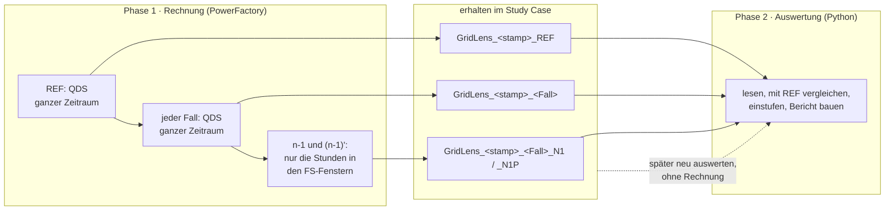
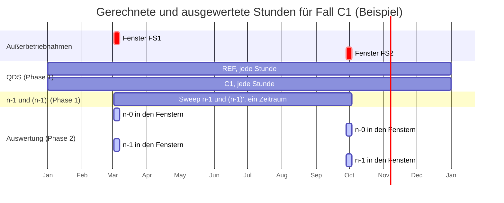

# GridLens – Berechnung und Auswertung, und wie GridLens Zeit spart

Wie GridLens 8.0 rechnet und auswertet, welche Stunden jeder Schritt abdeckt,
wo die Filter wirken und jede Maßnahme, die Rechen- oder Auswertezeit spart.
Stand: 25. Oktober 2026. Englische Fassung:
[`docs/CALCULATION_AND_EVALUATION.md`](../CALCULATION_AND_EVALUATION.md);
beide werden gemeinsam gepflegt. Wie GridLens mit PowerFactory arbeitet,
beschreibt [`POWERFACTORY.md`](POWERFACTORY.md).

---

## 1. Zwei Phasen: erst alles rechnen, dann auswerten

1. **Phase 1** führt alle Rechnungen aus und behält jedes Ergebnis als eigenes
   Objekt im Study Case. Dazwischen wird nichts gelesen.
2. **Zurücksetzen**: jeder geschriebene Wert wird zurückgesetzt und geprüft.
3. **Phase 2** liest die erhaltenen Objekte und wertet sie aus.

Weil die Ergebnisse erhalten bleiben, kann Phase 2 jederzeit **ohne Phase 1**
erneut laufen: *Results* im Fall-Manager listet die erhaltenen Läufe auf. **Der
Ingenieur allein entscheidet**, ob neu gerechnet oder ein erhaltener Lauf neu
ausgewertet wird; GridLens wechselt nie von selbst.

---

## 2. Welche Stunden gerechnet und ausgewertet werden

Beispiel: QDS-Zeitraum ein Jahr, stündlich. Fall C1 enthält zwei
Außerbetriebnahmen, FS1 in KW 10 und FS2 in KW 40.

| Schritt | Stunden | Warum |
|---|---|---|
| QDS, REF und jeder Fall | **jede Stunde des Zeitraums** | PowerFactory wendet jede FS in ihrem eigenen Fenster während einer QDS an; die QDS kann keine Stunden überspringen |
| n-1 und (n-1)' | **nur die QDS-Schritte von der ersten bis zur letzten Fensterstunde des Falls** | `calcPeriod = 4` mit `startTime`/`endTime`; jeder Schritt außerhalb der Fenster würde nur REF wiederholen |
| Auswertung n-0 | die Fensterstunden, dazu jede Stunde außerhalb, in der sich Fall und REF unterscheiden (Spill-over) | außerhalb der Fenster sollten Fall und REF gleich sein |
| Auswertung n-1 | nur die Fensterstunden | die Schritte zwischen auseinanderliegenden Fenstern werden gerechnet, aber nicht bewertet |

**Bekannte Grenze:** Weit auseinanderliegende Fenster (wie FS1 und FS2 oben)
machen den n-1-Zeitraum lang: jede Stunde dazwischen wird gerechnet. Ein
Zeitraum über *n-1 study times, at most* (Settings) wird mit Meldung
abgelehnt. Den Fall aufzuteilen oder ein Sweep je Fenster vermeidet das.

---

## 3. Maßnahmen, die Zeit sparen

| Maßnahme | Was sie spart | Wo | Status |
|---|---|---|---|
| **Erhaltenen Lauf neu auswerten** | die ganze Phase 1: keine QDS, kein n-1 | *Results* im Fall-Manager, `kept_runs` | genutzt |
| **Gleiche Fälle einmal rechnen** | eine QDS und ein n-1 je verschiedener Menge aus FS und Fenstern; die übrigen sind `REUSED` | `plan_fingerprint` | genutzt |
| **Gemeinsame n-1-Referenz** | der n-1-Sweep wird je Menge von Zeitpunkten einmal gerechnet und von jedem Fall mit denselben Stunden geteilt | `references` in `calculate_n1_case` | genutzt |
| **n-1 nur in den Fenstern** | statt jeder Stunde des Zeitraums nur die Fensterstunden (erster Lauf: 2 von 8784) | `n1_study_times`, `sweep_period` | geprüft 24.10.2026 |
| **Eine Spalte je Aufruf** | `GetColumnValues` liest eine ganze Spalte statt eines Aufrufs je Wert | `read_column` | genutzt |
| **Berichtsfilter vor dem Lesen** | Reihen von Netzen außerhalb des Berichtsfilters werden gar nicht gelesen | `collect_series` | genutzt |
| **Vergleich nur wo nötig** | die Fensterstunden und die Stunden, in denen Fall und REF abweichen, nicht jede Stunde | `compare_case` | genutzt |
| **Stopp nach dem ersten Lauf** | zeichnet das erste erhaltene Ergebnis keine Auslastung oder Spannung auf, startet kein weiterer Lauf | `check_recording` | geprüft 24.10.2026 |
| **Plotpunkte** | Zeitplots nutzen höchstens *Plot points* Punkte je Reihe | Setting `max_plot_points` | genutzt |
| **n-1-Filter** | nur Fehlerfälle in den n-1-Netzen, die ein gewähltes Betriebsmittel ausschalten, werden gerechnet | `excluded_contingencies` | genutzt |

Die Laufübersicht am Ende jedes Logs zeigt Zeit je Dienst und Anzahl der
Rechnungen; so lässt sich die Wirkung jeder Maßnahme an einem Lauf ablesen.

---

## 4. Rechnung im Detail

1. **REF**: R0 (`iopt_maint = 0`, keine FS) oder Rfix (`iopt_maint = 1`, nur
   die festen FS).
2. **Jeder Fall**: `iopt_maint = 1`; die FS des Falls und die festen haben
   `outserv = 0`, jede andere `outserv = 1`. Eine QDS über den ganzen Zeitraum.
   Direkt danach kopiert GridLens das Ergebnisobjekt, in das PowerFactory
   schrieb, als `GridLens_<stamp>_<Fall>`.
3. **n-1**: je Fall ein Sweep mit `isPlannedOutages = 0` (oder nur den festen
   FS) über den Zeitraum von der ersten bis zur letzten Fensterstunde.
4. **(n-1)'**: derselbe Zeitraum mit den FS des Falls.
5. Die n-1-Ergebnisse bleiben als `…_N1` und `…_N1P` erhalten; ihre
   Beschreibung nennt die n-1-Filter, mit denen sie gerechnet wurden.

## 5. Auswertung im Detail

1. Erhaltene QDS-Ergebnisse lesen; der Berichtsfilter entscheidet, welche
   Reihen gelesen werden.
2. Jeden Fall mit REF **zum selben Zeitschritt** vergleichen: die
   Fensterstunden und jede Stunde, in der sie abweichen; jeden Schritt
   einstufen (`NEW`, `WORSENED`, …).
3. Prüfen, ob jede FS wirkte (`APPLIED`, `NO EFFECT`, …) und ob sie nach ihrem
   Fenster weiter wirkt.
4. Erhaltene n-1-Ergebnisse lesen, die Fehlerfälle außerhalb der aktuellen
   n-1-Filter weglassen, (n-1)' gegen n-1 je Zeitpunkt und
   Fehlerfall einstufen.
5. Berichtstabellen bauen (und unter einem `IntReport` publizieren).

---

## 6. Wo die Filter wirken

| Filter (Settings → Network scope) | Rechnung | Auswertung | Neuauswertung eines erhaltenen Laufs |
|---|---|---|---|
| **Report filter: assessed equipment, grids** | keine Wirkung: PowerFactory rechnet das ganze Netz | nur Leitungen, Transformatoren und Knoten dieser Netze werden bewertet (n-0 und die in n-1 beobachteten Betriebsmittel) | wirkt vollständig |
| **n-1 filter: grids of the outaged equipment** | Fehlerfälle außerhalb dieser Netze sind für den Lauf „Not analysed“ | – | grenzt ein: jetzt außerhalb liegende Fehlerfälle bleiben aus der Auswertung |
| **n-1 filter: outaged elements** | nur Fehlerfälle, die mindestens ein gewähltes Betriebsmittel ausschalten, werden gerechnet; die übrigen sind für den Lauf „Not analysed“ (oder werden nicht angelegt). Keine Auswahl: jedes Betriebsmittel | die Auslastung jedes Betriebsmittels wird unter den gerechneten Fehlerfällen weiter bewertet | grenzt ebenso ein |
| *(kein Filter auf der QDS)* | die QDS rechnet immer das ganze Netz | | |

Bei einer Neuauswertung können die n-1-Filter nur **eingrenzen**: Ein
Fehlerfall, der bei der Rechnung „Not analysed“ war, hat kein Ergebnis, und
nur eine neue Rechnung fügt ihn hinzu. Das Log nennt die Filter, mit denen der
erhaltene Lauf gerechnet wurde, und die Fehlerfälle, die die aktuellen Filter
weglassen; die Vorschau des Fall-Managers sagt, was für die gewählten
*Results* gilt.

---

## 7. Neu auswerten in der Praxis

1. Fall-Manager öffnen.
2. *Results*: den erhaltenen Lauf (`GridLens_<stamp>_…`) wählen oder *Calculate now*.
3. Berichtsfilter, Grenzwerte oder Schwellen nach Bedarf ändern; die
   n-1-Filter ändern, um die Auswertung einzugrenzen.
4. *Start calculation*: mit einem erhaltenen Lauf rechnet PowerFactory nichts.

Der Bericht nennt, dass es eine Neuauswertung des erhaltenen Laufs ist; die
Ergebnisobjekte sind dieselben wie vorher.

---

## 8. Offene Frage: Auswertung in der Vorlage mit SQL

Stimulsoft liest die Berichtsdatenbank (SQLite) und könnte mit SQL in der
Vorlage vergleichen und auswerten. Dafür müssten die QDS-Zeitreihen in der
Berichtsdatenbank liegen: Python liest sie weiterhin aus PowerFactory
(Stimulsoft kann kein `ElmRes` lesen) und müsste dann jeden Wert mit
`IntReport.SetValue` schreiben, ein Aufruf je Zelle. Ein Jahr stündlich mit 450
Reihen, REF und fünf Fällen sind rund 24 Millionen Aufrufe; heute schreibt
GridLens einige tausend Ergebniszellen.

Ob das tragbar ist, hängt davon ab, wie schnell `SetValue` in PowerFactory ist;
das ist nicht gemessen. `ui/probe_report_write.py` misst es: Es läuft unter
einem **eigenen** IntReport, dessen Name „probe“ enthält (sein `Reset()` leert
diesen Bericht), schreibt Zahlen, Ganzzahlen und Texte in wachsenden Stufen und
eine schmale Langformat-Tabelle und gibt Zellen je Sekunde und Schätzungen für
die Fälle oben aus. Die Entscheidung folgt aus seinen Zahlen.
