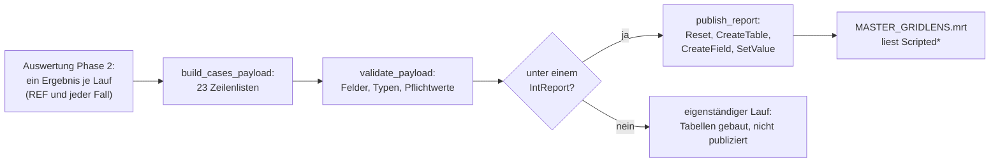

# GridLens – wie jede Scripted-Tabelle berechnet und erstellt wird

GridLens publiziert **38 Tabellen** (Datenvertrag 7.0), die beide
Berichtsvorlagen lesen: `MASTER_GRIDLENS` (Hauptbericht, Kapitel H01–H10)
und `MASTER_GRIDLENS_DETAIL` (technischer Detailbericht, D01–D13), gehalten als
Pages in `designer-pages/<Bericht>/` (`.dct`-Wörterbuch und je Page eine
`.pg`). Jede
Vorlage zeigt ihre Kapitel; für dieselbe Run-ID drucken beide dieselbe
Statistik. Dieses Dokument beschreibt Tabelle für Tabelle,
woher jede Zeile kommt, wie jedes Feld berechnet wird und welches Kapitel des
Berichts es zeigt. Stand: 26. Oktober 2026, Publisher 8.0.0. Englische
Fassung: [`docs/REPORT_TABLES.md`](../REPORT_TABLES.md); beide werden gemeinsam
gepflegt. Rechnung und Auswertung selbst:
[`BERECHNUNG_UND_AUSWERTUNG.md`](BERECHNUNG_UND_AUSWERTUNG.md).

Funktionsnamen in `code` stehen in `outage-assessment/main.py`.

---

## 1. Von den Ergebnissen zum Bericht

1. **Phase 2** liefert je Lauf ein *Ergebnis*: REF und jeder Planungsfall, jedes
   mit seinen Reihen (je Betriebsmittel und Variable), deren Statistik und, für
   einen Fall, dem Vergleich mit REF zu denselben Zeitschritten und seinem
   Urteil.
2. **`build_cases_payload`** macht aus diesen Ergebnissen und der Anfrage
   (Fälle, Außerbetriebnahmen, Settings) 23 Zeilenlisten, in der Reihenfolge
   von Abschnitt 3.
3. **`validate_payload`** prüft jede Zeile: nur deklarierte Felder (`TABLES`),
   der richtige Typ (Text, Ganzzahl, endliche Zahl), jedes Pflichtfeld
   (`REQUIRED_FIELDS`) gefüllt, genau eine Zeile in `ScriptedReportMeta`, ein
   Betriebsmittel je Trend-Tabelle. Texte werden auf 80 Zeichen (Namen) bzw.
   500 Zeichen gekürzt und enden mit „…“.
4. **`publish_report`** (nur unter einem `IntReport`): genau ein `Reset()`, dann
   je Tabelle `CreateTable(name)` mit dem Namen **ohne** das Präfix `Scripted`
   (PowerFactory ergänzt es), `CreateField` je Feld und `SetValue` je gefüllter
   Zelle. Eine Tabelle mit mehr als 5000 Zeilen wird gekürzt, und die
   Model-Quality-Seite erhält eine `FAIL`-Zeile (`_enforce_table_limits`).

---

## 2. Begriffe aller Tabellen

| Begriff | Bedeutung |
|---|---|
| **REF** | der Referenzlauf: R0 (keine Außerbetriebnahme) oder Rfix (nur die festen) |
| **Fall** | ein Planungsfall; *gerechnete* Fälle sind die, deren QDS konvergiert ist |
| **Reihe** | ein Betriebsmittel mit einer Variable über die Zeit: Leitungen und Transformatoren `c:loading`/`m:loading` in %, Knoten `m:u`/`m:u1` in p.u. |
| **Statistik** | je Reihe über den **ganzen** Zeitraum: Minimum, Maximum, Mittelwert und Zeitpunkt von Minimum und Maximum (`statistics`) |
| **kritisch** | Auslastung strikt über der Grenze (*Maximum loading for n-0*, Leitungen und Transformatoren getrennt), Spannung strikt außerhalb des Bands (`is_critical`) |
| **zeitgleicher Datensatz** | ein Betriebsmittel eines Falls neben demselben in REF, verglichen zu denselben Zeitschritten in den Fenstern und überall, wo sie abweichen (`compare_case`); trägt Schrittstatus, zeitgleiches Delta und verursachte Stunden |
| **Schrittstatus** | `NEW`, `WORSENED`, `PRE-EXISTING`, `IMPROVED`, `RESOLVED`, `EXCEEDED`, `DE-ENERGISED`, `OK`; ein Betriebsmittel erhält den schwersten |
| **Urteil** | je Fall eines von `NO LIMIT EXCEEDED`, `NO ADDITIONAL VIOLATION`, `OVERLOAD`, `VOLTAGE BAND`, `OVERLOAD + VOLTAGE BAND`, `DE-ENERGISED NODES`, `INCOMPLETE COVERAGE`, … (`assess_case`, einmal je Fall gespeichert und von jeder Tabelle genutzt) |
| **violation** | 1 (rot): vom Fall verursacht (`OVERLOAD`, `VOLTAGE BAND`, beides); 2 (gelb): Aufmerksamkeit (`NO ADDITIONAL VIOLATION`, `DE-ENERGISED NODES`, `INCOMPLETE COVERAGE`); 0: nichts |
| **Berichtsfilter** | nur Betriebsmittel der gewählten Netze werden überhaupt zu Reihen; jede Tabelle sieht nur sie |

**Das Urteil eines Falls** (`assess_case`), in dieser Reihenfolge:

1. eine verursachte Überlastung (`NEW`, `WORSENED` oder `EXCEEDED` einer Leitung oder eines Transformators) und eine verursachte Spannungsverletzung → `OVERLOAD + VOLTAGE BAND`;
2. nur eine verursachte Überlastung → `OVERLOAD`; nur eine verursachte Spannungsverletzung → `VOLTAGE BAND`;
3. ein vom Fall spannungslos geschalteter Knoten → `DE-ENERGISED NODES`;
4. die Außerbetriebnahmezeit ist nicht vollständig durch Ergebniszeilen abgedeckt (< 99,9 %) → `INCOMPLETE COVERAGE`;
5. eine Verletzung, die es schon in REF gibt (`PRE-EXISTING`, `IMPROVED`) → `NO ADDITIONAL VIOLATION`;
6. sonst → `NO LIMIT EXCEEDED`.

Ein Fall ohne Ergebniszeile in seinen Fenstern erhält `NO RESULT DATA IN
WINDOW`; fehlende oder unvollständige Ergebnisse führen nie zu `NO LIMIT
EXCEEDED`.

**Matrix-Tabellen** stellen REF und bis zu sechs Fälle nebeneinander
(`_matrix_tables`). Jede Zeile wiederholt die Blocknummer (`block`, Fälle 1–6,
7–12, …), die Zahl der Fallspalten ihres Blocks (`col_count`), die Fallnamen
(`case_a_name` … `case_f_name`) und ihre Texte (`case_a_text` … `case_f_text`); der Bericht hat
je Spaltenzahl ein Band-Paar. Genutzt von `ScriptedCaseComparison`,
`ScriptedTopLinesByCase` und den drei Anhangstabellen.

**Diagrammtabellen im Breitformat** zeichnen REF und die ersten sechs Fälle mit
festen Farben: Slot `ref` ist REF (grau), Slot `a`–`f` die Fälle
(`series_ref_name`, `series_a_name` … `series_f_name`, `value_ref`, `value_a` …
`value_f`). Genutzt von `ScriptedRadar` und den beiden Trend-Tabellen.

**Kein Feldname enthält eine Ziffer** (seit Vertrag 6.1). Mit Vertrag 6.0
fehlten die Tabellen, deren Felder Ziffern trugen (`c1_text`, `s0_name`, `v0`,
…), in der im Stimulsoft-Designer geöffneten Berichtsdatenbank, während jede
andere Tabelle vorhanden war.

---

## 3. Die Tabellen

### 3.1 `ScriptedReportMeta` – Titelseite, Kopf, Aussagen

**Kapitel:** Titelseite, Inhaltsverzeichnis, Kopf- und Fußzeile jeder Seite.
**Zeilen:** genau eine.

| Feld | Berechnung |
|---|---|
| `run_id` | Stempel der Ergebnisobjekte, die der Lauf behält oder neu auswertet (`GridLens_<Stempel>_…`); in jeder Kopfzeile beider Berichte |
| `study_name`, `study_description` | Name und Beschreibung des aktiven Study Case (die Titelseite zeigt keine Study ID) |
| `model_name` | Name des Projekts |
| `model_version` | `PowerFactory 2026` |
| `simulation_start`, `simulation_end` | erste und letzte Zeitbeschriftung des ersten konvergierten Laufs |
| `simulation_time_step` | Abstand der ersten beiden Zeitschritte, z. B. `1 h` |
| `generation_date`, `generated_by` | Ortszeit des Laufs, Windows-Benutzer |
| `run_mode` | `REFERENCE + PLANNING CASES` |
| `template_name`, `template_version`, `data_contract_version` | Konstanten des Skripts (MRT 7.0.0, Vertrag 7.0) |
| `result_name` | das konfigurierte Ergebnisobjekt |
| `assessment_scope` | Zahl der Planungsfälle, Name von REF, Text des Berichtsfilters |
| `assessment_status` | `PRE-ASSESSMENT - NOT AN OPERATIONAL RELEASE` |
| `voltage_limits` | Text des Spannungsbands aus den Settings |
| `has_cases` | `1`, wenn mindestens ein Fall gerechnet wurde |
| `case_source_text`, `reference_text`, `qds_mode_text` | woher die Fälle kommen, R0/Rfix, die feste QDS-Zeitbasis |
| `coverage_statement` | Aussage A (Wirkung der Außerbetriebnahmen) und Aussage B (absoluter Netzzustand, nur REF) |

### 3.2 `ScriptedModelQuality` – Model-Quality-Seite

**Haupt 4** Calculation Quality, **Detail 14** Quality and Error Register. **Zeilen:** je Prüfung eine, in dieser
Reihenfolge (`build_cases_payload`, `_model_quality`):

| Prüfung (`check_id`) | Statusregel |
|---|---|
| `planned_outages` | PASS, wenn mindestens eine Außerbetriebnahme einem Fall zugeordnet ist; Text: gefunden, zugeordnet, nicht gerechnet |
| `cases` | PASS, wenn jeder Lauf konvergiert ist und Reihen hat |
| `case_<id>` | FAIL je nicht konvergiertem Lauf |
| `case_configuration` | WARNING, wenn ein Fall nicht bereit ist |
| `request_warning_<n>`, `case_warning_<id>` | Warnungen aus der Fallkonfiguration |
| `coverage` | WARNING, wenn ein Fall weniger als 99,9 % seiner Außerbetriebnahmezeit abdeckt |
| `outside_window` | WARNING, wenn ein Fall außerhalb seiner Fenster von REF abweicht |
| `series_line`, `series_transformer`, `series_voltage` | bewertete und kritische Betriebsmittel je Art |
| `voltage_data` | INFO: ausgelassene DC-Knoten und Knoten ohne Spannung |
| `deenergized` | WARNING: von einem Fall spannungslos geschaltete Knoten |
| `time_variation` | WARNING, wenn jede Reihe konstant ist (Profile fehlen) |
| `reference_comparison` | PASS, wenn ein konvergierter REF existiert |
| `qds_mode` | INFO: ganzer ComStatsim-Zeitraum |
| `security_scope` | WARNING: was der Bericht nicht nachweist (n-1-Sicherheit, Schutz, …) |
| `limit_loading`, `limit_voltage` | INFO: die verwendeten Grenzen |
| `network_scope` | INFO: Berichtsfilter und Umfang der Fehlerfälle |
| `settings` | INFO, oder WARNING, wenn Settings von den GridLens-Vorgaben abweichen |
| `outages_<Fall>` | hat jede Außerbetriebnahme gewirkt (`APPLIED`, `EFFECT SEEN`, `NO EFFECT`, `NOT CHECKABLE`) |
| `outages_after_<Fall>` | eine Außerbetriebnahme, die nach ihrem Fenster weiter wirkt |
| `n1_<Fall>` | (n-1)' gegen n-1: Anzahl je Status; FAIL, wenn der Fall `NEW` oder `WORSENED` verursacht, WARNING, wenn Ergebnisse fehlen |
| `table_limit_<Tabelle>` | FAIL, wenn eine Tabelle bei 5000 Zeilen gekürzt wurde |

`affected_element` nennt den betroffenen Fall oder das Betriebsmittel, sonst
`-`. Die n-1-Ergebnisse stehen im Detail in den Tabellen des Vertrags 7.0
(Abschnitte 3.22–3.43).

### 3.3 `ScriptedCases` – gerechnete Fälle und Außerbetriebnahmen

**Haupt 5** (Planung der Außerbetriebnahmen) **und 6** (Falldefinition und Netzzustände).
**Zeilen:** REF (`case_order` 0), dann jeder Planungsfall in der Reihenfolge der
Konfiguration, dann jede Außerbetriebnahme außerhalb des simulierten Zeitraums
(`case_id` `N/A`) (`_case_rows`).

| Feld | REF | Planungsfall |
|---|---|---|
| `case_id`, `case_name` | `REF`, `Reference` | Id und Name des Falls |
| `is_reference` | 1 | 0 |
| `simulation_status` | Status des Laufs | Status des Laufs, oder des Falls, wenn er nicht gerechnet wurde |
| `period_text` | erste bis letzte Zeitbeschriftung | vom frühesten Beginn bis zum spätesten Ende seiner Fenster |
| `priority` | 0 | höchste Priorität seiner Außerbetriebnahmen |
| `equipment_name` | `No planned outage` oder die festen | die geschalteten Betriebsmittel seiner Außerbetriebnahmen |
| `assessment` | `BASELINE` | das Urteil, oder `NOT SIMULATED` / `NOT EVALUATED` mit Grund |
| `assessment_detail` | max. Leitungsauslastung und Spannungsbereich von REF | die Sätze hinter dem Urteil (`assessment_detail`): max. Auslastung mit Betriebsmittel, Zeit und REF-Wert, größter zeitgleicher Anstieg, Anzahl Überlastungen, Spannungsbereich, spannungslose Knoten, verursachte Stunden, Spill-over, Abdeckung |
| `violation` | 0 | 0, 1 oder 2 aus dem Urteil |
| `case_description`, `outage_names` | | Beschreibung und Außerbetriebnahmen des Falls |
| `states_text`, `windows_text` | | Netzzustände (aktive Menge zwischen Fenstergrenzen) und Fenster |
| `coverage_text` | `full period` | durch Ergebniszeilen abgedeckter Anteil der Außerbetriebnahmezeit |
| `provenance_text` | `CALCULATED` | `CALCULATED`, `REUSED (…)` oder `NOT CALCULATED` |

### 3.4 `ScriptedCaseMetrics` – Kennzahlenansicht

**Haupt 9** n-0 Case Comparison. **Zeilen:** REF (Reihenfolge 0) und jeder gerechnete
Fall (`_case_metrics`).

| Feld | Berechnung |
|---|---|
| `max_line_text`, `max_line_element` | höchstes Leitungsmaximum über den ganzen Zeitraum und seine Leitung |
| `coincident_delta_text` | größter **zeitgleicher** Anstieg einer Leitung: `max über t (Fall(t) − REF(t))` in den bewerteten Schritten, mit der Leitung; REF: `-` |
| `maxima_difference_text` | für dieselbe Leitung: Maximum des Falls minus Maximum von REF |
| `violation_hours_text` | Dauer der vom Fall verursachten Verletzungen, mit den Zeitschritten gewichtet |
| `voltage_range_text` | niedrigstes Minimum bis höchstes Maximum aller Knoten |
| `coverage_text` | durch Ergebnisse abgedeckter Anteil der Außerbetriebnahmezeit; REF: `full period` |

### 3.5 `ScriptedKpis` – die zwei Karten der Kennzahlenansicht

**Haupt 3** Overall Technical Assessment. **Zeilen:** eine (keine, wenn keine Leitung bewertet wurde).

- `highest_text`: das höchste Leitungsmaximum aller Zeilen aus 3.4 mit seiner
  Leitung; `highest_violation` 1, wenn es die Leitungsgrenze überschreitet.
- `delta_text`: der größte zeitgleiche Anstieg aller Fälle über der
  Änderungstoleranz (*n-0 change tolerance, loading*), mit dem Fall; sonst
  `no increase`.

### 3.6 `ScriptedPieLines` und `ScriptedPieTransformers` – Kreise der Referenz

**Haupt 7** Base Network Reference. **Zeilen:** je drei, die Auslastungsklassen von
**REF** (`_pies`, `loading_classes`): *bis zur Warnschwelle*, *Warnschwelle bis
Grenze*, *über der Grenze*. `element_count` zählt die Leitungen bzw.
Transformatoren, deren REF-Maximum in die Klasse fällt. Die Kreise färben die
Klassen über Bedingungen auf `class_label`.

### 3.7 `ScriptedReferenceExceeded` – Überlastungen schon in REF (entfällt in 7.0)

Entfällt mit Vertrag 7.0: ersetzt durch die n-0-Zeilen von `ScriptedReferenceFindings` (3.27), die auch Warnungen und Spannungen nennen.

### 3.8 `ScriptedCaseCounts` – kritische Betriebsmittel je Fall

**Haupt 9** n-0 Case Comparison (Diagramm). **Zeilen:** REF und jeder gerechnete
Fall (`_case_counts`). `line_count`, `transformer_count`, `node_count`: Zahl der
Betriebsmittel, die in diesem Lauf über den ganzen Zeitraum kritisch sind
(`_violation_counts`).

### 3.9 `ScriptedRadar` – Radarvergleich (entfällt in 7.0)

Entfällt mit Vertrag 7.0: der Auftrag entfernt Radardiagramme; die Zählungen bleiben in `ScriptedCaseCounts` (3.8).

### 3.10 `ScriptedLineLoadingBars` – höchstbelastete Leitungen über alle Läufe

**Haupt 9** (Diagramm der höchstbelasteten Leitungen). **Zeilen:** die *Top-N* (Setting,
Standard 10) Leitungen mit dem höchsten Maximum in **irgendeinem** Lauf
(`_line_bars`). `max_value` ist dieses Maximum, `case_name` der Lauf, in dem es
auftrat.

### 3.11 `ScriptedTrendMostLoaded` – Zeitplot der höchstbelasteten Leitung (entfällt in 7.0)

Entfällt mit Vertrag 7.0: der Auftrag entfernt Zeitplots mit Reference und bis zu sechs Fällen.

### 3.12 `ScriptedTrendLargestDelta` – Zeitplot des größten zeitgleichen Deltas (entfällt in 7.0)

Entfällt mit Vertrag 7.0: wie 3.11.

### 3.13 `ScriptedCaseComparison` – Zusammenfassung des Fallvergleichs

**Haupt 9.** Matrix-Tabelle mit neun Kennzahlen als Zeilen und REF plus den
Fällen als Spalten (`_case_comparison`, `COMPARISON_ROWS`):

| Zeile | Fallspalte | REF-Spalte |
|---|---|---|
| New overloads | Zahl der Leitungen/Transformatoren mit `NEW` | `-` |
| Worsened overloads | Zahl mit `WORSENED` | `-` |
| Pre-existing or improved overloads | Zahl mit `PRE-EXISTING` oder `IMPROVED` | `-` |
| Max. coincident loading increase | größtes zeitgleiches Delta in pp | `-` |
| New or worsened voltage violations | Zahl der Knoten mit `NEW` oder `WORSENED` | `-` |
| Nodes de-energised by the case | Zahl mit `DE-ENERGISED` | `-` |
| Duration of caused violations | verursachte Stunden | `-` |
| Outage time covered by results | Abdeckung | `full period` |
| Assessment | das Urteil | `BASELINE` |

`violation` ist 1 für eine Zeile, in der mindestens ein Fall etwas verursacht hat.

### 3.14 `ScriptedCalculationRuns` – Rechennachweis

**Haupt 13**, **Detail 15.** **Zeilen:** jeder Lauf (REF und jeder Fall), dann jeder
Planungsfall, der nicht lief (`_calculation_runs`).

| Feld | Berechnung |
|---|---|
| `run_kind` | `REFERENCE`, `CASE`, `… (reused)` oder `NOT RUN` |
| `reference_text` | für REF R0/Rfix, für einen Fall `REF` |
| `period_text`, `time_steps` | erste bis letzte Zeitbeschriftung, Zahl der Zeitschritte |
| `elapsed_text` | QDS-Zeit in s; `-` für einen wiederverwendeten Lauf, `0.0 s` für einen aus seinem erhaltenen Ergebnisobjekt neu ausgewerteten |
| `status`, `provenance_text` | Status des Laufs; `CALCULATED`, `REUSED` oder `NOT CALCULATED` |
| `result_object` | das erhaltene Ergebnisobjekt `GridLens_<stamp>_<Fall>` |
| `note` | was angewendet wurde (`iopt_maint=1; active: …`) oder dass der Lauf aus dem erhaltenen Ergebnisobjekt neu ausgewertet wurde |

### 3.15 `ScriptedTopLinesByCase` – höchstbelastete Leitungen je Fall

**Detail 17** (Anhangseite). Matrix-Tabelle: Zeile *n* enthält je Lauf die Leitung mit dem
n-höchsten Maximum in diesem Lauf als `Name - Max %` (`_top_lines_by_case`);
bis zu *Top-N* Zeilen, Schluss, wenn kein Lauf eine weitere Leitung hat.

### 3.16 `ScriptedAppendixLine` und `ScriptedAppendixTransformer` – Anhänge A und B

**Detail**, Anhang A (Leitungen) und B (Transformatoren). Matrix-Tabellen
mit einer Zeile je relevantem Betriebsmittel (`_loading_appendix`): sein
Maximum in irgendeinem Lauf liegt auf oder über der Warnschwelle, **oder** sein
Maximum weicht in einem Fall um mindestens *Appendix: loading change*
(Setting) von REF ab. Die Zelle ist das Maximum des Betriebsmittels in diesem
Lauf. Sortiert nach dem höchsten Maximum, dann Name. `violation`: 1, wenn ein
Fall eine Verletzung des Betriebsmittels verursacht, 2, wenn sie schon in REF
besteht.

### 3.17 `ScriptedAppendixVoltage` – Anhang C

**Detail**, Anhang C (Knotenspannungen). Je relevantem Knoten eine Zeile
(`_voltage_appendix`): ein anderer Status als `OK` in einem Fall, **oder** ein
Minimum, das um mindestens *Appendix: voltage change* von REF abweicht. Die
Zelle ist die minimale Spannung in diesem Lauf (p.u.). Sortiert nach der
größten Überschreitung des Bands, dann Name.

### 3.18 `ScriptedContingencyCases` – n-1-Zusammenfassung je Fall (entfällt in 7.0)

Entfällt mit Vertrag 7.0: ersetzt durch `ScriptedCaseStatistics` und `ScriptedCoverage` (3.22, 3.24).

### 3.19 `ScriptedContingencyCounts` – Diagramm der n-1-Zusammenfassung (entfällt in 7.0)

Entfällt mit Vertrag 7.0: ersetzt durch `ScriptedCaseStatusCounts` (3.23).

### 3.20 `ScriptedContingencyFindings` – n-1-Befunde je Betriebsmittel (entfällt in 7.0)

Entfällt mit Vertrag 7.0: ersetzt durch die Betriebsmittelmatrizen und `ScriptedContingencyEvents` (3.28–3.39); die Kürzung auf 40 Zeilen je Fall entfällt.

### 3.21 `ScriptedContingencySkipped` – nicht anwendbare Fehlerfälle (entfällt in 7.0)

Entfällt mit Vertrag 7.0: die nicht anwendbaren Contingencies zählen `ScriptedContingencyRegister` (3.37) und `ScriptedCoverage`.

### 3.22–3.43 Vertrag 7.0: die Statistik des Auswertungskerns

Erstellt von `_reporting_tables` aus der Statistik, die jeder ausgewertete Fall
trägt (`evaluate_n1_case`: `statistics` = `compare_scenario` von (n-1)' gegen
n-1, oder von n-1 mit sich selbst, wenn nur n-1 gerechnet wurde;
`reference_statistics` = `level_statistics` der n-1-Referenz), jeweils über
die Zeitpunkte in den Außerbetriebnahmefenstern des Falls (die geforderten
Zeitpunkte). Die n-0-Zeilen kommen aus den QDS-Ergebnissen. Jede Zählung
stammt aus der vollständigen Statistik vor jeder Anzeigegrenze. Zellen =
Zeitpunkt x Contingency x Betriebsmittel x Kriterium; Betriebsmittel =
eindeutige Objekte.

| # | Tabelle | Bericht und Kapitel | Zeilen | Erstellt von | Regel |
|---|---|---|---|---|---|
| 3.22 | `ScriptedCaseStatistics` | Haupt 3, 8 | je Fall und Ebene (n-0, n-1, (n-1)') | `_case_statistics` | kritische Leitungen/Trafos/Knoten, eindeutige NEW-/WORSENED-Betriebsmittel, Befunde je Status, kritische Contingencies und Zeitpunkte, Befundfolgen, Vollständigkeit; `assessment` für (n-1)': NEW OR WORSENED FINDINGS, INCOMPLETE COVERAGE, NO ADDITIONAL VIOLATION oder NO LIMIT EXCEEDED |
| 3.23 | `ScriptedCaseStatusCounts` | Haupt 8 (gestapelte Säulen) | je (n-1)'-Fall | `_case_status_counts` | NEW-, WORSENED-, IMPROVED-, RESOLVED-Befunde |
| 3.24 | `ScriptedCoverage` | Haupt 4, Detail 3 | je Fall und Ebene | `_coverage` | drei Achsen: geforderte/gerechnete Zeitpunkte, definierte/anwendbare Contingencies, geforderte/bewertete Zellen und die Zellen je Qualitätsstatus |
| 3.25 | `ScriptedScope` | Detail 3 | je Fall, Ebene, Netz, Spannungsebene, Klasse | `_scope` | überwachte, kritische und nicht vollständig bewertbare Betriebsmittel |
| 3.26 | `ScriptedOutageWindows` | Haupt 5 (Gantt und Tabelle), Detail 4 | je Außerbetriebnahme jedes Falls | `_outage_windows` | PowerFactory-Pfad, Betriebsmittel, Beginn, Ende; Gantt-Stunden ab dem ersten Beginn |
| 3.27 | `ScriptedReferenceFindings` | Haupt 7 (Top 10 je Ebene und Kriterium), Detail 5 (jede n-0-Zeile) | je Betriebsmittel und Kriterium ab Warnschwelle oder jenseits der Grenze | `_reference_findings` | n-0 aus der QDS-REF, n-1 aus den Referenzextremen; Thermik und Spannung getrennt |
| 3.28–3.30 | `ScriptedCriticalLines`, `…Transformers`, `…Nodes` | Haupt 10 | bis 20 / 15 / 20 auffällige Betriebsmittel, kritischste zuerst | `_critical_elements` | n-1-Referenzextrem mit Grenze, absolutes (n-1)'-Extrem je Fall mit Zählern N/W/P/I/R/Q; „Shown x of y“ in `critical_note` |
| 3.31–3.34 | `ScriptedDetailLines`, `…Transformers`, `…VoltageLow`, `…VoltageHigh` | Detail 6–9 | jedes auffällige Betriebsmittel, nach Netz und Spannungsebene | `_detail_matrices` | jedes Extrem mit Zeitpunkt und Contingency; Blöcke zu drei Fällen |
| 3.35 | `ScriptedClassificationMatrix` | Detail 10 | je auffälligem Betriebsmittel und Kriterium | `_classification` | Zähler je Fall als Text („N 4 · W 2“), Blöcke zu drei |
| 3.36 | `ScriptedClassificationCounts` | entfällt | – | – | keine Vorlage zeigte sie; die Zähler liefert `element_counters` bei Bedarf |
| 3.37 | `ScriptedContingencyRegister` | Detail 11 | je Fall und Contingency mit Befund oder Qualitätsstatus | `_contingency_register` | untersuchte, nicht anwendbare, fehlgeschlagene und fehlende Zeitpunkte; betroffene Betriebsmittel, kritische Zeitpunkte, schwerster Befund |
| 3.38 | `ScriptedContingencyRanking` | Haupt 11 (Säulen) | Top 10 Contingencies | `_contingency_register` | kritische Befunde über jeden (n-1)'-Fall |
| 3.39 | `ScriptedContingencyEvents` | Haupt 11 (`main_rank` > 0: Top 10 je Kriterium), Detail 12 (alle gelisteten) | die priorisierte Auswahl je Fall (bis 500) | `_contingency_events` | vollständiger Vergleichsschlüssel, n-1- und (n-1)'-Wert, Grenze, Verletzung, zeitgleiche Änderung, Status; `events_note` nennt „x of y“ |
| 3.40 | `ScriptedContingencyEpisodes` | Detail 13 | jede kritische Befundfolge | `_episodes` | erster und letzter untersuchter Zeitpunkt, Stützstellen, Spitze |
| 3.41 | `ScriptedQualityRegister` | Detail 14 | je Fall, Qualitätsstatus, Ursache und Contingency | `_quality_register` | Zeitraum und Zellen; nicht ausgewertete Fälle als Ganzes |
| 3.42 | `ScriptedTimeCriticality`, `ScriptedTimeMatrix` | Haupt 12 | je tatsächlichem Zeitpunkt | `_time_criticality` | mit n-1: eindeutige kritische Betriebsmittel in n-1 und in (n-1)' über alle Fälle (zwei Reihen), je Fall E = kritische Betriebsmittel, C = kritische Contingencies. Ohne n-1 (nur n-0 mit Außerbetriebnahmen): Reference und alle Fälle je QDS-Zeitschritt (`critical_steps`, gemerkt bevor die Wertefelder freigegeben werden; das Diagramm zeigt den größten Wert seit dem vorigen Plotpunkt), die Tabelle listet die Schritte, in denen ein Fall andere kritische Betriebsmittel hat als Reference |
| 3.43 | `ScriptedAssessmentSettings`, `ScriptedResultProvenance` | Haupt 13, Detail 15 | je Setting; je Ergebnisobjekt | `_assessment_settings`, `_result_provenance` | Wert, Einheit, Herkunft, Status; Objektname und PowerFactory-Pfad, soweit bekannt |

**Gespeichert wird nur, was gedruckt wird.** `UNPUBLISHED_FIELDS` nennt je Tabelle die Felder, die das Skript für
sich selbst berechnet (Zusammenfassungen, Log, Prüfungen) und die keine Vorlage zeigt; sie werden PowerFactory weder
deklariert noch geschrieben. Ungenutzte Szenario-Slots einer Matrixzeile bleiben leer (nicht geschrieben), und die
Detailmatrizen deklarieren nur drei Slots. Ein Test schlägt fehl, wenn ein deklariertes Feld von keiner Vorlage genutzt
wird.

**Kürzungen.** Kein Register wird in Fallreihenfolge gekürzt. Würde eine Tabelle `MAX_TABLE_ROWS` überschreiten,
teilt `_fair_cut` die Zeilen zwischen den Fällen (jeder behält seine schwersten Zeilen), und `_block_rows` behält in
jedem Szenarioblock dieselben, schwersten Zeilen; die Kürzung steht in `ScriptedModelQuality`, und jede Zählung
enthält die weggelassenen Zeilen weiter. Von den n-1-Referenzbefunden werden nur die Topzeilen publiziert (der
Detailbericht zeigt die n-0-Zeilen). Jeder Planungsfall behält seine Zeilen, auch wenn seine QDS oder sein n-1
scheiterte (`planning_results`); `ScriptedQualityRegister` enthält auch NOT APPLICABLE je Contingency.

`ScriptedReportMeta` (7.0) ergänzt `run_id` (in jeder Kopfzeile),
`overall_text`, `critical_note`, `events_note` und `empty_tables` (die
Tabellen ohne Zeilen; die Vorlagen zeigen danach einen Hinweis bei leerer
Tabelle) und streicht `study_id`, `chart_cases` und `radar_note`.
`has_contingency` und `contingency_text` bleiben.

---

## 4. Kapitel und ihre Tabellen

**Hauptbericht** (`MASTER_GRIDLENS.mrt`):

| Kapitel | Tabellen |
|---|---|
| 1, 2 Titelseite, Inhaltsverzeichnis | `ScriptedReportMeta` |
| 3 Overall Technical Assessment (H02) | `ScriptedKpis`, `ScriptedCaseStatistics` |
| 4 Calculation Quality (H03) | `ScriptedCoverage`, `ScriptedModelQuality` |
| 5 Planned Outage Planning (H04) | `ScriptedCases`, `ScriptedOutageWindows` (Gantt und Tabelle) |
| 6 Case Definition and Network States | `ScriptedCases` |
| 7 Base Network Reference (H05) | `ScriptedPieLines`, `ScriptedPieTransformers`, `ScriptedReferenceFindings` |
| 8 Scenario Comparison (H06) | `ScriptedCaseStatistics`, `ScriptedCaseStatusCounts` |
| 9 n-0 Case Comparison | `ScriptedCaseMetrics`, `ScriptedCaseComparison`, `ScriptedCaseCounts`, `ScriptedLineLoadingBars` |
| 10 Critical Equipment (H07) | `ScriptedCriticalLines`, `ScriptedCriticalTransformers`, `ScriptedCriticalNodes` |
| 11 Critical Contingencies and Findings (H08) | `ScriptedContingencyRanking`, `ScriptedContingencyEvents` |
| 12 Time Criticality (H09) | `ScriptedTimeCriticality`, `ScriptedTimeMatrix` |
| 13 Settings and Evidence (H10) | `ScriptedAssessmentSettings`, `ScriptedResultProvenance`, `ScriptedCalculationRuns` |

**Detailbericht** (`MASTER_GRIDLENS_DETAIL.mrt`):

| Kapitel | Tabellen |
|---|---|
| 1, 2 Titelseite, Inhaltsverzeichnis | `ScriptedReportMeta` |
| 3 Scope and Coverage (D01) | `ScriptedScope`, `ScriptedCoverage` |
| 4 Planned Outage Register (D02) | `ScriptedOutageWindows` |
| 5 n-0 Base Findings (D03) | `ScriptedReferenceFindings` (n-0) |
| 6–9 Line Loading Matrix, Transformer Loading Matrix, Voltage Minimum, Voltage Maximum (D04–D06b) | `ScriptedDetailLines`, `ScriptedDetailTransformers`, `ScriptedDetailVoltageLow`, `ScriptedDetailVoltageHigh` |
| 10 Classification Matrix (D07) | `ScriptedClassificationMatrix` |
| 11 Contingency Register (D08) | `ScriptedContingencyRegister` |
| 12 Single Finding Register (D09) | `ScriptedContingencyEvents` |
| 13 Episode Register (D10) | `ScriptedContingencyEpisodes` |
| 14 Quality and Error Register (D11) | `ScriptedQualityRegister`, `ScriptedModelQuality` |
| 15 Settings and Provenance (D12) | `ScriptedAssessmentSettings`, `ScriptedResultProvenance`, `ScriptedCalculationRuns` |
| 16 Method and Reading Key (D13) | nur Text |
| 17 Anhang und Anhänge A, B, C (n-0) | `ScriptedTopLinesByCase`, `ScriptedAppendixLine`, `ScriptedAppendixTransformer`, `ScriptedAppendixVoltage` |

Jedes Kapitel ist eine eigene Seite der Vorlage (`PageQuality`, `PageCases`, …),
nach der Titelseite (`PageCover`) und dem Inhaltsverzeichnis (`PageContents`):
Der Designer zeigt je Kapitel eine Seite, jede Seite außer der Titelseite hat
ihren eigenen Kopf, jede Seite ihren eigenen Fuß. Jedes Diagramm liest seine
eigene Tabelle und wird nie über eine Data Relation gefiltert (die
PowerFactory-Berichtsengine wendet Relationen auf Diagramme nicht an).
