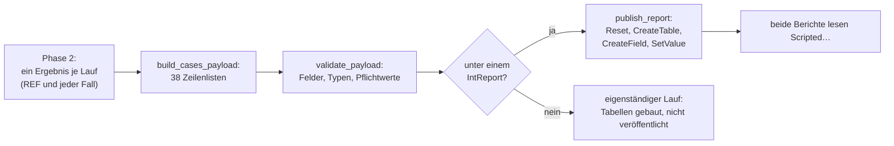

# Outage Assessment – wie jede Berichtstabelle berechnet und erstellt wird

Outage Assessment veröffentlicht **38 Tabellen** (Datenvertrag 7.1), die beide Berichte
lesen: `MASTER_OUTAGE_ASSESSMENT` (Hauptbericht) und `MASTER_OUTAGE_ASSESSMENT_DETAIL`
(technischer Detailbericht), gehalten als Pages in `designer-pages/<Bericht>/`
(ein `.dct`-Dictionary und je Seite eine `.pg`-Datei). Für dieselbe Run-ID
drucken beide Berichte dieselbe Statistik. Dieses Dokument beschreibt Tabelle
für Tabelle, woher jede Zeile kommt, wie jedes Feld berechnet wird und welches
Kapitel es zeigt. Englische Fassung: [../REPORT_TABLES.md](../REPORT_TABLES.md).
Die Bewertung selbst: [ARCHITEKTUR.md](ARCHITEKTUR.md) und
[BERECHNUNG_UND_AUSWERTUNG.md](BERECHNUNG_UND_AUSWERTUNG.md).

Funktionsnamen in `code` stehen in `outage-assessment/main.py`.

---

## 1. Von den Ergebnissen zum Bericht

1. **Phase 2** liefert je Lauf ein Ergebnis: REF und jeder Planungsfall, jedes
   mit seinen Reihen (je Betriebsmittel und Variable), deren Statistik und,
   für einen Fall, dem Vergleich mit REF zu denselben Zeitschritten, dem
   Urteil und der n-1-Statistik.
2. **`build_cases_payload`** macht aus den Ergebnissen und der Anfrage (Fälle,
   Außerbetriebnahmen, Einstellungen) 38 Zeilenlisten.
3. **`validate_payload`** prüft jede Zeile: nur deklarierte Felder (`TABLES`),
   der richtige Typ (Text, Ganzzahl, endliche Zahl), jedes Pflichtfeld
   (`REQUIRED_FIELDS`) gefüllt, genau eine Zeile in `ScriptedReportMeta`. Namen
   werden auf 80 Zeichen, andere Texte auf 500 gekürzt und enden mit „…“.
4. **`publish_report`** (nur unter einem `IntReport`): genau ein `Reset()`,
   dann je Tabelle `CreateTable(name)` mit dem Namen **ohne** das Präfix
   `Scripted` (PowerFactory ergänzt es), `CreateField` je Feld und `SetValue`
   je gefüllter Zelle. Eine Tabelle mit mehr als 5000 Zeilen (`MAX_TABLE_ROWS`)
   wird gekürzt, und die Kürzung steht auf der Qualitätsseite.

**Veröffentlicht wird nur, was gedruckt wird.** Felder, die das Skript für sich
berechnet (Zusammenfassungen, Log, Prüfungen) und die kein Bericht zeigt,
stehen in `UNPUBLISHED_FIELDS`; sie werden weder bei PowerFactory deklariert
noch geschrieben. Ungenutzte Fall-Slots einer Matrixzeile bleiben leer. Ein
Test schlägt fehl, wenn ein deklariertes Feld in keinem Bericht vorkommt.

---

## 2. Begriffe aller Tabellen

| Begriff | Bedeutung |
|---|---|
| **REF** | der Referenzlauf: R0 (keine Außerbetriebnahme) oder Rfix (nur die festen) |
| **Fall** | ein Planungsfall; *gerechnete* Fälle sind die, deren QDS konvergiert ist |
| **Reihe** | ein Betriebsmittel mit einer Variable über die Zeit: Leitungen und Transformatoren `c:loading`/`m:loading` in %, Knoten `m:u`/`m:u1` in p.u. |
| **Statistik** | je Reihe über den **ganzen** Zeitraum: Minimum, Maximum, Mittelwert und Zeitpunkt von Minimum und Maximum |
| **kritisch** | Auslastung echt über der Grenze (*Maximum loading for n-0*, Leitungen und Transformatoren getrennt), Spannung echt außerhalb des Bands |
| **zeitgleicher Datensatz** | ein Betriebsmittel eines Falls neben demselben in REF, verglichen zu denselben Zeitschritten in den Fenstern und überall, wo sie abweichen (`compare_case`); trägt Schrittstatus, zeitgleiches Delta und verursachte Stunden |
| **Schrittstatus** | `NEW`, `WORSENED`, `PRE-EXISTING`, `IMPROVED`, `RESOLVED`, `EXCEEDED`, `DE-ENERGISED`, `OUT OF SERVICE`, `OK`; ein Betriebsmittel erhält den schwersten |
| **Urteil** | je Fall eines der Urteile aus Abschnitt 2.1, einmal je Fall bestimmt und von jeder Tabelle genutzt |
| **violation** | 1 (rot): vom Fall verursacht (`OVERLOAD`, `VOLTAGE BAND`, beides); 2 (gelb): Aufmerksamkeit (`NO ADDITIONAL VIOLATION`, `DE-ENERGISED NODES`, `INCOMPLETE COVERAGE`); 0: nichts |
| **Berichtsfilter** | nur Betriebsmittel der gewählten Netze werden zu Reihen; jede Tabelle sieht nur sie |
| **Ebene** | `n-0` (QDS), `n-1` (Contingency Analysis der Referenz), `(n-1)'` (Contingency Analysis des Falls) |
| **Zelle** (n-1) | Studienzeitpunkt × Fehlerfall × überwachtes Element × Kriterium |

### 2.1 Urteil eines Falls (`assess_case`), in dieser Reihenfolge

1. eine verursachte Überlastung (`NEW`, `WORSENED` oder `EXCEEDED` einer
   Leitung oder eines Transformators) und eine verursachte
   Spannungsverletzung → `OVERLOAD + VOLTAGE BAND`;
2. nur eine verursachte Überlastung → `OVERLOAD`; nur eine verursachte
   Spannungsverletzung → `VOLTAGE BAND`;
3. ein vom Fall spannungslos geschalteter Knoten → `DE-ENERGISED NODES`;
4. die Außerbetriebnahmezeit ist nicht vollständig durch Ergebniszeilen
   abgedeckt (< 99,9 %) → `INCOMPLETE COVERAGE`;
5. eine Verletzung, die es schon in REF gibt (`PRE-EXISTING`, `IMPROVED`) →
   `NO ADDITIONAL VIOLATION`;
6. sonst → `NO LIMIT EXCEEDED`.

Ein Fall ohne Ergebniszeile in seinen Fenstern erhält `NO RESULT DATA IN
WINDOW`; ein Fall, der nicht gerechnet werden konnte, erhält `NOT EVALUATED`
oder `NOT SIMULATED` mit Grund. Fehlende oder unvollständige Ergebnisse führen
nie zu `NO LIMIT EXCEEDED`.

### 2.2 Matrixtabellen

Matrixtabellen stellen REF und mehrere Fälle nebeneinander. Jede Zeile
wiederholt die Blocknummer (`block`: Fälle 1–6, 7–12, …), die Zahl der
Fallspalten ihres Blocks (`col_count`), die Fallnamen (`case_a_name` …
`case_f_name`) und ihre Texte (`case_a_text` … `case_f_text`). Der Bericht hat
je Spaltenzahl ein Band-Paar, sodass ein Block nur seine eigenen Spalten zeigt.
Die Detailmatrizen verwenden Blöcke zu drei Fällen.

### 2.3 Diagrammtabelle im Breitformat

`ScriptedTimeCriticality` zeichnet Reference und die Fälle mit festen Farben:
Slot `ref` ist Reference (grau), Slots `a`–`f` die Fälle (`series_ref_name`,
`series_a_name` …, `value_ref`, `value_a` …). Jedes Diagramm liest seine
eigene Tabelle und wird nie über eine Datenrelation gefiltert, weil die
PowerFactory-Berichtsengine Relationen auf Diagramme nicht anwendet.

---

## 3. Die Tabellen

### 3.1 `ScriptedReportMeta` – Titelseite, Kopf, Aussagen

**Kapitel:** Titelseite, Inhaltsverzeichnis, Kopf- und Fußzeile jeder Seite.
**Zeilen:** genau eine.

| Feld | Berechnung |
|---|---|
| `run_id` | Stempel der Ergebnisobjekte, die der Lauf behält oder neu auswertet (`OA_<Stempel>_…`); in jeder Kopfzeile |
| `study_name` | Name des aktiven Study Case |
| `model_name` | Name des Projekts |
| `model_version` | `PowerFactory 2026` |
| `simulation_start`, `simulation_end` | erste und letzte Zeitbeschriftung des ersten konvergierten Laufs |
| `simulation_time_step` | Abstand der ersten beiden Zeitschritte, z. B. `1 h` |
| `generation_date`, `generated_by` | Ortszeit des Laufs, Windows-Benutzer |
| `run_mode` | `REFERENCE + PLANNING CASES`, `PLANNING CASES ONLY`, `REFERENCE ONLY - NO PLANNING CASE TO CALCULATE` oder `NO CALCULATION - NO PLANNING CASE TO CALCULATE` |
| `template_name`, `template_version`, `data_contract_version` | Konstanten des Skripts |
| `result_name` | die erhaltenen Ergebnisobjekte des Laufs |
| `assessment_scope` | Zahl der Planungsfälle, Art der REF, Berichtsfilter |
| `assessment_status` | `PRE-ASSESSMENT - NOT AN OPERATIONAL RELEASE` |
| `case_source_text` | woher die Fälle kommen (Fallmanager, gespeicherte Konfiguration, je Außerbetriebnahme) |
| `reference_text` | R0 oder Rfix mit den festen Außerbetriebnahmen |
| `qds_mode_text` | die Zeitbasis: vollständiger ComStatsim-Zeitraum mit seinem Zeitschritt |
| `coverage_statement` | Aussage A (Wirkung der Außerbetriebnahmen) und Aussage B (absoluter Netzzustand, nur REF) |
| `contingency_text` | verwendete Contingency Analysis und Fehlerfälle im Umfang, oder warum n-1 nicht gerechnet wurde |
| `overall_text` | die Gesamtaussage des Laufs |
| `critical_note`, `events_note` | „x von y gezeigt“ der Listen kritischer Betriebsmittel und Befunde |
| `empty_tables` | die Tabellen ohne Zeilen; die Berichte zeigen dafür einen Hinweis |

### 3.2 `ScriptedModelQuality` – Qualitätsprüfungen

**Haupt 4** Calculation Quality, **Detail 14** Quality and Error Register.
**Zeilen:** eine je Prüfung, in dieser Reihenfolge (`_model_quality`):

| Prüfung (`check_id`) | Statusregel |
|---|---|
| `planned_outages` | PASS, wenn mindestens eine Außerbetriebnahme einem Fall zugeordnet ist; Meldung: gefunden, zugeordnet, nicht gerechnet |
| `cases` | PASS, wenn jeder Lauf konvergiert ist und Reihen hat |
| `case_<id>` | FAIL je Lauf, der nicht konvergiert ist |
| `case_configuration` | WARNING, wenn ein Fall nicht bereit ist |
| `request_warning_<n>`, `case_warning_<id>` | Warnungen aus der Fallkonfiguration |
| `coverage` | WARNING, wenn ein Fall weniger als 99,9 % seiner Außerbetriebnahmezeit abdeckt |
| `outside_window` | WARNING, wenn ein Fall außerhalb seiner Fenster von REF abweicht |
| `series_line`, `series_transformer`, `series_voltage` | bewertete und kritische Betriebsmittel je Art |
| `voltage_data` | INFO: ausgelassene DC-Knoten und Knoten ohne Spannung |
| `deenergized` | WARNING: von einem Fall spannungslos geschaltete Knoten |
| `time_variation` | WARNING, wenn jede Reihe konstant ist (Profile fehlen) |
| `reference_comparison` | PASS, wenn eine konvergierte REF vorliegt |
| `qds_mode` | INFO: vollständiger ComStatsim-Zeitraum |
| `security_scope` | WARNING: was der Bericht nicht belegt (n-1-Sicherheit, Schutz, …) |
| `limit_loading`, `limit_voltage` | INFO: die verwendeten Grenzen |
| `network_scope` | INFO: Berichtsfilter und Umfang der Fehlerfälle |
| `settings` | INFO, oder WARNING, wenn Einstellungen von den Outage Assessment-Standards abweichen |
| `outages_<case>` | hat jede Außerbetriebnahme gewirkt (`APPLIED`, `EFFECT SEEN`, `NO EFFECT`, `NOT CHECKABLE`) |
| `outages_after_<case>` | eine Außerbetriebnahme, die nach ihrem Fenster weiterwirkt |
| `n1_<case>` | (n-1)' gegen n-1: Zählungen je Status; FAIL, wenn der Fall `NEW` oder `WORSENED` verursacht, WARNING, wenn Ergebnisse fehlen |
| `table_limit_<table>` | FAIL, wenn eine Tabelle bei 5000 Zeilen gekürzt wurde |

`affected_element` nennt den betroffenen Fall oder das Betriebsmittel, sonst `-`.

### 3.3 `ScriptedCases` – gerechnete Fälle und Außerbetriebnahmen

**Haupt 5** (Außerbetriebnahmeplanung) **und 6** (Falldefinition und
Netzzustände). **Zeilen:** REF (`case_order` 0), dann jeder Planungsfall in
der Reihenfolge der Konfiguration, dann jede Außerbetriebnahme außerhalb des
simulierten Zeitraums (`case_id` `N/A`) (`_case_rows`).

| Feld | REF | Planungsfall |
|---|---|---|
| `case_id`, `case_name` | `REF`, `Reference` | ID und Name des Falls |
| `is_reference` | 1 | 0 |
| `simulation_status` | Status des Laufs | Status des Laufs, oder des Falls, wenn er nicht gerechnet wurde |
| `period_text` | erste bis letzte Zeitbeschriftung | vom frühesten Beginn bis zum spätesten Ende seiner Fenster |
| `priority` | 0 | höchste Priorität seiner Außerbetriebnahmen |
| `equipment_name` | `No planned outage` oder die festen | die geschalteten Betriebsmittel seiner Außerbetriebnahmen |
| `assessment` | `BASELINE` | das Urteil, oder `NOT SIMULATED` / `NOT EVALUATED` mit Grund |
| `assessment_detail` | maximale Leitungsauslastung und Spannungsbereich von REF | die Sätze hinter dem Urteil: maximale Auslastung mit Betriebsmittel, Zeit und REF-Wert, größter zeitgleicher Anstieg, Zahl der Überlastungen, Spannungsbereich, spannungslose Knoten, verursachte Stunden, Spill-over, Abdeckung |
| `violation` | 0 | 0, 1 oder 2 aus dem Urteil |
| `case_description`, `outage_names` | | Beschreibung und Außerbetriebnahmen des Falls |
| `states_text`, `windows_text` | | Netzzustände (aktive Menge zwischen Fenstergrenzen) und Fenster |
| `coverage_text` | `full period` | durch Ergebniszeilen abgedeckter Anteil der Außerbetriebnahmezeit |
| `provenance_text` | `CALCULATED` | `CALCULATED`, `REUSED (…)` oder `NOT CALCULATED` |

### 3.4 `ScriptedCaseMetrics` – Kennzahlenansicht

**Haupt 9** n-0 Case Comparison. **Zeilen:** REF (Reihenfolge 0) und jeder
gerechnete Fall (`_case_metrics`).

| Feld | Berechnung |
|---|---|
| `max_line_text`, `max_line_element` | höchstes Leitungsmaximum über den ganzen Zeitraum und seine Leitung |
| `coincident_delta_text` | größter **zeitgleicher** Anstieg einer Leitung, `max_t (Fall(t) − REF(t))` über die bewerteten Schritte, mit der Leitung; REF: `-` |
| `maxima_difference_text` | für dieselbe Leitung: Maximum des Falls minus Maximum von REF |
| `violation_hours_text` | Dauer der vom Fall verursachten Verletzungen, gewichtet mit den Zeitschritten |
| `voltage_range_text` | niedrigstes Minimum bis höchstes Maximum aller Knoten |
| `coverage_text` | durch Ergebnisse abgedeckter Anteil der Außerbetriebnahmezeit; REF: `full period` |

### 3.5 `ScriptedKpis` – Kennzahlen

**Haupt 3** Overall Technical Assessment. **Zeilen:** eine (keine, wenn keine
Leitung bewertet wurde).

- `highest_text`: das höchste Leitungsmaximum aller Zeilen aus 3.4 mit seiner
  Leitung; `highest_violation` 1, wenn es die Leitungsgrenze überschreitet.
- `delta_text`: der größte zeitgleiche Anstieg aller Fälle über der
  Änderungstoleranz (*n-0 change tolerance, loading*), mit dem Fall; sonst
  `no increase`.

### 3.6 `ScriptedPieLines` und `ScriptedPieTransformers` – Referenz-Kreise

**Haupt 7** Base Network Reference. **Zeilen:** je drei, die Auslastungsklassen
von **REF** (`_pies`): *bis zur Warnschwelle*, *Warnschwelle bis Grenze*,
*über der Grenze*. `element_count` zählt die Leitungen bzw. Transformatoren,
deren REF-Maximum in die Klasse fällt. Die Kreise färben die Klassen über
Bedingungen auf `class_label`.

### 3.7 `ScriptedCaseCounts` – kritische Betriebsmittel je Fall

**Haupt 9** (Diagramm). **Zeilen:** REF und jeder gerechnete Fall
(`_case_counts`). `line_count`, `transformer_count`, `node_count`: in diesem
Lauf über den ganzen Zeitraum kritische Betriebsmittel.

### 3.8 `ScriptedLineLoadingBars` – höchstbelastete Leitungen über alle Läufe

**Haupt 9** (Balkendiagramm). **Zeilen:** die *Top-N* (Einstellung, Standard
10) Leitungen mit dem höchsten Maximum in **irgendeinem** Lauf
(`_line_bars`), die höchste oben. Das Diagramm stapelt drei Reihen:
`value_ok` (bis zur Warnschwelle, grau), `value_warning` (Warnschwelle bis
Grenze, gelb) und `value_over` (über der Grenze, rot); nur die Reihe der Klasse
der Leitung trägt ihr Maximum, die anderen sind 0, so folgt die Farbe den
Einstellungen. Das Maximum selbst und der Lauf, in dem es auftrat, behält das
Skript, sie werden nicht veröffentlicht.

### 3.9 `ScriptedCaseComparison` – Fallvergleich

**Haupt 9.** Matrixtabelle mit neun Kennzahlen als Zeilen und REF plus den
Fällen als Spalten (`_case_comparison`):

| Zeile | Fallspalte | REF-Spalte |
|---|---|---|
| New overloads | Zahl der Leitungen/Transformatoren mit Status `NEW` | `-` |
| Worsened overloads | Zahl mit `WORSENED` | `-` |
| Pre-existing or improved overloads | Zahl mit `PRE-EXISTING` oder `IMPROVED` | `-` |
| Max. coincident loading increase | größtes zeitgleiches Delta in %-Punkten | `-` |
| New or worsened voltage violations | Zahl der Knoten mit `NEW` oder `WORSENED` | `-` |
| Nodes de-energised by the case | Zahl mit `DE-ENERGISED` | `-` |
| Duration of caused violations | verursachte Stunden | `-` |
| Outage time covered by results | Abdeckung | `full period` |
| Assessment | das Urteil | `BASELINE` |

`violation` ist 1 für eine Zeile, in der mindestens ein Fall etwas verursacht hat.

### 3.10 `ScriptedCalculationRuns` – Rechennachweis

**Haupt 13**, **Detail 15.** **Zeilen:** jeder Lauf (REF und jeder Fall), dann
jeder Planungsfall, der nicht gerechnet wurde (`_calculation_runs`).

| Feld | Berechnung |
|---|---|
| `run_kind` | `REFERENCE`, `CASE`, `… (reused)` oder `NOT RUN` |
| `reference_text` | bei REF R0/Rfix, bei einem Fall `REF` |
| `period_text`, `time_steps` | erste bis letzte Zeitbeschriftung, Zahl der Zeitschritte |
| `elapsed_text` | QDS-Zeit in s; `-` für einen wiederverwendeten Lauf, `0.0 s` für einen aus seinem Ergebnisobjekt neu ausgewerteten Lauf |
| `status`, `provenance_text` | Status des Laufs; `CALCULATED`, `REUSED` oder `NOT CALCULATED` |
| `result_object` | das erhaltene Ergebnisobjekt `OA_<Stempel>_<Fall>` |
| `note` | was angewendet wurde (`iopt_maint=1; active: …`) oder dass der Lauf neu ausgewertet wurde |

### 3.11 `ScriptedTopLinesByCase` – höchstbelastete Leitungen je Fall

**Detail 17** (Anhangsseite). Matrixtabelle: Zeile *n* enthält je Lauf die
Leitung mit dem n-höchsten Maximum in diesem Lauf als `Name - max %`
(`_top_lines_by_case`); bis zu *Top-N* Zeilen, endet, wenn kein Lauf eine
weitere Leitung hat.

### 3.12 `ScriptedAppendixLine` und `ScriptedAppendixTransformer` – Anhänge A und B

**Detail**, Anhänge A (Leitungen) und B (Transformatoren). Matrixtabellen mit
einer Zeile je relevantem Betriebsmittel (`_loading_appendix`): sein Maximum
in irgendeinem Lauf liegt auf oder über der Warnschwelle, **oder** sein
Maximum weicht in einem Fall um mindestens *Appendix: also list a loading
change from* von REF ab. Die Zelle ist das Maximum des Betriebsmittels in
diesem Lauf. Sortiert nach dem höchsten Maximum, dann Name. `violation`: 1,
wenn ein Fall eine Verletzung des Betriebsmittels verursacht, 2, wenn sie schon
in REF besteht.

### 3.13 `ScriptedAppendixVoltage` – Anhang C

**Detail**, Anhang C (Knotenspannungen). Eine Zeile je relevantem Knoten
(`_voltage_appendix`): ein anderer Status als `OK` in einem Fall, **oder** ein
Minimum, das um mindestens *Appendix: also list a voltage change from* von REF
abweicht. Die Zelle ist die Mindestspannung in diesem Lauf (p.u.). Sortiert
nach der größten Überschreitung des Bands, dann Name.

### 3.14–3.34 Statistik je Ebene, Betriebsmittel, Fehlerfall und Zeit

Gebaut von `_reporting_tables` aus der Statistik, die jeder ausgewertete Fall
trägt (`evaluate_n1_case`: `statistics` = `compare_scenario` von (n-1)' gegen
n-1, oder von n-1 mit sich selbst, wenn nur n-1 gerechnet wurde;
`reference_statistics` = `level_statistics` der n-1-Referenz), jeweils über
die Studienzeitpunkte in den Fenstern der Außerbetriebnahmen des Falls. Die
n-0-Zeilen kommen aus den QDS-Ergebnissen. Jede Zählung stammt aus der
vollständigen Statistik vor jeder Anzeigegrenze. Betriebsmittel zählen
einzeln.

| # | Tabelle | Bericht und Kapitel | Zeilen | Gebaut von | Regel |
|---|---|---|---|---|---|
| 3.14 | `ScriptedCaseStatistics` | Haupt 3, 8 | je Fall und Ebene (n-0, n-1, (n-1)') | `_case_statistics` | kritische Leitungen/Transformatoren/Knoten, einzelne NEW/WORSENED-Betriebsmittel, Befunde je Status, kritische Fehlerfälle und Studienzeitpunkte, Episoden, Vollständigkeit; `assessment` für (n-1)': NEW OR WORSENED FINDINGS, INCOMPLETE COVERAGE, NO ADDITIONAL VIOLATION oder NO LIMIT EXCEEDED |
| 3.15 | `ScriptedCaseStatusCounts` | Haupt 8 (gestapelte Säulen) | je (n-1)'-Fall | `_case_status_counts` | Befunde NEW, WORSENED, IMPROVED, RESOLVED |
| 3.16 | `ScriptedCoverage` | Haupt 4, Detail 3 | je Fall und Ebene | `_coverage` | drei Achsen: angefragte/gerechnete Studienzeitpunkte, definierte/anwendbare Fehlerfälle, geforderte/ausgewertete Zellen und die Zellen je Qualitätsstatus |
| 3.17 | `ScriptedScope` | Detail 3 | je Fall, Ebene, Netz, Spannungsebene, Klasse | `_scope` | überwachte, kritische und nicht vollständig auswertbare Betriebsmittel |
| 3.18 | `ScriptedOutageWindows` | Haupt 5 (Fensterdiagramm und Tabelle), Detail 4 | je Außerbetriebnahme jedes Falls | `_outage_windows` | PowerFactory-Pfad, Betriebsmittel, Beginn, Ende; Diagramm: `start_hours` (unsichtbarer Balken bis zum Beginn) und `duration_hours` (das Fenster), Stunden ab dem ersten Beginn |
| 3.19 | `ScriptedReferenceFindings` | Haupt 7 (Top 10 je Ebene und Kriterium), Detail 5 (jede n-0-Zeile) | je Betriebsmittel und Kriterium ab Warnung oder über der Grenze | `_reference_findings` | n-0 aus der QDS-REF, n-1 aus den Referenz-Extremen; thermisch und Spannung getrennt |
| 3.20–3.22 | `ScriptedCriticalLines`, `…Transformers`, `…Nodes` | Haupt 10 | bis zu 20 / 15 / 20 auffällige Betriebsmittel, kritischste zuerst | `_critical_elements` | n-1-Referenz-Extrem mit Grenze, absolutes (n-1)'-Extrem je Fall mit Zählern N/W/P/I/R/Q; „x von y gezeigt“ in `critical_note` |
| 3.23–3.26 | `ScriptedDetailLines`, `…Transformers`, `…VoltageLow`, `…VoltageHigh` | Detail 6–9 | jedes auffällige Betriebsmittel, nach Netz und Spannungsebene | `_detail_matrices` | jedes Extrem mit Studienzeitpunkt und Fehlerfall; Blöcke zu drei Fällen |
| 3.27 | `ScriptedClassificationMatrix` | Detail 10 | je auffälligem Betriebsmittel und Kriterium | `_classification` | Zähler je Fall als Text („N 4 · W 2“), Blöcke zu drei |
| 3.28 | `ScriptedContingencyRegister` | Detail 11 | je Fall und Fehlerfall mit Befund oder Qualitätsstatus | `_contingency_register` | geprüfte, nicht anwendbare, gescheiterte und fehlende Studienzeitpunkte; betroffene Betriebsmittel, kritische Zeiten, schwerster Befund |
| 3.29 | `ScriptedContingencyRanking` | Haupt 11 (Säulen) | Top 10 Fehlerfälle | `_contingency_register` | kritische Befunde über alle (n-1)'-Fälle |
| 3.30 | `ScriptedContingencyEvents` | Haupt 11 (`main_rank` > 0: Top 10 je Kriterium), Detail 12 (alle gelisteten) | die priorisierte Auswahl je Fall (bis 500) | `_contingency_events` | vollständiger Vergleichsschlüssel, n-1- und (n-1)'-Wert, Grenze, Verletzung, zeitgleiche Änderung, Status; `events_note` nennt „x von y“ |
| 3.31 | `ScriptedContingencyEpisodes` | Detail 13 | jede kritische Episode | `_episodes` | erster und letzter geprüfter Studienzeitpunkt, Punkte, Spitze |
| 3.32 | `ScriptedQualityRegister` | Detail 14 | je Fall, Qualitätsstatus, Ursache und Fehlerfall | `_quality_register` | Bereich der Studienzeitpunkte und Zellen; als Ganzes nicht ausgewertete Fälle |
| 3.33 | `ScriptedTimeCriticality`, `ScriptedTimeMatrix` | Haupt 12 | je Studienzeitpunkt | `_time_criticality` | mit n-1: einzelne kritische Betriebsmittel in n-1 und in (n-1)' über alle Fälle (zwei Reihen), je Fall E = kritische Betriebsmittel, C = kritische Fehlerfälle. Ohne n-1: Reference und alle Fälle je QDS-Zeitschritt (das Diagramm nimmt die größte Zahl seit dem vorigen Plotpunkt); die Tabelle nennt die Schritte, in denen ein Fall andere kritische Betriebsmittel hat als Reference |
| 3.34 | `ScriptedAssessmentSettings`, `ScriptedResultProvenance` | Haupt 13, Detail 15 | je Einstellung; je Ergebnisobjekt | `_assessment_settings`, `_result_provenance` | Wert, Einheit, Herkunft, Status; Objektname und PowerFactory-Pfad, soweit bekannt |

**Kürzungen.** Kein Register wird in Fallreihenfolge gekürzt. Würde eine
Tabelle 5000 Zeilen überschreiten, verteilt `_fair_cut` die Zeilen auf die
Fälle (jeder behält seine schwersten Zeilen), und `_block_rows` behält in
jedem Fallblock dieselben, schwersten Zeilen; die Kürzung steht auf der
Qualitätsseite, und jede Zählung enthält auch die ausgelassenen Zeilen. Von
den n-1-Referenzbefunden werden nur die obersten Zeilen veröffentlicht (der
Detailbericht zeigt die n-0-Zeilen). Jeder Planungsfall behält seine Zeilen,
auch wenn seine QDS oder sein n-1 gescheitert ist; `ScriptedQualityRegister`
enthält auch NOT APPLICABLE je Fehlerfall.

---

## 4. Kapitel und ihre Tabellen

**Hauptbericht** (`MASTER_OUTAGE_ASSESSMENT`):

| Kapitel | Tabellen |
|---|---|
| 1, 2 Titelseite, Inhaltsverzeichnis | `ScriptedReportMeta` |
| 3 Overall Technical Assessment | `ScriptedKpis`, `ScriptedCaseStatistics` |
| 4 Calculation Quality | `ScriptedCoverage`, `ScriptedModelQuality` |
| 5 Planned Outage Planning | `ScriptedCases`, `ScriptedOutageWindows` (Fensterdiagramm und Tabelle) |
| 6 Case Definition and Network States | `ScriptedCases` |
| 7 Base Network Reference | `ScriptedPieLines`, `ScriptedPieTransformers`, `ScriptedReferenceFindings` |
| 8 Scenario Comparison | `ScriptedCaseStatistics`, `ScriptedCaseStatusCounts` |
| 9 n-0 Case Comparison | `ScriptedCaseMetrics`, `ScriptedCaseComparison`, `ScriptedCaseCounts`, `ScriptedLineLoadingBars` |
| 10 Critical Equipment | `ScriptedCriticalLines`, `ScriptedCriticalTransformers`, `ScriptedCriticalNodes` |
| 11 Critical Contingencies and Findings | `ScriptedContingencyRanking`, `ScriptedContingencyEvents` |
| 12 Time Criticality | `ScriptedTimeCriticality`, `ScriptedTimeMatrix` |
| 13 Settings and Evidence | `ScriptedAssessmentSettings`, `ScriptedResultProvenance`, `ScriptedCalculationRuns` |

**Detailbericht** (`MASTER_OUTAGE_ASSESSMENT_DETAIL`):

| Kapitel | Tabellen |
|---|---|
| 1, 2 Titelseite, Inhaltsverzeichnis | `ScriptedReportMeta` |
| 3 Scope and Coverage | `ScriptedScope`, `ScriptedCoverage` |
| 4 Planned Outage Register | `ScriptedOutageWindows` |
| 5 n-0 Base Findings | `ScriptedReferenceFindings` (n-0) |
| 6–9 Line Loading Matrix, Transformer Loading Matrix, Voltage Minimum, Voltage Maximum | `ScriptedDetailLines`, `ScriptedDetailTransformers`, `ScriptedDetailVoltageLow`, `ScriptedDetailVoltageHigh` |
| 10 Classification Matrix | `ScriptedClassificationMatrix` |
| 11 Contingency Register | `ScriptedContingencyRegister` |
| 12 Single Finding Register | `ScriptedContingencyEvents` |
| 13 Episode Register | `ScriptedContingencyEpisodes` |
| 14 Quality and Error Register | `ScriptedQualityRegister`, `ScriptedModelQuality` |
| 15 Settings and Provenance | `ScriptedAssessmentSettings`, `ScriptedResultProvenance`, `ScriptedCalculationRuns` |
| 16 Method and Reading Key | nur Text |
| 17 Appendix und Anhänge A, B, C (n-0) | `ScriptedTopLinesByCase`, `ScriptedAppendixLine`, `ScriptedAppendixTransformer`, `ScriptedAppendixVoltage` |

Jedes Kapitel ist eine eigene Seite (`PageQuality`, `PageCases`, …) nach der
Titelseite (`PageCover`) und dem Inhaltsverzeichnis (`PageContents`); jede
Seite außer der Titelseite hat ihren eigenen Kopf, jede Seite ihren eigenen Fuß.

## 5. Einen Bericht im Stimulsoft-Designer zusammensetzen

Für jeden Bericht zuerst das `.dct`-Dictionary öffnen, dann die `.pg`-Seiten
in Dateireihenfolge (`00_Cover.pg`, `01_Contents.pg`, …) mit *Open Page*. Die
Berichtskultur ist `en-US`; Zahlen haben ihr eigenes Format, das
Dezimaltrennzeichen hängt also nicht von den Windows-Einstellungen ab.
