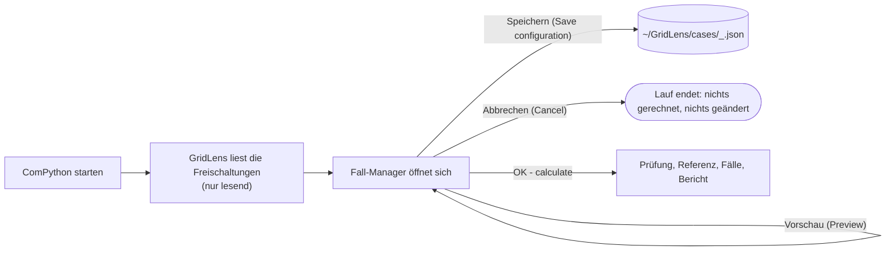

# GridLens Fall-Manager – Bedienungsanleitung

Englische Fassung: [../CASE_MANAGER.md](../CASE_MANAGER.md)

Der Fall-Manager ist der kleine Dialog, den GridLens beim Start des ComPython
öffnet (`CASE_SOURCE = 'gui'`). Er bearbeitet nur eine Konfiguration.
PowerFactory wartet, solange er offen ist; vor **OK – calculate** wird nichts
gerechnet und nichts verändert. Die Beschriftungen im Dialog sind englisch;
hier stehen sie in Klammern.



## Bereiche des Fensters

| Bereich | Zweck |
|---|---|
| **Freischaltungen** (links, *Planned outages*) | jede gefundene `IntPlannedout` / `IntOutage`: Name, Betriebsmittel, Beginn, Ende, Priorität, Status (*in simulated period*, *outside simulated period*, *Ignored in PowerFactory*). Spalte **Case** zeigt `[x]` für FS des gewählten Falls, **Fixed** für feste FS der Referenz. |
| **Planungsfälle** (rechts, *Planning cases*) | Fall-IDs: Buchstaben, Ziffern, `_`, `-`, höchstens 16 Zeichen. **New**, **Rename**, **Copy**, **Delete**, **One case per outage** (füllt die Liste wie GridLens 7). Darunter: Beschreibung, *Includes cases* (Gesamtplanungen, Hierarchie), *Only together with* (bedingte Fälle). |
| **Bewertungsauftrag** (unten links, *Assessment request*) | alternative Fälle (`A|B; C|D`), Regeln, Modus des Rechenzeitraums, Pfad der gespeicherten Konfiguration |
| **Berechnungsvorschau** (unten rechts, *Calculation preview*) | Referenz, Zahl der QDS-Läufe, je Fall seine FS, die paarweise Beziehung (T01–T13), Netzzustände, vorgeschlagene Fenster, Warnungen und der Grund, warum ein Fall nicht gerechnet werden kann |

## Typische Aufgaben

| Aufgabe | Vorgehen |
|---|---|
| Eine FS allein | **New** → FS auswählen → Doppelklick (oder **Assign / remove**) |
| FS1 und FS2 gleichzeitig | ein Fall, beide zuordnen |
| FS1 in KW10 *oder* KW40 | in PowerFactory je Termin eine Freischaltung anlegen, je Termin ein Fall, `A|B` als Alternativen eintragen |
| FS1 tatsächlich zweimal (KW10 *und* KW40) | beide Vorkommen in denselben Fall |
| A und B finden beide statt | Fall **AB** mit *Includes cases* `A, B`; wird nie automatisch gebildet |
| B nur zusammen mit A | Fall B: *Only together with* `A`; gerechnet wird er über einen gemeinsamen Fall |
| Zusatzwirkung einer neuen FS, während FS0 fest geplant ist | FS0 auswählen → **Fixed outage (reference)**; die Referenz wird Rfix und hält FS0 in jedem Fall aktiv |
| FS mit eigenem Termin in einem Fall | **Own dates** erfasst ihn; GridLens 8.0 wendet ihn **nicht** an (der Fall erscheint als NOT EVALUATED) – stattdessen eine Freischaltung mit diesem Termin anlegen |

Regeln (je Zeile eine, FS-Namen wie in der Liste):

```
not_overlap: FS1, FS2
order: FS1, FS2
together: FS3, FS4
```

`not_overlap` – dürfen nicht überlappen; `order` – FS2 erst nach dem Ende von
FS1; `together` – nur gemeinsam und zeitgleich.

## Schaltflächen

| Schaltfläche | Wirkung |
|---|---|
| **Preview** | prüft und zeigt den Plan; keine QDS |
| **Save configuration** | schreibt die JSON-Datei mit der nächsten Revisionsnummer, Benutzer und Zeit; das Projekt bleibt unberührt |
| **OK – calculate** | prüft; fragt nach, wenn Fälle nicht gerechnet werden können; schließt den Dialog; danach beginnt die Rechnung |
| **Cancel** / Fenster schließen | beendet den Lauf; nichts gerechnet, nichts gespeichert, nichts im Projekt geändert |

Ein Fehler in einer Schaltfläche erscheint als Meldungsfenster; der Dialog
bleibt offen, und es wurde nichts gerechnet.

## Woher die Fälle kommen

| `CASE_SOURCE` | Verhalten |
|---|---|
| `'gui'` (Standard) | Dialog, vorbelegt mit der gespeicherten Konfiguration. Kann `tkinter` kein Fenster öffnen oder lässt sich der Dialog nicht aufbauen: die gespeicherte Konfiguration; ohne sie: je FS ein Fall. Der Bericht nennt die verwendete Quelle. |
| `'saved'` | die gespeicherte Konfiguration, ohne Dialog (wiederholbare Läufe) |
| `'per_outage'` | je Freischaltung im simulierten Zeitraum ein Fall (Verhalten von GridLens 7) |

Die Konfiguration liegt in `CASE_CONFIG_DIR` (Standard `~/GridLens/cases`), eine
Datei je Projekt, benannt nach dem Projekt und einem Hash seines vollen Pfads.
Eine Datei mit falschem Schema, falscher Version oder falschen Feldtypen stoppt
den Lauf mit ihrem Pfad und allen gefundenen Problemen, statt übergangen zu
werden – und zwar bevor irgendetwas in PowerFactory geändert wird.

```json
{
  "schema": "gridlens.cases", "schema_version": 1, "revision": 3,
  "project": "\\User\\Grid.IntPrj", "saved_at": "2026-10-22 10:15:00 +0200", "saved_by": "hadi",
  "mode": "conservative",
  "background": ["\\User\\Grid.IntPrj\\Outages\\FS0.IntPlannedout"],
  "cases": [
    {"id": "A", "name": "FS1 + FS2 KW10", "description": "",
     "outages": ["...\\FS1.IntPlannedout", "...\\FS2.IntPlannedout"],
     "includes": [], "requires": [], "overrides": {}}
  ],
  "exclusive_groups": [["A", "B"]],
  "rules": [{"kind": "not_overlap", "first": "...\\FS1.IntPlannedout", "second": "...\\FS2.IntPlannedout"}]
}
```

Freischaltungen werden über ihren vollen PowerFactory-Pfad gespeichert, nie
über den Anzeigenamen. Eine umbenannte oder gelöschte Freischaltung macht ihren
Fall NOT EVALUATED, der Pfad wird genannt.

## Was nach OK in PowerFactory passiert

- Ein Referenzlauf, dann eine QDS je unterschiedlichem Fall. Fälle mit gleichen
  Freischaltungen und Fenstern werden einmal gerechnet.
- Während eines Fall-Laufs haben nur die FS des Falls (und die festen)
  `outserv = 0`; jede andere Freischaltung steht auf „Ignored“. `iopt_maint`,
  jedes `outserv`, `ComStatsim.results` und die Studienzeit werden danach
  zurückgesetzt und zurückgelesen.
- Jeder Lauf behält sein Ergebnisobjekt im aktiven Study Case:
  `GridLens_<yymmdd-HHMMSS>_<Fall-ID>` (z. B. `GridLens_261022-101500_REF`,
  `GridLens_261022-101500_A`). Die Berichtsseite *Calculation Evidence* listet
  sie. Alte Läufe bitte selbst löschen, wenn sie nicht mehr gebraucht werden.
- Ein wiederverwendeter Fall hat kein eigenes Ergebnisobjekt; die
  Nachweistabelle nennt das Objekt, das er teilt („shared with A“).

## Wenn sich der Dialog in PowerFactory nicht öffnet

Das Ausgabefenster zeigt `The case manager cannot open a window: …` bzw.
`The case manager could not be built: …` und die Quelle, die GridLens
stattdessen verwendet. `tools/FS_CaseManager_GUI_Test_PowerFactory2026.py` als
eigenes ComPython ausführen, um Tcl/Tk zu prüfen. Bis der Dialog funktioniert,
die Fälle an einem Arbeitsplatz konfigurieren, an dem er läuft (oder die JSON
bearbeiten), und `CASE_SOURCE = 'saved'` setzen. Ein DPL-Dialog als Rückfall
ist nicht umgesetzt.
