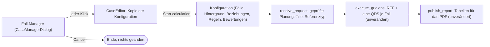

# GridLens Fall-Manager – Bedienungsanleitung

Englische Fassung: [../CASE_MANAGER.md](../CASE_MANAGER.md)

Der Fall-Manager ist das Fenster, das GridLens beim Start des ComPython öffnet
(`CASE_SOURCE = 'gui'`). Er **konfiguriert** nur die Berechnung. Er zeigt keine
Ergebnisse: Ergebnisse, Grenzwertverletzungen und Diagramme stehen im
PDF-Bericht, den die bestehende GridLens-Publikation nach der Rechnung erzeugt.
PowerFactory wartet, solange das Fenster offen ist; vor **Start calculation**
wird nichts gerechnet und nichts verändert. Die Beschriftungen im Fenster sind
englisch wie Code, Log und Bericht; hier stehen sie kursiv.

Technik: `tkinter` / `ttk` des Python, das PowerFactory ausführt, einheitlich
über `ttk.Style` (Thema `clam`); `tk.Canvas` nur für die Zeitachse. Kein
weiteres Paket.

## Aufbau

Drei Reiter; Statuszeile und Aktionsleiste bleiben auf jedem Reiter sichtbar:

```
 [ Workspace ] [ Fixed background & rules ] [ Review & start (1) ]
+--------------------------------------+------------------------------------+------------------------+
| Available planned outages            | Case A - Sommermaßnahmen           | Planning cases  2 of 5 |
| In case  Planned outage Equip. Start | 2 case outages · 1 fixed backgr.   | Planning case Outg Stat|
| [All  v][            ][     ][     ] | Planned outage Equip. Start End Pr | [            ][  ][ v ]|
| ☑ in case FS Bedarf 1 NE_L1  ...     | [          ][     ][    ][   ][  ] | Sommer         2  ready|
| ☐       FS Bedarf 3    NE_L7  ...    | FS Bedarf 1    NE_L1  ...          | Nord-Ost       1  ready|
| fixed   FS Hintergrund NE_L5  ...    | FS Bedarf 2    NE_L2  ...          | 4 shown                |
| 48 shown                             | 2 shown                            | [New][Copy][Edit][Del.]|
|                                      | [Remove from case] [Details]       | Selected case          |
| [Add to case] [Set as fixed] [Det.]  | Timeline of the case               |  [x] Include           |
|                                      |   |=====FS Bedarf 1=====|          |  Relations to other ⓘ  |
|                                      |     |====FS Bedarf 2====|          |  Also | Only | Altern. |
|                                      |                                    |                        |
+--------------------------------------+------------------------------------+------------------------+
 [Save configuration] [Load saved]   QDS ... · n-0 · 3 of 4 cases ready · 1 problem  [Cancel] [Start calculation]
```

- **Workspace** – drei Bereiche, etwa 40 % / 38 % / 22 %, Trennlinien verschiebbar.
  Von links nach rechts der Weg einer FS: aus der Library in den gewählten
  Fall, der rechts ausgewählt wird.
  - **Verfügbare Freischaltungen** (links): alle FS (`IntPlannedout`) der Library mit *In case*
    (`in case`, `fixed`, leer; auch als Zeilenfarbe), *Planned outage,
    Equipment, Start, End, Status*; *Add to case* (oder Enter, für alle markierten Zeilen),
    *Set as fixed background*, *Details* (auch Doppelklick auf eine Zeile).
    Die erste Spalte *In case* ist ein **Häkchen**: anhaken (Klick oder
    Leertaste) nimmt die FS in den gewählten Fall auf, abhaken beendet die
    Zuordnung; `☑ in case`, `☐` frei, `fixed` (nicht anhakbar). Demand
    Transfers (`IntOutage`) werden nicht gelesen: Sie verschieben Last und
    schalten kein Betriebsmittel.
  - **Der gewählte Fall** (Mitte): Titel *Case A - Name*, die Zeile *n case outages ·
    m fixed background outages*, die Tabelle *Planned outage, Equipment, Start,
    End, Priority*, *Remove from case*, *Details* und die Zeitachse des Falls.
  - **Planungsfälle** (rechts) – **höchstens 5**; der Zähler *2 of 5 cases* steht über der
    Tabelle, bei fünf sind *New* und *Copy* gesperrt. Tabelle *Planning case, Outages*
    (Zahl der FS), *Status* (`ready`, `not calculated`, `excluded`). Niemand
    vergibt eine ID: GridLens nummeriert die Fälle selbst (C1 … C5, die kleinste
    freie Nummer) und nutzt die ID nur intern (Beziehungen, Ergebnisobjekte
    `GridLens_<stamp>_C1`, Bericht). Darunter *New, Copy, Edit, Delete*, *One
    case per planned outage* (legt höchstens fünf an) sowie für den gewählten Fall
    *Include in the calculation* und die *Relations to other cases*
    per Klick: *Also contains* (Gesamtplanung), *Only valid with* (bedingter
    Fall), *Alternative to* (entweder – oder). Name und Beschreibung brauchen
    hier keinen Platz: ein **Doppelklick auf den Fall** (oder *Edit*) öffnet ein
    kleines Fenster mit beiden; die Mitte zeigt die Beschreibung neben dem
    Fallnamen. Siehe
    [Beziehungen zwischen Planungsfällen](#beziehungen-zwischen-planungsfällen).
- **Fixed background & rules** – links die festen Hintergrund-FS (Rfix) mit
  *Remove from fixed background*; rechts die Regeln zwischen FS mit drei Auswahllisten
  (*FS, Regel, FS*; ein Name, den es im Projekt doppelt gibt, trägt seinen
  PowerFactory-Pfad), *Add rule*, *Remove rule*.
- **Review & start** – *Calculation* (n-0, n-1 deaktiviert, QDS-Zeitraum des
  aktiven ComStatsim), *What will be calculated* in kurzen Zeilen und die
  Tabelle *Problems and warnings*. Der Reiter zeigt die Zahl der Probleme, z. B.
  *Review & start (1)*.
- **Statuszeile** (jeder Reiter): QDS-Zeitraum, Bewertung, rechenbare Fälle,
  Problemzahl in Rot; ein Klick öffnet *Review & start*.

### Filtern und Sortieren – jede Tabelle

- Eine **Filterzeile** direkt unter den Spaltenköpfen: ein Textfeld je
  Textspalte (zeigt Zeilen, die den Text enthalten, ohne Groß/Klein) und eine
  Auswahlliste je Kategoriespalte (*Status*, *In case*, *Rule*; *All* schaltet
  sie ab). Filter mehrerer Spalten gelten zusammen.
- Unter der Tabelle: *12 of 48 shown · Clear filters* (nur solange ein Filter
  aktiv ist).
- Ein **Klick auf einen Spaltenkopf** sortiert nach der Spalte, ein zweiter
  kehrt die Reihenfolge um (▲/▼ hinter der Überschrift); Zahlen nach Wert.
- Filtern und Sortieren ändern nur die Anzeige, nie die Konfiguration. Köpfe
  und Filter folgen der Tabellenbreite; auf schmalen Bildschirmen schrumpfen
  alle Spalten anteilig.

### Hilfe beim Überfahren mit der Maus

Bleibt die Maus etwa eine halbe Sekunde auf einem Bedienelement, erscheint
eine Erklärung, was es für die Berechnung bewirkt: jede Schaltfläche, die drei
Beziehungsüberschriften und -listen (mit ⓘ markiert), *Include in the
calculation*, Name und Beschreibung, der Fallzähler, die Spaltenköpfe mit
Kategorien (*Status*, *In case*, *Outages*, *Priority*, *Rule*; jeder nennt auch das
Sortieren), jedes Filterfeld, die Legende der Zeitachse, die Regelauswahl,
n-1, der QDS-Zeitraum und die Statuszeile. Die Texte stehen englisch in
`HELP_TEXTS` und `COLUMN_HELP` von `gridlens_report.py` (Klasse `Tooltip`, nur
Standardbibliothek).

## Beziehungen zwischen Planungsfällen

Ein Planungsfall ist eine Menge von Freischaltungen. Die drei Beziehungen
sagen, wie Fälle zusammengehören. Sie werden **rechts** unter *Selected case*
→ *Relations to other cases* gesetzt: Fall in der Tabelle wählen, dann in
einer der drei Listen andere Fälle anklicken (ein Klick wählt einen Fall aus und hebt ihn
hervor, ein zweiter hebt die Auswahl auf; mehrere sind erlaubt). Jede Liste zeigt nur die anderen Fälle. Die
Wirkung steht sofort in der Statuszeile und auf *Review & start*.

| Beziehung (Feld der Konfiguration) | Bedeutung | Was GridLens tut |
|---|---|---|
| **Also contains** (`includes`) | Gesamtplanung: dieser Fall enthält alle FS der ausgewählten Fälle und was diese enthalten | ein QDS-Lauf mit allen gleichzeitig aktiv; die ausgewählten Fälle behalten ihre eigenen Läufe, sofern sie nicht ausgeschlossen sind. Ein Fall, der sich über andere selbst enthält (Kreis), wird abgelehnt. |
| **Only valid with** (`requires`) | Bedingung: dieser Fall ergibt nur zusammen mit den ausgewählten Fällen Sinn | gerechnet wird er nur, wenn er sie auch enthält (über *Also contains*, direkt oder indirekt). Sonst steht er als NOT EVALUATED mit Grund im Bericht; nichts wird automatisch ergänzt. Wird ein vorausgesetzter Fall gelöscht, wird dieser Fall ausgeschlossen. |
| **Alternative to** (`exclusive_groups`) | entweder – oder: alternative Planungen derselben Arbeit | jeder wird für sich gerechnet; ein Fall, der über *Also contains* zwei Alternativen enthält, ist NOT EVALUATED. Die Beziehung gilt in beide Richtungen. |

Beispiel:

- *Leitung Nord* (C1: FS Nord) und *Leitung Süd* (C2: FS Süd) sind getrennte Maßnahmen.
- *Gemeinsam* (C3) hat keine eigene FS und **enthält auch** C1 und C2: ein Lauf
  mit beiden Leitungen außer Betrieb. Eine Änderung an C1 wirkt in C3 mit.
- *Umschaltung* (C4: Schaltmaßnahme) ist **nur gültig mit** C1: gerechnet wird
  sie erst, wenn C4 auch C1 enthält (C1 zusätzlich unter *Also contains*
  auswählen); sonst nennt Review & start *case C4 may only be evaluated together
  with case C1*.
- *KW 10* (C5) ist **Alternative zu** *Leitung Nord* (gleiche Arbeit, anderer
  Termin): beide werden einzeln gerechnet, ein Fall mit beiden wird abgelehnt.

Die Regeln auf *Fixed background & rules* wirken eine Ebene tiefer, zwischen zwei
**Freischaltungen** in jedem Fall: *must not overlap* (Fenster dürfen sich
nicht überschneiden), *second only after the first* (die zweite beginnt erst
nach dem Ende der ersten), *only together* (ein Fall mit der einen enthält
auch die andere, zur selben Zeit). Ein Fall, der eine Regel bricht, wird
nicht gerechnet und gemeldet.

## Was ein Klick bewirkt

| Aktion | Wirkung |
|---|---|
| Klick auf einen Fall rechts (`<<TreeviewSelect>>`) | die Mitte zeigt sofort seine Freischaltungen; links sind sie als `in case` markiert; Beschreibung, Beziehungen, Zeitachse, die anderen Reiter und die Statuszeile folgen. Kein weiteres Fenster. |
| Text in ein Filterfeld tippen / Filterliste wählen | die Tabelle zeigt sofort nur passende Zeilen; *Clear filters* zeigt wieder alle |
| Klick auf einen Spaltenkopf | sortiert nach der Spalte; ein zweiter Klick kehrt die Reihenfolge um |
| Klick auf einen Fall in einer Beziehungsliste | wählt ihn aus (hervorgehoben) oder hebt die Auswahl auf; die Beziehung gilt sofort |
| Maus auf einem Bedienelement ruhen lassen | nach etwa einer halben Sekunde erscheint eine Erklärung; sie schließt beim Verlassen oder bei einem Klick |
| Klick auf die Statuszeile | öffnet *Review & start* |
| Häkchen in der ersten Spalte der linken Liste setzen oder entfernen (oder Leertaste) | genau diese FS kommt sofort in den gewählten Fall oder verlässt ihn; eine feste FS lässt sich nicht anhaken und nennt den Grund |
| *Add to case* oder Enter in der linken Liste | die gewählten FS werden zugeordnet; Falltabelle, Zahl der FS, Markierungen und Vorschau aktualisieren sich sofort. Eine FS, die schon im Fall oder fest ist, wird mit Grund abgelehnt. |
| *Remove from case* oder Entf-Taste in der Mitte | nur die Zuordnung endet; die Freischaltung in PowerFactory bleibt unberührt. |
| Doppelklick in der Mitte oder *Details* | ein kompaktes Fenster mit den PowerFactory-Daten der FS (Objekt, Klasse, Betriebsmittel, Schalthandlungen, Fenster, Priorität, Status, verwendet in Fällen) und ihren eigenen Terminen in diesem Fall. |
| *Set as fixed background* | die FS wird Teil der Referenz und jedes Falls (Rfix). Abgelehnt, solange sie einem Fall zugeordnet ist – sie wirkt so nie doppelt. |
| *New* | legt *Case n* mit der nächsten generierten ID an (C1 … C5), wählt ihn aus und öffnet sein Fenster für Name und Beschreibung. Bei fünf Fällen gesperrt. |
| *Copy* | neue generierte ID, Name *… (copy)*, gleiche FS, eigene Termine und Beziehungen (auch *Alternative to*); danach unabhängig. Bei fünf Fällen gesperrt. |
| Doppelklick auf einen Fall, *Edit* oder Enter in der Fallliste | ein kleines Fenster *Planning case* mit *Name* und *Description*; *OK* (Enter) übernimmt, *Cancel* (Escape) lässt beides unverändert; ein leerer Name wird abgelehnt. Die generierte ID für Beziehungen und Ergebnisobjekte bleibt. |
| Doppelklick auf eine Zeile der linken Liste | das Detailfenster dieser Freischaltung |
| *Delete* | fragt einmal nach und nennt die Fälle, die sich ändern; entfernt den Fall und jeden Verweis darauf (Beziehungen anderer Fälle, Alternativen). Ein Fall, der nur mit dem gelöschten gültig ist, wird ausgeschlossen und so nie ohne seine Bedingung gerechnet. Die Freischaltungen bleiben. |
| *One case per planned outage* | ersetzt die Fälle durch einen je FS im simulierten Zeitraum, höchstens fünf (mit Hinweis, wenn FS übrig bleiben); ignorierte und feste FS bekommen keinen. |
| *Save configuration* / *Load saved configuration* | schreibt / liest die JSON-Datei des Projekts mit Revision, Benutzer und Zeit; das Projekt bleibt unberührt. |
| *Cancel*, Escape, Fenster schließen | beendet den Lauf: nichts gerechnet, nichts gespeichert, nichts im Projekt geändert. |
| *Start calculation* | prüft (siehe unten), schließt das Fenster und übergibt die Konfiguration an GridLens; danach laufen die bestehende Berechnung und PDF-Publikation. Es folgt kein Ergebnisfenster. |

## Zeitachse

Die Zeitachse dient nur der Planungskontrolle (keine Lastfluss-, Spannungs-
oder sonstigen Ergebnisse). Eine Zeile je Fall-FS (blau) und je feste FS
(grau); hellblau schattiert sind Zeiten, in denen mehr als eine FS aktiv ist.
Sich überlappende FS sind normale Planung, weder Warnung noch Fehler;
Datumsangaben an Beginn und Ende jedes belegten Zeitraums. Ein langer leerer
Zeitraum (z. B. zwischen KW10 und KW40) erscheint als schmales helles Band,
damit weit auseinanderliegende FS lesbar bleiben (`timeline_scale`).

## Berechnungsoptionen

- **n-0 – quasi-dynamische Simulation (QDS)**: immer an; die einzige
  Bewertung, die GridLens hat.
- **n-1 – Contingency Analysis**: sichtbar, aber deaktiviert, mit dem Hinweis,
  dass diese GridLens-Version keine Contingency Analysis hat. Eine
  Konfigurationsdatei, die n-1 verlangt, wird mit diesem Grund abgelehnt statt
  übergangen.
- **QDS-Zeitraum**: aus dem aktiven ComStatsim, nur angezeigt. Es gibt keine
  Zeitoptimierungsoption und keine verkürzten Rechenfenster; jeder Lauf deckt
  den ganzen ComStatsim-Zeitraum ab.

## Prüfungen bei *Start calculation*

1. Die Konfiguration ist gültig (IDs, Verweise, eigene Termine, Regeln, Beziehungen).
2. Mindestens ein Fall ist rechenbar; sonst fragt GridLens, ob nur die
   Referenz gerechnet werden soll.
3. Nicht rechenbare Fälle (fehlende FS, kombinierte Alternativen, verletzte
   Regel, außerhalb des Zeitraums, eigene Termine) werden mit Grund genannt;
   GridLens fragt, ob es weitergehen soll, und meldet sie als
   NOT EVALUATED / NOT SIMULATED.
4. Es wird nur n-0 verlangt.

## Übergabe an GridLens



Trennung im Code: `CaseManagerDialog` ist das Fenster und hält nur den
Auswahlzustand; `CaseEditor` enthält jede Bearbeitungsregel und die Kopie der
Konfiguration (ohne Fenster getestet); die PowerFactory-Referenzen sind die
Datensätze, die GridLens vor dem Öffnen gelesen hat; `resolve_request` macht
aus der Konfiguration den Berechnungsauftrag; `execute_gridlens` rechnet,
`publish_report` publiziert. Das Fenster schaltet nie Betriebsmittel, schreibt
nie in PowerFactory und startet nie eine QDS.

## Woher die Fälle kommen

| `CASE_SOURCE` | Verhalten |
|---|---|
| `'gui'` (Standard) | das Fenster, vorbelegt mit der gespeicherten Konfiguration. Kann `tkinter` es nicht öffnen oder lässt es sich nicht aufbauen: die gespeicherte Konfiguration; ohne sie je FS ein Fall. Der Bericht nennt die Quelle. |
| `'saved'` | die gespeicherte Konfiguration, ohne Fenster |
| `'per_outage'` | je Freischaltung im simulierten Zeitraum ein Fall |

Konfigurationsdatei: `CASE_CONFIG_DIR` (Standard `~/GridLens/cases`), eine je
Projekt. Neue Felder seit der Überarbeitung: `assessments` (`["n-0"]`) und je
Fall `enabled` (true/false). Eine gespeicherte oder von Hand bearbeitete
Konfiguration mit mehr als fünf Fällen (z. B. von GridLens 8.0 gespeichert)
öffnet sich trotzdem im Fallmanager, zeigt *6 of 5 cases* in Rot und den Grund
unter *Review & start*, damit Fälle gelöscht werden können; Rechnen, Speichern
und `CASE_SOURCE = 'saved'` lehnen sie mit diesem Grund ab; nur
`CASE_SOURCE = 'per_outage'` (ohne Fenster) legt weiterhin je FS einen Fall ohne
Grenze an. Ein mit *Include in the calculation* ausgeschlossener Fall (`excluded`) wird weder gerechnet noch
berichtet, kann aber Teil eines anderen Falls sein.

## Was sich gegenüber dem bisherigen Fenster geändert hat

| Erhalten | Geändert |
|---|---|
| Fälle: neu, kopieren, umbenennen, löschen, Beschreibung, je FS ein Fall | Fallliste als filterbare Tabelle mit FS-Zahl und Status, **höchstens 5 Fälle**, **IDs generiert (C1 … C5), nie getippt**; neuer Fall ohne Dialog; Umbenennen im Feld; Löschen bereinigt Verweise |
| Zuordnung von FS, eine FS in mehreren Fällen | Zuordnung aus einer eigenen Liste verfügbarer FS mit Suche, Filter und *Add to case*; die Falltabelle zeigt nur die FS des Falls |
| feste Hintergrund-FS (Rfix) | eigener Abschnitt und eigene Schaltfläche; eine feste FS kann nicht zugleich Fall-FS sein |
| Beziehungen *includes*, *requires*, Alternativen | Auswahl aus Listen vorhandener Fälle statt getippter IDs |
| Regeln `not_overlap`, `order`, `together` | über drei Auswahllisten statt getippter Textzeilen |
| eigene Termine je Fall (erfasst, nicht angewendet) | im Detailfenster der FS |
| Konfiguration speichern, Vorschau, Abbrechen, OK | Vorschau in kurzen Zeilen; *Load saved configuration*; OK heißt jetzt *Start calculation* |
| – | **entfernt:** Auswahl Conservative/Optimized und der Vorschlag kürzerer Fenster |
| – | **neu:** drei Reiter (Workspace, Fixed background & rules, Review & start), Filterzeile und Sortieren per Spaltenkopf in jeder Tabelle, Statuszeile, Problemliste, Zeitachse, n-0/n-1-Auswahl, *Include in the calculation* je Fall |

## In PowerFactory ausprobieren

`tools/FS_CaseManager_GUI_Test_PowerFactory2026.py` ist ein **eigenständiges
Skript**: Es lädt und importiert `gridlens_report.py` nicht und wird allein in
ein ComPython eingefügt. Es trägt eine eigene Kopie des Fallmanagers (Fenster
und was es braucht: Einlesen der Freischaltungen, Prüfen einer Konfiguration,
Vorschau), öffnet daher genau dieses Fenster mit den echten Freischaltungen des
aktiven Projekts, nur lesend, und gibt aus, was *Start calculation* zurückgibt,
statt zu rechnen. Speichern und Laden arbeiten auf einer temporären Kopie der
Konfiguration. Öffnet sich das Fenster dort nicht, die Fälle an einem
Arbeitsplatz konfigurieren, an dem es läuft, und `CASE_SOURCE = 'saved'` setzen.

Die Kopie ist in der Datei markiert und wird von `tools/sync_case_manager_copy.py`
geschrieben (Entwicklungswerkzeug, nicht Teil der Auslieferung). Wer den
Fallmanager in `gridlens_report.py` ändert, führt
`python3 tools/sync_case_manager_copy.py` aus;
`test_the_copied_case_manager_matches_gridlens_report` schlägt fehl, solange die
Kopie veraltet ist.
