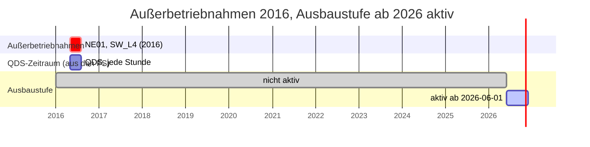
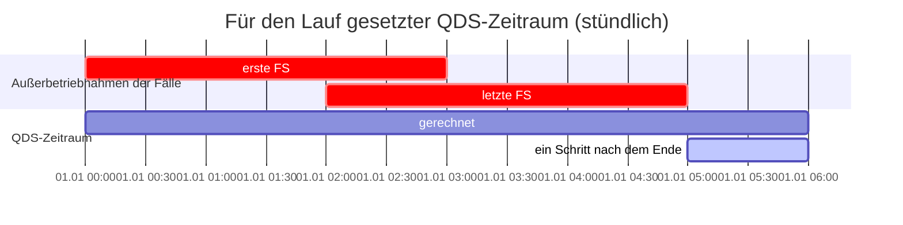
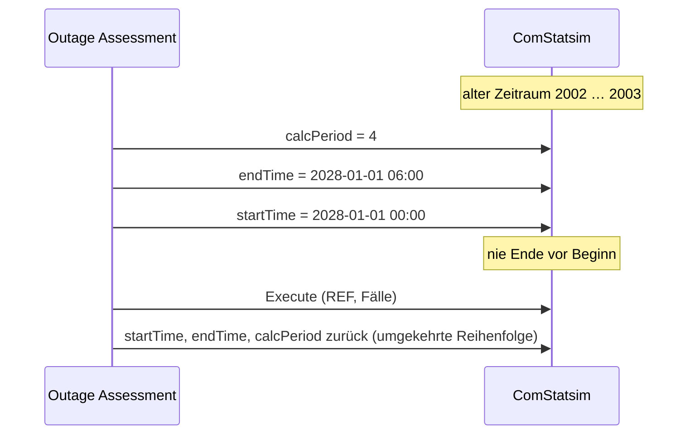
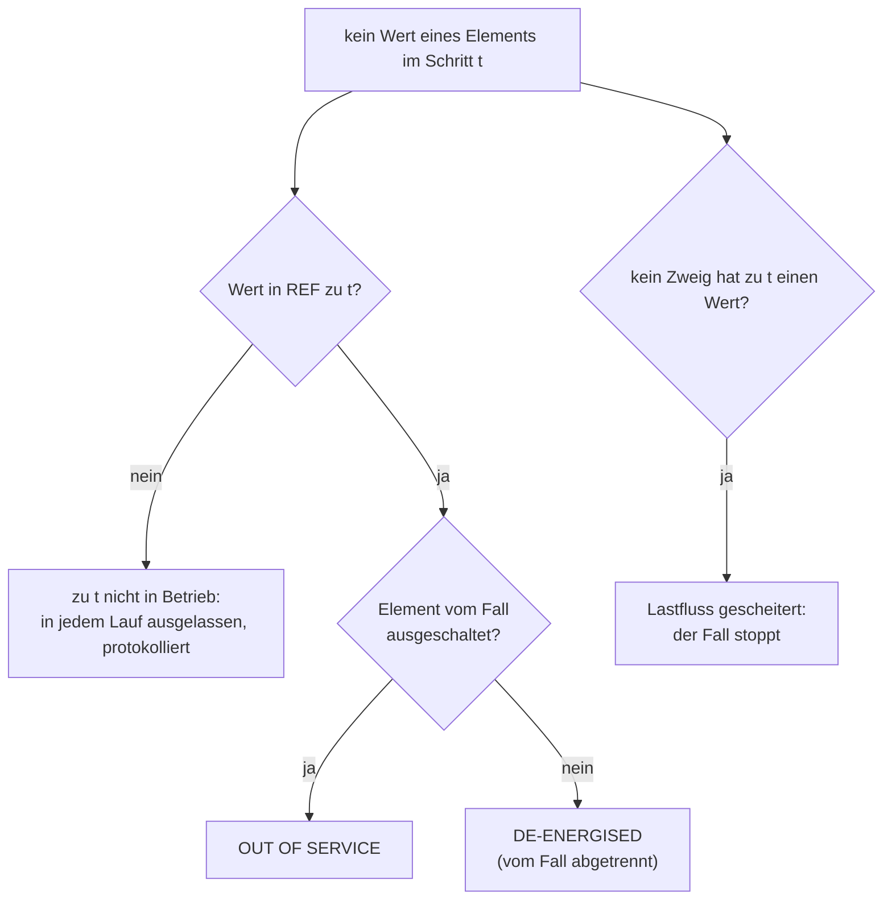

# Stolperstellen und wie Outage Assessment sie behandelt

PowerFactory und seine Berichtsengine verhalten sich an einigen Stellen anders,
als man erwartet. Das verändert Ergebnisse oder bricht einen Lauf ab. Diese
Seite sammelt jeden solchen Fall aus echten Läufen: was schiefgeht und was das
Tool dagegen tut. Die Architektur ([ARCHITEKTUR.md](ARCHITEKTUR.md)) beschreibt
den normalen Ablauf; diese Seite die Fallen drumherum.

Inhalt:

1. [Ausbaustufen und QDS-Zeitraum](#1-ausbaustufen-und-qds-zeitraum)
2. [Welchen Zeitraum die QDS wirklich rechnet](#2-welchen-zeitraum-die-qds-wirklich-rechnet)
3. [QDS-Zeitraum aus den Außerbetriebnahmen setzen](#3-qds-zeitraum-aus-den-außerbetriebnahmen-setzen)
4. [Außerbetriebnahmen anwenden](#4-außerbetriebnahmen-anwenden)
5. [Fehlende Werte](#5-fehlende-werte)
6. [Ergebnisobjekte](#6-ergebnisobjekte)
7. [Zustand, den PowerFactory während eines Laufs ändert](#7-zustand-den-powerfactory-während-eines-laufs-ändert)
8. [Ergebnisse schnell lesen](#8-ergebnisse-schnell-lesen)
9. [Contingency Analysis (n-1)](#9-contingency-analysis-n-1)
10. [Berichtsengine (Stimulsoft)](#10-berichtsengine-stimulsoft)
11. [Python in PowerFactory](#11-python-in-powerfactory)

---

## 1. Ausbaustufen und QDS-Zeitraum

**Problem.** Eine Ausbaustufe einer Variante wird zu ihrer *Aktivierungszeit*
aktiv. Die QDS wertet die Variante in jedem Zeitschritt aus: Ein Schritt vor
der Aktivierungszeit sieht das Netz **ohne** die Stufe. Liegen die
Außerbetriebnahmen in einem anderen Jahr als die Stufe, wird sie in keinem Lauf
aktiv.

**Gut zu wissen.**

- Die PowerFactory-Meldung *'Recording' expansion stages at study time …*
  nennt die Stufe, die zur aktuellen Study-Case-Zeit **Änderungen aufzeichnet**.
  Über die während der QDS aktiven Stufen sagt sie nichts.
- Ein Element, das erst ab einer Aktivierungszeit existiert, hat davor keinen
  Wert (Abschnitt 5). Die Logtabelle *Time-dependent operation* zeigt, wann
  Elemente Werte bekommen oder verlieren.
- **Was zu tun ist:** Außerbetriebnahmen und Aktivierungszeiten in denselben
  Zeitraum legen: die Aktivierungszeit in den Zeitraum der Außerbetriebnahmen
  oder die Außerbetriebnahmen in das Jahr der Stufe.

---

## 2. Welchen Zeitraum die QDS wirklich rechnet

**Problem.** `ComStatsim` hält mehrere Zeitraumangaben nebeneinander. Gerechnet
wird nur die, die *Time period* (`calcPeriod`) auswählt; die anderen behalten
alte Werte. Nur `startTime`/`endTime` zu lesen ergab 2002–2003 für eine QDS,
die auf einen Tag in 2028 stand, und jede Außerbetriebnahme galt als außerhalb.

| `calcPeriod` | Zeitraum, den PowerFactory rechnet | Vom Tool gelesen |
|---|---|---|
| 0 | der Tag in `date` (JJJJMMTT, 00:00) plus `stepNumber` Schritte | ja |
| 4 | benutzerdefiniert `startTime` … `endTime` | ja |
| andere | nicht geprüft | Zeitraum bleibt offen; die Außerbetriebnahmen werden gegen die Zeitachse der Ergebnisse geprüft, mit Warnung |

`powerfactory_tests/inspect_qds_period.py` gibt jedes zeitartige Attribut des
`ComStatsim` und den Zeitraum aus, den das Tool liest, ohne etwas zu ändern.

---

## 3. QDS-Zeitraum aus den Außerbetriebnahmen setzen

Standardmäßig (*QDS period* = *first to last planned outage*) setzt das Tool
den Zeitraum für jeden Lauf selbst, damit REF und jeder Fall genau dieselbe
Zeit abdecken. Drei Einzelheiten sind wichtig:

1. **Kein Schritt vor der ersten Außerbetriebnahme.** Dort wirkt keine, und der
   Schritt kann in einen anderen Netzstand fallen. Ein Schritt am
   31.12.2027 23:00 lag vor einer Ausbaustufe, die am 01.01.2028 beginnt; ein
   Trafo dieser Stufe hatte dort keinen Auslastungswert und stoppte den Lauf.
2. **Ein Schritt nach dem letzten Ende.** PowerFactory zeigt die Wirkung einer
   Außerbetriebnahme teils im Schritt direkt nach ihrem Fenster (ein Fenster
   00:00–01:59 veränderte das Ergebnis um 02:00). Dieser Schritt wird gerechnet
   und bewertet.
3. **Schreibreihenfolge.** PowerFactory prüft jeden einzelnen Schreibvorgang
   von `startTime` und `endTime` (*End date must not be before beginning of
   the time period*). Liegt der neue Zeitraum nach dem alten Ende, wird zuerst
   das Ende geschrieben; das Zurücksetzen in umgekehrter Reihenfolge geht dann
   ebenfalls nur durch gültige Zeiträume.

Feste Hintergrund-Außerbetriebnahmen verlängern den Zeitraum nicht; eine
monatelange feste Außerbetriebnahme würde sonst jeden Lauf so lang machen.

---

## 4. Außerbetriebnahmen anwenden

- `IntPlannedout` hat in PowerFactory 2026 **kein** `Apply`, `Reset` oder
  `Check`. PowerFactory wendet eine Außerbetriebnahme während der QDS an, wenn
  *Planned Outages* (`iopt_maint`) an ist, sie nicht *Ignored* ist
  (`outserv = 0`) und der Zeitschritt in ihrem Fenster liegt. Das Tool wählt
  die Außerbetriebnahmen eines Falls nur über `outserv` und setzt jedes Flag
  danach zurück.
- PowerFactory setzt die Außerbetriebnahme nach dem Lauf zurück (*Outage …
  reset*) und lässt Schalter teils anders stehen. Das Tool protokolliert jeden
  geänderten Schalter; es schaltet nie selbst.
- Bleiben die Betriebsmittel einer Außerbetriebnahme nach ihrem Fenster ohne
  Last, meldet das Tool sie als *in effect after its window* mit der Dauer.

---

## 5. Fehlende Werte

PowerFactory schreibt für ein Element in einem Zeitschritt keinen Wert (NaN),
wenn es nicht in Betrieb ist (Ausbau- oder Schaltstufe), wenn ein Fall es aus-
oder abschaltet oder wenn der Lastfluss scheitert. Ein fehlender Wert ist nie 0.

- Ein Wert im Fall ohne Wert in REF wird allein bewertet (EXCEEDED über der
  Grenze); ein neu zugeschaltetes, überlastetes Element wird so nie übersehen.
- n-1: Eine Zelle wird ausgelassen, wenn REF n-0 zu diesem Zeitpunkt keinen
  Wert hat; ein Wert nur in n-1 und keiner in (n-1)' ist NOT_EVALUATED mit
  diesem Grund, nie IMPROVED.
- Eine Spannung unter *De-energised below* (0,1 p.u.) oder NaN gilt als
  spannungslos, nicht als Wert.

---

## 6. Ergebnisobjekte

- PowerFactory schreibt jede QDS in **sein eigenes** Ergebnisobjekt im Study
  Case und überschreibt es beim nächsten Lauf. Das Tool kopiert es direkt nach
  jedem Lauf (`AddCopy`) als `OA_<stamp>_<Fall>`; die Kopien bleiben.
- PowerFactory-Namen sind auf etwa 40 Zeichen begrenzt. Das Präfix `OA_` hält
  Namen wie `OA_261029-214330_<Fall>_N1P` kurz genug.
- Ist `ComStatsim.results` leer, lässt der REF-Lauf PowerFactory sein eigenes
  Ergebnisobjekt binden; bindet es keins, legt das Tool ein leeres `ElmRes`
  *Quasi-Dynamic Simulation AC* an, bindet es, rechnet REF noch einmal und lässt
  es gebunden.
- Eine Bindung an eine erhaltene `OA_…`-Kopie stoppt den Lauf vor jeder
  Änderung: Die nächste QDS würde ein erhaltenes Ergebnis überschreiben.

---

## 7. Zustand, den PowerFactory während eines Laufs ändert

| Was sich ändert | Wer es ändert | Behandlung |
|---|---|---|
| Study-Case-Zeit | PowerFactory setzt sie auf den letzten gerechneten Schritt | nach jedem Lauf zurückgesetzt |
| Schalterzustände | PowerFactory, wenn es eine Außerbetriebnahme zurücksetzt | protokolliert, nicht zurückgestellt |
| `iopt_maint`, QDS-Zeitraum, `outserv` | das Tool | zurückgesetzt und zurückgelesen; ein nicht rücksetzbarer Wert stoppt den Lauf |
| `ComStatsim.results` | PowerFactory (eigene Bindung) oder das Tool (nur wenn leer) | bleibt so, protokolliert |

---

## 8. Ergebnisse schnell lesen

`ElmRes.GetColumnValues` liest eine ganze Spalte in einem Aufruf, braucht aber
einen `IntVec`. Das Tool legt ihn im laufenden Script an und löscht ihn am Ende
der Auswertung. Verweigert PowerFactory das (*cannot create IntVec*, z. B. bei
einem Script an einer schreibgeschützten Stelle), wird jeder Wert einzeln
gelesen: gleiche Ergebnisse, deutlich langsamer. Die Laufzusammenfassung zählt
beide Wege.

---

## 9. Contingency Analysis (n-1)

- Mit `calcPeriod = 4` rechnet der Sweep `startTime` … `endTime` (ohne Ende)
  und ignoriert den Vektor `studyTime`, auch wenn er unverändert zurückgelesen
  wird. Das Tool schreibt diesen Zeitraum für jeden Sweep.
- `isPlannedOutages` lässt genau den Fehlerfall weg, dessen Betriebsmittel eine
  Außerbetriebnahme schon ausschaltet; er ist NOT_APPLICABLE, nicht FAILED.
- Fehlerfälle außerhalb des n-1-Filters werden für den Sweep auf *Not
  analysed* (`outserv`) gesetzt und danach zurückgesetzt.
- `c:maxCntcy` hilft nicht, den kritischen Fehlerfall zu finden.

---

## 10. Berichtsengine (Stimulsoft)

| Stolperstelle | Regel in den Berichtsseiten |
|---|---|
| Leerraum zwischen den Tags einer leeren Liste wird als Text gelesen; der Designer bricht mit `InvalidCastException` ab | leere Listen selbstschließend |
| Data Relations wirken nicht auf Diagramme; ein Diagramm zeichnete die Daten aller Master-Zeilen | jedes Diagramm liest eine eigene Tabelle nur mit seinen Reihen |
| die Palette eines Diagrammstils trägt keine Bedeutung | Farben fest je Reihe oder über `Conditions` |
| Diagramme werden beim Export mit der Windows-Kultur gezeichnet, die `Culture=en-US` nicht erreicht | keine Achse druckt ein Dezimalzeichen: Auslastungsachsen ganzzahlig, Zählachsen ohne Beschriftung |
| Tabellen- und Feldnamen mit Ziffern fehlten in der Berichtsdatenbank | Namen ohne Ziffern |
| ein umbrechender Name zerreißt das Zeilenraster | Datenzellen `GrowToHeight=True` |
| Bereichsdiagramme (Gantt): die Ende-Spalte wurde in PowerFactory 2026 SP1 nicht gezeichnet – ein Fenster erschien von 0 bis zu seinem Beginn | stattdessen gestapelte Balken: ein unsichtbarer Balken bis zum Beginn, dann das Fenster (`duration_hours`) |
| eine Kategorieachse mit `StartFromZero=False` schneidet den ersten und letzten Balken halb ab und lässt ihre Namen weg | `StartFromZero=True` auf jeder Kategorieachse |
| Werte über Punkten oder Säulen (`OutsideEnd`) werden am oberen Rand abgeschnitten | Werte in der Säule (`InsideEnd`) |
| eine Farbe nach einem festen Schwellwert in der Seite passt nicht zu Grenzwerten aus den Einstellungen | das Skript teilt den Wert auf eine Reihe je Klasse auf (`value_ok`, `value_warning`, `value_over`) |

---

## 11. Python in PowerFactory

- Das `Application`-Objekt nie löschen oder freigeben (`del app`, Garbage
  Collection): Das schloss PowerFactory. Die Warnung zum Unattended-Modus wird
  stattdessen hingenommen.
- Zeiten sind Epoch-Sekunden und werden in der Ortszeit des Rechners gezeigt.
- Der Laufzeitcode nutzt nur die Standardbibliothek und `powerfactory`.
